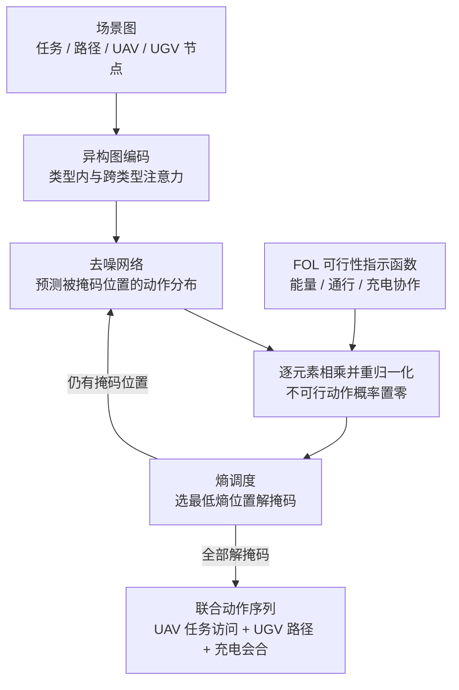

# MEND：带运行约束的 UAV-UGV 掩码神经符号扩散规划

**MEND 把无人机（UAV）与地面车（UGV）的协同任务规划建模为条件掩码生成：模型学习联合动作序列分布，推理时用逻辑可行性指示函数把不合规动作概率置零，并优先解掩码预测熵最低的位置。**

论文 *Collaborative Planning for UAV-UGV Teams under Operational Constraints via Masked Error-bounded Neuro-Symbolic Diffusion*（[arXiv:2610.18850](https://arxiv.org/abs/2610.18850)，[项目页](https://hcrlab.gitlab.io/project/mend/)）。

## 英文缩写速查

| 缩写 | 英文全称 | 简要说明 |
|------|----------|----------|
| MEND | Masked Error-bounded Neuro-Symbolic Diffusion | 本文方法：掩码扩散 + 逻辑重加权 + 熵调度 |
| UAV / UGV | Unmanned Aerial / Ground Vehicle | UAV 覆盖快但能量有限；UGV 作移动充电站，受路网可通行性约束 |
| FOL | First-Order Logic | 用于导出动作可行性（访问、通行、充电协作）的一阶逻辑规则 |
| MIP | Mixed-Integer Programming | 论文中提供专家数据与真值对照的精确求解器 |
| HGT | Heterogeneous Graph Transformer | 项目页所述的上下文感知嵌入组件 |

## 为什么重要

- 多机协同规划里「能量、通行、充电」属于硬约束；纯学习式生成常违反约束，纯搜索又慢。MEND 把约束放在推理期分布上，而不是训练损失里。
- 生成顺序不再固定或随机，而是按约束感知分布的熵排序，把「容易确定的位置先定」作为误差控制手段。
- 对异构机队（空中 + 地面）的任务分配与路径选择给出一个可对照 MIP 的快速近似求解路线。

## 核心信息

| 项 | 内容 |
|----|------|
| **机构** | University of Massachusetts Amherst；U.S. Army DEVCOM Army Research Laboratory（项目页与论文 HTML 所列） |
| **作者** | Zihao Deng、Qianhuang Li、Maggie Wigness、John Rogers、Donghyun Kim、Hao Zhang（arXiv 页） |
| **平台** | ROS 集成 Unity 3D 仿真（Starling-2 UAV、Warthog UGV，LiDAR 重建 10 km × 10 km 地图）；实物为 2 台 Crazyflie + 2 台 Limo 的混合现实案例 |
| **数据** | 专家数据由 MIP 生成（受限 UAV 任务分配 + UGV 路径规划）；数据量在附录，未核实 |
| **开源** | **未列代码**（2026-10-17 核查）：项目页仅有论文 PDF、附录、BibTeX 与占位视频链接，无 GitHub / 数据集；论文也无代码可用性声明 |

## 核心原理

### 流程总览

前向过程逐步用 mask 替换动作 token，去噪网络在被掩码位置上最小化负对数似然；网络以异构图（任务、路径、UAV、UGV 节点）为条件。推理时每步先用 FOL 指示函数重加权并归一化，再选熵最小的位置解掩码。

- **重加权：** 可行动作之间的相对似然保持不变，只剔除不可行动作（论文 HTML）。
- **误差界：** 论文的 Theorem 1 主张熵调度下的 KL 误差不大于无约束情形；证明在附录，本页未核实。

## 源码运行时序图

**不适用**：2026-10-17 核查项目页与论文均未提供官方代码或数据链接，无可对齐的训练 / 推理入口，故不绘制运行时序图。

## 与其他工作对比

| 维度 | MEND（本文） | [Diffusion Policy](../methods/diffusion-policy.md) | [NoMaD](./paper-notebook-nomad-goal-masked-diffusion-policies-for-navigat.md) | [路径规划五范式](../comparisons/robot-path-planning-five-paradigms-taxonomy.md) |
|------|------|------|------|------|
| 生成 / 求解对象 | 离散联合动作序列（UAV 任务访问 + UGV 路径 + 充电会合） | 单机器人连续动作序列 | 单机器人导航动作（action diffusion） | 图搜索、采样、势场、MPC、RL 等路线分类 |
| 「掩码」含义 | 掩码扩散的 token 掩码，按熵最低优先解掩码 | 无 | attention goal mask，切换 ImageGoal 与无目标探索 | 不适用 |
| 硬约束处理 | 推理期 FOL 可行性指示函数把不可行动作概率置零 | 无显式逻辑约束 | 本库页未述 | 搜索 / 优化类可在求解中直接编码约束 |
| 机队 | UAV + UGV 异构多机 | 单机 | 单机策略（训练数据来自多种机器人） | 按技术路线划分，不限机队 |

- **相对 Diffusion Policy：** 同属生成式，但 MEND 在离散符号动作空间做掩码扩散，并把约束放在采样分布上；Diffusion Policy 生成连续控制动作，不带逻辑可行性过滤。
- **相对 NoMaD：** 两者都用 mask，但 NoMaD 的 mask 是目标条件开关，MEND 的 mask 是生成过程本身的 token 掩码，机制不同。
- **相对经典规划范式：** MEND 以 MIP 生成专家数据并作真值，报告 1.9%–5.95% 的质量差距换 14.5–472 倍加速，可读作学习式近似优化求解器。
- 各文任务与指标完全不同，数字不可横比。

## 工程实践

| 项 | 说明 |
|----|------|
| 源码运行时序图 | **不适用**（无官方代码） |
| 复现门槛 | 需自行搭建 Unity + ROS 仿真并用 MIP 生成专家数据；论文给出 UAV 10 m/s、UGV 4.5 m/s、UAV 能量 287.7 kJ、UGV 能量 36,810 kJ 等仿真参数 |
| 规划频率 | 1 UAV–1 UGV（T15-P5）7.8 Hz；4 UAV–2 UGV（T45-P10）2.8 Hz（论文 HTML） |
| 约束接入 | 新约束需写成逐动作的二值可行性判定，再并入指示函数 |
| 开源状态 | 项目页无代码（2026-10-17），后续是否发布未核实 |

## 实验与评测

- **基线：** Guided Local Search、Tabu Search、Simulated Annealing，以及 Vanilla MDM（均匀调度）与 Entropy-guided MDM（无约束采样）。
- **T15-P5：** MEND 在 1U–1G、2U–1G、2U–2G、4U–2G 四种队形上任务完成率均为 100%；VMDM 为 81.33%–92.32%，EMDM 为 93.50%–98.17%。
- **T45-P10：** MEND 四种队形均 100%；VMDM 62.56%–73.83%，EMDM 77.16%–89.61%。1U–1G 上 MEND 能耗 7502.81 kJ，GLS 为 14997.32 kJ。
- **对 MIP 真值：** 4U–2G、T45-P10 工期差距 4.28%、能耗差距 5.95%，约快 472 倍；2U–1G、T15-P5 工期差距 1.9%、能耗差距 3.9%，约快 14.5 倍。
- **泛化：** 训练用乡村地图，未见仿真地图为城市（2U–2G、15 任务）与郊区（4U–2G、45 任务），以及 LiDAR 扫描的大学校园真实地图（4U–2G、15 任务）。
- **消融：** 去掉神经符号模块或熵调度出现 UAV 负载不均与能量违约；论文仅给定性消融，无数值（论文 HTML）。
- **实物：** 2 Crazyflie + 2 Limo，访问 15 个任务并完成一次任务中充电；文中未报告定量结果。

## 结论

**MEND 的价值在于「推理期逻辑重加权 + 熵优先解掩码」让生成式规划同时拿到满任务完成率与接近 MIP 的质量，但证据主要来自仿真，且无公开代码。**

1. **约束放在采样分布上** — 不可行动作被置零，任务完成率在所有报告配置上为 100%，而无约束的 VMDM / EMDM 在大规模任务下降到 62%–90%。
2. **生成顺序是第二个杠杆** — 熵调度相对均匀调度降低能耗与工期，但数值消融缺失，贡献拆分只能定性读。
3. **读质量要对 MIP 而不是对启发式** — 相对 MIP 的差距为 1.9%–5.95%（所报两组），速度优势 14.5–472 倍。
4. **规划频率随规模下降** — 2.8 Hz（4U–2G、T45-P10）仍需联合推理，低通信场景的鲁棒性是作者承认的局限。
5. **实物只做可行性演示** — 无成功率，不能当作真机性能证据。

## 局限与风险

- **静态任务集：** 序列长度固定，动态任务到达未显式建模，靠重规划补充（论文所述）。
- **联合推理依赖通信：** 受限通信下可能退化（论文所述）。
- **专家数据依赖 MIP：** 数据规模与训练细节在附录，未核实。
- **未开源：** 项目页无代码、无数据（2026-10-17），复现需自建。
- **工期比较口径：** 论文称工期只应在全部方法完成时比较，但表中为所有方法列值；读表需注意。

## 关联页面

- [扩散模型](../concepts/diffusion-model.md) — 掩码扩散与连续扩散的区别背景
- [机器人路径规划五范式](../comparisons/robot-path-planning-five-paradigms-taxonomy.md) — 搜索 / 优化 / 学习式规划的定位
- [多机器人协同](../concepts/humanoid-multi-robot-coordination.md) — 多智能体协调的相关讨论
- [Diffusion Policy](../methods/diffusion-policy.md) — 生成式策略在控制中的另一路线

## 参考来源

- [mend_arxiv_2610_18850.md](../../sources/papers/mend_arxiv_2610_18850.md) — 论文摘录与开源核查
- [mend-project.md](../../sources/sites/mend-project.md) — 项目页归档
- [arXiv:2610.18850](https://arxiv.org/abs/2610.18850) — 原文

## 推荐继续阅读

- [MEND 项目页](https://hcrlab.gitlab.io/project/mend/)
- [MEND 论文 HTML](https://arxiv.org/html/2610.18850v1)
