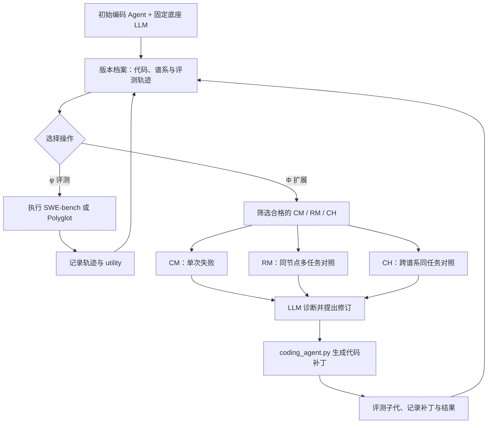
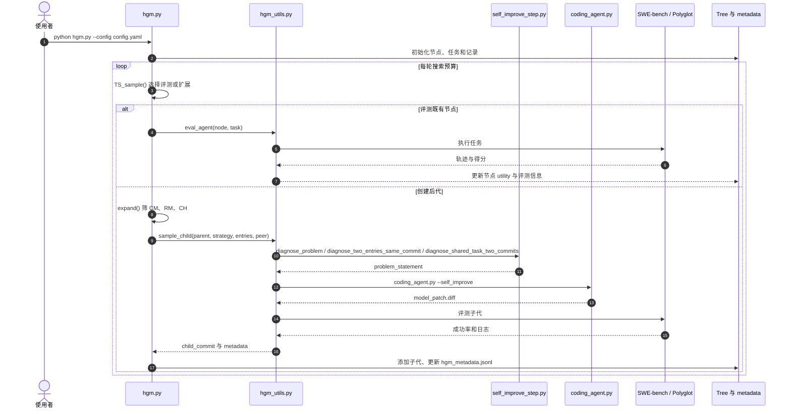

# Mendel Gödel Machine（MGM）：孟德尔哥德尔机——通过比较进化自改进编码智能体

**原文：** *Mendel Gödel Machine: Recursive Self-Improving Coding Agents via Comparative Evolution*（Changzhi Liu、Yilun Liu、Sikuan Yan、Volker Tresp、Yunpu Ma），[arXiv:2608.07645v1](https://arxiv.org/abs/2608.07645v1)，2026-08-07。**机构：** 电子科技大学、慕尼黑大学、慕尼黑机器学习中心。**官方代码：** [RealLcz/MGM](https://github.com/RealLcz/MGM)。

## 一句话定义

**MGM 让自修改编码 Agent 比较“同一程序在多个任务上的执行”与“不同谱系在同一任务上的执行”，据此诊断下一轮代码改进。**

## 英文缩写速查

| 缩写 | 英文全称 | 简要说明 |
|---|---|---|
| MGM | Mendel Gödel Machine | 本项目的比较进化机制 |
| HGM | Huxley Gödel Machine | MGM 扩展的进化树基线 |
| CM | Clonal Mutation | 单节点单失败任务自修改 |
| RM | Reaction-norm Mutation | 同节点跨任务对照 |
| CH | Cross-lineage Hybridization | 跨谱系同任务对照 |
| RSI | Recursive Self-Improvement | 智能体自身能力的循环改进 |
| LLM | Large Language Model | 承担诊断和程序修订的模型 |

## 为什么重要

- **充分利用历史轨迹：** 原有进化档案存储多个 Agent 的任务执行结果，却往往只被用于选亲本和分数排序；MGM 把这些历史轨迹变成修复线索。
- **分清自改对象：** 被修改的是编码 Agent 的程序/工具流程，底座 LLM 参数保持不变。
- **区分研究证据：** 软件任务基准分数不能自动代表机器人可执行性或安全性。

## 核心原理

### 方法和算子资格

进化树的节点保存代码（genotype）、任务执行轨迹和结果（phenotype）。外层根据搜索状态选择任务评测 φ-evaluation 或生成新节点 Φ-expansion。扩展时只在资格满足的算子间按权重采样，默认 CM:RM:CH 为 **0.10:0.45:0.45**。

| 算子 | 输入证据 | 行为 |
|---|---|---|
| CM | 单个 Agent 的失败轨迹 | diagnose_problem() |
| RM | 同一 Agent 的至少两条任务轨迹 | diagnose_two_entries_same_commit() |
| CH | 不同谱系对同一任务的执行结果 | diagnose_shared_task_two_commits() |

CH 若一方成功一方失败：编辑**失败**侧的 Primary，以成功侧 Context 的轨迹作参考；若双方失败，源码依据整体 utility 选主要谱系。所谓杂交指**对照轨迹引导修改**，不是直接合并两套源码。论文第 4 节加性 fitness 和诊断假设下的理论推导不能泛化为无条件收敛保证。

### 流程总览

## 源码运行时序图

以下根据 [hgm.py](https://github.com/RealLcz/MGM/blob/main/hgm.py)、[hgm_utils.py](https://github.com/RealLcz/MGM/blob/main/hgm_utils.py)、[self_improve_step.py](https://github.com/RealLcz/MGM/blob/main/self_improve_step.py) 静态核对，不代表已执行全量实验：

## 工程实践

| 环节 | 操作要点 |
|---|---|
| 启动 | README 给出 HGM_OUTPUT_DIR 指定目录后运行 sbatch scripts/slurm/mgm.slurm；也可 python hgm.py --config config.yaml |
| 参数 | 配置 A/B/C 权重 0.1/0.45/0.45，RM 最少两次评测；failed_pool_boost=1.0 表示默认未额外强化失败任务 |
| 资源 | Linux、Conda/Python 3.11、模型后端、任务数据、容器隔离；实验可使用 Slurm + vLLM + Apptainer |
| 代码一致性 | README 描述无需 Docker daemon，但 hgm_utils.sample_child() 仍使用 Docker 客户端；需确认所运行版本与模式 |
| 审计 | 保留 parent/peer、共享任务、所选算子、model_patch.diff、metadata.json 和测试日志 |

## 实验与评测

论文报告 Qwen3.6-35B-A3B、200 次 φ-evaluation、24 次 Φ-expansion 的结果（未在本仓库重跑）：

| 基准 | 初始 Agent | HGM | MGM |
|---|---:|---:|---:|
| SWE-bench Verified-60 | 68.3% | 73.3% | **78.3%** |
| Polyglot-60 | 50.8% | 77.9% | **93.2%** |

完整 Polyglot-225 的单独评测为 **210/225（93.3%）**；这和 60 题的 93.2% 不同。跨基准和跨底座模型迁移的其他实验同样属于编程任务。

## 结论

**MGM 提升的是编码 Agent 进化时“诊断证据的利用方式”：把孤立失败扩展为同节点多任务、跨谱系同任务比较，论文在限定的编程基准上观察到了效果。**

1. 建立带 Agent 版本、任务 ID、成败和完整执行轨迹的归档。
2. 数据稀缺时保留 CM；有多任务数据才选 RM，有跨谱系同题证据才选 CH。
3. 用独立 held-out 任务检验是否真正迁移，而不只读搜索集最高分。
4. 区分无需新增任务评测与完全没有附加 token/算力成本。
5. 机器人控制系统仅可借鉴离线自改代码的验证流程；真机安全门和物理成功率须另外建立。

## 与其他工作对比

| 工作 | 关键差异 |
|---|---|
| [DGM](./paper-darwin-godel-machine.md) | 开放式代码进化档案和单失败诊断；MGM 进一步利用比较轨迹 |
| HGM | 侧重树搜索/分配评测预算，MGM 补充自修改算子 |
| [Meta-Rewarding](./paper-meta-rewarding-language-models.md) | 这是不同论文 arXiv:2407.19594，使用偏好优化改进回答与判断能力，不是 MGM 的代码实现 |

## 局限与风险

- 不修改底座权重，也没有递归加速的普适证明；理论结论依赖任务及诊断假设。
- 跨谱系可比较性要求存在共享任务评测，成功迁移不自动保证泛化。
- 生成代码可能破坏系统，不能跳过沙箱权限、日志和人工审查。
- 实验需要大量模型推理与基准运行，**未做独立复现、无机器人真机实验**。

## 关联页面

- [Darwin Gödel Machine](./paper-darwin-godel-machine.md)
- [Hyperagents](./paper-hyperagents.md)
- [递归自我改进概念](../concepts/recursive-self-improvement.md)
- [RSI 纵深路线 Stage 4](../../roadmap/depth-rsi.md)
- [Meta-Rewarding Language Models（独立论文）](./paper-meta-rewarding-language-models.md)

## 参考来源

- [MGM 论文原文核对归档](../../sources/papers/mendel_godel_machine_arxiv_2608_07645.md)
- [MGM 源码及运行入口归档](../../sources/repos/mendel-godel-machine.md)
- [MGM 官方项目页归档](../../sources/sites/mendel-godel-machine.md)
- [arXiv 论文全文及附录](https://arxiv.org/html/2608.07645)

## 推荐继续阅读

- [MGM 官方项目主页](https://reallcz.github.io/MGM/)
- [MGM 官方源码](https://github.com/RealLcz/MGM)
- [Darwin Gödel Machine 原论文](https://arxiv.org/abs/2505.22954)
