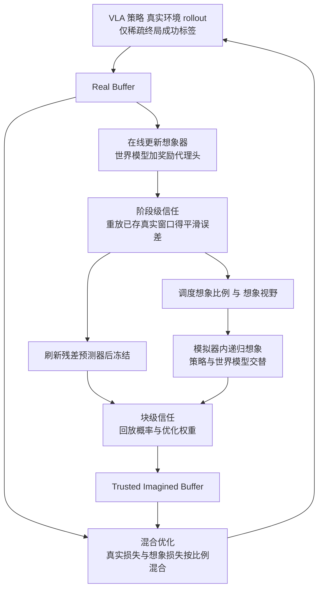

# MERL：信任校准的 VLA 后训练

## 一句话定义

**MERL（Model-Evolving Reinforcement Learning）让「世界模型 + 奖励代理头」组成的想象器随策略一起在线更新，并用想象器自身的可靠度估计，决定想象数据占多大比例、推多远、哪些想象片段先回放以及各占多大梯度权重。**（arXiv 摘要、§3）

## 英文缩写速查

| 缩写 | 英文全称 | 简要说明 |
|------|----------|----------|
| VLA | Vision-Language-Action | 视觉–语言–动作策略；本文用 OpenVLA-OFT 初始化（C.2） |
| RL | Reinforcement Learning | 强化学习 |
| MFRL | Model-Free RL | 无模型精修，本文匹配对照，只用真实交互（C.6） |
| MBRL | Model-Based RL | 基于模型的精修，用世界模型想象 rollout |
| MERL | Model-Evolving RL | 本文框架名 |
| SFT | Supervised Fine-Tuning | 监督微调初始化，Tab. 1 的参照行 |
| GRPO | Group Relative Policy Optimization | 本文策略优化为 GRPO 式 token 级 clipped 目标（A.5） |
| PRO | LIBERO-PRO | 在 LIBERO 任务上加受控部署扰动的基准（C.1） |
| SR | Success Rate | 成功率 |
| AUC | Area Under the curve | 这里指 SR 学习曲线的归一化面积，不是 ROC-AUC（C.3） |
| S2T-H | Stages-to-Threshold (High) | 达到高阈值所需精修阶段数，越小越快（C.3） |
| ECE | Expected Calibration Error | 信任估计的校准误差（D.3） |

## 为什么重要

- 作者指出一个具体张力：无模型精修没有模拟器偏差但交互昂贵，基于模型的精修省交互却可能被不可靠的想象带偏，即使模拟器在线适配也一样（摘要、§1）。
- 作者的论点是「模拟器演化」与「模拟器可信度」是两个问题：更新模拟器能让想象更贴近当前策略，但不保证每条 rollout 都有用，所以需要夹在想象与策略学习之间的信任层（§1）。
- 论文用匹配对照把「在线更新」和「信任校准」分开测：冻结模拟器加信任（Tab. 1 的 75.1）和在线更新不加信任（76.2）各自都低于两者兼备（79.7），其中冻结模拟器的无信任版本（73.3）甚至低于纯无模型（77.2）。

## 核心原理与流程总览

图依据：论文 §3 / Fig. 2 / 附录 A.6 算法 1。

**想象器（§3.2、A.1）：** 世界模型 Wφ 是动作条件视频预测器，一次预测一个动作块（C=8）的后续观测，视野超过一块时策略与世界模型递归交替。奖励代理头 Qψ 输出 [0,1] 进度分，监督目标是由终局成功标签导出的截断折扣 success-to-go（式 1）。作者明确说贡献不在想象器结构，而在其上的信任层。

**阶段级信任（§3.3、A.3）：** 每个阶段模拟器更新后，重放已存真实窗口（不增加环境交互）得到视觉失配与代理失配，指数平滑成 ε̃s，再经 χs 映射为想象比例 ρs∈[0.05, 0.95] 与视野 hs∈[8, 32] 环境步。误差越大，想象越少、越短。

**块级信任（§3.4、A.4）：** 每个想象块得到误差 εs,i，转成回放概率 p（逆误差优先级）与梯度权重 w（负指数并截断）。没有真实后续的递归块，用残差预测器 gξ 估计误差；gξ 每次模拟器更新后用已存的真实–预测配对刷新再冻结，打分时不查询未来真实观测。

**策略更新（式 4/25）：** L = (1−ρs)·L_real + ρs·L_imag；两个批次独立采样，想象分支额外乘 w。作者特意说明，由于按 p 采样且按 w 加权，这是「信任加权的想象更新」而非均匀想象回放的无偏估计（A.5）。

**理论（附录 B）：** 命题 1 把代理偏差界在视觉预测差异的折扣累积上，命题 2 把阶段差异界在 K·ρ·h·ε̃ 上，命题 3 说明按误差反序加权的偏差上界不劣于均匀。作者自述它们是条件界，不是收敛保证，平均误差只是调度统计量（§3.3、B）。

## 工程实践

- **代码：** 论文全文未给出代码或项目页链接（全文检索无命中），源码运行时序图不适用。
- **初始化与动作：** 所有方法共用 OpenVLA-OFT 检查点，动作块 C=8、7 维动作、token 化动作头（因为 GRPO 式目标需要新旧策略的 token 概率）；单个全局 RGB 相机，默认关闭本体感知（C.2）。
- **预算与算力：** 每阶段后每个在线方法累计 6s 条真实轨迹，转移数上限 ≤3072s；想象 rollout 不计入真实交互预算（C.4）。单节点 4×H100，3 卡策略、1 卡模拟器，100 阶段在线运行约 35 小时（C.5）。
- **关键超参（A.3）：** ρmin=0.05、ρmax=0.95、hmin=C、hmax=4C；κ 与代理损失权重 λq 做 {0.5,1,2}× 一次一变，Avg. SR/AUC 至多变动 1.4/1.6（D.5）。
- **真机（附录 E）：** AgileX PiPER X 单臂，固定全局 RGB 相机；Block-to-Box 与 Lid-to-Pot 各 50 条示范，全部方法只用这批固定示范在服务器上离线精修，再部署做闭环推理评测，每任务 20 次试验。

## 主要结果

| 设置 | 结果 | 出处 |
|------|------|------|
| 匹配对照（单次点估计） | Avg. SR / AUC / S2T-H：MFRL 77.2 / 67.9 / 103.4；Online-Updated MBRL 76.2 / 65.4 / 139.6；MERL 79.7 / 70.6 / 92.1 | Tab. 1 |
| 分套件 MERL | Spatial 82.8，Object 85.2，Goal 81.9，Long 68.8；SFT 平均仅 30.2 | Tab. 1 |
| 同协议外部方法（3 种子） | SimpleVLA-RL 77.1±1.1，WMPO† 75.4±1.2，WoVR† 77.8±0.9，MERL 79.7±0.7 | Tab. 2 |
| 配对 95% CI | MERL−WoVR：ΔAUC 2.2 [1.2, 3.3]，ΔS2T-H −9.2 [−15.4, −3.1] | Tab. 4 |
| 消融 | 只加阶段信任 AUC 68.4，只加块信任 67.6，两者 70.6 | Tab. 5 |
| 模拟器诊断 | 冻结→演化：PSNR 22.4→25.9，FVD 286.0→198.0，代理 MAE 0.183→0.126 | Tab. 6 |
| 无预言机信任（深度 2–4，N=1500） | Pearson r 0.68，Rank-AUC 0.80，ECE 0.067 | §4、Tab. 9 |
| 真机（2 任务，各 20 次） | SFT 35.0%，MFRL 55.0%，Online-Updated MBRL 60.0%，MERL-Visual 77.5%，MERL 80.0% | Tab. 3 |

† 为作者移植到本基准与模型资产上的同算法版本，并非原作者原始实现（Tab. 2 注）。

## 与清单说法的对比核对

对照对象：CoRL 2026 阅读清单（Glen Berseth 博客）对本文的一句摘要，据任务说明为 LLM 据摘要起草：「VLA RL post-training with an evolving world model and reward head, using imagined rollouts in proportion to how much they can be trusted.」

| 清单措辞 | 论文核对 | 结论 |
|----------|----------|------|
| VLA RL post-training | 是；但经验验证主要是 OpenVLA-OFT（token 化动作）在 LIBERO-PRO 仿真上的在线精修（§4、C.2）；真机部分是固定 50 条示范的离线精修，不是在线 RL（附录 E） | 方向一致，限定词缺失：仿真为主，真机非在线 |
| evolving world model | 是，世界模型随策略在线更新；模拟器诊断显示演化版优于冻结版（Tab. 6） | 一致 |
| reward head | 是代理头 Qψ，但它不是环境奖励，而是用终局成功标签构造的 success-to-go 进度代理（式 1） | 基本一致，需注意它是代理 |
| imagined rollouts in proportion to how much they can be trusted | 论文是两层：阶段级可靠度决定想象比例与视野，块级信任决定回放概率与梯度权重（§3.3–§3.4）；「按可信度」中的可信度是预测的误差估计，作者说它不保证物理正确（§5） | 一致但偏简略，漏了块级这一层 |
| 清单未提的结果 | 79.7% 平均成功率、10.9% 学习速度提升（阶段数口径，非墙钟，C.4）、三种子外部对比 | 清单只有摘要句，无数字，不存在对不上 |

我的判断（非作者自述）：清单这句话与论文没有事实冲突；唯一容易误读的是把「奖励头」当作可靠奖励信号，以及把真机结果当成在线真机 RL。

## 结论

MERL 通过可信度分配想象训练预算，证据支持特定 token 化 VLA 设置，不能解释为物理正确性保证。

- 按深度核验想象器校准，可靠度下降时缩短视野并增加真实数据约束。
- 把精修阶段数、环境交互与墙钟计算分开报告，阶段减少不等于总成本减少。
- 将真机固定示范离线精修与仿真在线训练区分，现有结果未验证连续 flow 或 diffusion 动作策略。

## 局限

**作者自述（§5、附录 E）：**
- 只验证了 token 化 VLA 与结构化桌面任务，固定 RGB；LIBERO-PRO 保持任务语义，不证明新任务学习或接触丰富场景的泛化。
- 信任是预测估计，深度越大越不准（深度 3–4 的 Pearson r 降到 0.64，ECE 升到 0.074，Tab. 9），不保证物理正确；信任分桶实验只证明预测效用，单个块的因果贡献未解。
- 在线更新模拟器增加计算，校准依赖真实数据覆盖。
- 真机只有两个任务且为离线精修，完整版与视觉版区间重叠，不能断言代理头的统计增益；连续动作生成式策略（flow / diffusion）留作未来工作。

**我看到的未验证之处（判断，非论文自述）：**
- Tab. 1 的匹配对照是单次点估计且无区间；摘要的「10.9%」出自这张表（103.4→92.1），按精修阶段数计，不是墙钟或环境转移节省（C.4），而每阶段还要付模拟器更新与想象的计算（100 阶段约 35 小时，C.5）。
- 外部对比里 WMPO 与 WoVR 是作者移植版（Tab. 2 †），与原论文报告值不可直接比较；SimpleVLA-RL 与 MFRL 对照数字接近（77.1 与 77.2），说明增益相对的是同一类 GRPO 式无模型基线。
- 真机用的是 50 条示范的离线精修，对比的 MFRL 在此处也是「固定数据上的 grounded-only 精修」；MERL 80.0% 与 Online-Updated MBRL 60.0% 的 95% CI 为 [65.2, 89.5] 与 [44.6, 73.7]，有重叠（我据 Tab. 3 读出，论文只明说了完整版与视觉版的重叠）。
- 命题 1–3 依赖 Lipschitz 与误差上界假设，论文未验证这些假设在实际模型上成立。
- 图（Fig. 4、6 的定性对比）本次只读了图注，未目视核验。

## 关联页面

- [VLA 方法总览](../methods/vla.md)
- [基于模型的强化学习](../methods/model-based-rl.md)
- [强化学习](../methods/reinforcement-learning.md)
- [GRPO](../methods/grpo.md)
- [Sim2Real](../concepts/sim2real.md)
- [LIBERO 基准](./libero-benchmark.md)
- [OpenVLA](./paper-openvla.md)
- [SimpleVLA-RL](./paper-simplevla-rl.md)：论文外部对比中的无模型基线
- [RLinf-VLA](./paper-rlinf-vla.md)：论文引用的 VLA+RL 训练栈
- [WoVR](./paper-rcl-2602-13977-wovr-world-models-as-reliable-simulators-for-pos.md)：论文外部对比中的在线更新基线
- [WMPO](./paper-sa-2511-09515-wmpo-world-model-based-policy-optimization-for-v.md)：论文外部对比中的静态模型基线
- [World4RL](./paper-sa-2509-19080-world4rl-diffusion-world-models-for-policy-refin.md)：同属世界模型内精修（论文引用）

## 参考来源

- [论文来源归档（含核对范围与通读）](../../sources/papers/merl_arxiv_2610_16517.md)
- [公众号综述摘录（33 篇 Manipulation）](../../sources/raw/wechat_senlanke_manipulation_33_papers_2026-10-12_16.md)
- [arXiv:2610.16517](https://arxiv.org/abs/2610.16517)：通读正文与附录 A–F（图仅读图注）

## 继续阅读

- [arXiv PDF](https://arxiv.org/pdf/2610.16517)
- [基于模型的强化学习](../methods/model-based-rl.md)
- [WoVR](./paper-rcl-2602-13977-wovr-world-models-as-reliable-simulators-for-pos.md)
