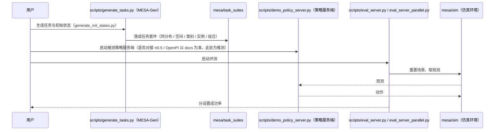

# MESA（arXiv:2611.05567）

**MESA**（*MESA: An Evaluation Framework for Compositional, Semantic, and Spatial Generalization in Robotics*，[arXiv:2611.05567](https://arxiv.org/abs/2611.05567)，[项目页](https://www.pair.toronto.edu/MESA/)，[代码](https://github.com/pairlab/mesa-env)）来自 [具身智能小站 2026-11-05 盘点](../../sources/blogs/wechat_embodied_station_43_papers_grasp_mesa_airoa_2026-11-05.md)，属「策略泛化与评测」组。

## 一句话定义

**MESA** 是面向语言条件桌面操作策略的框架，含 MESA-Gen（任务与示范的规模化生成）和 MESA-Bench（分同分布、空间、类别、实例、组合泛化设置的标准化评测）（官方 README）。

## 英文缩写速查

| 缩写 | 英文全称 | 简要说明 |
|------|----------|----------|
| MESA | MESA: An Evaluation Framework for Compositional, Semantic, and Spatial Generalization in Robotics | 本文方法 / 基准的简称 |

## 为什么重要

- 换个杯子、换个位置，分别测泛化。MESA 在单臂和双臂仿真中分别改变摆位、物体实例、类别和子任务组合，让人看清是哪一种变化拖低了成绩。
- 开源结论：**已开源**（步骤 2.5，2026-11-05）。资源入口 pairlab/mesa-env 经 git ls-remote 可达；项目页 HTTP 200。
- 同期同组工作见 [接触丰富的手物重定向、分项泛化评测与手持夹爪示范：具身智能小站 11-05 期 43 篇阅读坐标](../overview/embodied-station-2026-11-05-43-papers-technology-map.md)。

## 核心机制

| 项 | 内容 |
|----|------|
| **arXiv** | [2611.05567](https://arxiv.org/abs/2611.05567) |
| **开源** | **已开源** |
| **要点** | 单臂与双臂仿真里分别改变摆位、物体实例、类别和子任务组合，让人看清是哪一种变化拖低成绩；官方仓库基于 MimicGen、OpenPI、LeRobot、RoboCasa、LIBERO 等（README 致谢）。 |
| **文内指标** | 公众号转述（未回论文核对）：π0.5 在单臂、双臂各五套测试中平均成功率分别为 52.0% 和 48.7%；单臂同分布 62.8%，换到训练中未见过的物体类别降至 26.4%；每项任务测试 50 次。 |

## 源码运行时序图

按官方 README 与目录结构画（浅克隆读了 README、`scripts/` 与 `mesa/` 目录，**未逐文件阅读源码**）：评测侧是「策略服务端 + 评测服务」两端分离，具体参数以 `docs/` 为准。

## 实验与评测

- 公众号转述（未回论文核对）：π0.5 在单臂、双臂各五套测试中平均成功率分别为 52.0% 和 48.7%；单臂同分布 62.8%，换到训练中未见过的物体类别降至 26.4%；每项任务测试 50 次。
- **官方仓库（浅克隆读 README，MIT 许可）：** 含 `mesa/`（task_suites、mimicgen、serving、sim 等）与 `scripts/`（`generate_tasks.py`、`eval_server.py`、`eval_server_parallel.py`、`demo_policy_server.py`）；权重与数据在 Hugging Face 集合；用 uv 安装，另可选装 LeRobot 导出依赖。论文发表信息：README BibTeX 写 CoRL 2026（OpenReview）。
- **读法：** 本页为索引级摘要，依据公众号转述的官方摘要与仓库信息整理；逐项数字与 baseline 以原文 PDF 为准。

## 与其他工作对比

- 横向索引见 [接触丰富的手物重定向、分项泛化评测与手持夹爪示范：具身智能小站 11-05 期 43 篇阅读坐标](../overview/embodied-station-2026-11-05-43-papers-technology-map.md)；同 arXiv 不重复造页。

## 结论

**换个杯子、换个位置，分别测泛化：π0.5 单臂同分布 62.8%、未见类别降至 26.4%（公众号转述）。**

1. 开源边界：**已开源** — 资源入口 pairlab/mesa-env 经 git ls-remote 可达；项目页 HTTP 200。
2. 核心机制：单臂与双臂仿真里分别改变摆位、物体实例、类别和子任务组合，让人看清是哪一种变化拖低成绩；官方仓库基于 MimicGen、OpenPI、LeRobot、RoboCasa、LIBERO 等（README 致谢）。
3. 复现与选型前核对任务协议、硬件与基准口径，勿直接横比公众号摘录数字。

## 关联页面

- [simulation-evaluation-infrastructure](../concepts/simulation-evaluation-infrastructure.md)
- [vla](../methods/vla.md)
- [imitation-learning](../methods/imitation-learning.md)
- [embodied-station-2026-11-05-43-papers-technology-map](../overview/embodied-station-2026-11-05-43-papers-technology-map.md)
- [具身评测基准选型闭环（知识链）](../overview/hub-embodied-eval-benchmark.md)

## 参考来源

- [mesa_arxiv_2611_05567.md](../../sources/papers/mesa_arxiv_2611_05567.md)
- [wechat_embodied_station_43_papers_grasp_mesa_airoa_2026-11-05.md](../../sources/blogs/wechat_embodied_station_43_papers_grasp_mesa_airoa_2026-11-05.md)
- [arXiv:2611.05567](https://arxiv.org/abs/2611.05567)

## 推荐继续阅读

- [arXiv PDF](https://arxiv.org/pdf/2611.05567)
- [项目页](https://www.pair.toronto.edu/MESA/)
- [https://github.com/pairlab/mesa-env](https://github.com/pairlab/mesa-env)
