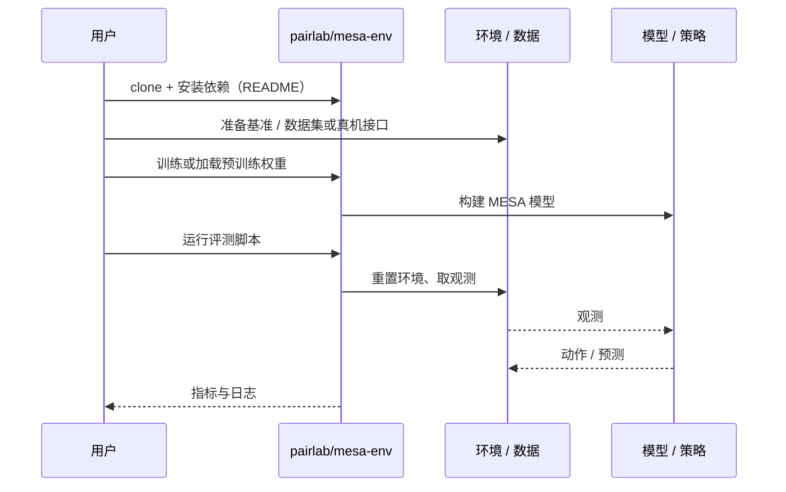

# MESA（arXiv:2611.05567）

**MESA**（*MESA: An Evaluation Framework for Compositional, Semantic, and Spatial Generalization in Robotics*，[arXiv:2611.05567](https://arxiv.org/abs/2611.05567)，[项目页](https://www.pair.toronto.edu/MESA/)，[代码](https://github.com/pairlab/mesa-env)）来自 [具身智能小站 2026-11-05 盘点](../../sources/blogs/wechat_embodied_station_43_papers_grasp_mesa_airoa_2026-11-05.md)，属「策略泛化与评测」组。

## 一句话定义

**机器人换个位置还能抓杯子，换个没见过的杯子却可能失手。**

## 英文缩写速查

| 缩写 | 英文全称 | 简要说明 |
|------|----------|----------|
| MESA | MESA: An Evaluation Framework for Compositional, Semantic, and Spatial Generalization in Robotics | 本文方法 / 基准的简称 |

## 为什么重要

- 换个杯子、换个位置，分别测泛化。MESA 在单臂和双臂仿真中分别改变摆位、物体实例、类别和子任务组合，让人看清是哪一种变化拖低了成绩。
- 开源结论：**已开源**（步骤 2.5，2026-11-05）。资源入口 pairlab/mesa-env 经 git ls-remote 可达；项目页 HTTP 200。
- 同期同组工作见 [接触丰富的手物重定向、分项泛化评测与手持夹爪示范：具身智能小站 11-05 期 43 篇阅读坐标](../overview/embodied-station-2026-11-05-43-papers-technology-map.md)。

## 核心机制

| 项 | 内容 |
|----|------|
| **arXiv** | [2611.05567](https://arxiv.org/abs/2611.05567) |
| **开源** | **已开源** |
| **要点** | 机器人换个位置还能抓杯子，换个没见过的杯子却可能失手。 |
| **文内指标** | 公众号转述：该模型每项任务测试 50 次。 |

## 源码运行时序图

以下为按仓库入口（`pairlab/mesa-env`）推断的通用运行链路；入库日仅核实仓库可达，未逐文件阅读，具体脚本名以 README 为准。

## 实验与评测

- 公众号转述：该模型每项任务测试 50 次。
- **读法：** 本页为索引级摘要，依据公众号转述的官方摘要与仓库信息整理；逐项数字与 baseline 以原文 PDF 为准。

## 与其他工作对比

- 横向索引见 [接触丰富的手物重定向、分项泛化评测与手持夹爪示范：具身智能小站 11-05 期 43 篇阅读坐标](../overview/embodied-station-2026-11-05-43-papers-technology-map.md)；同 arXiv 不重复造页。

## 结论

**换个杯子、换个位置，分别测泛化：该模型每项任务测试 50 次。**

1. 开源边界：**已开源** — 资源入口 pairlab/mesa-env 经 git ls-remote 可达；项目页 HTTP 200。
2. 核心机制：机器人换个位置还能抓杯子，换个没见过的杯子却可能失手。
3. 复现与选型前核对任务协议、硬件与基准口径，勿直接横比公众号摘录数字。

## 关联页面

- [simulation-evaluation-infrastructure](../concepts/simulation-evaluation-infrastructure.md)
- [vla](../methods/vla.md)
- [imitation-learning](../methods/imitation-learning.md)
- [embodied-station-2026-11-05-43-papers-technology-map](../overview/embodied-station-2026-11-05-43-papers-technology-map.md)

## 参考来源

- [mesa_arxiv_2611_05567.md](../../sources/papers/mesa_arxiv_2611_05567.md)
- [wechat_embodied_station_43_papers_grasp_mesa_airoa_2026-11-05.md](../../sources/blogs/wechat_embodied_station_43_papers_grasp_mesa_airoa_2026-11-05.md)
- [arXiv:2611.05567](https://arxiv.org/abs/2611.05567)

## 推荐继续阅读

- [arXiv PDF](https://arxiv.org/pdf/2611.05567)
- [项目页](https://www.pair.toronto.edu/MESA/)
- [https://github.com/pairlab/mesa-env](https://github.com/pairlab/mesa-env)
