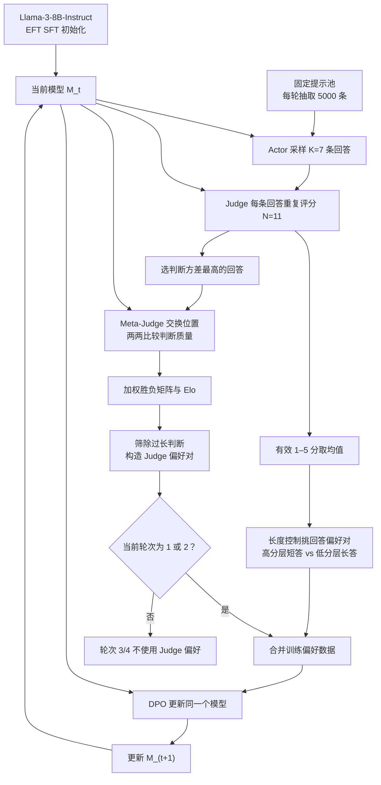

# Meta-Rewarding Language Models：元奖励语言模型——让评委的评委改进对齐 / Self-Improving Alignment with LLM-as-a-Meta-Judge

## 一句话定义

**Meta-Rewarding**（Wu 等，EMNLP 2025）把 [Self-Rewarding](./paper-self-rewarding-language-models.md) 中的“生成回答 → 模型自评分”扩展为**同一个模型扮演 Actor、Judge、Meta-Judge 三种角色**，不仅学习优劣回答，还学习优劣**评审判断**，从而用 DPO 同时改善指令遵循和判断能力。

## 英文缩写速查

| 缩写 | 英文全称 | 简要说明 |
|---|---|---|
| LLM | Large Language Model | 同一语言模型按不同提示承担三种角色 |
| DPO | Direct Preference Optimization | 利用 chosen/rejected 偏好对直接优化模型 |
| SFT | Supervised Fine-Tuning | 先用已有 EFT 评审数据初始化种子 |
| EFT | Evaluation Fine-Tuning | 从前作继承的初始评审能力训练数据 |
| LC | Length-Controlled | AlpacaEval 2 控制输出长度影响的胜率口径 |
| Elo | Elo Rating System | 将元评委两两比较转换成判断质量得分 |
| RSI | Recursive Self-Improvement | 自我改进研究语境；本论文属于有界模型自训练 |

## 为什么重要

- **自评是瓶颈：** 仅让 Actor 追逐固定判断质量会快速饱和，甚至利用自身偏差。Meta-Rewarding 为 Judge 自身构建偏好训练信号。
- **明确改进对象：** 相比只靠答案打分构造偏好对的 Self-Rewarding，新增“对评判质量的元评判”；元评委仍是同一模型，而非独立可信的监督者。
- **机器人研发的可迁移启发（非论文实验结论）：** 若用模型评估自身的轨迹、计划或代码，还需要单独检验评估器漂移；真实任务的成功/安全必须由外部环境信号验收，不能用元评委取代。

## 核心信息

| 项 | 事实 |
|---|---|
| 英文标题 | Meta-Rewarding Language Models: Self-Improving Alignment with LLM-as-a-Meta-Judge |
| 中文标题 | 元奖励语言模型：通过 LLM 元评委实现自改进对齐 |
| 作者 | Tianhao Wu、Weizhe Yuan、Olga Golovneva、Jing Xu、Yuandong Tian、Jiantao Jiao、Jason Weston、Sainbayar Sukhbaatar |
| 机构 | Meta FAIR；加州大学伯克利分校（University of California, Berkeley）；纽约大学（New York University） |
| 用户指定版本 | [arXiv:2407.19594v2](https://arxiv.org/abs/2407.19594v2)，2024-07-30 |
| 正式发表 | [EMNLP 2025（ACL Anthology）](https://aclanthology.org/2025.emnlp-main.583/)，11537–11554 |
| 模型 / 任务 | Llama-3-8B-Instruct；自然语言指令遵循与评审能力 |
| 官方源码 | arXiv v2、ACL Anthology 和第一作者公开论文列表未列明专属可运行仓库（2026-11-19 核查） |
| 边界 | 无机器人运动控制、Sim2Real 或真机验证 |

## 核心原理

### 1. Actor 回答偏好：质量近似时优先短答（论文 §2.1）

给定提示 `x`，当前模型 `M_t` 采样 `K=7` 个候选回答；同一模型以 Judge 身份对每个回答独立作 `N=11` 次 1–5 分评判，解析有效得分并取均值。

不直接用最高分和最低分生成偏好对：定义质量层阈值 `ρ`，**chosen** 从接近最高分的回答中选**最短**，**rejected** 从接近最低分的回答中选**最长**。目的在于对抗“答案越长越容易被偏爱”的评分偏差。论文在不同轮次调整 `ρ`，最终迭代使用 `ρ=0.4`。

### 2. Judge 判断偏好：元评委对“评分理由+分数”再打分（论文 §2.2）

1. 对每个提示，挑 Judge 重复评分**方差最高**的候选回答，重点研究评委不确定的样本。
2. 将这条回答的不同 Judgement 两两交给 Meta-Judge 比较；同一个 `M_t` 在 meta-judge 提示下评估哪个判断更好。
3. 将两条判断的位置前后互换，并对位置胜率进行加权，减少先后顺序偏差。
4. 将两两胜负构成矩阵并拟合 Elo，选最高/最低 Elo 的判断作为偏好对；过滤过长的 chosen judgement，避免偏爱冗长评审。

### 3. 三角色合一的迭代 DPO（论文 §2、§3.1）

Actor 偏好对提高回答能力，Judge 偏好对改善评审能力，合并后对**同一个模型**执行 DPO。实验中 Iteration 1–2 同时训练两类偏好，**Iteration 3–4 仅训练 Actor 偏好**：原因是评委偏差在后续轮次累积，不能把图上的 Judge 支路理解成四轮都持续开启。

### 流程总览（根据原文 Figure 1、§2 重绘）

注意：图是论文**训练算法流程**，不是已发布官方仓库的可运行源码调用栈。

## 源码运行时序图

**不适用：尚未核实到本论文官方可运行的训练或推理代码入口。** 已核对 [arXiv v2 全文](https://arxiv.org/html/2407.19594v2)、[EMNLP 2025 正式页](https://aclanthology.org/2025.emnlp-main.583/)与[第一作者论文列表](https://thwu1.github.io/tianhaowu/publications/)，未找到明确附属代码仓库。通用 DPO 框架或第三方实现不能冒充官方源码，因此不编造 `sequenceDiagram`。

## 实验与评测

以下为**论文作者报告，非本库独立复现**（§3、附录 A）：

| 基准 / 口径 | 种子模型 | 对照 / 中间结果 | Meta-Rewarding |
|---|---:|---:|---:|
| AlpacaEval 2 LC 胜率 | 22.92% | Self-Rewarding + LC 四轮：35.49% | 四轮：**39.44%** |
| Arena-Hard 胜率 | 20.6% | — | 四轮：**29.1%** |
| MT-Bench 总分 | 8.116 | Meta Iter 3：8.341 | Iter 4：8.288 |
| 与人工偏好的 Spearman | 0.315 | Meta Iter 2：**0.382** | Iter 4：0.326 |

- **采样设置：** 提示池 20,000，每轮采 5,000；每提示 7 个回答、每回答 11 次评判。前三种指标的测试任务均为语言生成或打分。
- **Judge 不等于外部 ground truth：** GPT-4 判断与 Open Assistant 人类排序用于独立评估，但模型自评和 Meta-Judge 的偏差会共同漂移。
- **结果不单调：** MT-Bench 多轮指标与人类排序相关性在后续轮次回落，不应只展示最终的 AlpacaEval 数字。

## 结论

**Meta-Rewarding 表明“训练评委”能改善自奖励式语言模型的指令遵循，但同时揭示评委漂移会让自举过程变得不稳定。**

1. **区分两套偏好数据：** Actor 优劣回答与 Judge 优劣判断不能混为同一评分。
2. **显式控制长度：** 报告 LC 胜率，并监测回答/判断文本长度，否则易把冗长当质量。
3. **高方差样本优先：** 将额外评审算力投入判断争议最大的回答；但要审计筛选偏差。
4. **停止条件不能只靠自评分：** 原文两轮后停用 Judge 偏好训练，说明元评委并非越训越可靠。
5. **保持独立验收锚：** 用 held-out 人工偏好或外部 evaluator 衡量漂移；迁移至机器人时需额外验证环境安全与任务成功。

## 与其他工作对比

| 方法 | 生成反馈的方式 | 是否显式训练 Judge | 证据边界 |
|---|---|---|---|
| [Self-Rewarding LLM](./paper-self-rewarding-language-models.md) | 同一模型给自己的回答评分 | 偏好优化主要围绕 Actor 响应 | Llama 2 70B、ICML 2024 |
| **Meta-Rewarding（本论文）** | 同模型 Meta-Judge 两两比较 Judge 判断 | **是，前两轮用判断偏好 DPO** | Llama 3 8B、EMNLP 2025 |
| [SPIN](./paper-spin-self-play-fine-tuning.md) | 用原始 SFT 答案对比旧模型生成的回答 | 否，不依赖自评打分 | 语言模型自博弈 |
| [开放式 RSI](../concepts/recursive-self-improvement.md) | 要求可追溯外部验证与改进机制迁移 | 取决于方法 | 不能仅由本论文语言基准提升推导 |

## 工程实践

- **可重建的研究检查点：** 记录模型 checkpoint、候选答案、11 次原始评分及解析失败、采样温度/top-p、长度阈值 `ρ`、Elo 胜负和偏好数据来源。
- **原文配置：** SFT 学习率 5e-8；DPO 学习率 5e-6、β=0.1、batch=32（附录 A.3）；第 1、2 轮联合训练，第 3、4 轮只用回答偏好。
- **监控量：** 自评分均值和方差、1–5 分满分比、位置互换后选胜翻转率、与人工偏好 Spearman/一致率、LC 胜率，以及真实回答长度。
- **机器人侧延伸（非原文实证）：** 可把规划器候选与自我评价分别审计，但物理任务要另用 [策略优化](../methods/policy-optimization.md) 中的外部任务目标与 [强化学习](../methods/reinforcement-learning.md) 中的环境反馈验收，不直接复用语言评分当真机奖励。

## 局限与风险

- **有限分值与高分饱和：** 5 分制分辨率有限；Meta-Judge 偏好更高分判断的比例 Iter 1 为 63.04%，Iter 2 为 97.68%，Judge 平均分约由 4.1 上移到 4.7 以上。
- **位置偏差：** 虽交换输入判断顺序并加权，位置偏差后续仍增强，阻碍第 3 轮继续使用 Judge 训练。
- **分布漂移：** 对非自身生成回答的判断能力收益有限；附录中人类排序相关性在 Iter 2 达峰后回落。
- **人工数据与外部锚：** 初始 EFT 含历史人工排序；后续迭代没有新人工标注，不等于完全没有人工监督。
- **任务限制：** 没有机器人策略、真实物理环境、长期可持续自改进或公开官方可执行复现结果。

## 关联页面

- [Self-Rewarding Language Models：前作](./paper-self-rewarding-language-models.md)
- [SPIN：Self-Play Fine-Tuning](./paper-spin-self-play-fine-tuning.md)
- [RSI 纵深路线：Stage 3 打分器与验证锚](../../roadmap/depth-rsi.md)
- [策略优化方法](../methods/policy-optimization.md)
- [强化学习](../methods/reinforcement-learning.md)
- [RSI 全谱系综述](./paper-rsi-survey-2607-07663.md)

## 参考来源

- [Meta-Rewarding arXiv v2 通读归档](../../sources/papers/meta_rewarding_language_models_arxiv_2407_19594.md)
- [arXiv v2 HTML 全文与附录](https://arxiv.org/html/2407.19594v2)
- [EMNLP 2025 官方论文页](https://aclanthology.org/2025.emnlp-main.583/)
- [Tianhao Wu 公开论文列表](https://thwu1.github.io/tianhaowu/publications/)

## 推荐继续阅读

- [Self-Rewarding Language Models 原论文](https://arxiv.org/abs/2401.10020)
- [Direct Preference Optimization 原论文](https://arxiv.org/abs/2305.18290)
