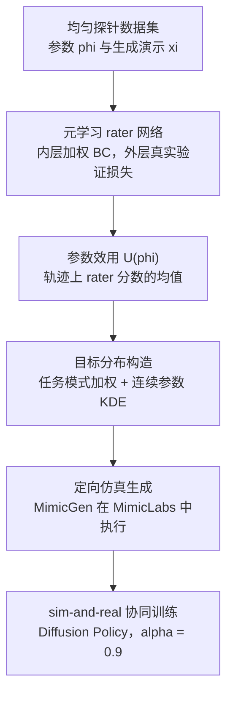

# MetaGenSim：学习该在仿真里生成什么数据

**MetaGenSim** 把仿真器的数据生成分布当作待优化对象（论文称 Active Generative Simulation）：先在参数空间上均匀采样一个探针数据集，用元梯度训练一个 rater 网络给每条仿真样本打分，再把分数映射为生成参数的概率密度，只在高效用区域定向生成数据，与少量真实演示做 sim-and-real 协同训练。

## 英文缩写速查

| 缩写 | 英文全称 | 简要说明 |
|------|----------|----------|
| MetaGenSim | Meta-Learning Generative Simulation | 本文方法：元学习驱动的仿真数据分布优化 |
| rater | Auxiliary rater network | 辅助打分网络，为每个 (观测, 动作) 对输出效用分，用于加权训练 |
| KDE | Kernel Density Estimation | 核密度估计，把参数效用映射为可采样的生成分布 |
| DP | Diffusion Policy | 论文真机协同训练所用的策略类型，α = 0.9 |
| BC-RNN | Behavior Cloning with RNN | 仿真实验与元学习内层使用的行为克隆模型 |
| VLA | Vision-Language-Action | 视觉-语言-动作模型，论文用 π0.5 验证迁移 |

## 为什么重要

- **仿真数据不一定有用：** 均匀随机生成的仿真数据会稀释目标任务相关的样本，论文的真机对照中，均匀生成甚至低于只用真实数据的基线。
- **省去手工对齐：** 专家手动对齐仿真参数成本高，且在无法精确对齐时可能误导；MetaGenSim 尝试从真实验证集的梯度信号中自动找到有用区域。
- **对部分对齐有处理方式：** 当仿真任务与真实任务不完全一致时，论文展示了通过原子技能拼接与物体-容器组合利用数据的做法。

## 核心信息

| 项 | 内容 |
|----|------|
| **机构** | Georgia Institute of Technology（佐治亚理工学院） |
| **平台 / 任务** | 真机 Franka Panda，四个任务：stackCube、mugBin、bowlTray、mugHang；仿真 MimicLabs 子集（8 个任务） |
| **数据** | 真机每任务 10 条真实演示；仿真数据由 MimicGen 在定制的 MimicLabs 环境中生成 |
| **策略** | 真机与仿真协同训练的主策略为 Diffusion Policy（α = 0.9）；元学习内层为 BC-RNN |
| **开源** | **未开源**（截至 2026-10-15 未发现官方代码；项目页 Code 按钮为模板占位符，论文无代码发布声明） |

## 核心原理

### 从探针到定向生成

1. **探针数据集：** 在用户给定的参数空间 Φ 上均匀采样参数 φ_i，生成对应演示 ξ_i，得到 D_probe。
2. **rater 元学习：** 内层用 rater 给 sim 与 real 样本的 softmax 权重做加权 BC；外层在真实验证集损失上对 rater 参数求梯度（通过若干步内层展开）。rater 因此成为真实任务表现的代理。
3. **参数效用：** 把生成轨迹上 rater 分数的均值作为该参数的效用 U(φ)。
4. **分布构造：** 先按任务模式的平均效用做指数加权采样，再对连续参数（物体位姿、相机位姿、桌面纹理）做加权 KDE。
5. **定向生成与协同训练：** 从分布中采样参数生成仿真数据，与少量真实数据按 α 混合训练策略。

## 源码运行时序图

**不适用**（未发现官方可运行代码：项目页 Code 按钮为模板占位符，论文未给出仓库或发布承诺，无法对齐运行入口）。

## 工程实践

| 项 | 建议 |
|----|------|
| 参数空间设计 | 只有写入参数空间 Φ 的因素能被优化；论文的真机实验中背景与光照未纳入 Φ，因此仍未对齐 |
| 探针规模 | 探针是单轮均匀采样；稀疏探针可能漏掉小的高效用区域，论文建议多轮自适应探针 |
| 温度与带宽 | 带宽过小或温度过高都会降低效果（论文附录有相关消融）；目标数据集过窄会导致生成分布过窄 |
| 代理策略 | 论文称用轻量代理策略筛选的分布可迁移到大型 VLA 微调，适合把昂贵的大模型实验前置到小模型上 |
| 真机数据量 | 真机只用每任务 10 条演示，协同训练的收益主要来自仿真侧分布选择 |
| 评测口径 | 论文报告 Pick 与 Pick+Place 两级成功数，每任务 20 次 rollout；比较时需同时看两级 |

## 实验与评测

- **真机协同训练（Table 1，Diffusion Policy，四任务合计每方法 80 次）：** 全任务（Pick+Place）MetaGenSim 58/80；Oracle（专家手动对齐）57/80；IWR 33/80；UniformGen 23/80；STRAP 27/80；RealOnly 26/80。Pick 阶段 MetaGenSim 为 67/80。
- **相对提升：** 全任务 58/80 对 23/80 约为 +152%，与摘要中的“约 150%”一致。
- **仿真-仿真（Fig. 3）：** 在 8 个 MimicLabs 任务上，BC-RNN 与 DP 的协同训练结果与 Oracle 相当（3 个种子，峰值成功率）；逐任务曲线与 DP 结果见附录 G。
- **VLA 迁移（Table 2）：** 论文称用代理策略筛选的数据可用于 π0.5 微调，具体计数本页未核实。

## 结论

**MetaGenSim 的核心判断是：仿真数据的价值取决于生成分布，而不是仿真器能生成多少数据。**

1. **均匀生成可能有害：** 真机对照中，均匀生成的协同训练结果低于只用真实数据的基线，说明无差别增加仿真样本不是安全选择。
2. **效用信号可以来自真实验证损失：** rater 通过元梯度对齐真实验证集，无需人工给出参数对齐规则。
3. **效果接近专家对齐：** 在论文的四个真机任务上，MetaGenSim 与人工对齐的 Oracle 几乎持平。
4. **部分对齐也能用：** 当任务不完全对齐时，论文展示了通过原子技能与容器组合利用仿真数据的路径，但这依赖参数空间的设计。
5. **工程前提是参数空间：** 未纳入 Φ 的因素（如背景与光照）无法被优化，部署前需要先把关键视觉与物理因素纳入生成器。

## 与其他工作对比

| 对照 | 差异读法 |
|------|----------|
| 均匀域随机化（[domain randomization](../concepts/domain-randomization.md)） | 均匀覆盖参数空间，论文中的 UniformGen 基线在真机上提升有限；MetaGenSim 只在效用高的区域采样 |
| 检索类方法（STRAP、IWR） | 从已有数据集中按相似度或影响选样；论文指出它们受静态数据覆盖限制，无法合成新数据，MetaGenSim 可以 |
| 手动对齐（Oracle） | 效果相当，但需要专家逐项调参；MetaGenSim 自动完成分布选择 |
| [Sim2Real](../concepts/sim2real.md) 系统辨识路线 | 追求仿真与真实的物理一致性；MetaGenSim 不要求高保真对齐，而是调整数据分布 |

## 局限与风险

- **依赖用户给定的参数空间与生成管线：** 只能利用 Φ 中暴露的因素和生成管线能产生的数据。
- **探针覆盖：** rater 只能对探针覆盖到的区域打分，稀疏探针与高维参数下的核密度估计都不稳定。
- **分布集中度：** 论文未加显式的多样性约束，分布宽度只靠温度与带宽控制，窄目标数据会导致窄分布。
- **真机规模较小：** 每任务 20 次 rollout、四个任务，统计置信区间较宽，结论需谨慎外推。
- **无公开代码：** 复现依赖论文附录中的算法与超参数，目前无法直接运行。

## 关联页面

- [Sim2Real](../concepts/sim2real.md) — 仿真到真实迁移的总体问题
- [Domain Randomization](../concepts/domain-randomization.md) — 均匀随机化的对照路线
- [Generative Data Augmentation](../methods/generative-data-augmentation.md) — 用生成式手段扩充训练数据的相关范式
- [Diffusion Policy](../methods/diffusion-policy.md) — 论文真机实验所用策略
- [VLA](../methods/vla.md) — 论文 π0.5 迁移实验所属模型类别
- [Behavior Cloning](../methods/behavior-cloning.md) — 元学习内层与协同训练的基础损失
- [Notebook：Sim-and-Real Co-Training 简单配方](./paper-notebook-sim-and-real-co-training-a-simple-recipe-for-vis.md) — 同一协同训练问题的另一条路线

## 参考来源

- [metagensim_arxiv_2610_19479.md](../../sources/papers/metagensim_arxiv_2610_19479.md) — 论文摘录与开源核查（2026-10-15）
- [wechat_embodied_station_robot_31_papers_2026-10-15.md](../../sources/raw/wechat_embodied_station_robot_31_papers_2026-10-15.md) — 文章摘要与链接
- [arXiv:2610.19479](https://arxiv.org/abs/2610.19479) — 原文（提交日期 2026-10-14）

## 推荐继续阅读

- [MetaGenSim 项目页](https://meta-gensim.github.io/) — 方法概览与视频（未提供代码）
- [MimicGen](https://arxiv.org/abs/2310.17596) — 论文用于生成仿真演示的数据生成系统（外部参考，论文引用）
