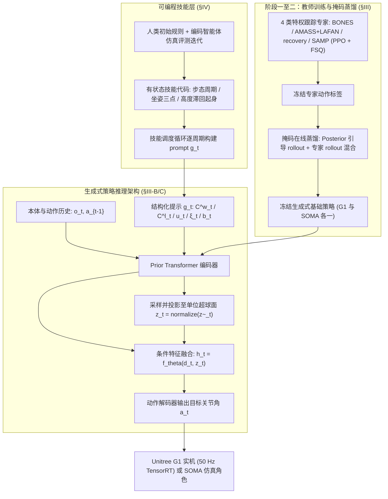
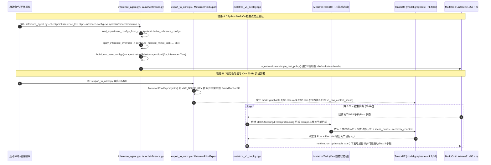

# METATRON：可提示的人形全身动作执行层

> **METATRON**（*METATRON: A Promptable Whole-Body Execution Layer for Humanoids*，[arXiv:2610.38027](https://arxiv.org/abs/2610.38027)）由 NVIDIA 与 Dollhouse Robotics 提出，并集成于 [NVlabs/ProtoMotions](https://github.com/NVlabs/ProtoMotions)。本页基于论文 v1 正文、Hugging Face 模型卡 `nvidia/Metatron-v1` 及 `ProtoMotions` 开源推理/导出/C++ 部署源码精读整理。

## 一句话定义

**METATRON 将人形机器人控制拆分为“冻结的通用全身生成式基础策略 + 逐控制步构造结构化目标提示的有状态技能程序”，使开发者或编码智能体只需修改上层程序而不重训底层强化学习策略，即可在 Unitree G1 实机与仿真中复用同一控制权重实现行走、触达、跌倒恢复、坐下与强抗推恢复等全身技能。**

## 英文缩写速查

| 缩写 | 英文全称 | 简要说明 |
|---|---|---|
| RL | Reinforcement Learning | 强化学习，本文 Stage 1 跟踪专家采用 PPO 训练 |
| WBC | Whole-Body Control | 全身控制，协同下肢平衡与上肢操作目标 |
| VAE | Variational Autoencoder | 变分自编码器，METATRON 采用单位超球面条件 VAE 作为学生基础策略 |
| FSQ | Finite Scalar Quantization | 有限标量量化，用于 Stage 1 运动跟踪专家的动作/潜表征正则化 |
| FK | Forward Kinematics | 正向运动学，用于躯干高度滞回恢复触发与锚点状态计算 |

## 为什么重要

1. **打破“一任务一策略”的重复训练循环：** 传统人形 RL 针对遥操作、起身、坐下或跨栏各自从头训练策略，每个策略都要重新学习平衡与步态协同；METATRON 将“如何平衡并协调全身执行部分目标”下沉进单一冻结基础策略。
2. **明确区分控制执行与技能编码：** 运行时**没有 LLM 在控制环内**；大模型或编码智能体只在离线仿真评测场中分析动捕与反馈、生成紧凑的有状态技能代码（状态机/周期轨迹/滞回规则），实机控制仍以 `50 Hz` 确定性代码生成提示。
3. **验证跨任务抗干扰泛化：** 同一冻结权重在不专门针对突发推扰重训上层特化策略的前提下，依托生成式多模态运动先验与主动迈步技能接口，能在高达 `1000 N` 的瞬时推力下保持 75% 的直立恢复率。

## 核心原理

### 1. 系统流程总览

### 2. 结构化 Prompt 接口与球面条件 VAE

- **五元组 Prompt `g_t = (C^w_t, C^ℓ_t, u_t, ξ_t, b_t)`（§III-B）：**
  - `C^w_t`：世界系时空身体部位位置与/或朝向目标（可局部缺失或稀疏）；
  - `C^ℓ_t`：以躯干为规范坐标系的局部姿态目标；
  - `u_t`：航向坐标系下的二维平面速度指令；
  - `ξ_t`：一组无序风格参考帧，经池化后注入隐式风格条件；
  - `b_t`：场景物体 8 角点三维包围盒，用于交互避障与对齐。
- **训练期 Posterior vs 部署期 Prior（§III-C）：**
  - **Prior Transformer** 仅读取可部署传感与动作历史 `(o_t, a_{t-1})` 及被随机掩码的 `g_t`，输出条件特征 `d_t` 与高斯参数 `(μ_t, σ_t)`；
  - **Posterior** 仅在训练期引入仿真特权状态与未来参考 `(s_t, y_t)` 预测残差 `(μ_t + Δμ_t, σ'_t)`；
  - 隐变量经 L2 归一化落在单位超球面 `z_t = z̃_t / ||z̃_t||_2`，并与 `d_t` 融合 `h_t = f_θ(d_t, z_t)` 后解码为关节目标 `a_t`。训练联合优化 KL 散度、均值单位范数正则、下一步条件预测 `F(h^q_t) -> sg(d_{t+1})`、相邻帧特征一致性与动作平滑项。**导出与真机部署阶段关闭采样噪声（`VAE_NOISE_KEY = 0`），仅前向运行确定性 Prior 均值与解码器。**

### 3. 四大内置技能原语与数据构建（§IV–§V）

- **数据来源（§V）：** 常规 MoCap 数据与 `SAMP` 家具交互数据。SAMP 重定向采用基于朝向表面点云的两阶段无碰撞优化，**仅惩罚穿模、不惩罚真实表面接触**；跌倒起身专家额外结合合成的人类-在环（HIL）风格恢复轨迹。
- **技能原语示例（§IV）：**
  - **步态转向：** 利用周期函数拟合左右脚落足轨迹 `p_i(τ)`（eq. 6）驱动迈步；
  - **坐姿交互：** 提供座椅中心上方/后方躯干目标与座椅前缘双脚目标的三点约束；
  - **跌倒起身恢复：** 基于 FK 计算的躯干离地高度滞回阈值自动切换起身提示；
  - **交互顺应：** 下发零速度与可控躯干高度/朝向，而将双臂目标留空以保持物理顺应。

## 实验与评测

### 1. 全身末端触达评测（论文 Table I）

在 54 个全身腕部触达目标（距离 `0.35–1.8 m`，不含合成恢复数据，判定条件为 `10 cm` 保持且全程未跌倒）上的实测对比：

| 方法 | 目标触达率 | 平均触达误差 | 保持直立率 |
|---|---|---|---|
| **METATRON** | **83%** | **5.9 cm** | **100%** |
| ARDY + SONIC | 39% | 6.4 cm | 82% |
| GRU + IK + SONIC | 28% | 5.6 cm | 81% |
| GRU + SONIC | 0% | — | 87% |

### 2. 行走中强外力抗推测试（论文 Table II）

在 `1 m/s` 前进过程中对躯干施加持续 `100 ms` 的横向/全向冲击推力（覆盖 8 个方向），统计推后 `8 s` 内未跌倒成功率：

| 方法 | `200 N` | `400 N` | `600 N` | `800 N` | `1000 N` |
|---|---|---|---|---|---|
| **METATRON** | **100%** | **100%** | **62%** | **75%** | **75%** |
| ARDY + SONIC | 100% | 100% | 17% | 0% | 0% |
| GRU + IK + SONIC / GRU + SONIC | 100% | 75% | 25% | 0% | 0% |

### 3. 消融实验与仿真/实机边界（§VI-F）

- **结构消融：** 完整 METATRON 在 `0–200 N` 下优于 `Global-only`、`Mocap-only` 与 `No-aux`，且在所有非零推力档位优于适配后的 `MaskedMimic+` 与 `HOVER+`。
- **技能层必要性边界：** 若撤去上层迈步技能、仅向基础策略直接注入静态位置路点目标，在 `600–800 N` 强推力下**所有对比变体（含 METATRON 基础策略）的站立率都会跌破 `10%`**——说明抗大推力不仅依赖底层生成先验，也强依赖技能层提供合理的动态步态目标。
- **平台口径：** Unitree G1 实机运行单个冻结的 C++ TensorRT + CUDA graphs 策略（笔记本 GPU 经以太网 `50 Hz`、`kControlDt = 0.02 s` 通信）；SOMA 角色交互以及项目页上的跨栏、保龄球、网球、踢球等案例运行于 MuJoCo 仿真，其中物体位置/释放由场景脚本定时或显式给出，不应混淆为视觉闭环真机成功率。

## 与其他工作对比

| 维度 | METATRON（本文） | MaskedMimic+ / HOVER+ | 专项 RL 任务策略（如单任务行走/踢球） |
|---|---|---|---|
| **控制抽象** | 单一冻结生成式基础策略 + 有状态代码技能层 | 多目标/局部跟踪条件控制策略 | 针对单一奖励函数优化的专用策略 |
| **新技能开发方式** | 修改或由编码智能体迭代技能代码，**无需重训 RL** | 需改训练任务配置并重新微调/蒸馏 | 需重新设计奖励并重头跑 PPO |
| **全身大范围触达** | 83% 触达率、100% 直立（Table I） | 缺席结构化多模态恢复组合或局部退化 | 下肢强于上肢协同或难以零样本复用 |
| **生态定位** | 作为通用动作执行基座，可支撑如 [G1 守门员应用](./g1-football-metatron-goalkeeper.md) 等高层技能编排 | ProtoMotions 前代方法与基线 | 与 [ProtoMotions](./protomotions.md) 中各单独任务配方并列 |

## 结论

**METATRON 证明了将“全身平衡生成先验”冻结为可部分提示的球面条件 VAE、把“任务逻辑与节律规划”外移为有状态编程技能层的路线，能够在同一套 Unitree G1 实机权重上兼顾高难度全身触达、多技能切换与强外力抗扰，为编码智能体零策略重训迭代人形技能提供了可执行底座。**

- 提示接口 `g_t` 接收结构化数值目标（部位姿态、速度、风格池、包围盒），运行时**无 LLM 推理延迟**，所有智能体参与均发生在离线仿真代码迭代阶段。
- 单位超球面潜变量与 `F(h^q_t) -> sg(d_{t+1})` 等辅助约束显著提升了遮挡目标下的生成连续性；导出部署则通过置零隐空间噪声实现确定性推理。
- 开源模型卡 `nvidia/Metatron-v1` 仅发布 Unitree G1（29 DoF）检查点与两份不可互换的 ONNX 文件，**不包含 SOMA 权重、训练动捕数据集或浏览器 TypeScript 源码**。
- 源码库 `examples/experiments/metatron/` 提供了单教师蒸馏教学配方，与论文正式发布的 4 专家联合蒸馏 G1 模型在专家覆盖范围上存在工程差异。
- 极端突发速度输入（如静止直给 `2 m/s`）与缺少主动迈步技能时的强推扰仍构成边界条件，生产部署需配合指令 EMA 平滑与完整技能触发逻辑。

## 源码运行时序图

以下时序严格对齐 `NVlabs/ProtoMotions` 中的 Python 仿真推理（`protomotions/inference_agent.py` -> `protomotions/launch/inference.py`）、确定性 ONNX 导出（`deployment/export_to_onnx.py` + `deployment/metatron_policy.py`）与 C++ TensorRT 实机/MuJoCo 闭环（`deployment/native/examples/metatron_v1_deploy.cpp`）：

## 工程实践

1. **三类开源制品与不可混用警告：**
   - `G1/inference_last.ckpt`（459,455,983 字节，epoch-6410）：面向 ProtoMotions PyTorch/MuJoCo/Isaac 推理及 ONNX 再导出的原生 29 关节 Unitree G1 模型；
   - `demo/model.onnx`：单机器人 39 路输入模型，专用于浏览器 WASM/WebGPU 单实例演示；
   - `racer/network.onnx`：6 机器人批量推理模型，输入维度与 `demo/model.onnx` **不可互换**。
2. **许可证分离核算：** `NVlabs/ProtoMotions` 框架源码采用 **Apache-2.0**；而 `nvidia/Metatron-v1` 权重与 ONNX 制品受 **NVIDIA Open Model License**（见模型仓库 `LICENSE.pdf`）约束，商业/二次分发前需分别审查。
3. **开源训练配方的单教师差异：** 复现训练时需注意 `examples/experiments/metatron/g1_student.py` 默认接入单一五部位跟踪教师（`--expert-model-path`），用于跑通球面条件 VAE（`LATENT_DIM=64`, `TOKEN_DIM=1024`, `NUM_FUTURE_STEPS=5`）蒸馏链路；论文实机模型则合并了 4 类领域专家的动作分布。
4. **实机防突变与自检流程：** 真机部署前务必先运行 C++ 仓库提供的 `unitree_sensor_probe` 检查 IMU 与关节通信状态；上层遥操作或脚本下发速度指令时建议加 EMA 平滑，避免静止状态下突变超高速指令。

## 常见误区与局限

- **误区：误以为运行时有大模型直接“读自然语言驱动关节”。** 实际运行时只执行确定性 C++/Python 有状态技能程序和冻结的 Prior+Decoder 神经网络；编码智能体只在离线仿真开发新技能脚本时介入。
- **误区：把项目页 MuJoCo 仿真花式展示当成真机感知闭环能力。** METATRON 本身不含视觉与全局定位，跨栏杆位置、保龄球/网球释放以及沙发交互均由外部代码提供物体包围盒 `b_t` 或在目标附近预设触发。
- **训练覆盖边界风险（§VII）：** 对未充分覆盖的瞬态指令组合敏感（论文报告从静止突然输入 `2 m/s` 前进命令会诱发近似前滚翻的失稳过渡），高度依赖上层技能的速率限制与状态转换条件。
- **未公开资产范围：** Hugging Face 未公开 SOMA 预训练权重、未打包原始 MoCap/SAMP 训练动作集，且 `demos/metatron/` 仅发布编译包 `demo.zip` 而非浏览器 TypeScript 源码。

## 关联页面

- [protomotions](./protomotions.md) — 承载 METATRON 训练、推理与 C++ 导出部署工具链的开源统一运动学习框架
- [g1-football-metatron-goalkeeper](./g1-football-metatron-goalkeeper.md) — 基于 METATRON 提示接口构建的宇树 G1 守门员技能案例
- [senlanke-weekly-2026-10-26-30-humanoid-quadruped-technology-map](../overview/senlanke-weekly-2026-10-26-30-humanoid-quadruped-technology-map.md) — 同期人形/四足控制周报技术地图
- [humanoid-locomotion](../tasks/humanoid-locomotion.md) — 人形运动控制任务总览
- [reinforcement-learning](../methods/reinforcement-learning.md) — 运动跟踪专家策略使用的强化学习方法

## 参考来源

- [arXiv:2610.38027 论文全文精读归档](../../sources/papers/metatron-promptable-whole-body-execution_arxiv_2610_38027.md) — §I–§VII 算法推导、Table I/II 定量评测与 §VII 局限
- [NVIDIA 项目页与 Hugging Face 模型卡归档](../../sources/sites/metatron-nvidia.md) — `nvidia/Metatron-v1` 制品拆解、许可边界与演示口径
- [NVlabs/ProtoMotions METATRON 源码读解](../../sources/repos/protomotions_metatron.md) — 推理入口、单教师蒸馏脚本、ONNX 导出与 C++ TensorRT 50 Hz 闭环
- [【10.26-10.30前沿论文动态】人形／四足33篇](../../sources/blogs/wechat_senlanke_weekly_humanoid_quadruped_2026-10-26_30.md) — 周报策展线索
- [【10.26-10.30前沿论文动态】具身操作27篇](../../sources/blogs/wechat_senlanke_weekly_manipulation_2026-10-26_30.md) — 周报线索交叉记录

## 推荐继续阅读

- [METATRON arXiv 原文 PDF](https://arxiv.org/pdf/2610.38027)
- [NVIDIA METATRON 官方项目页](https://research.nvidia.com/labs/par/projects/metatron/)
- [ProtoMotions 官方预训练模型指南](https://nvlabs.github.io/ProtoMotions/getting_started/pretrained_models.html)
- [Hugging Face 模型仓库 nvidia/Metatron-v1](https://huggingface.co/nvidia/Metatron-v1)
