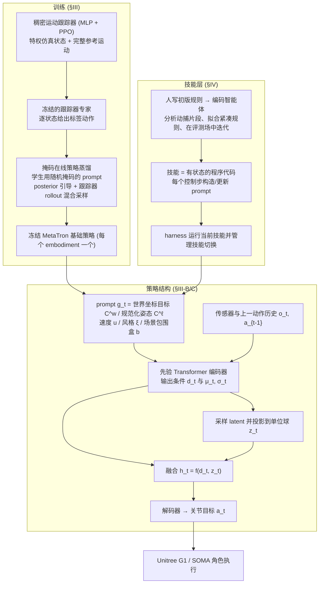

# METATRON：可提示的人形全身动作执行层

**METATRON**（*METATRON: A Promptable Whole-Body Execution Layer for Humanoids*，[arXiv:2610.38027](https://arxiv.org/abs/2610.38027)）收录于 senlanke「具身运控lab」10-26–10-30 前沿论文动态（人形/四足）。本页依据**周报条目 + arXiv 摘要页**整理，流程图依据论文方法部分（见参考来源），未逐页核对实验数字；指标与结论以论文为准。

## 一句话定义

**METATRON：可提示的人形全身动作执行层——冻结一个接收身体部位目标、速度和风格提示的生成式基础策略；高层技能以有状态程序逐周期生成提示，使编码智能体能够通过修改程序而不是重新训练策略来构建新技能。**

## 英文缩写速查

| 缩写 | 英文全称 | 简要说明 |
|------|----------|----------|
| RL | Reinforcement Learning | 强化学习 |
| WBC | Whole-Body Control | 全身控制 |

## 为什么重要

- 周报所述待解决的问题：不同人形任务通常分别训练控制策略，重复学习平衡和全身协调能力。

## 流程总览

图依据：论文 §III（基础策略、prompt 接口、生成式策略、训练）/ Fig.2、§IV 技能层 / Fig.3

## 核心机制

| 项 | 内容 |
|----|------|
| **arXiv** | [2610.38027](https://arxiv.org/abs/2610.38027) · [PDF](https://arxiv.org/pdf/2610.38027) |
| **作者（arXiv）** | Tessler, Chen, Jiang, Yifeng, Otto, Alec, Shi, Yi, Iqbal, Umar, Chechik, Gal, Peng, Xue Bin |
| **机构（周报所述，未逐条核实）** | NVIDIA、Dollhouse Robotics |
| **arXiv 评论栏** | （无） |
| **开源** | arXiv 摘要页与评论未见代码或项目页链接（仅核对 arXiv 摘要页，不代表未发布）（2026-11-02） |
| **周报所述创新点** | 冻结一个接收身体部位目标、速度和风格提示的生成式基础策略；高层技能以有状态程序逐周期生成提示，使编码智能体能够通过修改程序而不是重新训练策略来构建新技能。 |

### arXiv 摘要节选（英文原文）

> Humanoid controllers often require task-specific training despite sharing the need for balance and whole-body coordination. We present Metatron, a promptable whole-body execution layer combining a generative base policy with a programmable skill layer.

## 源码运行时序图

**不适用**：arXiv 摘要页与评论未见代码或项目页链接（仅核对 arXiv 摘要页，不代表未发布），无可对齐的官方代码流程。

## 实验与评测

- 周报与摘要给出的数字/场景已写入上表「创新点」与摘要节选；其余实验细节、基线与成功率定义请回到论文正文。
- 读法：先对齐任务设定、传感器与成功定义（仿真/真机），再解读 headline 数字，勿跨论文直接比较。

## 与其他工作对比

| 维度 | 读法 |
|------|------|
| **同周对照** | 见 [人形/四足周报技术地图](../overview/senlanke-weekly-2026-10-26-30-humanoid-quadruped-technology-map.md)，按方向浏览同期论文 |
| **开源状态** | arXiv 摘要页与评论未见代码或项目页链接（仅核对 arXiv 摘要页，不代表未发布） |

## 结论

**METATRON：可提示的人形全身动作执行层。**

1. 本页是入库级摘要，复现前请核对论文正文、附录与代码仓库。
2. 指标须连同实验条件解读。
3. 关注 arXiv 版本更新与代码发布。

## 关联页面

- [senlanke-weekly-2026-10-26-30-humanoid-quadruped-technology-map](../overview/senlanke-weekly-2026-10-26-30-humanoid-quadruped-technology-map.md)
- [humanoid-locomotion](../tasks/humanoid-locomotion.md)
- [reinforcement-learning](../methods/reinforcement-learning.md)

## 参考来源

- [metatron-promptable-whole-body-execution_arxiv_2610_38027.md](../../sources/papers/metatron-promptable-whole-body-execution_arxiv_2610_38027.md)
- [wechat_senlanke_weekly_humanoid_quadruped_2026-10-26_30.md](../../sources/blogs/wechat_senlanke_weekly_humanoid_quadruped_2026-10-26_30.md)
- [arXiv:2610.38027](https://arxiv.org/abs/2610.38027)
- [arXiv PDF](https://arxiv.org/pdf/2610.38027)：已通读方法部分（实验与附录以略读为准）：§III 基础策略、§IV 技能层、§V 训练数据、§VI 实验（附录未读）

## 推荐继续阅读

- [arXiv PDF](https://arxiv.org/pdf/2610.38027)
