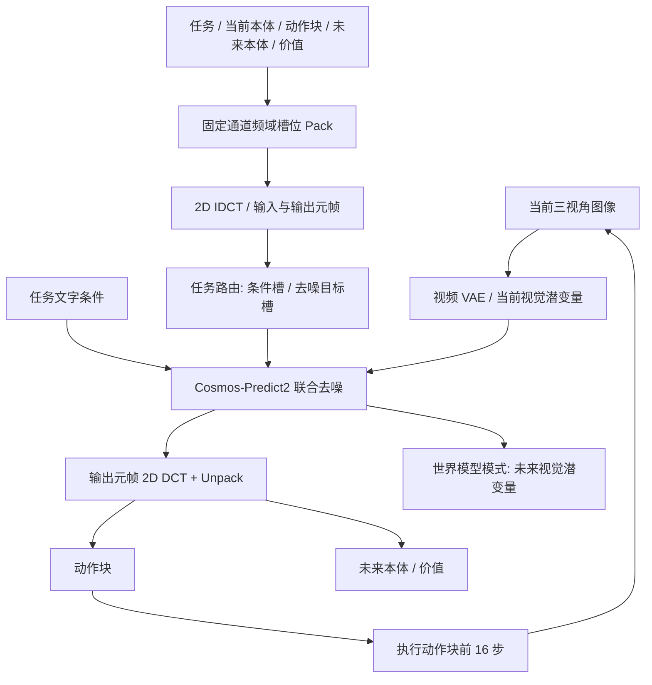
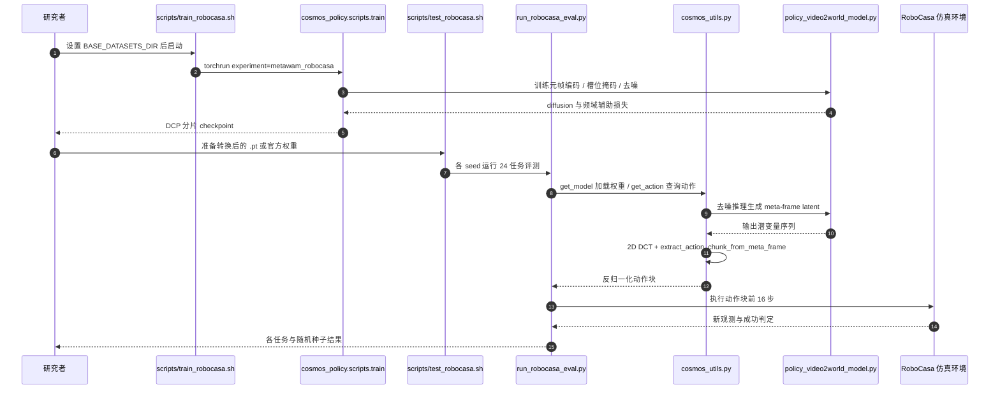

# MetaWAM： 从视频帧到机器人元帧：世界–动作模型的统一潜空间接口

## 一句话定义

MetaWAM 将机器人动作、状态和价值信号塞入与视频扩散兼容的频域 meta-frame，形成统一世界–动作潜空间接口。

## 英文缩写速查

| 缩写 | 英文全称 | 简要说明 |
|---|---|---|
| WAM | World Action Model | 联合产生未来观测与动作的模型 |
| DCT | Discrete Cosine Transform | 将结构化机器人变量编码进频域槽位 |
| DiT | Diffusion Transformer | 进行视频与机器人元帧联合去噪的网络 |
| RoboCasa | RoboCasa | 室内机器人操作仿真评测集 |

## 为什么重要

现有视频扩散骨干天然处理图像时空网格，但动作、关节/末端状态、价值是结构化低维数据。通过固定频域槽位共享表示，能减少额外大头部和反复去噪开销。

## 核心原理

论文采用 **输入元帧 + 当前三视角 latent + 输出元帧 + 未来三视角 latent**，合计 **8 个 latent 时间槽**；逐信号分帧的 Cosmos Policy 基线为 11 槽。输入元帧复用 tokenizer 原有的空白槽，输出元帧联合承载动作、未来本体与价值。

编码过程是 **Pack → 2D 正交逆 DCT（IDCT）→ 空间 latent**，而不是“先做 DCT 再注入”：归一化机器人信号被写入互斥通道的 `k_H=0` 频域系数；模型去噪后执行 **2D DCT → 固定槽位 Unpack** 直接恢复动作、未来本体与价值，**没有学习式动作解码器**。

槽位掩码按任务改变条件/预测目标：策略预测动作；世界模型在已知动作下预测未来状态；价值分支使用转移信息预测价值。论文主实验采用 Cosmos-Predict2-2B 视频扩散骨干，多视角图像仍走视频 VAE。具体实现还有可选的零初始化 `slot_mask_embedder` 残差分支，用于将细粒度掩码嵌入 DiT；“无需改动骨干”应理解为保留视频去噪主干与潜变量接口，**不等于没有新增任何可训练模块**。

## 流程总览

> 依据论文 §4、图 3 和官方源码，图中的 DCT/IDCT 方向不同：**注入用 IDCT；读回用 DCT**。不同任务的条件槽由掩码决定，并非所有输入信号都在每种任务中可见。

## 实验与评测

| 评测 | MetaWAM | 关键对照 / 条件 |
|---|---:|---|
| RoboCasa（24 任务） | **68.9%** | Cosmos Policy 67.1%；每任务 50 次演示 |
| 模型查询时延 | **0.291 s** | Cosmos Policy 0.479 s，降低约 39%（11 → 8 latent 槽） |
| LIBERO 原始基准 | **98.1%** | Cosmos Policy **98.5%**；MetaWAM 在该项并非领先 |
| LIBERO-Plus 综合 | **83.4%** | Cosmos Policy 82.2%；对背景/初始状态扰动仍敏感 |
| Franka 真机三任务 | **85.0% ID / 68.3% OOD** | 每任务每设置 20 次测试；论文作者报告 |

这些数据均为作者评测，未在本次工作中独立复现。RoboCasa 官方评测脚本设 24 任务 × 50 次 trial × 3 seeds（195/196/197），总计 3600 回合；**训练时每任务 50 条演示**与**评测时每任务 50 次 trial**是不同概念。0.291 秒是模型单次查询时延，不是低层伺服周期。

## 结论

**MetaWAM 的亮点在于直接把低维机器人信号变成视频骨干可处理的频域元帧，并通过共享去噪预测多种目标。**

1. 对照源码中的频域槽位与模型输入维度，不能把 meta-frame 当成普通 RGB 图。
2. 复现时固定 RoboCasa 24 任务、3 随机种子与每任务 50 次试验协议。
3. 比较 39% 延迟变化应说明 0.479 s → 0.291 s 的对照条件。
4. 先用官方 checkpoint 跑评测，再进行自己的数据微调。

## 与其他工作对比

[MetaWAM](paper-metawam.md) 以频域元帧建立视频–动作统一输入，而 LaST0.5 通过交互中心潜变量连接世界与动作专家。

## 源码运行时序图

已核查官方训练/评测 shell 入口、RoboCasa 评测主程序、频域编码、掩码与推理 readout 的对应源码。下图仅表示已验证的调用层次；本次**未执行**训练或真机实验。

源码依据：[`scripts/train_robocasa.sh`](https://github.com/showlab/MetaWAM/blob/main/scripts/train_robocasa.sh)、[`scripts/test_robocasa.sh`](https://github.com/showlab/MetaWAM/blob/main/scripts/test_robocasa.sh)、[`policy_video2world_model.py`](https://github.com/showlab/MetaWAM/blob/main/cosmos_policy/models/policy_video2world_model.py)、[`cosmos_utils.py`](https://github.com/showlab/MetaWAM/blob/main/cosmos_policy/experiments/robot/cosmos_utils.py)。

## 工程实践

### 频域槽位的源码约束

在 [`policy_text2world_model.py`](https://github.com/showlab/MetaWAM/blob/main/cosmos_policy/models/policy_text2world_model.py) 中，`use_single_meta_frame=True` 的主要频域布局要求 latent **至少 16 通道**，固定分配如下：

| 通道 | 对应变量 | 实现约束 |
|---|---|---|
| 0 | task type | 三类任务 one-hot |
| 1–3 | current proprio | 9 个数值，按 3×3 槽位写入 |
| 4–11 | action chunk | 动作展平后写入第 0 行系数；容量为 `8 × latent_width` |
| 12–14 | future proprio | 9 个数值 |
| 15 | value | 单标量 |

`_encode_frequency_meta_frame_v2` 通过专门的 row-0 IDCT 实现频域提升；`cosmos_utils.extract_action_chunk_from_meta_frame` 对输出元帧做正交 **2D DCT**，选取通道 4–11 的 `k_H=0` 槽并重塑动作。这是确定性解析读取，而非额外训练动作 decoder。`policy_video2world_model.py` 实现细/粗两级条件掩码，[`minimal_v1_lvg_dit.py`](https://github.com/showlab/MetaWAM/blob/main/cosmos_policy/_src/predict2/networks/minimal_v1_lvg_dit.py) 中 `slot_mask_embedder` 为**零初始化的附加残差输入**；`use_single_meta_frame=False` 则回退 Cosmos Policy 分帧布局。

### 复现入口

- 训练：`bash scripts/train_robocasa.sh`；使用 `Cosmos-Predict2-2B-Video2World`、默认 4 GPU、每 GPU batch 64、4 次梯度累积，有效 batch 1024；论文表述为 4×H200。
- 仿真评测：`bash scripts/test_robocasa.sh`；5 步动作去噪、`chunk_size=32`、`num_open_loop_steps=16`，默认 195/196/197 三个种子。
- 官方权重：[RoboCasa](https://huggingface.co/Ethanliang99/MetaWAM-RoboCasa-Predict2-2B)、[LIBERO](https://huggingface.co/Ethanliang99/MetaWAM-LIBERO-Predict2-2B)、[RealWorld](https://huggingface.co/Ethanliang99/MetaWAM-RealWorld-Predict2-2B)。真机权重依赖作者的 Franka 设置，不能假定开箱即适用于任意平台。

完整环境、数据下载与 checkpoint 转换步骤以官方 [ROBOCASA.md](https://github.com/showlab/MetaWAM/blob/main/ROBOCASA.md) 为准。源码入口与配置已经复核，**未做硬件级或 benchmark 结果复现**。

## 局限与风险

- **固定布局的泛化边界：** 实现硬编码 16 通道和 9D 本体状态等槽位，动作长度还受 `8 × latent_width` 限制；接入新机器人需核对动作维度、归一化、相机数量与频域容量，不能仅替换 URDF。
- **实验适用范围：** RoboCasa 相对 Cosmos Policy 的成功率仅提高 1.8 个百分点，LIBERO Original 低于该基线；延迟主要受硬件、视频分辨率、序列长度与去噪步数影响。
- **论文自述局限：** 固定频段分配与损失权重对任务比例/信号尺度变化敏感；语言指令理解受视频骨干限制；LIBERO-Plus 暴露背景和初始状态变化下的鲁棒性不足。
- **部署边界：** 依赖较重的 Cosmos 视频模型、数据统计量与相机标定；推理时延不能直接当作低层控制频率。

## 关联页面

- [World Action Models](../concepts/world-action-models.md)
- [LaST0.5](paper-last05.md)
- [Elastic-WAM](paper-elastic-wam.md)
- [VLA](../methods/vla.md)

## 参考来源

- [arXiv:2611.14365 归档](../../sources/papers/metawam_arxiv_2611_14365.md)
- [官方仓库核验](../../sources/repos/metawam.md)

## 推荐继续阅读

- [论文原文](https://arxiv.org/abs/2611.14365)
- [官方代码](https://github.com/showlab/MetaWAM)

> **复核状态（2026-11-12）：** 已通读并核对 arXiv v1 HTML 正文、实验与附录，数据均按作者论文口径记录；本次未独立复现其训练、推理、性能指标。
