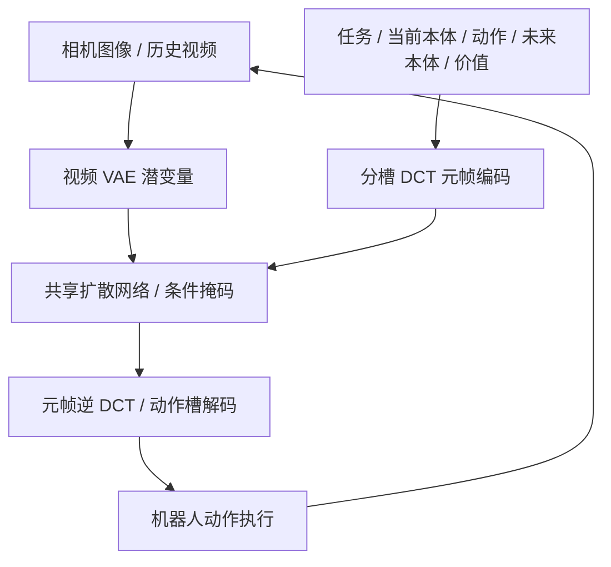
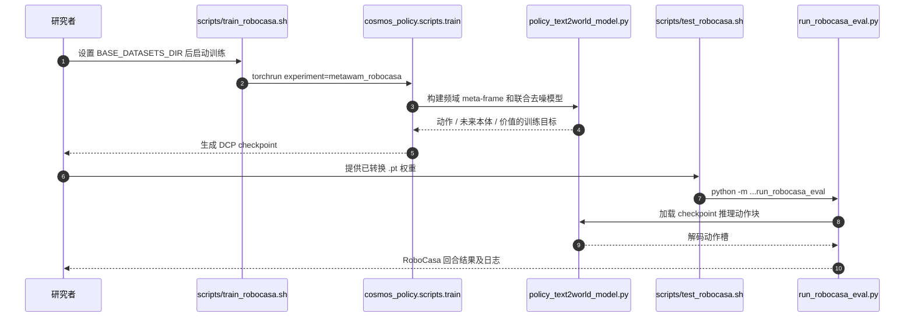

# MetaWAM： 从视频帧到机器人元帧：世界–动作模型的统一潜空间接口

## 一句话定义

MetaWAM 将机器人动作、状态和价值信号塞入与视频扩散兼容的频域 meta-frame，形成统一世界–动作潜空间接口。

## 英文缩写速查

| 缩写 | 英文全称 | 简要说明 |
|---|---|---|
| WAM | World Action Model | 联合产生未来观测与动作的模型 |
| DCT | Discrete Cosine Transform | 将结构化机器人变量编码进频域槽位 |
| DiT | Diffusion Transformer | 进行视频与机器人元帧联合去噪的网络 |
| RoboCasa | RoboCasa | 室内机器人操作仿真评测集 |

## 为什么重要

现有视频扩散骨干天然处理图像时空网格，但动作、关节/末端状态、价值是结构化低维数据。通过固定频域槽位共享表示，能减少额外大头部和反复去噪开销。

## 核心原理

从视觉潜变量构建含通道分槽的 meta-frame。正交 DCT 系数的不同槽分别承载任务、当前本体状态、动作块、未来本体状态与价值；反变换读回连续控制信息。原始视频潜变量与 meta-frame 一起进入共享扩散网络，并以槽位任务条件与掩码限定监督；推理时仅对必要目标作较短去噪。

## 流程总览

> **注意：** 此图仅抽象论文所述方法模块与数据/控制流，非未公开代码的实际调用路径。

## 实验与评测

论文 RoboCasa 24 任务平均成功率 68.9%（对照 Cosmos Policy 67.1%），推理延迟约 0.479 s → 0.291 s（约 -39%）；Franka 三项真机任务平均成功率 85.0%，OOD 设置 68.3%。这些数值是论文自报；时延不等于机器人低层控制周期。

## 结论

**MetaWAM 的亮点在于直接把低维机器人信号变成视频骨干可处理的频域元帧，并通过共享去噪预测多种目标。**

1. 对照源码中的频域槽位与模型输入维度，不能把 meta-frame 当成普通 RGB 图。
2. 复现时固定 RoboCasa 24 任务、3 随机种子与每任务 50 次试验协议。
3. 比较 39% 延迟变化应说明 0.479 s → 0.291 s 的对照条件。
4. 先用官方 checkpoint 跑评测，再进行自己的数据微调。

## 与其他工作对比

[MetaWAM](paper-metawam.md) 以频域元帧建立视频–动作统一输入，而 LaST0.5 通过交互中心潜变量连接世界与动作专家。

## 源码运行时序图

已读官方 README、RoboCasa 训练/评测 shell 入口与频域槽位实现，以下仅表示代码所证实的 RoboCasa 训练/评测调用链；并未实际执行复现实验。

## 工程实践

官方仓库提供 RoboCasa、LIBERO 和真机训练/评测脚本，以及 MetaWAM RoboCasa 权重。RoboCasa 复现实验入口为 scripts/train_robocasa.sh 与 scripts/test_robocasa.sh；需要准备 RoboCasa 数据、Cosmos-Predict2-2B 权重、环境依赖，训练默认 4 GPU。模型 meta-frame 频域槽位实现在 cosmos_policy/models/policy_text2world_model.py。

## 局限与风险

RoboCasa 成功率改进相对幅度有限，延迟收益与任务/硬件/去噪步数相关；框架仍依赖大规模视频模型及任务专属数据规范，不能直接用作高频关节闭环。

## 关联页面

- [World Action Models](../concepts/world-action-models.md)
- [LaST0.5](paper-last05.md)
- [Elastic-WAM](paper-elastic-wam.md)
- [VLA](../methods/vla.md)

## 参考来源

- [arXiv:2611.14365 归档](../../sources/papers/metawam_arxiv_2611_14365.md)
- [官方仓库核验](../../sources/repos/metawam.md)

## 推荐继续阅读

- [论文原文](https://arxiv.org/abs/2611.14365)
- [官方代码](https://github.com/showlab/MetaWAM)

> **复核状态（2026-11-12）：** 论文关键方法与结果已核对，但全文与全部附录尚未逐项通读，故本节点保持 draft；不得将自报数值视为独立复现。
