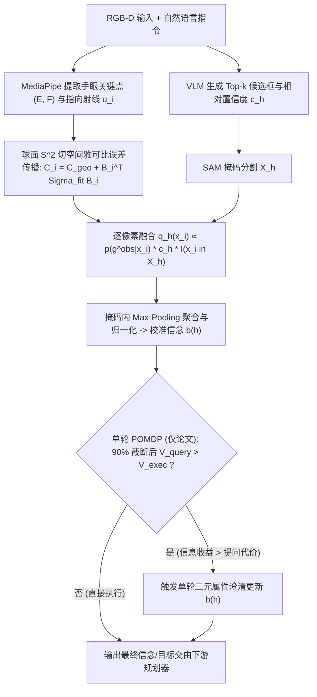
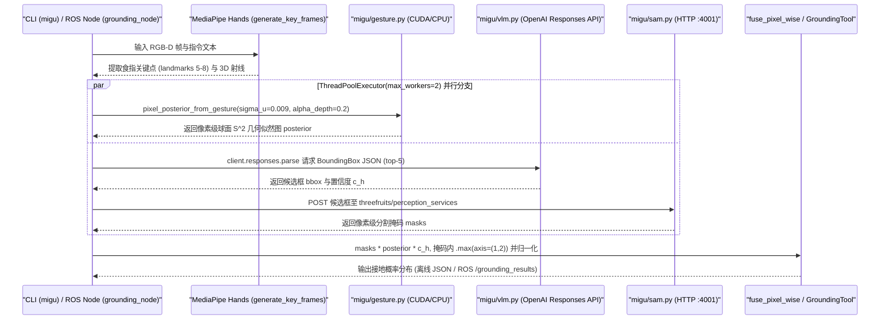

# MIGU: Multimodal Instruction Grounding under Uncertainty

## 一句话定义

**MIGU 是一种面向模糊人机指代指令的概率接地（grounding）框架，它在 3D 传感与人体关键点不确定性下，将指向几何似然与 VLM+SAM 语义置信度在像素级融合，输出校准后的目标概率信念供决策或主动澄清使用。**

## 英文缩写速查

| 缩写 | 英文全称 | 简要说明 |
| :--- | :--- | :--- |
| MIGU | Multimodal Instruction Grounding under Uncertainty | 本文提出的不确定性感知多模态指代接地框架 |
| VLM | Vision-Language Model | 视觉语言模型，用于生成候选边界框与相对置信度 |
| SAM | Segment Anything Model | 实例分割模型，将候选框转化为像素级目标掩码 |
| POMDP | Partially Observable Markov Decision Process | 部分可观测马尔可夫决策过程，用于决定直接执行或发起单轮澄清 |
| TAMP | Task and Motion Planning | 任务与运动规划，下游接收接地信念分布进行抓取与重排 |
| NLL | Negative Log-Likelihood | 负对数似然，用于评估接地概率分布的校准质量 |

---

## 为什么重要

1. **解决“语言指代 + 指示手势”双歧义的互补性问题：** 在同类物体密集摆置的日常桌面或移动操作场景中，仅靠自然语言（如“拿这个杯子”）无法区分同类实例，而仅靠 3D 指向射线在目标距离拉大到 0.5–3 m 时极易因微小的手部关键点抖动与深度误差发生严重偏靶。
2. **输出校准信念而非硬 Top-1：** 现有确定性接地或黑盒 VLM 标记方法（如 SoM、PIVOT）在概率校准（NLL、Brier）上表现较差。MIGU 保留完整后验分布，使下游单轮 POMDP 行为规划器能够权衡“直接抓取风险”与“开口提问成本”。
3. **工程落地边界清晰：** 项目官方仓库 [MingkeLu/MIGU](https://github.com/MingkeLu/MIGU) 已开放核心 grounding 管线、100 帧真实 RGB-D 基准数据集（`captures/`）与 ROS Noetic 在线服务接口，便于直接作为机器人前序感知组件接入现有规划栈。

---

## 核心原理

MIGU 将“手势几何似然”与“语义掩码置信度”在同一像素空间中耦合，并通过单轮 POMDP 决定是否向人类发起二元属性澄清：

1. **3D 几何不确定性建模与球面切空间传播（§IV-B）：**
   - 对像素 $x_i$ 与手部食指位置 $F$ 构造名义向量 $\bar{y}_i = x_i - F$，将视角单元向量切平面噪声 $\delta_u \sim \mathcal{N}(0, \sigma_u^2 P_i)$ 与线性深度噪声 $\sigma_{d,i} = \alpha_d d_i$ 经 $y = E + d u - F$ 的雅可比 $J_i$ 传播到指向向量空间，投影至 $\mathbb{S}^2$ 切平面 $T_{\mu_i}\mathbb{S}^2$，再叠加手部拟合协方差 $B_i^\top \Sigma_{\mathrm{fit}} B_i$ 得到总协方差 $C_i$。
   - 在流形 $\mathbb{S}^2$ 上用对数映射残差评估高斯几何似然 $p(g^{\mathrm{obs}} \mid x_i)$，保留了“近处指代角度容差大、远处波束随距离变窄”的几何物理性质。
2. **语义分割与逐像素融合（§IV-A, §IV-C）：**
   - 由 VLM 解析语言指令并给出至多 $k$ 个候选框及未校准相对分数 $c_h$，SAM 将候选框转为像素掩码 $X_h$，避免框内背景像素污染指向统计。
   - 在像素粒度计算联合得分 $q_h(x_i) \propto p(g^{\mathrm{obs}} \mid x_i) \cdot c_h \mathbb{I}[x_i \in X_h]$，并在每个实例掩码内取最大值（max pooling）再跨实例归一化，得到信念分布 $b(h)$。
3. **单轮 POMDP 主动澄清（§IV-D，论文决策层）：**
   - 保留最小 90% 累积概率的候选假设并重归一化，从预定义二元视觉/空间属性词表 $\mathcal{C}$ 中搜索期望值最优的问题 $q^*$。当 $V_{\mathrm{query}}(b, q^*) > V_{\mathrm{exec}}(b)$ 时发起单轮二元确认提问，再按回答执行贝叶斯更新。

---

## 源码运行时序图

基于官方仓库 `MingkeLu/MIGU`（核查 `migu/pipeline.py`、`migu/gesture.py`、`migu/vlm.py` 与 `planning_interface/grounding_node.py`），已开源代码的真实运行调用流如下（注意：单轮 POMDP 澄清对话框与下游规划器不在该仓库内）：

---

## 实验与评测

### 1. 100 场景真实 RGB-D 基准消融（Table I）

在覆盖 0.2–0.5 m 近距桌面与 0.5–3 m 中距场景的 100 帧真实样本（含 16 组 scene/pick/place 数据集 `captures/`）上，论文对比了完整 MIGU 与几何/语义替换变体：

| 方法 / 消融变体 | Acc. ↑ | Top-2 ↑ | Scaled 2D Dev ↓ | NLL ↓ | Brier ↓ |
| :--- | :---: | :---: | :---: | :---: | :---: |
| **MIGU (full)** | **83%** | **95%** | **0.0592** | **1.17** | **0.25** |
| w/o semantics（仅几何） | 51% | 76% | 0.0869 | 1.37 | 0.49 |
| w/o geometry（仅语义） | 46% | 64% | 0.1746 | 1.76 | 0.57 |
| Geo. -> ray-distance | 76% | 89% | 0.0805 | 2.91 | 0.40 |
| Geo. -> ray-angle | 58% | 83% | 0.1441 | 1.63 | 0.51 |
| Geo. -> distance-threshold | 74% | 90% | 0.0851 | 2.88 | 0.36 |
| Sem. -> VLM+detector | 60% | 76% | 0.0984 | 5.08 | 0.47 |
| Sem. -> VLM-SoM | 77% | 85% | 0.0907 | 3.49 | 0.41 |
| Sem. -> VLM-Grid | 40% | 45% | 0.1287 | 17.66 | 1.02 |
| Sem. -> VLM-PIVOT | 42% | 49% | 0.1237 | 14.67 | 0.93 |

### 2. 基线对比与真机部署（Fig. 7 & Table II）

- **校准基线对比（Fig. 7）：** MIGU 在 NLL 与 Brier 上均优于 Geometric、Touch-Line Transformer、GIRAF、VLM-SoM、VLM-Grid 与 VLM-PIVOT；相比 `LEGS-POMDP`，NLL 降低 **22.5%**、Brier 降低 **60.3%**。
- **Autolife S2 轮式人形机器人（Table II，8 个任务 × 3 次试验 = 24 次）：** 在接入 Whisper ASR 与 `cuRoboV2 + ContactGraspNet + VAMP` 规划器后：
  - Semantic Only：**45.8%**
  - Geometry Only：**41.7%**
  - MIGU Without Clarification：**83.3%**
  - **MIGU With Clarification：91.7%**（较不澄清提升 +8.4 个百分点）
- **Fetch 移动操作定性演示：** 结合 `PDDLStream + OWLv2 + SAM` 验证了存在遮挡障碍重排的取瓶任务与基于二元澄清提问的苹果抓取放置任务。

---

## 与其他工作对比

- **对比纯视觉标记 VLM 方法（VLM-SoM / VLM-Grid / VLM-PIVOT）：** 仅靠 2D 视觉提示很难利用 3D 深度与射线角度误差分布，尤其在多物体遮挡或中距离场景中概率严重过自信（NLL 高达 3.49–17.66）；MIGU 将 3D 几何不确定性与分割掩码显式正交分解后再逐像素融合，准确率和校准度均大幅领先。
- **对比启发式指代与既往贝叶斯接地（LEGS-POMDP / GIRAF）：** 简单“射线距离”或“固定夹角”忽略了深度噪声和近远景透视收缩差异；MIGU 通过流形 $\mathbb{S}^2$ 切平面误差传播给出严谨的物理似然尺度，从而支撑下游主动澄清决策。
- **对比端到端 [VLA](../methods/vla.md) 策略：** MIGU 属于模块化感知接地前端，不直接预测低层关节动作，而是为传统 TAMP 规划栈或高层任务编排提供带置信度校准的 3D 目标实体信念，与底层动作生成模块互补。

---

## 结论

**MIGU 用可解析的 $\mathbb{S}^2$ 切空间 3D 指向不确定性模型对齐 VLM+SAM 像素语义，为模糊人机指令提供了目前校准度最可靠的前端信念接口；但其开源仓库目前仅覆盖“接地感知与 ROS 接口”，单轮 POMDP 澄清及机器人运动规划仍需自行拼装。**

- **核对接入前置服务：** 部署 `MingkeLu/MIGU` 前必须自备外部 `threefruits/perception_services`（`sam-server` 端口 `4001`；若跑 OWLv2 消融另需 `4000`）与 `OPENAI_API_KEY`（默认配置为 `gpt-5.6-sol`）。
- **留意论文与代码超参差异：** 论文 §IV-B 引用的文献噪声先验为 $\sigma_u = 0.044\text{ rad}$、$\alpha_d = 0.04$，而开源代码默认参数为 `sigma_u = 0.009`、`alpha_depth = 0.2`、`fitting_covariance_beta = 1.5`，跨硬件深度相机移植时需按传感器手册重新标定。
- **独立复现单轮澄清逻辑：** 仓库中未包含 POMDP 澄清对话、Whisper ASR 与 Fetch/Autolife S2 规划器脚本；仅依赖 `planning_interface/grounding_node.py` 输出的 `/grounding_results` 话题即可驱动外部澄清或抓取规划节点。
- **直接复用现成基准：** 仓库 `captures/` 已完整公开 16 组场景/抓放 RGB-D 与标注数据及 `baselines/` / `ablations/` 脚本，适合用作多模态指代校准评测集。

---

## 工程实践

1. **环境安装与离线基准运行：** 使用 `uv sync`（如需 ROS Noetic 接口则加 `--extra ros`）安装 `pyproject.toml` 声明依赖后，先启动外部 SAM HTTP 服务（`http://127.0.0.1:4001`）与配置 `OPENAI_API_KEY`，即可直接运行 `migu`（`migu.pipeline:main`）与 `migu-result-analysis` 复现 `captures/` 基准及全部消融基线。
2. **双路并发降低在线延迟：** `migu/pipeline.py` 使用 `ThreadPoolExecutor(max_workers=2)` 将“MediaPipe + $\mathbb{S}^2$ 几何似然（支持 CUDA）”与“远程 VLM 结构化框预测 + 本地 SAM 分割”并行执行，可掩盖一部分 VLM API 网络往返延迟。
3. **ROS 在线集成要点：** `planning_interface` 提供 `migu-gesture-monitor` 与 `migu-grounding-node`，默认订阅 `/head_camera/rgb/image_raw`、`/head_camera/depth_registered/image` 与 `/usr_instruction`、`/ray_queries`，并将包含候选掩码置信度的 JSON 信念分布发布到 `/grounding_results`，便于接入外部 MoveIt / cuRoboV2 / PDDLStream 规划器。

---

## 局限与风险

1. **依赖未校准 VLM 分数与外部 API：** 论文 §VI 明确指出语义先验直接采用 VLM 输出置信度作为相对权重，若上游 VLM 漏检真实目标或对错误框给出极端高分，融合后验仍会被误导；同时闭源云端 VLM 调用在实时性与断网环境下存在延迟和可用性瓶颈。
2. **仅支持单轮二元澄清：** 行为规划目前限于单个二元属性词表 $\mathcal{C}$ 内的“问一次”决策，无法处理多轮开放式追问、代词共指消解或伴随规划执行的动态多步信念更新。
3. **局部静态词表与遮挡边界：** 二元澄清属性依赖预定义词表；当手指与相机视角存在重度遮挡或关键点拟合失效时，几何似然分支会退化。
4. **开源范围不完整：** 官方仓库未包含澄清模块、ASR 及真机规划器代码，复现论文中 Autolife S2 的 91.7% 闭环成功率需要额外自研或集成语音与全身规划栈。

---

## 关联页面

- [VLA（视觉-语言-动作）](../methods/vla.md) — 对比端到端策略模型与模块化概率指代接地的系统定位差异
- [Manipulation（机器人操作）](../tasks/manipulation.md) — 桌面与带障碍移开的指代抓取下游任务背景
- [Loco-Manipulation（移动操作）](../tasks/loco-manipulation.md) — Fetch 与 Autolife S2 等轮式/双足移动操作平台集成语境
- [具身智能周报技术图谱（2026-10-18）](../overview/embodied-station-2026-10-18-26-papers-technology-map.md) — 收录该工作的阶段性技术脉络索引

## 参考来源

- [arXiv:2609.24995 论文精读笔记](../../sources/papers/migu_multimodal_instruction_grounding_arxiv_2609_24995.md) — 论文全文核对（§I–VII、Table I–II、Fig. 7 与 §VI 局限）
- [MIGU 项目主页核对记录](../../sources/sites/migu-multimodal-instruction-grounding.md) — 项目主页与官方 GitHub 仓库关联核对
- [MingkeLu/MIGU 官方仓库源码核查](../../sources/repos/mingkelu_migu.md) — 运行入口、参数差异与开源范围核实

## 推荐继续阅读

- [Manipulation（机器人操作）](../tasks/manipulation.md)
- [Loco-Manipulation（移动操作）](../tasks/loco-manipulation.md)
- [VLA（视觉-语言-动作）](../methods/vla.md)
