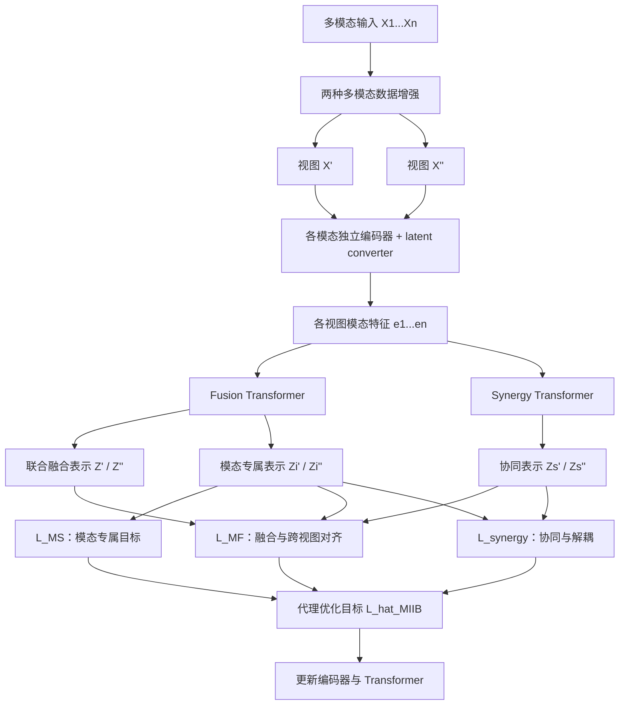

# MIIB：多模态自监督学习中的多模态信息交互瓶颈

*Multimodal Information Interactions Bottleneck for Multimodal Self-Supervised Learning*（[arXiv:2611.07718v1](https://arxiv.org/abs/2611.07718v1)，作者注明已获 IEEE TPAMI 接收）。

## 一句话定义

**MIIB（Multimodal Information Interactions Bottleneck）** 将多模态信息分解中的冗余、独有、协同作为建模目标，通过各模态编码与融合/协同 Transformer 路径及可优化的信息论代理损失，学习适合下游任务的自监督融合表征。

## 英文缩写速查

| 缩写 | 英文全称 | 简要说明 |
|---|---|---|
| MIIB | Multimodal Information Interactions Bottleneck | 本文的多模态自监督学习框架 |
| PID | Partial Information Decomposition | 把目标相关信息划分为冗余、各模态独有与协同 |
| IB / DIB | Information Bottleneck / Deterministic Information Bottleneck | 表征充分性与压缩；本文实现使用确定性代理目标 |
| MF / MS | Modality Fusion / Modality-Specific | 融合与逐模态两类优化项 |
| vMF | von Mises–Fisher | 超球面分布与核函数，用于熵/对齐目标 |
| MSE | Mean Squared Error | Vision&Touch 末端位置回归误差 |
| InterSHAP | Interaction SHAP | 衡量模态交互对预测的相对贡献 |

## 为什么重要

CLIP 一类对齐式学习强调不同模态之间的共享语义，但多模态机器人传感器中，视觉的全局几何、力觉的接触信号和本体感受各自包含无法简单由另一模态替代的信息。MIIB 研究如何在自监督预训练中不只保留共享部分，还学到多模态组合才产生的协同信息。本文与机器人相关的直接证据是 Vision&Touch 接触预测/末端位置预测，**不是** 已部署的闭环机器人策略。

## 核心信息

| 项目 | 内容 |
|---|---|
| 论文 | [arXiv:2611.07718v1](https://arxiv.org/html/2611.07718v1)，2026-11-05 提交 |
| 作者 | Liangjian Wen、Jiangtao Zheng、Jiang Duan、Qun Dai 等，共 11 人 |
| 所属机构 | 西南财经大学、北京 X-Humanoid Research Institute、中国科学院深圳先进技术研究院、四川大学、国防科技大学、复旦大学、上海 AI for Science 研究机构、电子科技大学、Chengdu Everimaging Science and Technology Co., Ltd.（公司中文法定名称未核实） |
| 期刊状态 | 作者在 arXiv 备注 “Accepted for publication in TPAMI”；正式出版 DOI、卷期未核实 |
| 官方代码 | [wanglingzaishi/MIIB](https://github.com/wanglingzaishi/MIIB) — **2026-11-09 仓库公开但为空** |
| 原文核验 | 已读 arXiv v1 正文 §I–VII、表 I–VIII、公式与 Algorithm 1、官方 supplementary Appendix A–C；未独立复现实验 |

## 核心原理

### 从冗余到协同

两模态与任务目标的信息按照 PID 写成：

```text
I(X1, X2; Y) = R + U1 + U2 + S
R：两个模态都可提供的冗余
U1/U2：各模态独有
S：只有联合输入才能恢复的协同
```

传统跨模态对比学习常优先捕获 R；MIIB 用双视图自监督将模态专属表示、联合融合表示与协同表示分别作为训练对象，帮助保留 U 与 S，而不是假设每个模态本身已足够预测全部任务标签。

### 流程总览（对照论文 Fig.2 与 Algorithm 1）



**结构细节：** 论文称双路径架构（模态专属提取与融合）；Fig.2 计算上包含 Fusion Transformer 的「联合 + 逐模态」两种调用，以及独立的 Synergy Transformer 路径。两个增强视图共同提供自监督目标，不能把图误读成有标签的 PID 真值分离器。

### 可优化损失的边界

论文原始目标由模态专属损失、模态融合损失、协同损失相加构成（Eq.10），但确定性编码器的互信息项可能形式上不可解；作者在 Eq.27 中把它们化为超球面表征的熵项、跨视图内积对齐及 cosine hinge 解耦项，使用 vMF 变分上界和基于 Stein 的 score-based 熵梯度估计（补充 Appendix A）。

这更接近**结构化 alignment–uniformity 正则**，不是严格意义的随机信息瓶颈容量约束；协同损失是鼓励捕获 S 的归纳偏置，论文未证明精确恢复理论 PID 原子。

## 工程实践

| 核对维度 | 论文设定或落地注意 |
|---|---|
| 训练骨干 | 模态专属 encoder 与 latent converter，Fusion 与 Synergy Transformer；编码器与增强策略遵循 CoMM 设置 |
| 融合 Transformer | 8 个注意力头；双模态 1 层、三模态 2 层；可学习 CLS token |
| 优化器与时长 | AdamW、100 epochs；普通实验 5 个 seeds（42–46），InterSHAP 15 个 seeds |
| 硬件 | 论文实验使用单块 RTX 4090 24 GB |
| 敏感超参数 | 三类 entropy regularization penalty 与 cosine margin gamma；完整配置见 supplementary Table I |
| 机器人切入点 | Vision&Touch：视觉、力和本体三模态；评测下一步接触分类及末端位姿回归 |
| 复现状态 | 目前无法执行官方 MIIB：GitHub 空仓，不应臆造 pip、训练配置、模型权重或运行结果 |

## 源码运行时序图

**不适用**：截至 2026-11-09，[官方 GitHub 仓库](https://github.com/wanglingzaishi/MIIB) 已创建但没有任何公开文件、训练脚本或模型入口。上面的 Mermaid **只对应论文 Fig.2 与 Algorithm 1 的方法数据流**；不能将 Algorithm 1 当作经源码核实的运行时序。待发布实际实现后，再依据代码入口补 `sequenceDiagram`。

## 实验与评测

| 实验与协议 | MIIB | 对照 | 正确读法 |
|---|---:|---:|---|
| Trifeature 协同信息，线性探测 accuracy | **79.1%** | CoMM 71.4% | +7.7 个百分点 |
| Trifeature 独有信息，线性探测 accuracy | **89.8%** | CoMM 86.8% | +3.0 个百分点；冗余两者同为约 99.9% |
| MultiBench 双模态分类均值，线性探测 | **66.73%** | CoMM 64.45% | 仅分类任务平均；不要混入 MSE |
| Vision&Touch 三模态接触预测 accuracy | **94.2%** | CoMM 94.1% | +0.1 个百分点，不等于真机成功率 |
| MM-IMDb 线性探测 Weighted-F1 / Macro-F1 | **62.80 / 56.20** | CoMM 61.29 / 53.79 | 两者共享预训练 CLIP backbone |
| MM-IMDb 1% 标注微调 Weighted-F1 / Macro-F1 | **63.22 / 56.80** | CoMM 60.68 / 53.66 | 少量监督微调，不是纯无监督预测 |

**消融与统计边界：** UR-FUNNY / MUSTARD 加齐三项损失后达 65.4% / 66.0%（主文 Table VII）；InterSHAP 对 UR-FUNNY、MIMIC 的提升具有 p<0.05，而补充材料对 MOSI、MUSTARD 的差值分别为 -0.53/-0.42，p=0.738/0.687，未显著。不能宣称协同贡献指标在所有数据集都有提升。

**代价：** 主文 Table VIII，MM-IMDb 的模型参数从 CoMM 236.5M 增至 MIIB 243.6M，单 RTX 4090 训练时间从 4.11 h 增至 4.31 h；这只是论文给定实验设置的训练开销对比。

## 结论

**MIIB 的实证价值在于通过专用协同路径与熵/对齐目标改善多模态自监督表征，尤其在协同信息强的基准上；距离可重复的机器人部署尚有明显边界。**

1. 对比“只对齐”模型时单独检查 R、U、S 的任务，而不只看单一平均准确率。
2. 复制 Fig.2 时保留逐模态编码、融合与协同路径，以及两个增强视图的交叉约束。
3. 训练前先对齐 backbone、增强、下游协议和线性探测/微调设置，避免把不同协议的指标放一起。
4. 对接机器人场景可先从 Vision&Touch 接触分类与末端回归入手；不要外推成 VLA 实时控制已验证。
5. 未看到公开源码前，只能依据论文复核方法和数值，不能宣称完整可执行复现。
6. 必须核对 supplemental 的显著性结果；MOSI/MUSTARD 的 InterSHAP 结果不支持“处处更强”。

## 与其他工作对比

- [Dependency, Compression, and Synergy / GMIL](./paper-multimodal-information-theory.md)（arXiv:2609.14421）偏统一信息论表述与方法分类；**MIIB 是不同的、有具体 Transformer 训练目标和基准实验的论文**，尽管作者与 PID 术语有所重叠。
- FactorCL 为共享 + 独有信息拆分提供基线；CoMM 进一步建模多模态交互；MIIB 则增加专门的 Synergy Transformer 与 entropy/align 结构化目标，实验按同编码器协议比较。

## 局限与风险

- 官方仓库当前为空；没有可审核源码、数据预处理细节的独立实现、模型权重及实际执行入口。
- 论文重心是**静态模态与较紧凑 backbone**；视频、复杂时序和大型基础模型整合仍属未来研究。
- 协同约束是归纳偏置而非对 PID 协同项 S 的可证明恢复，不能直接把 cosine 去相关解释为统计独立。
- Vision&Touch 数据来自 Franka Panda peg insertion 的轨迹/任务评测，**不等于本文开展了真机闭环策略部署**；需区分接触分类预测与执行成功率。
- TPAMI 接收信息以作者 arXiv 备注为依据，未验证正式 IEEE 出版书目信息。

## 关联页面

- [Dependency, Compression, and Synergy：前序信息论框架](./paper-multimodal-information-theory.md)
- [多模态基础概念](../concepts/multimodality-basics.md)
- [视触觉融合](../concepts/visuo-tactile-fusion.md)

## 参考来源

- [MIIB 原文及补充材料逐节核验](../../sources/papers/miib_multimodal_information_interactions_bottleneck_arxiv_2611_07718.md)
- [MIIB 官方 GitHub 空仓状态核查](../../sources/repos/miib-wanglingzaishi.md)
- [官方 arXiv HTML 全文](https://arxiv.org/html/2611.07718v1)
- [官方 3 页补充材料](https://arxiv.org/src/2611.07718v1/anc/supplementary.pdf)

## 推荐继续阅读

- [arXiv 官方 PDF（Fig.2 与完整实证表）](https://arxiv.org/pdf/2611.07718v1)
