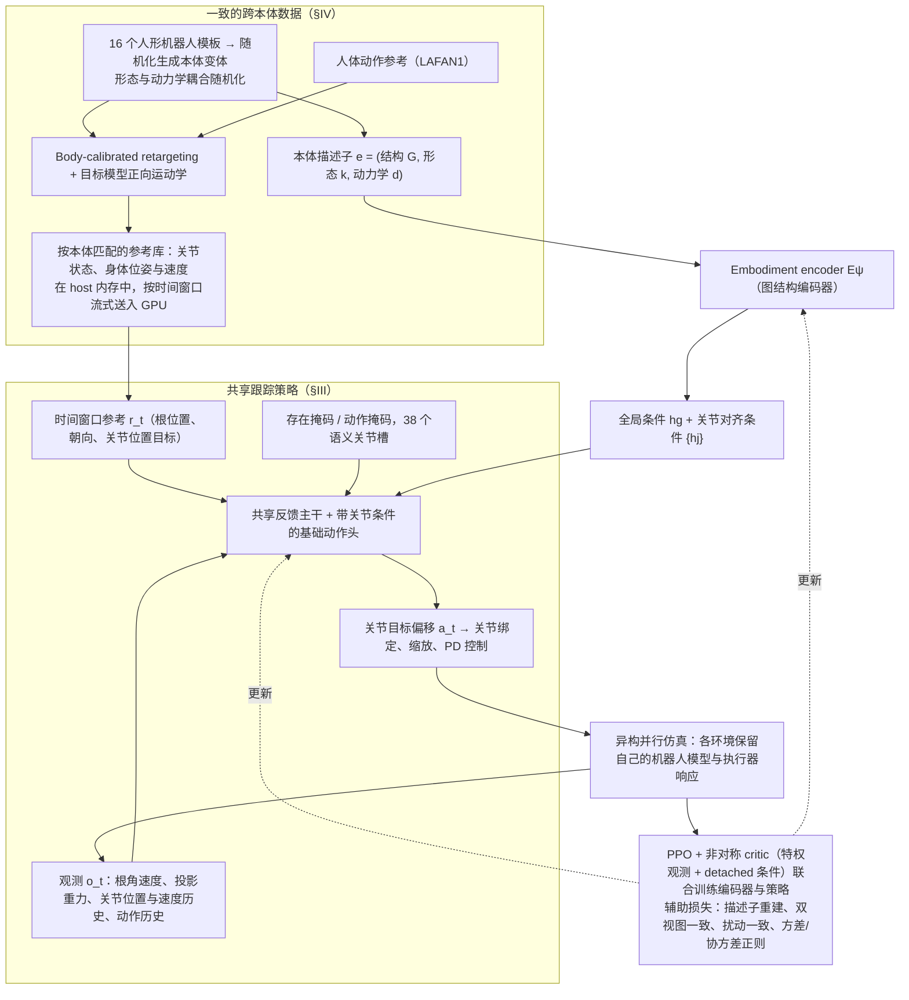

# MimicAll: Structured Embodiment Conditioning for Cross-Humanoid Whole-Body Motion Tracking

**一句话定义：** 将机体结构描述编码为全局和逐关节条件，与观测历史及匹配机体的参考动作一起预测关节目标偏移。

## 流程总览

图依据：论文 §III（含式 1–7）/ §IV / Fig.3 / Fig.4

## 英文缩写速查

| 缩写 | 英文全称 | 简要说明 |
|------|----------|----------|
| RL | Reinforcement Learning | 强化学习 |
| MLP | Multilayer Perceptron | 多层感知机 |
| G1 | Unitree G1 | 论文评测的人形机器人平台 |

## 方法

将机体结构描述编码为全局和逐关节条件，与观测历史及匹配机体的参考动作一起预测关节目标偏移。

## 评测与结果

训练覆盖 16 类人形机器人的 4096 个变体；随机 G1 的 100STYLE 评测中，共享训练 30 秒成功率为 99.4%，单机体专家为 42.9%。

## 结论

这项研究提供了跨本体全身动作跟踪的一个具体方案。

- 复现时先对齐论文任务和评测条件。
- 将方法收益与实际应用条件分开验证。
- 对代码及数据的可用性持续跟踪。

## 与其他工作对比

- **vs 单机体专家：** 随机 G1 的 100STYLE 评测中，共享训练 30 秒成功率 99.4%，单机体专家 42.9%；差异来自把机体结构描述编码为全局与逐关节条件。
- **vs [YAHMP](./paper-yahmp.md)：** YAHMP 是面向 Unitree G1 单一本体的全身动作跟踪消融框架；MimicAll 训练覆盖 16 类人形的 4096 个变体，目标是跨本体泛化。
- **vs [EXE](./paper-exe-cross-embodiment.md)：** EXE 在操作层用共享动作先验 + 具身特有运动学做跨具身迁移；MimicAll 在全身跟踪层以机体条件化实现跨本体。

## 源码运行时序图

不适用：尚未核实可运行的官方实现。

## 局限与开放状态

数值限于论文所述数据集、随机 G1 和评测设置；不能直接推断真机效果。未核实到官方代码入口。

## 关联页面

- [HuGe 人形 VLA](./paper-huge-humanoid-vla.md)
- [RynnVLA-Latent](./paper-rynnvla-latent.md)
- [EXE 跨具身预训练](./paper-exe-cross-embodiment.md)
- [MOTIO 技能工程](./paper-motio.md)

- [相关方法](./paper-yahmp.md)
- [机器人仿真三层结构](../concepts/robot-simulation-three-layers.md)

## 参考来源

- [论文归档](../../sources/papers/mimicall_arxiv_2610_33508.md)
- [arXiv PDF](https://arxiv.org/pdf/2610.33508)：已通读方法部分（实验与附录以略读为准）：§III 结构化本体条件跟踪、§IV 一致的跨本体学习、§V 基准设定、Fig.3/4

## 推荐继续阅读

- [论文原文](https://arxiv.org/abs/2610.33508)
