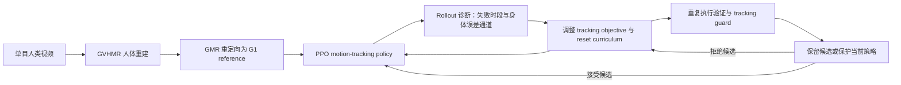
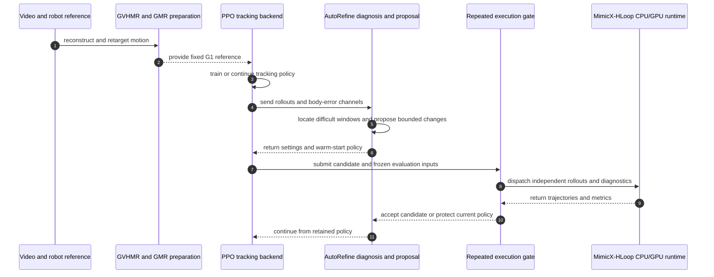

# MimicX（策略在环的视频驱动人形动作跟踪监督精炼）

**MimicX**（*Policy-in-the-Loop Supervision Refinement for Video-Driven Humanoid Motion Tracking*，[arXiv:2610.09055](https://arxiv.org/abs/2610.09055)，[项目页](https://nebulis-lab.com/MimicX)、[官方代码](https://github.com/NEBULIS-Lab/MimicX)）把策略执行失败作为新的监督信号：定位困难时间窗和身体误差，再联合调整跟踪目标与 reset curriculum，训练后通过重复 rollout 验证候选策略是否值得保留。

## 英文缩写速查

| 缩写 | 英文全称 | 简要说明 |
|------|----------|----------|
| PI-LS | Policy-in-the-Loop Supervision | 以策略执行结果反馈改写训练监督的闭环方式 |
| PPO | Proximal Policy Optimization | 继续训练 motion-tracking policy 的强化学习算法 |
| GVHMR | Generalizable Vision-based Human Motion Reconstruction | 从单目视频重建带世界坐标的人体运动 |
| GMR | Generative Motion Retargeting | 将人体运动重定向为机器人参考轨迹 |
| REH | Robust Execution Horizon | 衡量策略在困难动作段可靠执行长度的指标 |
| G1 | Unitree G1 humanoid robot | 论文评测使用的 29-DoF 人形机器人 |
| MjLab | MuJoCo Lab | 论文使用的物理仿真与训练环境之一 |

## 为什么重要

视频能提供大量人类动作目标，但一个看起来合理的参考轨迹，不代表机器人在接触、动力学和身体协调约束下能完成它。若只把参考轨迹当作固定监督，策略在某个转移处持续失败时，增加跟踪权重可能只是让它更用力地追逐当前难以执行的目标。

MimicX 将失败从最终分数转成**监督编辑依据**：先识别何时开始偏离、哪些身体误差突出，再改变跟踪目标和练习起点。改动不是自动接纳；候选策略还要通过重复执行和 tracking guard。这使方法同时处理「如何跟得像」和「能否可靠执行到后面」。

## 核心信息

| 字段 | 内容 |
|------|------|
| 机构 | 香港科技大学（广州）（The Hong Kong University of Science and Technology (Guangzhou)） |
| 作者 | Shuaijun Liu、Chenglong Zhang、Xuhao Liu、Feiyang You、Yifan Liao、Shuyang Hao、Chaozhe Zhang、Chengyu Wu、Zhen Sun、Ningxin Su |
| 平台 | Unitree G1，29 DoF；MuJoCo / MjLab |
| 输入 | 单目人体视频，经 GVHMR 重建、GMR 重定向后得到机器人运动参考 |
| 策略训练 | PPO motion-tracking policy；仿真 200 Hz，策略 50 Hz |
| 核心任务 | 网球挥拍、足球颠球、舞蹈序列、功夫序列 |
| 代码开放 | **已开源** — 官方实现 Apache-2.0；策略与资产分别托管于 Hugging Face |
| 数据限制 | 原始视频、SMPL 家族模型、GVHMR / SONIC 权重及第三方动作数据不随仓库发布，需按上游许可另行准备 |

## 流程总览

视频重建 / 重定向负责给出运动目标；策略 rollout 再决定目标和练习分布是否需要调整。验证阶段用重复执行证据筛选候选，避免单次随机 rollout 决定策略去留。

## 核心原理

### 1. 从执行失败定位监督缺口

策略在当前 reference 上 rollout 后，系统利用时间局部表现和身体误差通道定位难段，而不只记录一个 episode return。于是「整段跟不好」可以拆成「何时开始偏离」和「哪些身体部位贡献误差」，成为生成候选改动的依据。

### 2. 联合修改目标函数与练习起点

AutoRefine 对 tracking objective 和 reset curriculum 提出有界候选：前者调整训练关注的误差项，后者调整策略从哪些参考阶段 / 状态开始练习。训练从当前策略继续，不必每次从头开始。关键是保留每项改动的来源和效果，不能把局部 reward 上升直接当作成功。

### 3. 用重复 rollout 做接受门控

每个候选都重复执行评测，检查完成度、可靠运动长度与跟踪质量；tracking guard 防止候选靠牺牲跟踪精度换取更长存活。不满足门槛时保护已有策略。MimicX-HLoop 将 rollout、CPU 诊断与 I/O 组织成依赖感知工作，减少闭环等待时间；调度方式变化不应改变输入、随机种子、预算和选择规则。

## 源码运行时序图

图中模块按 README 的视频到策略流程、AutoRefine 与 HLoop 组织；实际仿真训练依赖固定的 tracking backend 和外部授权输入。

## 工程实践

| 工程步骤 | 对应实现 / 注意点 |
|----------|------------------|
| 安装与 CPU 测试 | Python 3.11 环境；安装 `.[dev,visualization]` 后运行 `python -m pytest -q`。CPU fixtures 可检查确定性 refinement cycle，不需预训练模型 |
| 准备参考动作 | 用 GVHMR 从视频恢复 SMPL-X 世界坐标动作，再由 GMR 转成机器人 reference；核对上游模型和动作数据许可 |
| 训练跟踪策略 | 在 MuJoCo / MjLab tracking backend 上运行 PPO；仿真 200 Hz，策略 50 Hz |
| 运行监督精炼 | AutoRefine 从当前策略 warm-start，读取 rollout 并提出目标权重和 curriculum 候选 |
| 复核候选 | 固定输入、seed、评测预算与 tracking guard，重复 rollout 后才更新保留策略 |
| 缩短反馈等待 | HLoop 显式调度 GPU rollout、CPU 诊断和 I/O 依赖；并行运行时核对工件与选择结果 |

## 实验与评测读法

| 评测维度 | 报告结果 | 应如何理解 |
|----------|----------|------------|
| 核心对照 | Fixed Reference baseline | 检验执行反馈能否改善固定监督下的策略 |
| 核心视频任务 | Tennis Swing、Football Juggling、Dance Sequence、Kung Fu Sequence | 覆盖挥拍、颠球、舞蹈和高动态动作序列 |
| 任务匹配比较 | 12 个配对比较中 tracking error 与 REH 均改善 | 增益覆盖核心任务配对；不是跨机器人结论 |
| 任务平均误差 | body-tracking error 降低 25.7% | 摘要给出的四任务平均值 |
| 任务平均执行时域 | Robust Execution Horizon 提升 255.6% | 论文指标上的相对提升，不等同于真机续航或所有任务成功率 |
| 附加研究 | 视频、参考运动、碰撞场景及 HLoop 执行研究 | 与核心四任务使用的协议应分开阅读 |

论文消融中 MimicX 的 task-balanced normalized horizon 并非所有配置中最高。因此同时看执行长度、身体误差和 tracking guard，而不是只挑一个指标。

## 与其他工作对比

| 路线 | 监督信号 | 主要关注点 |
|------|----------|------------|
| [SONIC](../methods/sonic-motion-tracking.md) | 规模化参考运动跟踪 | 用多样动作训练可复用的全身运动先验 |
| MimicX | 策略 rollout 反向编辑训练监督 | 针对当前视频参考中的失败段调整目标与 reset curriculum，并验证候选策略 |
| [模仿学习](../methods/imitation-learning.md) | 示范或参考分布 | 更广义的学习范式；MimicX 的策略在环是监督精炼机制 |

两者并非相互替代：SONIC 的重点是规模化参考动作跟踪，MimicX 的重点是用执行失败改写监督；实验基线和系统设定不同，论文数字不可直接横比。

## 结论

**MimicX 的关键贡献是把跟踪策略的物理执行错误转成结构化监督修订，再用重复 rollout 和 tracking guard 控制更新风险。**

1. **先诊断再调参：** 先定位困难时段和误差身体区域，再决定修改跟踪项或 reset 分布。
2. **监督与练习分布一起改：** 只提高跟踪权重可能持续追逐难以执行的参考；reset curriculum 提供改变练习起点的手段。
3. **候选更新必须可被拒绝：** 固定评测输入并重复执行，不让单次高 reward 掩盖跟踪质量退化。
4. **数字要组合解读：** body error 与 REH 同时改善，才支持「既像又能执行」的判断；消融中的归一化 horizon 并非始终最高。
5. **代码开放不等于输入齐全：** 算法实现、策略和资产可获得，但视频及若干上游模型 / 数据仍需按许可取得。

## 局限与风险

- **评测范围有限：** 核心证据来自 G1 29-DoF、MuJoCo / MjLab 和四类视频任务，不能直接推出其他机器人或真机的相同收益。
- **参考依赖外部组件：** GVHMR、GMR、SMPL-X 和动作数据承担视频重建、人体模型与重定向；其误差会传递到训练参考。
- **开源依赖许可：** MimicX 代码为 Apache-2.0，但第三方模型、数据和资产各有条款；官方资产归档说明不会重新分发原始视频、SMPL 家族权重及第三方预训练权重。
- **基线结论须守协议：** 25.7% 与 255.6% 是论文报告的任务均值，不是任意视频的效果承诺。
- **自动精炼需要可审计门槛：** 若输入、种子、预算或 tracking guard 随候选改变，选择结果就难以归因。

## 关联页面

- [SONIC 规模化人形运动跟踪](../methods/sonic-motion-tracking.md)
- [模仿学习](../methods/imitation-learning.md)
- [全身控制](../concepts/whole-body-control.md)
- [GVHMR 人体动作重建](../entities/gvhmr.md)
- [Unitree G1](../entities/unitree-g1.md)

## 推荐继续阅读

- [MimicX 项目页](https://nebulis-lab.com/MimicX)
- [MimicX 官方源码与 Quickstart](https://github.com/NEBULIS-Lab/MimicX)
- [MimicX 方法文档](https://github.com/NEBULIS-Lab/MimicX#documentation)
- [MimicX-Policies](https://huggingface.co/Shuaijun/MimicX-Policies)
- [MimicX-Assets](https://huggingface.co/datasets/Shuaijun/MimicX-Assets)
- [arXiv:2610.09055](https://arxiv.org/abs/2610.09055)

## 参考来源

- [MimicX 论文归档](../../sources/papers/mimicx_arxiv_2610_09055.md)
- [MimicX 项目页归档](../../sources/sites/mimicx-nebulis-lab.md)
- [MimicX 官方代码仓归档](../../sources/repos/mimicx.md)
