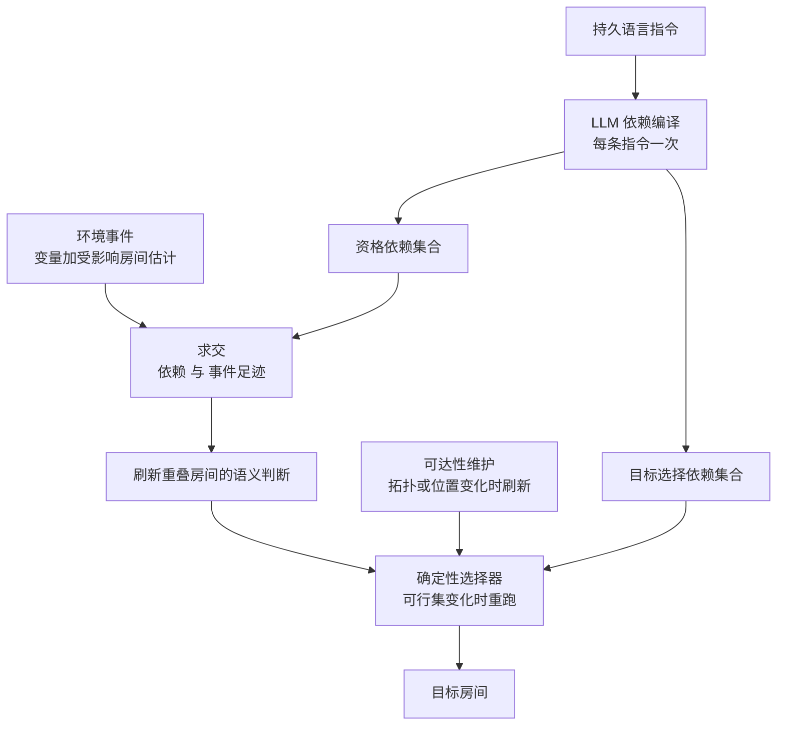

# MIND：只重算受影响房间的指令条件增量语义落地

**MIND 让机器人在执行持久语言指令（如「去一个有某物品的房间」）时，不必每次环境变化后都重新评估所有缓存的房间判断：语言模型一次性把指令编译为依赖变量，事件足迹与之求交，只刷新重叠的房间，可达性与目标选择则单独维护。**

论文 *MIND: Instruction-Conditioned Incremental Grounding for Robots*（[arXiv:2610.19262](https://arxiv.org/abs/2610.19262)，[项目页](https://mind-icra27.github.io/)，[匿名代码仓库](https://anonymous.4open.science/r/mind-icra27)），ICRA 2027 投稿。

## 英文缩写速查

| 缩写 | 英文全称 | 简要说明 |
|------|----------|----------|
| MIND | Instruction-Conditioned Incremental Grounding 的方法名 | 增量维护房间资格判断的控制器 |
| LLM | Large Language Model | 用于编译依赖与充当语义评估器（Phi-4、Qwen3、gpt-oss-120b） |
| OWLv2 | Open-vocabulary object detector v2 | 论文用其从观测推导移除足迹（google/owlv2-large-patch14-ensemble） |
| ProcTHOR | Procedural THOR | 程序化生成房屋的仿真环境，用于 240 条五事件序列评测 |

## 为什么重要

- 语义评估（每次调用语言模型判断房间是否合格）是成本主体；复用未受影响的判断可直接省调用。
- 把「语义是否仍成立」与「是否可达」拆开维护，避免拓扑变化触发昂贵的语义重算。
- 给出可检验的保证：评估器固定、依赖与足迹保守覆盖时，决策与全量重算一致。

## 核心信息

| 项 | 内容 |
|----|------|
| **机构** | Indiana University Bloomington（Abouagour、Min）；Incheon National University（Nam、Jo） |
| **平台** | ProcTHOR 序列；AI2-THOR 闭环；Unitree G1（四区实验室布局） |
| **模型** | 编译器与评估器：Phi-4、Qwen3-8B、Qwen3-14B、gpt-oss-120b；机载 4-bit 判官；足迹检测 OWLv2 |
| **开源** | **匿名评审仓库，内容未核实**（2026-10-17）：[仓库](https://anonymous.4open.science/r/mind-icra27)抓取只返回标题；论文称含代码、生成器、提示词、模型配置，见 [仓库归档](../../sources/repos/mind-icra27.md) |

## 核心原理

### 流程总览

指令只编译一次得到两个依赖集合（语义资格、目标选择），覆盖库存、区域标签、位置、历史、拓扑五类状态；之后每个事件只触发与依赖相交的房间刷新。

- 库存只计入资格集合。
- 保证不覆盖编译器预测或评估器精度。

## 源码运行时序图

**不适用**：官方代码仅为匿名评审仓库，2026-10-17 抓取不到文件树与入口，无法对齐真实模块；公开发布后补充。

## 与其他工作对比

| 维度 | MIND（本文） | [ConceptGraphs](./paper-conceptgraphs-open-vocabulary-3d-scene.md) | [SayPlan](./paper-sayplan-llm-scene-graph-planning.md) |
|------|------|------|------|
| 关注环节 | 指令条件下房间资格判断的增量维护 | 构建开放词汇 3D 对象图 | 在大型场景图上检索任务子图并做 LLM 规划 |
| 输入前提 | 已填充的语义地图 + 受限状态词表 | 观测 + VLM 语义 | 已建好的场景图 |
| 环境变化 | 依赖集合与事件足迹求交，只刷新受影响房间 | 本库页未述 | 本库页未述 |
| 语言模型角色 | 每条指令一次依赖编译 + 语义评估器 | VLM 提供开放词汇语义 | 规划 + 符号约束检查 |

- **相对 ConceptGraphs：** ConceptGraphs 负责把场景建成可查询的开放词汇表示；MIND 假设这类语义地图已存在，只解决「事件后哪些缓存判断需要重算」。
- **相对 SayPlan：** SayPlan 的贡献在把大场景图折叠进 LLM 上下文做规划；MIND 不做规划，贡献是在决策与全量重算一致的前提下减少评估调用（ProcTHOR 30.6 → 11.2）。
- 上位概念见 [具身语义认知地图](../concepts/embodied-semantic-cognitive-map.md)；另两页为索引级摘要，无可横比数字。

## 工程实践

| 项 | 建议 |
|----|------|
| 源码运行时序图 | **不适用**（匿名仓库内容未核实） |
| 接入前提 | 需要已有的语义地图与受限状态词表（论文自述） |
| 足迹策略 | 宁可过估：过估只多评估，欠估会损害正确性 |
| 编译器选择 | Phi-4（K=2）精确签名恢复 0.667、包含率 1.000；gpt-oss-120b 精确恢复 0.935 |
| 成本口径 | 评估器时间约降 2.49x，扣除 0.56 s 编译后每序列净省 0.30 s |

## 实验与评测

- **ProcTHOR（240 条五事件序列，1,200 决策）：** 平均语义评估 30.6 降到 11.2，决策全部保持；Phi-4 与 Qwen3-14B 冻结评估器同样 1,200/1,200。
- **不提升准确率：** 全量重算 episode 准确率仅 0.342（Phi-4）与 0.275（Qwen3-14B），MIND 与其一致而非更高。
- **基线：** 仅库存静态规则准确率 0.479、失效召回 0.703；无编译器的逐事件相关性基线 0.658（13.1 次评估）。
- **AI2-THOR：** 32 个闭环 episode 最终目标与全量重算一致，评估 10.47 对 26.00（2.48x）。
- **足迹：** 观测推导的移除足迹在 54 个留出房屋全部包含受影响房间，单侧 95% 下界 0.946。
- **Unitree G1：** 26 次计分运行、4 场景；场景 1 评估 3 对 9，场景 4 为 4 对 15 至 18（两策略均弃权）。

## 结论

**MIND 是一种省调用的缓存失效策略，而不是提升任务准确率的方法；其价值在评估器贵、事件稀疏的长程指令场景。**

1. **依赖显式化** — 一次编译换来逐事件的精确失效判断。
2. **只省不增** — 决策与全量重算一致，准确率仍由评估器决定。
3. **足迹要保守** — 欠估足迹会产生过期决策（一次 Qwen3-8B 签名漏掉历史，造成 10 个过期决策）。
4. **拆分维护** — 可达性与目标选择独立刷新，减少不必要语义评估。
5. **硬件证据有限** — 单一布局 4 个场景。

## 局限与风险

- 假设语义地图已填充、状态词表受限，依赖标签未独立标注。
- 冻结判决带隔离了维护保真度，未覆盖评估器输出随时间变化的鲁棒性。
- 多候选区域谓词、跨候选基数约束、未来状态预测不在范围内。
- 硬件上一个案例中两种策略都继承了评估器对位置字段的误读。
- 代码仅匿名仓库，评审后可能变动；其内容未核实。

## 关联页面

- [具身语义认知地图](../concepts/embodied-semantic-cognitive-map.md) — MIND 维护的房间级语义状态的上位概念
- [机器人视觉感知栈选型闭环](../queries/robot-perception-stack-selection-loop.md) — MIND 的增量语义状态属「2D→3D 提升与语义建图」层，再交给 LLM 规划消费
- [零样本物体导航](../tasks/zero-shot-object-navigation.md) — 语义目标选择的任务语境
- [AI2-THOR](ai2-thor.md) — 闭环评测仿真器
- [Unitree G1](unitree-g1.md) — 硬件验证平台
- [视觉语言导航](../tasks/vision-language-navigation.md) — 语言指令驱动导航的相关任务

## 参考来源

- [mind-incremental-grounding_arxiv_2610_19262.md](../../sources/papers/mind-incremental-grounding_arxiv_2610_19262.md) — 论文摘录与开源核查
- [mind-icra27-project.md](../../sources/sites/mind-icra27-project.md) — 项目页归档
- [mind-icra27.md](../../sources/repos/mind-icra27.md) — 匿名仓库归档
- [arXiv:2610.19262](https://arxiv.org/abs/2610.19262) — 原文

## 推荐继续阅读

- [MIND 项目页](https://mind-icra27.github.io/)
- [论文 HTML](https://arxiv.org/html/2610.19262v1)
