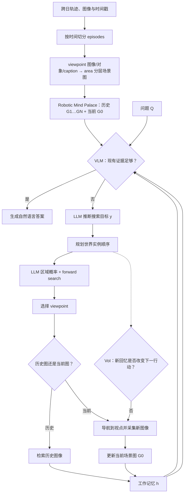
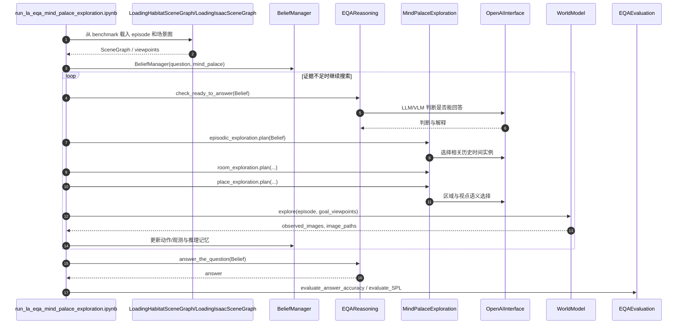

# Enter the Mind Palace：走进记忆宫殿——长期主动具身问答的推理与规划

**论文：** *Enter the Mind Palace: Reasoning and Planning for Long-term Active Embodied Question Answering*（[arXiv:2507.12846v2](https://arxiv.org/abs/2507.12846)，[CoRL 2025 / PMLR 305](https://proceedings.mlr.press/v305/ginting25a.html)）。机构：**Field AI、斯坦福大学（Stanford University）**；方法名称 **Mind Palace Exploration**。项目和 [参考实现 / benchmark](https://github.com/mind-palace-laeqa/benchmark) 均公开。

## 一句话定义

把机器人多日/多月巡检记录组织成可按时间和空间查询的「记忆宫殿」，让智能体在 **检索过去、探索现在、直接回答** 三种行为中循环选择，解决长期主动具身问答（LA-EQA）。

## 英文缩写速查

| 缩写 | 英文全称 | 简要说明 |
|------|----------|----------|
| LA-EQA | Long-term Active Embodied Question Answering | 跨多次历史观测与当前主动探索的具身问答 |
| EQA | Embodied Question Answering | 需借助环境观测回答自然语言问题 |
| VLM | Vision-Language Model | 阅读图像并判断证据是否充分 |
| LLM | Large Language Model | 推断目标、选择时间片与规划搜索 |
| VoI | Value of Information | 判断继续检索历史是否会改变下一步决策 |
| SPL | Success weighted by Path Length | 按路径效率衡量探索效果的指标 |

## 为什么重要

- 传统 episodic EQA 主要回看**单段历史**，active EQA 主要探索**当前场景**；LA-EQA 把跨天记忆与实时补证合起来。
- 长期巡视可能产生数千帧，全部塞入 VLM 上下文不经济；只从相关历史世界实例检索视点能控制图像预算。
- 对找丢失包裹、对比办公区陈设和跨日状态推断等任务，**先查历史再实地找**可以减少实际走动，但历史稀疏时仍需警惕陈旧结论。

## 核心信息

| 项目 | 内容 |
|------|------|
| 作者 | Muhammad Fadhil Ginting 等 13 人 |
| 机构 | Field AI、斯坦福大学（Stanford University） |
| 发表 | CoRL 2025；PMLR 305:5072–5106 |
| 任务 | LA-EQA：历史检索 + 当前探索 + 时序推理 |
| 基准 | 3 仿真（HM3D 两宅 / Isaac 仓库）+ 2 真实场景，共 150 题 |
| 开源 | Python 参考实现、Jupyter 运行入口与题集；场景外链下载 |

## 核心原理

**任务状态：** 论文将 LA-EQA 定义为 (Q, M, E, x0, A*)，其中 M 是多个 episode 的时间-位姿-图像记录，E 是动态当前环境。策略选择 retrieve、explore 或 answer。

1. **建构长期宫殿：** 每个时间 episode 生成一个分层场景图：视点 viewpoint（位姿、图像、物体标签和 caption）归属区域 area；历史图 G1…GN 与当前逐步更新的 G0 共同构成 Mind Palace。
2. **决定查什么：** VLM 根据问题 Q 和工作记忆 h 判断能否回答；不足时 LLM 推断要找的目标对象或空间概念 y。
3. **三层检索/搜索：** 先选历史/当前世界实例，再估计各 area 里出现 y 的概率，用 forward search 选区域顺序，最后在区域内挑 viewpoint。历史视点直接取回图像；当前视点调用导航与新观测。
4. **重规划并回答：** 相关观测进入工作记忆，当前图更新；重复推理与探索，直到可回答或受限于搜索预算。
5. **VoI 提早停止回忆：** 若当前预测集仅有一个目标区域，或额外记忆不会改变下一步区域搜索顺序，停止继续检索旧图，转向现场探索。停止是**决策相关**，不是固定图片数量阈值。

## 流程总览



**关键区别：** 从旧场景图取图无需物理行走；当前场景探索必须付出导航路径成本。论文的 VoI 门限用于减少无收益的过去记忆调用。

## 源码运行时序图

官方 [benchmark 仓库](https://github.com/mind-palace-laeqa/benchmark) 的可运行入口是 ```scripts/run_la_eqa_mind_palace_exploration.ipynb```，下图根据 notebook 的显式调用以及 ```src/contextual_long_term_reasoning/``` 核验（展示离线 benchmark 参考实现，**不是**真机导航/ROS 部署时序）。



复现按 README 配 Conda 环境并执行 notebook：```test_one_question = True``` 只跑一题，改为 False 才会遍历题集；需配置 ```OPENAI_API_KEY``` 和下载场景资产。对应函数与边界见 [源码归档](../../sources/repos/mind-palace-laeqa-benchmark.md)。

## 工程实践

| 问题 | 做法 / 选型含义 |
|------|----------------|
| 记忆索引 | 保留 episode 时间键、图像原始位置、区域聚类与物体/文本索引；不要只保存连续摘要 |
| 时序推理 | 区分单次过去 / 多次过去 / 过去-现在 / 过去-现在-未来问题，显式选择需要的时间段 |
| 规划代价 | 历史检索为常量近似成本；当前探索以区域之间实际路径为成本，不能把两者等价处理 |
| 推理资源 | LLM/VLM 请求和外部 API 是系统耗时与费用因素；优先记录检索图像数、导航长度及准确率三项 |
| 机器人对接 | 演示 notebook 的 WorldModel 离线取图不等于开源真机导航服务；实机需另外集成定位、地图、运动规划与安全控制 |
| 评估设置 | 参考公开题集 / 场景文件与 GPT-4o 评判协议，区分原论文指标与本地可复现数字 |

## 实验与评测

论文 Table 1（同 GPT-4o 设置与预算；**论文报告值，未复跑**）：

| 方法 | 回答正确率 | 探索效率 | 平均历史检索图像数 |
|------|-----------:|---------:|-------------------:|
| Mind Palace | **65.0%** | **0.45** | **22.86** |
| Mind Palace + early stopping | 61.8% | 0.42 | **15.73** |
| Multi-Frame VLM | 52.9% | — | 100 |
| ReMEmbR | 46.1% | — | 0 |
| Active EQA w/ Frames | 43.7% | 0.29 | 100 |

- 五场景：Habitat HM3D 家庭 ×2、Isaac 仓库、办公室及高层工地，**每场景 30 题**、总 150 题，覆盖五类时间依赖。
- 真实办公室超过 1,000 平米 / 27 区域；腿式机器人读取 10 段历史巡检，针对 7 道需主动探索的问题，论文报告平均少搜 3–10 间房。
- **不要误读：** 65.0%→61.8% 是提前停止后的精度下降；22.86→15.73 是图像检索下降，不能宣称早停在所有指标上无损。

## 结论

**长期 EQA 的关键不是把历史照片全放进上下文，而是以时空场景图索引历史，让回忆与现场导航共同服务下一步信息获取。**

1. **优先保留跨 episode 的时间索引**：仅当前地图或单次轨迹不足以回答多日变化问题。
2. **历史检索与现场搜索使用不同成本模型**：区域规划要同时看可能找到目标的概率与到达成本。
3. **衡量信息效率而非单看正确率**：强制检索预算相同时，Mind Palace 的 22.86 张历史图像对应 65.0% 正确率；早停仅 15.73 张但正确率降至 61.8%。
4. **部署需要完整低层栈**：开源 Python notebook 证明参考算法可研究，不代表真机现场轨迹与导航已经封装。
5. **历史缺失就是证据缺失**：巡检没看见人不等于位置一直空闲，应为不确定性保留主动补证路径。

## 与其他工作对比

| 方法/任务 | 记忆范围 | 具身动作 | 主要侧重 |
|----------|----------|----------|----------|
| 单 episode EQA / ReMEmbR | 一段历史或检索库 | 主要历史回答 | 已有观测的回顾式推理 |
| 传统 active EQA | 当下现场 | 主动找视角 | 当前场景采集 |
| **Mind Palace（本文）** | **多次跨天/跨月场景图** | **历史检索与当前导航交替** | 跨时间推理 + 信息收益驱动探索 |
| [HUMEMBR](./paper-humembr.md) | 多日人物身份与例行 | 工具检索 + Spot 找人 | 人中心 ReID 与行为模式预测 |

## 局限与风险

- **巡检覆盖不足**：某办公桌在取样时看似无人，并不能证明几天都无人使用，论文 §8 有误判实例。
- **VLM 空间/语义错误**：物体计数、功能属性与跨区域可见性会影响可靠性，不能用检索层掩盖感知错误。
- **人为数据构建**：长周期场景变化与问题仍依赖人工设计，150 题难直接外推至任意工业环境。
- **实现范围**：仓库已开源参考算法与 benchmark；未核实公开完整的实景腿式机器人低层控制、ROS 驱动和现场 6 个月采集管线。
- **本次未实测**：未下载多 GB 数据、未调用付费视觉 API、未进行机器人真机或重新跑 150 题。

## 关联页面

- [HUMEMBR：人物例行记忆与预测式导航](./paper-humembr.md) — 与本文的对象/场景记忆互补
- [视觉–语言导航](../tasks/vision-language-navigation.md) — 语言空间接地与导航任务边界
- [机器人自主探索](../tasks/autonomous-exploration.md) — 为回答问题主动选择视角
- [3D 空间 VQA](../concepts/3d-spatial-vqa.md) — 场景表示与空间问答
- [导航纵深路线](../../roadmap/depth-navigation.md) — Stage 5 主动感知与长期记忆挂载

## 参考来源

- [CoRL 2025 论文原文归档](../../sources/papers/mind_palace_la_eqa_arxiv_2507_12846.md)
- [项目主页来源归档](../../sources/sites/mind-palace-laeqa.md)
- [官方代码与 benchmark 归档](../../sources/repos/mind-palace-laeqa-benchmark.md)

## 推荐继续阅读

- [PMLR 正式全文](https://proceedings.mlr.press/v305/ginting25a.html)
- [arXiv v2 HTML 含附录](https://arxiv.org/html/2507.12846v2)
- [官方论文项目与演示](https://mind-palace-laeqa.github.io/)
- [LA-EQA Benchmark 与参考实现](https://github.com/mind-palace-laeqa/benchmark)
