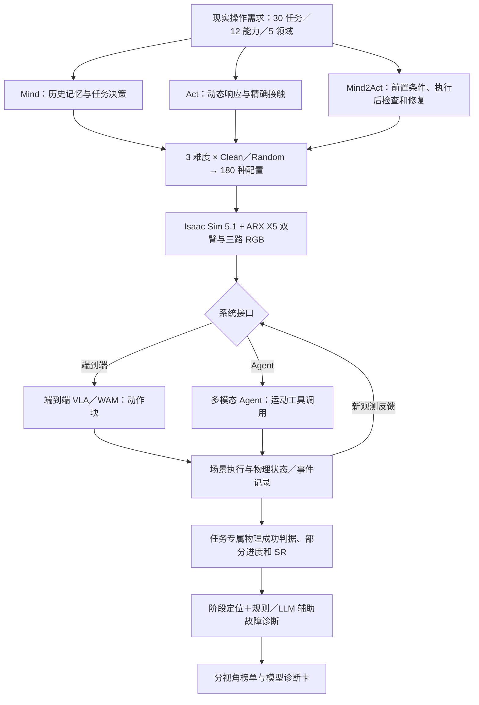
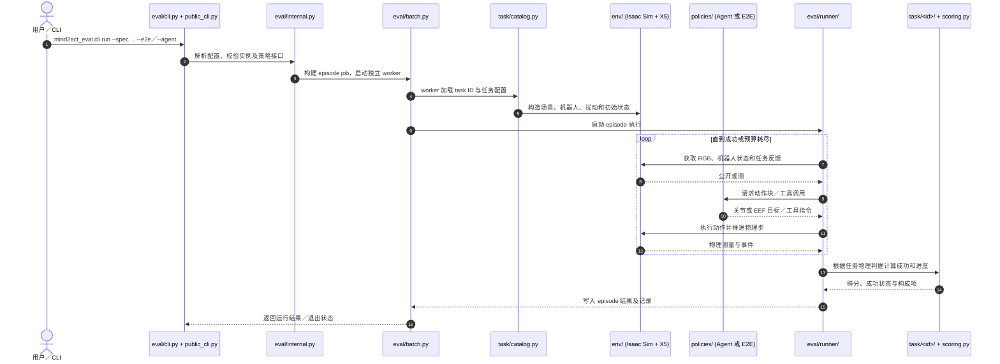

# Mind2Act World: A Diagnostic Benchmark for Embodied Mind, Physical Action, and Mind-Action Composition in Robotic Manipulation｜Mind2Act World：具身认知、物理动作与认知–动作组合能力诊断基准

## 一句话定义

**Mind2Act World** 是一套面向机器人操作的**能力解耦与组合诊断基准**：分别测试基于历史信息决策（Mind）、准确及时的物理执行（Act），以及**执行后验证环境反馈并修正下一步决策**（Mind2Act），而不只给模型一个终局成功率。

## 英文缩写速查

| 缩写 | 英文全称 | 简要说明 |
|---|---|---|
| VLA | Vision-Language-Action | 接收视觉、语言与机器人状态，直接生成操作动作的策略 |
| WAM | World-Action Model | 世界建模与动作生成耦合的端到端模型族 |
| SR | Success Rate | 真实完成任务判据的 episode 比例，不等于部分进度得分 |
| RGB | Red, Green, Blue | 头部与两腕三路彩色摄像头输入 |
| EEF | End Effector | 机器人末端执行器，Agent 可对其提交目标位姿 |

## 为什么重要

一个系统可能记得食材顺序，却无法维持锅具接触；也可能能完成熟悉的抓取，却忘记上一步是否成功。将这些能力混在单一任务成功率里，难以判断该改模型记忆、动作控制，还是执行–验证–修复的接口。Mind2Act World 为 **Agent、VLA、WAM** 提供物理结果评测和分层失败归因，特别强调单项能力强不代表能完成多步组合任务。

## 核心信息

| 项 | 核验结论 |
|---|---|
| 论文 | [arXiv:2611.26444v1，2026-11-19](https://arxiv.org/abs/2611.26444) |
| 项目 / 榜单 | [项目](https://mind2act-world.com/) · [Leaderboard](https://mind2act-world.com/leaderboard.html) |
| 模型诊断 | [Diagnosis / Model Profile Cards](https://mind2act-world.com/diagnosis.html) |
| Benchmark 代码 | [Mind2Act/Mind2Act_World](https://github.com/Mind2Act/Mind2Act_World) |
| 训练示范 | [mind2act-train](https://huggingface.co/datasets/Mind2Act-World/mind2act-train) |
| 任务组成 | 30 项任务（Mind / Act / Mind2Act 各 10）· 12 能力类别 · 5 应用领域 |
| 测试配置 | 3 难度 × Clean/Random 双设置：共 180 组 |
| 仿真平台 | Isaac Sim 5.1 / ARX X5 双机械臂、平行夹爪、三路 RGB |
| 样本 | 4,500 条专家示范（75.8 小时），9 个对照系统共 56,700 次评测 episode |
| 机构 | 清华大学深圳国际研究生院等跨机构合作团队 |

## 核心机制：从拆分到闭环组合

1. **Mind（10 任务）**：把物理执行设计得较简单，重点考核实体身份、过程顺序、空间位置、通过试错学习规则与综合记忆。例如短时出现的物品信息必须在后续阶段正确调用。
2. **Act（10 任务）**：任务目标明确，重点考核动态响应和精细物理执行。包括输送带抓取、限时按钮、阻值/电压调节、笔迹跟踪、布料折叠、印章与多米诺。
3. **Mind2Act（10 任务）**：后一步依赖上一步**真实物理结果**，必须持续判断前置条件是否成立、是否需要修正/重试。例如烹饪需确认食材放入并根据温度切换加热状态；桥梁搭建需验证结构稳固后再放车。
4. **难度与扰动**：同一任务目标以 Easy/Medium/Hard 逐步增加记忆、时序、精度或多步依赖；Clean/Random 改变视觉和干扰条件。
5. **判分**：由模拟物理测量、任务事件和最终状态判定成功；任务得分 0–100，可有部分进度，但必须达成完整物理谓词才算成功。综合得分采用 **25% Mind + 25% Act + 50% Mind2Act**，与全部 episode 的 **SR** 是两种不同指标。

## 流程总览

图依据：论文 §3–§4、§6；箭头描述基准的测试和诊断数据流，不代表被测模型都采用相同内部架构。

## 源码运行时序图

阅读官方 `README.md`、`docs/source-layout.md` 及 `eval/cli.py`、`eval/batch.py`、`eval/runner/__init__.py`、`eval/scoring.py` 后得到的**实际评测运行入口与模块职责**：

**可复现入口：** `"$ISAAC_PYTHON" -m mind2act_eval.cli run --spec "$SPEC" --asset-root "$ASSET_ROOT" --e2e --gpu "$GPU"`；Agent 使用 `--agent`，另需工具运行时、运动规划服务和模型服务。源码调用关系见 [运行入口核读](../../sources/repos/mind2act-world.md)。**本次只核对源码，未实际启动 Isaac Sim 运行评测。**

## 工程实践

1. **先锁定 release 与资产**：使用官方 [dev assets snapshot](https://huggingface.co/datasets/Mind2Act-World/mind2act-dev-assets/tree/main)，将 `release-v1.0.0/RELEASE.json` 的 `official_code_commit` 与源码一致，并校验归档 SHA256；使用 Linux、NVIDIA GPU、Isaac Sim 5.1 所附 Python 3.11。
2. **接口按赛道区分**：VLA/WAM 通过 XPolicyLab 的策略 adapter 输出关节或末端动作块；Agent 通过 `m2a_agent` 使用 `move_eef`、`wait_steps`、`memory_resolve` 和 `give_up`。
3. **预算必须原样记录**：端到端任务时长按专家演示 90 分位乘 1.2，Agent 为四倍物理预算并限制 150 次决策；重试、模型服务和规划器也是系统边界的一部分。
4. **结果表至少保留**：task ID、难度、Clean/Random、系统类型、官方 commit、物理判据、成功率、部分得分、停止原因、任务阶段事件、墙钟成本、模型推理延迟与日志。**单次失败要先找首个阻断点**，再选补数据、状态记忆或接触控制。
5. **训练数据**：官方公开 `mind2act-train`；但成功轨迹占主导，不含充足“操作失败→判断→修复”示例，应独立记录该数据覆盖缺口。

## 实验与评测

论文 §5 / 表 4 给出的代表性结果：

| 系统 | 赛道 | Mind SR | Act SR | Mind2Act SR |
|---|---|---:|---:|---:|
| GPT-6 Astra | Agent | 52.7% | 39.0% | **12.0%** |
| InternW0 | WAM / 端到端 | 以原文表 4 为准 | 以原文表 4 为准 | **3.03%** |

- 三个 Agent、四个 VLA、两个 WAM，共 9 个系统。Agent 每个 900 次 episode，端到端系统每个 9,000 次；对照使用相同任务定义与物理判据，但预算和适配链不同。
- **12% vs 3.03% 不能直接作为架构优劣排名**：Agent 可使用规划工具、更多物理步并在推理时暂停仿真；作者分别设置榜单。
- **时效性差距**：论文表 6 中 Agent 每次调用平均 11.0–35.6 秒，端到端策略每次动作预测约 77.1–488.1 毫秒；仿真内限时成功不可解释为真机实时反应成功。
- 模型诊断卡针对三个具有代表性系统，基于阶段事件记录、规则和 LLM judge 总结失败类型；它是系统改进线索而非受控因果实验。

## 结论

**Mind 或 Act 单项能力的提高不能自动解决多步骤任务中的“执行结果是否达标、下一步是否应继续”这一闭环组合问题。**

1. 用三视角报告替代单一总体成功率；尤其单列 Mind2Act 完整成功率。
2. 将成功率与任务部分得分、任务级预算和实时延迟分开汇报。
3. 对每次失败标注首次阻断阶段，区分历史记忆错、抓取接触错与前置条件验证/修复错。
4. 用成功/失败后修复的示教补足仅包含成功轨迹的数据，针对具体中断阶段增采。
5. 对 Agent 与端到端模型分别比较，避免“工具与四倍预算”造成的跨榜误读。
6. 发布前补做真机延迟与接触验证；模拟器暂停推理不能提供实时性证据。

## 与其他工作对比

| 基准 | 核心评估侧重点 | 本文的不同之处 |
|---|---|---|
| [LIBERO](./libero-benchmark.md) | 操作任务家族与策略迁移成功率 | Mind2Act 明确拆分认知、执行和二者组合，并按步骤诊断 |
| [ManiLadder](./paper-maniladder-manipulation-benchmark.md) | 任务难度分层与覆盖能力 | Mind2Act 重点在失败属于哪种能力和闭环组合瓶颈 |
| [RoboDojo](./robodojo.md) | 仿真与真机统一操作策略评测 | Mind2Act 当前是单仿真双臂平台的诊断协议，不提供真机验证结论 |
| [RoboChallenge Zero](./paper-robochallenge-zero.md) | 变化任务下真机零样本执行泛化 | Mind2Act 可微调策略且主要在固定仿真协议上做任务级诊断 |

## 局限与风险

- **未验证真机迁移**：仅 Isaac Sim 桌面双臂平台，无法据此证明灵巧手、移动操作、人形全身或生产工厂中的可靠性。
- **仿真推理暂停**：计时任务的模拟时限不含模型推理等待；Agent 的工具规划能力受固定 harness 影响。
- **统计与覆盖有限**：只评估 9 个系统，部分能力类只有少量任务，固定英语指令；论文模型排名是 v1 样本结论，线上榜单可能新增结果。
- **诊断不等于因果归因**：规则和 LLM judge 能提示失败环节，但不足以孤立辨识模型内部模块的真实根因。
- **开源边界**：Benchmark 源码和训练示范已开放；需要另下载匹配资产与服务。官方 README 标记 Mini World、独立 Agent 外部提交榜单仍待发布，提交说明也未完全公布。本次没有实际运行回归测试。

## 关联页面

- [具身模型测评纵深路线 Stage 3](../../roadmap/depth-embodied-eval.md) — 任务结果、过程事件和跨赛道解释
- [具身评测基准选型闭环](../overview/hub-embodied-eval-benchmark.md) — 认知到物理执行的分层验收
- [机器人操作任务](../tasks/manipulation.md) — 接触、精细操作与连续工作流
- [VLA](../methods/vla.md) — 端到端动作策略
- [RoboDojo](./robodojo.md) — 仿真/真机物理评测对照
- [ManiLadder](./paper-maniladder-manipulation-benchmark.md) — 操作任务难度阶梯
- [仿真与真机评测差距](../concepts/sim-vs-real-eval-gap.md) — 不可直接外推的边界

## 参考来源

- [论文全文核读（§1–8、附录 A–F）](../../sources/papers/mind2act-world-arxiv-2611-26444.md)
- [官方项目页、排行榜、数据与发布状态核验](../../sources/sites/mind2act-world.md)
- [Benchmark 源码、官方运行入口及复现边界](../../sources/repos/mind2act-world.md)

## 推荐继续阅读

- [论文 HTML 全文](https://arxiv.org/html/2611.26444) — §3 任务体系、§4 评测协议、§5 数据、§6 诊断、§7 局限
- [完整任务卡](https://mind2act-world.com/benchmark.html) · [实时排行榜](https://mind2act-world.com/leaderboard.html)
- [模型诊断卡](https://mind2act-world.com/diagnosis.html) · [官方代码](https://github.com/Mind2Act/Mind2Act_World) · [训练数据](https://huggingface.co/datasets/Mind2Act-World/mind2act-train)
