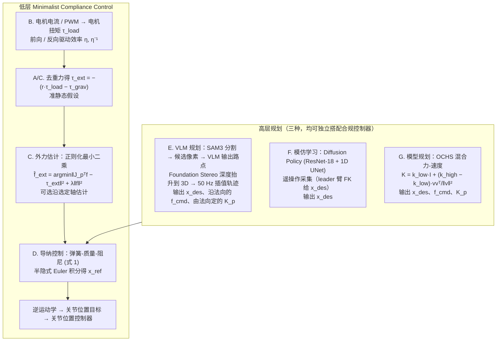

# Minimalist Compliance Control（arXiv:2603.00913）

**Minimalist Compliance Control**（Haochen Shi, Songbo Hu, Yifan Hou, Weizhuo Wang, C. Karen Liu, Shuran Song；Stanford University；[arXiv:2603.00913](https://arxiv.org/abs/2603.00913)，[项目页](https://minimalist-compliance-control.github.io/)）— 不用力传感器、不用学习：用现成电机电流/电压与雅可比估计外力，驱动任务空间导纳控制，即插即用接到任意高层策略后。

## 一句话定义

不用力传感器、不用学习：用现成电机电流/电压与雅可比估计外力，驱动任务空间导纳控制，即插即用接到任意高层策略后。

## 英文缩写速查

| 缩写 | 英文全称 | 简要说明 |
|------|----------|----------|
| MCC | Minimalist Compliance Control | 本文柔顺控制器 |
| F/T | Force/Torque | 传统六维力传感（本文免） |
| VLM | Vision-Language Model | 高层轨迹生成示例 |
| WBC | Whole-Body Control | 人形全身执行层 |

## 为什么重要

柔顺控制长期被昂贵 F/T 传感器和 RL sim2real 门槛挡住；MCC 用电机自带信号降低部署成本。

## 流程总览

图依据：论文 §III（III-A 弹簧–质量–阻尼、III-B 电机扭矩估计、III-C 外力估计、III-D 导纳控制 + IK、III-E/F/G 三种高层规划；Fig. 2）

## 核心原理（方法）

电机扭矩模型 + 雅可比映射估计外力矩 → 弹簧–质量–阻尼导纳更新位姿参考；与 VLM/扩散/模型基策略正交。

## 实验与评测

机械臂、LEAP 灵巧手、两台人形：擦白板、画图、煎蛋、球体旋转等；相对 RL 柔顺基线更稳跟踪且力更合理。

## 结论

MCC 是「小脑层」柔顺模块：不替代策略学习，但让接触任务在廉价硬件上可部署、可监管接触力。

- 无需 F/T 传感器与额外学习
- 跨机械臂/灵巧手/人形验证
- 可叠 VLM、模仿学习或 OCHS 模型基策略
- 估计精度足够支撑稳定导纳
- 未建模加速度/Coriolis 等是已知权衡

## 源码运行时序图

**不适用**（截至 2026-08-18：无统一公开可运行代码仓库，或本文为综述/控制器论文以项目页演示为主）。

## 局限与风险

项目页未开源代码；电流标定与电机模型误差影响估计；未覆盖极端冲击负载。

## 与其他工作对比

相对 UniFP/FACET 等 RL 力控，解析可解释、无 sim2real；相对显式 F/T，硬件成本低。

## 关联页面

- [paper-umi-ft](./paper-umi-ft.md)
- [paper-prism](./paper-prism.md)
- [manipulation](../tasks/manipulation.md)
- [REALab 14 篇技术地图](../overview/realab-14-papers-technology-map-2026.md)

## 参考来源

- [minimalist_compliance_arxiv_2603_00913.md](../../sources/papers/minimalist_compliance_arxiv_2603_00913.md)
- [wechat_shenlan_realab_14_papers_2026.md](../../sources/blogs/wechat_shenlan_realab_14_papers_2026.md)
- [arXiv PDF](https://arxiv.org/pdf/2603.00913)：已通读方法部分（实验与附录以略读为准）：摘要、§I 引言、§III 方法（A–G）；§IV 实验略读

## 推荐继续阅读

- 论文：<https://arxiv.org/abs/2603.00913>
- 项目页：<https://minimalist-compliance-control.github.io/>
