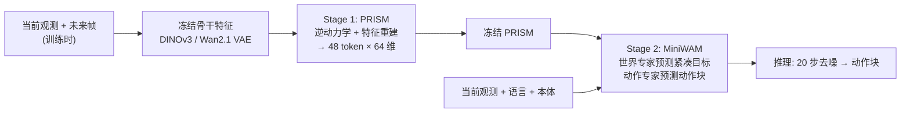

# MiniWAM：用紧凑未来目标做高效世界–动作建模

## 一句话定义

**MiniWAM** 先用 **PRISM**（逆向时空建模的预测表示）把「当前→未来」的冻结视觉特征压成每相机仅 3×4×4×64 的紧凑潜变量，再冻结 PRISM，让一个 0.25B 的双专家 Transformer 联合预测这些紧凑未来目标与动作，从而绕开对原生 DINOv3 / Wan2.1-VAE 特征的昂贵预测。

## 英文缩写速查

| 缩写 | 英文全称 | 简要说明 |
|------|----------|----------|
| WAM | World-Action Model | 联合预测未来状态与动作的策略 |
| PRISM | Predictive Representations via Inverse Spatiotemporal Modeling | 本文紧凑未来表示编码器 |
| MoT | Mixture-of-Transformers | 世界专家与动作专家 12 层并行结构 |
| VAE | Variational Autoencoder | 此处指 Wan2.1 VAE 潜变量（两种原生特征之一） |
| DINOv3 | Self-distillation with no labels v3 | 另一种原生视觉特征骨干（ViT-B/16） |
| KL | Kullback–Leibler divergence | PRISM 瓶颈的正则项（β=1e-6） |
| SR | Success Rate | 基准成功率 |

## 为什么重要

- **指出 WAM 的算力浪费点：** 预测原生视觉特征把训练预算花在与控制无关的细节上；紧凑目标在受控对比中还更准（DINOv3：LIBERO-Plus-2K 74.1 对 60.9）。
- **小模型可竞争：** 约 247.5M 策略参数，不用视频生成骨干、也无具身预训练，在 LIBERO 97.2 与 6B 级 Fast-WAM（95.8）、DreamWAM（96.9）同量级。
- **数字要读准：** 「65×」是未来特征网格位置数（3136/48），Transformer token 只少 16.3×；「8×」是 RoboTwin、horizon 32、VAE 特征下含 Stage 1 的总加速 8.46×。

## 核心信息

| 项 | 内容 |
|----|------|
| **机构** | 新加坡国立大学（NUS）；南洋理工大学（NTU）；新加坡科技研究局（A*STAR，据项目页） |
| **规模** | 约 247.5M 策略参数（冻结的视觉与文本编码器不计） |
| **评测** | 仅仿真：LIBERO、LIBERO-Plus、RoboTwin 2.0；无真机 |
| **开源** | 截至 2026-10-12 未发布；项目页写 "Coming soon before Nov 2026" |

## 核心原理

### 方法栈

| 模块 | 设计 |
|------|------|
| 冻结特征 | Wan2.1 VAE（224×224，当前 + 16 帧未来）或 DINOv3 ViT-B/16（17×196×768，降到 64 维） |
| PRISM 编码器 | 3D 卷积（卷积–GroupNorm–SiLU），网格 (5,28,28) 或 (5,14,14) → (3,4,4)，D_L=64；对角高斯瓶颈，Stage 2 用均值作目标 |
| Stage-1 损失 | λ_a·流匹配动作损失（逆动力学）+ 特征重建 MSE（λ_rec=1）+ β·KL（β=1e-6） |
| MiniWAM | 12 层 MoT，世界与动作 DiT 各宽 768 / FFN 3072 / 12 头；动作 flow matching；语言与本体感觉走 cross-attention |
| 推理 | 20 步去噪；LIBERO 每 10 步重规划、块长 16；RoboTwin 每 24 步、块长 24 |

### 流程总览

## 方法

1. **为何用逆动力学监督。** 单纯重建会保留外观；逆动力学让紧凑潜变量必须足以解释「从当前到未来需要什么动作」。Stage-1 消融（DINOv3，LIBERO-Plus-2K）：仅重建 69.5、仅逆动力学 70.5、两者 74.1，在三种瓶颈大小下增益稳定约 4.5 点。
2. **瓶颈大小要够。** 4×4(D=64) 74.1 → 2×2 67.8 → 1×1(D=16) 61.7；48 个 token 是在效率与精度间取的点。
3. **两阶段而非联合。** 先学目标，再训策略；Stage 1 中动作可读潜变量、反向不行，Stage 2 世界–动作双向注意力。
4. **训练配置。** LIBERO：Stage 1 15 epoch（16,260 次更新），Stage 2 50 epoch（54,200 次）；RoboTwin 为 6 / 25 epoch；AdamW、峰值学习率 5e-4、余弦调度、全局 batch 256、BF16。
5. **表示分析。** LIBERO-90 未见任务上，PRISM 使跨骨干 CKA 由 0.372/0.249 升至 0.795/0.705，留一任务 Jaccard@5 由 0.170/0.107 升至 0.512/0.333，动作 RMSE 由 0.400/0.370 降至 0.365/0.272（主视角/腕部）。

## 实验与评测

- **主表（成功率）：** MiniWAM(0.25B) LIBERO **97.2**、LIBERO-Plus **73.6**、RoboTwin 2.0 **46.1**。对照 π0.5(3.3B) 96.4 / 85.7 / 58.4；π0(3.3B) 93.5 / 70.5 / 31.4；OpenVLA-OFT(7B) 96.6 / 71.4 / –；Fast-WAM(6B) 95.8 / 71.0 / 39.9；DreamWAM(6B) 96.9 / 75.4 / –；Xiaomi-Robotics-0(4.7B) 98.7 / – / 40.5。结论：LIBERO 持平或略高，LIBERO-Plus 与 RoboTwin 仍落后 π0.5 约 12 与 12 点。
- **受控对比（LIBERO / LIBERO-Plus-2K）：** VAE：无共训 62.3/25.1 → 原生共训 92.8/50.2 → PRISM 94.8/56.5；DINOv3：89.0/56.5 → 93.2/60.9 → PRISM 97.2/74.1。
- **训练吞吐（单卡 RTX PRO 6000，batch 256）：** RoboTwin、VAE、horizon 32：原生 7.79 → PRISM 81.66 样本/秒（Stage 2 10.48×；含 Stage 1 总 8.46×）；LIBERO horizon 16 总加速约 3.05–3.55×；含数据管线后 PRISM 仍保留核心吞吐的 96.9–99.2%。
- **目标尺寸：** 每相机原生 token 784 → 48；目标标量 VAE 50,176 / DINOv3 2,408,448 → 3,072。
- **注意：** RoboTwin 数字是 clean 训练赛道；主表 LIBERO-Plus 是否用全集原文未明确。

## 源码运行时序图

**不适用**：截至 2026-10-12 项目页尚无代码仓库（"Coming soon before Nov 2026"），无法对齐真实脚本；上方流程图为论文的训练流程，而非仓库入口。

## 工程实践

| 项 | 建议 |
|----|------|
| 复现 | 暂无官方代码；论文给出较完整的超参（PRISM 通道/步长、β、λ、学习率、更新次数），可据此自实现 |
| 设计取舍 | 若想省训练算力，优先压缩「预测目标」而非扩大骨干 |
| 使用边界 | PRISM 需按下游设置单独训练；跨任务共享编码器是作者的未来工作 |
| 加速读法 | 总加速随 horizon 增大而提高（horizon 32 约 8×，horizon 16 约 3–4×）；多相机（RoboTwin）受益更大 |
| 开源核查（2026-10-12） | 项目页无 GitHub / HF 链接；声明 2026 年 11 月前发布代码、配置、检查点、评测脚本 |

## 结论

**对 WAM 而言，「预测什么」比「用多大的模型预测」更关键：把未来目标压成带动作语义的紧凑表示，既更快也更准，但在扰动鲁棒性与复杂双臂任务上仍落后大型 VLA。**

1. **逆动力学 + 重建联合监督** — 比单项各高约 4.5 点（4×4 瓶颈）。
2. **别把 65× 当成速度比** — 位置数 65.3×，Transformer token 16.3×，总训练加速最高 8.46×、LIBERO 约 3–7×。
3. **小模型可打平大 WAM** — 0.25B 的 LIBERO 97.2 与 6B 级相当，但 LIBERO-Plus 73.6 低于 π0.5 的 85.7。
4. **瓶颈不要太小** — 1×1 (D=16) 掉到 61.7。
5. **需要等代码** — 当前只有论文，超参描述可作自实现参考；无真机证据。

## 与其他工作对比

| 对照 | 差异读法 |
|------|----------|
| [Fast-WAM](./paper-fast-wam.md) | Fast-WAM 在推理期跳过未来视频去噪（6B）；MiniWAM 从训练目标压缩入手（0.25B），LIBERO 97.2 对 95.8 |
| [π0.5](./paper-pi05-open-world-vla.md) | 大型 VLA 基线，LIBERO-Plus 85.7、RoboTwin 58.4 均高于 MiniWAM |
| [World Action Models 概念](../concepts/world-action-models.md) | 多数 WAM 预测像素/VAE/DINO 特征；MiniWAM 预测学习得到的紧凑目标 |
| [LIBERO 基准](./libero-benchmark.md) / [RoboTwin](./robotwin.md) | 本文评测基准 |

## 局限与风险

- **论文自述：** PRISM 按下游设置单独学习；PRISM 在 Stage 2 冻结；表示分析为单检查点单种子；RoboTwin 对比赛道与其他方法不尽一致；无真机，作者声明仿真性能不等于真实可靠性。
- **开源状态：** 截至 2026-10-12 未发布。
- **数字解释风险：** 「65×」「8×」均有限定条件，见上文。

## 关联页面

- [Manipulation 周报汇总（2026-10-05~10-09）](../overview/frontier-manipulation-2026-10-05-10-09.md)
- [World Action Models 概念](../concepts/world-action-models.md)
- [生成式世界模型](../methods/generative-world-models.md)
- [Fast-WAM](./paper-fast-wam.md)
- [LIBERO 基准](./libero-benchmark.md)
- [RoboTwin](./robotwin.md)

## 参考来源

- [miniwam_arxiv_2610_12194.md](../../sources/papers/miniwam_arxiv_2610_12194.md) — 论文摘录
- [miniwam.md](../../sources/sites/miniwam.md) — 项目页与开源核查
- [Manipulation 周报来源](../../sources/blogs/frontier_manipulation_2026_10_05_10_09.md) — 线索来源（技术事实以论文为准）
- [arXiv:2610.12194](https://arxiv.org/abs/2610.12194)

## 推荐继续阅读

- [MiniWAM 项目页](https://j1dan.github.io/MiniWAM)
- [DINOv3 论文](https://arxiv.org/abs/2508.10104)
- [LIBERO-Plus](https://arxiv.org/abs/2510.13626)
