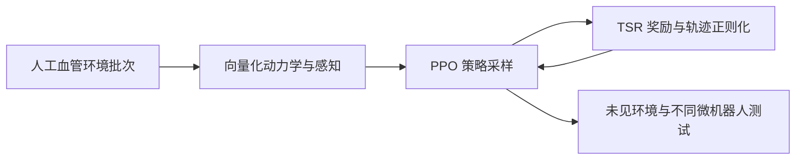
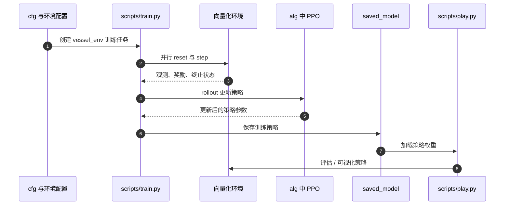

# Minute-scale training for microrobot navigation

**Minute-scale training for microrobot navigation**（Yinghan Sun 等，*Nature Machine Intelligence*，2026-09-28，DOI: 10.1038/s42256-026-01305-w；arXiv:2608.00854）提出一套面向磁驱微型机器人导航的快速深度强化学习训练框架：用完全向量化的血管环境并行仿真提升采样吞吐，再用 task-shaping-regularization（TSR）奖励改善稀疏任务反馈下的学习效率和轨迹质量。

## 一句话定义

把微型机器人连续导航的仿真采样、奖励塑形与迁移验证组织成快速训练闭环，使策略在数分钟级训练后可跨机器人形态和未见导航环境测试。

## 英文缩写速查

| 缩写 | 英文全称 | 简要说明 |
|------|----------|----------|
| DRL | Deep Reinforcement Learning | 通过环境交互学习导航策略的深度强化学习 |
| TSR | Task-Shaping-Regularization | 结合任务、进度塑形与平滑/安全正则项的奖励框架 |
| PPO | Proximal Policy Optimization | 论文采用的策略优化算法 |
| sim-to-real | Simulation to Real | 将仿真训练策略迁移到实物机器人 |

## 为什么重要

- **缩短实验迭代：** 论文报告训练时间低于 10 分钟，降低了微型机器人导航策略调参与重复实验的时间成本。
- **仿真效率和奖励设计同时处理：** 快速 rollout 解决“样本产生慢”，TSR 通过任务进度反馈和轨迹正则化解决单靠成功/失败信号学习效率低的问题。
- **验证了跨形态迁移：** 论文展示策略在两种微机器人形态以及多个未见场景中的零样本导航；这支持了框架对不同运动能力机器人的适应性，但不等于对任意形态均可直接部署。

## 流程总览

训练阶段在大批量并行环境内生成状态转移，由 PPO 更新导航策略；TSR 奖励把目标进度变成更稠密的训练信号，同时鼓励平滑且远离障碍的运动。论文再将训练策略用于不同微机器人和未见环境，考察不经任务专项微调的迁移表现。

## 核心机制

### 1. 大规模向量化仿真

仿真器批量处理微机器人动力学、受 LiDAR 启发的虚拟感知与可行性检查。论文摘要报告超过 **10,000 个**人工血管环境、约 **190,000 transitions/s**；高吞吐让 PPO rollout 和策略参数搜索可以在分钟级实验周期内完成。

### 2. TSR 奖励

TSR 将训练信号拆成三个互补作用：

- **Task：** 任务目标的成功/失败反馈，直接定义导航任务。
- **Shaping：** 根据到目标的逐步进展提供较稠密的反馈，帮助策略穿越长而弯曲的通道。
- **Regularization：** 惩罚过度变化的动作并奖励安全间隙，抑制抖动和贴障轨迹。

论文摘要报告，TSR 让动作变化至少减少 **33.7%**，障碍物间隙至少增加 **2.1%**，并加快收敛。比较时需以论文各实验场景和指标定义为准，百分比不是对所有微机器人任务的普遍保证。

### 3. 真实机器人与跨场景测试

论文使用磁驱的表面滚动微机器人和螺旋微机器人进行验证。测试包括人工血管网络、带圆柱和立方体障碍的三维场景，以及狭窄、弯曲的脑动脉仿体通道。三维实验中，平面导航策略使用俯视反馈，螺旋机器人高度由独立控制器处理；因此应把它读作分层的 3D 验证，而非单一策略端到端控制全部自由度。

## 工程实践

| 项 | 内容 |
|----|------|
| **源码状态** | 已开源，官方仓库 [`yinghansun/mr-nav`](../../sources/repos/yinghansun-mr-nav.md)，BSD-3-Clause |
| **训练入口** | `python ./scripts/train.py --env vessel_env --num_run 1 --num_epoch 500` |
| **训练硬件** | README 建议至少 8 GB GPU 显存，并称 RTX 3060 上约 8–10 分钟；论文摘要报告 under 10 minutes |
| **部署边界** | 实验验证覆盖论文所示磁驱微机器人、场景和观测配置；不能据此假定不同控制接口、成像系统或全 3D 动力学也可免适配迁移 |
| **源码运行时序图** | 见下图 |

仓库 README 给出的主路径是 `scripts/train.py` 训练并保存策略，再由 `scripts/play.py` 加载模型评估或可视化。它提供了实现入口；具体复现实验还需按论文配置准备环境数据和运行依赖。

## 评测与结果

| 指标 / 验证 | 论文报告 |
|-------------|----------|
| 仿真规模与采样 | 超过 10,000 个人工血管环境；约 190,000 transitions/s |
| 训练耗时 | 低于 10 分钟 |
| 动作变化 | TSR 至少降低 33.7% |
| 障碍物间隙 | TSR 至少增加 2.1% |
| 零样本迁移 | 不同微机器人形态及未见血管环境中的导航测试 |
| 实物验证 | 人工血管网络、3D 障碍环境、脑动脉仿体通道 |

## 与其他工作对比

| 对照路线 | 与本工作的差异 |
|----------|----------------|
| 常规微型机器人导航 DRL 训练 | 论文指出既有训练往往需数小时至数天；本工作把主要提速归因于向量化血管环境仿真，并用 TSR 缓解稀疏奖励下的收敛问题 |
| [基于模型的强化学习](../methods/model-based-rl.md) | 通过学习动力学模型提高样本效率；本工作不显式学习模型，而是用高吞吐仿真直接为无模型 PPO 提供大量 transitions |
| [动态窗口法（DWA）](../methods/dwa.md) 等规划式局部导航 | 在线依赖显式运动模型与代价函数搜索速度指令；本工作把避障与平滑偏好写进 TSR 奖励，由训练后的策略直接输出动作 |

以上为方法路线层面的定性对比：论文报告的 33.7% / 2.1% 是 TSR 在其评测场景中的改进幅度，不是与 DWA 或基于模型 RL 的直接数值比较。

## 结论

**这项工作的主要贡献是把微型机器人导航 RL 的训练实验周期压到分钟级，同时以 TSR 约束轨迹平滑性和障碍间隙，并通过实物跨形态测试展示迁移潜力。**

- 做效率对照时，先统一并行环境数、硬件和 transitions 计数口径；采样吞吐不等于真实机器人运行速度。
- 采用 TSR 时，需按任务重新定义目标进度、障碍代价与正则权重；论文中的 33.7% 和 2.1% 是其评测场景结果。
- 零样本迁移证据适用于论文展示的微机器人和观测/控制配置，迁移到新机构时仍要核对形态、执行器和反馈差异。
- 3D 实验包含分开的平面策略和高度控制环节；不能把全部 3D 自主控制归因于单个平面策略。
- 官方代码可用于复现训练与评估流程；训练前要准备仓库要求的数据和 PyTorch / GPU 依赖。

## 关联页面

- [强化学习](../methods/reinforcement-learning.md)：PPO rollout、奖励设计与仿真采样效率。
- [基于模型的强化学习](../methods/model-based-rl.md)：与显式学习动力学模型的路线对照。
- [动态窗口法（DWA）](../methods/dwa.md)：传统局部导航规划方法，可作为规划式导航背景。

## 参考来源

- [论文来源归档](../../sources/papers/minute_scale_microrobot_navigation_arxiv_2608_00854.md)
- [官方源码归档](../../sources/repos/yinghansun-mr-nav.md)
- [Nature Machine Intelligence 正式论文](https://www.nature.com/articles/s42256-026-01305-w)
- [arXiv:2608.00854](https://arxiv.org/abs/2608.00854)

## 推荐继续阅读

- [官方 mr-nav 代码仓库](https://github.com/yinghansun/mr-nav)
- [Nature Machine Intelligence 正式论文](https://doi.org/10.1038/s42256-026-01305-w)
