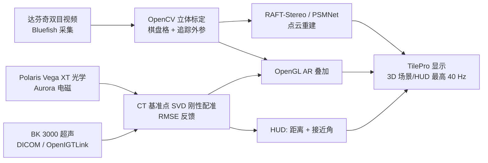

# MIRAGE：达芬奇控制台里的统一手术导航与可视化框架

**MIRAGE**（*Multimodal Image-based Robotic Assistance and Guidance Environment*，[arXiv:2610.12780](https://arxiv.org/abs/2610.12780)，Dartmouth Thayer School of Engineering，Halter Lab，[项目页](https://sites.google.com/dartmouth.edu/halter-lab/resources/mirage)）是一个把多种成像与追踪流同步后显示在达芬奇外科医生控制台内的软件框架，论文将其定位为临床前技术验证平台。

## 一句话定义

**一个时间同步的手术导航中间层：采集达芬奇双目内窥镜视频，与光学/电磁追踪、CT 配准和术中超声融合，并经 TilePro 显示 AR 叠加、点云与带距离/角度的导航 HUD。**

## 英文缩写速查

| 缩写 | 英文全称 | 简要说明 |
|------|----------|----------|
| MIRAGE | Multimodal Image-based Robotic Assistance and Guidance Environment | 本文框架 |
| AR | Augmented Reality | 视频上叠加术前模型/导航信息 |
| HUD | Heads-Up Display | 显示工具到目标距离与接近角 |
| TRE | Target Registration Error | 目标配准误差（文中定义，未报数值） |
| EM | Electromagnetic tracking | Aurora 电磁追踪 |
| RMSE | Root Mean Square Error | 基准点配准与重投影的误差度量 |

## 为什么重要

- 机器人手术里术中多模态信息分散，医生需移开视线；在控制台内统一显示是实用方向。
- 论文把「标定精度」与「端到端目标精度」分开作为评测终点，并覆盖 S/Si/Xi/SP 四代平台，工程可比性较强。
- 诚实标明为 IDEAL 0–1/早期 2a 阶段，避免把模体结果当临床获益。

## 方法栈 / 流程总览

## 方法

- **软件结构：** C++ 后端负责视频 I/O、渲染、追踪接口和标定管线；Python 前端负责 GUI、配准、导航与重建；pybind11 的 OverlayEngine 绑定提供带时间戳帧缓冲、互斥保护状态与工作线程，声称尽可能零拷贝。
- **同步：** 所有流使用单调主机时钟，追踪位姿插值到视频时间戳（位置线性、旋转 SLERP）。
- **配准：** CT 基准点与探针采样点的最小二乘 SVD 刚性拟合并显示 RMSE；实时导航线程组合工具位姿与 CT 配准、平滑并投影回 SO(3)。
- **标定与重建：** OpenCV 立体标定，外参 SE(3) 扭量参数化；视差用 RAFT-Stereo（默认，更快）或 PSMNet，经 Q 矩阵反投影并滤波后在 VTK 中与半透明 CT 网格同显。
- **超声：** 有界队列丢最旧帧以保低延迟；ROI、标记点 CSV、marching cubes 伪体积；探针追踪时 US→CT 由 CT→光学、光学→探针、探针→US 三段变换相乘。
- **HUD：** 按归一化距离-角度得分选目标，其余变暗。

## 源码运行时序图

不适用：论文声明完整实现含专有硬件接口，未公开代码，也没有公开仓库（项目页核查见 [mirage-halter-lab.md](../../sources/sites/mirage-halter-lab.md)），无法对齐真实目录与脚本。

## 实验与评测

模体实验，平台 da Vinci S/Si/Xi/SP，咽喉、肾脏、手术与含毛细管杆模体，工作距离 100/300/500 mm（Xi、SP）：

- **标定与误差：** 物理误差 0.1/0.3/0.6 mm，像素误差 2/2.5/2.5 px；Xi 上优化使 2D 误差 4.3→2.5 px、3D 误差 3.0→0.6 mm。标定重投影 RMSE 约 S 6 px、Xi 2 px（正文数字，与表 5 的 2.5 px 略有出入）。
- **数字不一致：** 摘要写平均 3D 重投影误差 0.6 mm，但表 2 三档平均约 0.33 mm，0.6 mm 只对应 500 mm；以表内数字为准。
- **基准点配准 RMSE（均值±SD）：** S/Si 1.2±0.20 mm，Xi 0.9±0.20 mm，SP 0.9±0.20 mm；TRE 数值未报告。
- **AR 叠加误差（100 mm）：** S 6.0、Si 3.0、Xi 2.5、SP 2.5 px。
- **立体重建（mm，PSMNet / RAFT-Stereo）：** 腹主动脉 2.63/2.17，下腔静脉 2.30/1.79，右肾 2.15/2.25，右输尿管 2.43/2.13；单对推理约 0.60 s / 0.20 s。
- **时序：** 叠加配对帧延迟 16.7 ms（60 FPS，追踪 400 Hz）；HUD 与超声追踪 40 Hz。端到端延迟与超声精度原文未报告数值。
- 对比：论文与既有系统做了功能表对比（声称唯一同时具备实时追踪、立体重建、AR、时间同步和多平台），不是数值基准对比。

## 工程实践

| 项 | 内容 |
|----|------|
| 硬件 | Kronos K8 SDI 卡 + RTX 6000 Ada GPU，Bluefish 采集 |
| 工作流 | 术前棋盘格标定通常 1–2 分钟；基准点配准通常 30 秒内收敛 |
| 开源状态 | **未开源**：项目页无下载；实现含专有硬件接口；另有两项美国临时专利申请 |
| 复现路径 | 依赖论文的数学形式、伪代码、配置模式与设备无关评测协议，换硬件自行实现 |
| 源码运行时序图 | 不适用（无公开代码） |

## 结论

**MIRAGE 是一篇系统集成与模体评测论文：价值在于时间同步的多模态控制台显示和跨四代达芬奇平台的量化，而不是新的配准或重建算法，也没有临床证据。**

1. 引用其精度时要区分标定误差（0.1–0.6 mm）与配准 RMSE（0.9–1.2 mm）与重建误差（约 1.8–2.6 mm）。
2. 摘要 0.6 mm 均值与表内不一致，转述时用分距离的表值。
3. 想自建同类系统，可借鉴单调时钟 + 位姿插值、有界队列丢旧帧的低延迟做法。
4. 立体重建默认选 RAFT-Stereo（约 0.20 s/对，三个结构上更准）。
5. 未报告 TRE、端到端延迟与超声精度，临床相关结论需等后续工作。
6. 代码不公开，不要预期可直接部署。

## 局限与风险

- 仅模体，没有活体或临床验证，不能推断临床获益；人因与学习曲线未评估。
- 多数组件是成熟方法，贡献在集成与绑定；SP 平台实验最少。
- 关键终点（TRE、端到端延迟、超声精度）缺数值；摘要与表内数字不一致。
- 实现不公开，且涉及专利；复现门槛高。
- 软组织形变、配准不准、算力和硬件成本是论文引用文献中的持续问题。

## 与其他工作对比

| 对照 | 差异读法 |
|------|----------|
| [DASH 达芬奇适配器](./paper-dash-da-vinci-adapter.md) | 偏向把外部控制接入达芬奇；MIRAGE 偏向视觉导航显示 |
| [Cosmos-Surg-dVRK](./paper-sa-2510-16240-cosmos-surg-dvrk-world-foundation-model-based-au.md) | 世界模型生成式仿真；MIRAGE 是真实多模态感知融合 |
| [人形外科医生活体腹腔镜](./paper-humanoid-surgeon-in-vivo-laparoscopy.md) | 自主操作方向；MIRAGE 是人在回路的辅助可视化 |

## 关联页面

- [34 篇具身论文空间落地技术地图](../overview/embodied-station-34-papers-spatial-grounding-technology-map.md)
- [DASH 达芬奇适配器](./paper-dash-da-vinci-adapter.md)
- [人形外科医生活体腹腔镜](./paper-humanoid-surgeon-in-vivo-laparoscopy.md)
- [Cosmos-Surg-dVRK](./paper-sa-2510-16240-cosmos-surg-dvrk-world-foundation-model-based-au.md)

## 参考来源

- [微信盘点来源](../../sources/blogs/wechat_embodied_station_34_papers_spatial_grounding_2026-10-12.md)
- [mirage_arxiv_2610_12780.md](../../sources/papers/mirage_arxiv_2610_12780.md)
- [mirage-halter-lab.md](../../sources/sites/mirage-halter-lab.md)
- [arXiv:2610.12780](https://arxiv.org/abs/2610.12780)

## 推荐继续阅读

- [MIRAGE 项目页](https://sites.google.com/dartmouth.edu/halter-lab/resources/mirage)
- [arXiv HTML 全文](https://arxiv.org/html/2610.12780v1)
- [RAFT-Stereo 论文](https://arxiv.org/abs/2109.07547)
