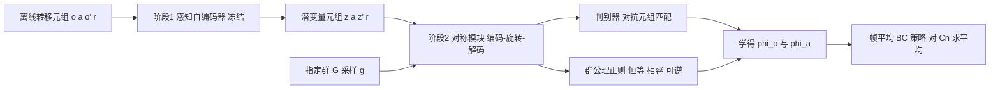

# MIRROR：从离线机器人交互数据中学出隐藏对称性（arXiv:2610.17422）

**MIRROR**（*MIRROR: Reflecting Hidden Symmetries from Offline Robot Interaction Data*，Liu, Yao, Huang, Xu, Zhao，[arXiv:2610.17422](https://arxiv.org/abs/2610.17422)，项目页 [pomdp-mirror.github.io](https://pomdp-mirror.github.io)）。本页来自 Glen Berseth 的 CoRL 2026 阅读清单（P2，Imitation Learning & Data Quality 组）；清单排序是作者自己兴趣模型的打分，不是论文质量评价。

## 一句话定义

**已知对称群 G 时，从离线单步转移元组 (o, a, o', r) 学出 G 同时作用于图像观测与机器人动作的非线性耦合变换，并用群公理正则约束，再用于帧平均行为克隆。**（论文摘要与第 1、4 节）

## 英文缩写速查

| 缩写 | 英文全称 | 简要说明 |
|------|----------|----------|
| POMDP | Partially Observable Markov Decision Process | 部分可观测马尔可夫决策过程，论文形式化的设定 |
| BC | Behavior Cloning | 行为克隆，监督式模仿 |
| EBC | Equivariant Behavior Cloning | 论文实验中对帧平均 BC 变体的命名前缀，如 EBC-MIRROR |
| SO(2) | Special Orthogonal group in 2D | 平面旋转群，全部实验使用的群 |
| Cn | Cyclic group of order n | SO(2) 的循环子群，帧平均所用，n 取 2/4/8/16 |
| GAN | Generative Adversarial Network | 生成对抗网络，基线 SymGAN、LaLiGAN 的基础 |
| LaLiGAN | （论文未给全称）| 基线：先前的潜空间对称发现方法（Yang et al. [11]），正则恒等公理 |
| ExSym | Extrapolated Symmetry | 手工设计的像素旋转加动作旋转对称，作基线 |
| SAM 2 | Segment Anything Model 2 | 真机实验中生成目标分割掩码 |

## 为什么重要

- **作者自述的动机（第 1 节）：** 对称性能提升样本效率与泛化，但现有方法假设观测与动作如何一起变换是已知的；图像观测下该假设难满足，点云或各种已知变换的投影表示需要按传感器与任务定制预处理。
- **我的判断：** 它把问题从"手写每种观测模态的变换"换成"指定群，其余从数据学"，对想在不同视觉模态间复用等变策略的人有参考价值；但证据规模较小（见局限）。

## 核心原理与流程总览

输入是离线转移元组数据集 D。阶段 1 在 D 的观测上预训练感知自编码器（卷积球面自编码器，潜变量 z 在 S^15 上，128x128 输入，附录 C.1）后冻结。阶段 2 训练观测对称模块 (E_z, D_z) 与动作对称模块 (E_a, D_a)：把 z 与 a 编码到带固定块对角旋转表示的对称潜空间（观测 du=64，动作 dv=16，附录 C.2），对同一采样的群元素 g 旋转后解码，奖励保持不变。谱归一化判别器区分原始与变换后的潜变量元组（式 1）。

- **损失（式 1–3）：** 对抗项 L_adv，加 L_id、L_comp、L_inv 与非平凡惩罚 L_nt（防止所有变换退化为恒等，沿用 LaLiGAN）。附录 C.4 给出权重 λ_adv=λ_id=λ_comp=λ_inv=1.0，λ_nt=0.1。
- **为何单独正则相容性（第 5.2 节、附录 A.2）：** 相容加恒等能推出可逆，相容加可逆能推出恒等，而恒等加可逆推不出相容（论文给出 ϕ(R_θ,x)=x+sin θ 反例）。这是精确约束上的逻辑关系，论文明确说不意味着训练中几个惩罚可互换。
- **帧平均策略（附录 E.1、式 20）：** π(o) = 对 g∈H 平均 ϕ_a(g⁻¹, f(ϕ_o(g,o)))，f 为预训练 ResNet-18 加两层 MLP。论文指出：学出的非线性 ϕ_a 不保证精确群公理，也不保证对平均的可交换条件，故精确等变保证不适用，只用下游成功率评估。

## 工程实践

- **数据（第 5 节、附录 B.4）：** 每任务 100,000 训练 + 10,000 评估元组；行为策略是按任务路标点做比例位姿控制的有限状态机。动作为 [-1,1] 归一化末端指令（4 或 5 维，附录 B.2）；奖励为 4 或 6 维向量，供判别器使用（附录 B.3）。
- **训练（附录 C.3–C.4，Table 5）：** 阶段 1 与阶段 2 各 100,000 次梯度更新，阶段 2 批大小 4096，学习率 1e-4；判别器与对称模块一比一交替更新；群元素角度 θ ~ N(0, π²) 取模 2π；3 个种子。
- **评估指标（附录 B.5）：** 对称不变误差用特征空间上的 Wasserstein-2 距离（ResNet-18 特征做地面代价）；恒等、相容、可逆误差在特征距离下度量。相容误差在 16x16=256 个角度对上平均。
- **真机（第 6 节、附录 F）：** 7 自由度 Kinova GEN3 加 Robotiq 2F85，RealSense D435 固定相机，观测改为高度图（裁剪到桌面上 0.3 m）加 SAM 2 目标掩码；在仿真中对该模态重新做对称发现与 BC 训练，零样本部署。真机结果为 13/20、19/20、9/20、16/20（Drawer Opening / Drawer Closing / Cube Dropping / Hammer Lifting，Table 12）。
- **代码：** 未在论文中找到仓库地址，仅有项目页。

## 与清单说法的核对

清单原话（作者说明为 LLM 据摘要起草）：「Discovers how symmetry groups act on pixel observations and actions from offline data, for symmetry-aware policy learning.」

| 清单措辞 | 论文核对 |
|----------|----------|
| discovers how symmetry groups act | 基本准确，但要点是**群 G 必须事先指定**（第 8 节限制 1），MIRROR 学的是该群如何作用，不是发现有哪些群。 |
| on pixel observations and actions | RGB 主实验成立（第 5 节，固定相机 128x128，附录 C.1）；真机用的是深度导出的高度图加分割掩码（第 6 节），不是原始像素。 |
| from offline data | 成立：由有限状态机控制器采集的离线转移元组（附录 B.4）。 |
| for symmetry-aware policy learning | 成立但幅度有限：帧平均 BC 平均成功率 80.48% 到 85.12%（第 5.3 节，Table 2），Drawer Opening 仅 71.4 到 71.7；这是仿真结果，真机无普通 BC 对照（Table 12）。 |
| （清单未提） | 手工 ExSym 与 GAN 发现的基线在帧平均下平均成功率均低于普通 BC（第 5.3 节），说明收益依赖变换质量。 |

结论：清单一句话没有错，但略去了两点关键限定，即群需预先指定，以及增益是仿真内、小幅度、3 个种子的。

## 局限

**论文自述（第 8 节）：**
- 需事先指定群 G。
- 只能恢复数据中已有的对称性；若数据缺乏沿对称方向的变化（如场景朝向固定），判别器无可匹配对象，变换可能塌缩为恒等。

**论文文本中可见的其他限定：**
- 学出的变换不保证精确群公理，帧平均的精确等变保证不适用（附录 E.1）；"decoded transformations need not be geometric rotations"（图 4 题注）。
- 恒等误差并非最低：LaLiGAN 0.296 低于 MIRROR 0.317（Table 1），所以"四项指标三项最低"。
- 去掉 L_adv 时恒等误差反而最低（0.156），说明单一指标不足以说明变换质量。

**我看到的未验证之处（推测与判断）：**
- 只测 SO(2) 一个群、四个自定义 Robosuite 任务、固定相机，未见更复杂群（如 SE(3)）或多视角、真实数据采集的离线数据。
- 训练数据由有限状态机收集，示范分布较窄；论文未检验对噪声或多样示范数据的稳健性。
- Table 2 的标准差不小（平均 85.1 ± 8.1，BC 80.5 ± 7.0），平均增益 4.64 个百分点相对任务间波动不大；Drawer Closing 仿真 RGB 与高度图设置下普通 BC 与 EBC 差距很小或更优（Table 11 中 BC 0.9159 高于各 EBC）。
- 真机 Cube Dropping 仅 9/20，且没有真机普通 BC 或其他对称基线，真机部分只能说明可部署，不能说明对称带来增益。
- 帧平均需对 n 个变换各做一次前向，C16 即 16 倍推理量（附录 E.4 自述）。

## 关联页面

- [行为克隆（Behavior Cloning）](../methods/behavior-cloning.md)：帧平均策略的基础
- [模仿学习（Imitation Learning）](../methods/imitation-learning.md)
- [Sim2Real](../concepts/sim2real.md)：本文的零样本真机部署
- [域随机化（Domain Randomization）](../concepts/domain-randomization.md)：另一条提升迁移的路线，可对照
- [分布外泛化（OOD Generalization）](../concepts/out-of-distribution-generalization.md)：对称性作为泛化归纳偏置的背景

## 参考来源

- [mirror-symmetry-discovery_arxiv_2610_17422.md](../../sources/papers/mirror-symmetry-discovery_arxiv_2610_17422.md)
- [arXiv:2610.17422](https://arxiv.org/abs/2610.17422)
- [项目页](https://pomdp-mirror.github.io)
- 清单来源：Glen Berseth，My CoRL 2026 Reading List（fracturedplane.com，2026-11-10）

## 继续阅读

- [arXiv PDF](https://arxiv.org/pdf/2610.17422v1)
- 论文引用的前置工作：LaLiGAN（Yang et al. [11]）、SO(2)-equivariant RL（Wang et al. [1]）、Frame Averaging（[23]）
- [行为克隆](../methods/behavior-cloning.md)
