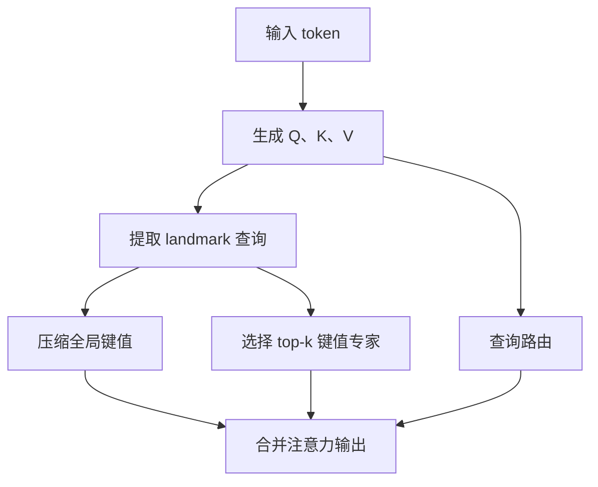
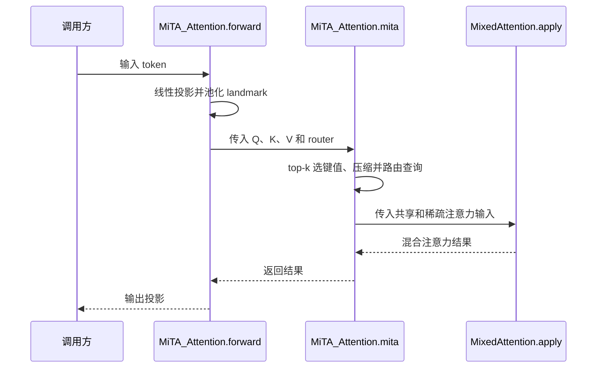

# Mixture-of-Top-k Attention: Efficient Attention via Scalable Fast Weights / MiTA：通过可扩展快权重实现高效注意力

MiTA 将注意力解释为输入依赖的快权重网络，结合共享压缩与稀疏路由；由北京邮电大学提出，论文与官方仓库标注 NeurIPS 2026。

## 英文缩写速查

| 缩写 | 英文全称 | 简要说明 |
|------|----------|----------|
| MiTA | Mixture-of-Top-k Attention | 共享压缩与 top-k 专家路由 |
| FFN | Feed-Forward Network | 前馈网络 |
| MLP | Multi-Layer Perceptron | 多层感知机 |
| LRA | Long Range Arena | 长序列评测基准 |

## 核心原理

对单个查询，注意力写作 $V\\operatorname{softmax}(K^Tq/\\sqrt d)$，可写成以指数为激活函数的两层快权重 MLP；其键值来自输入，归一化还依赖查询。**这是一种等价表述，不意味着注意力运算消失，也不等同于普通固定参数 FFN。**论文引用了更早的快权重研究。

论文按五个维度组织现有方法：扩展策略、专家数量、专家类型、专家构造、路由拓扑。MiTA 通过 landmark 查询压缩全局上下文，同时构造可复用的 top-k 键值专家，查询路由到其中的专家。

## 项目流程图

## 源码运行时序图

根据官方 README 模块入口及 `mita/mita_attention.py`；底层内核与训练入口尚待核查。

## 评测

- ImageNet-1K：MiTA-DeiT-T 为 71.1% / 1.1G FLOPs；加入深度卷积后为 73.4% / 1.1G。DeiT-T 为 72.2% / 1.2G，比较时需区分结构配置。
- ADE20K：直接替换 ViT-T 的注意力，MiTA 为 36.5 mIoU / 7G FLOPs，CBT 基线为 39.1 / 12G。
- LRA：五任务总训练时间 2.4 小时，对比标准注意力 10.6 小时；使用 RTX 4090 测量。结果属于论文指定任务和实现条件。

## 结论

MiTA 展示了结合全局压缩与局部稀疏读取的可行性，精度和速度需结合任务实测。

- 采用共享专家可保留压缩后的全局上下文。
- top-k 专家可供多个查询复用；专家数量和宽度影响精度及开销。
- 视觉结果不能直接推断机器人策略或大语言模型上的收益。

## 局限与待核查

官方公开了注意力模块、视觉训练代码及检查点链接；目前尚未完整复核论文全部附录、训练入口和底层内核，亦未运行项目或仓库 CI。不要将该草稿视为完整复现。

## 参考来源

- [论文归档](../../sources/papers/mita.md)
- [官方代码归档](../../sources/repos/mita.md)
- [论文 v6 全文](https://arxiv.org/html/2602.01219v6)
