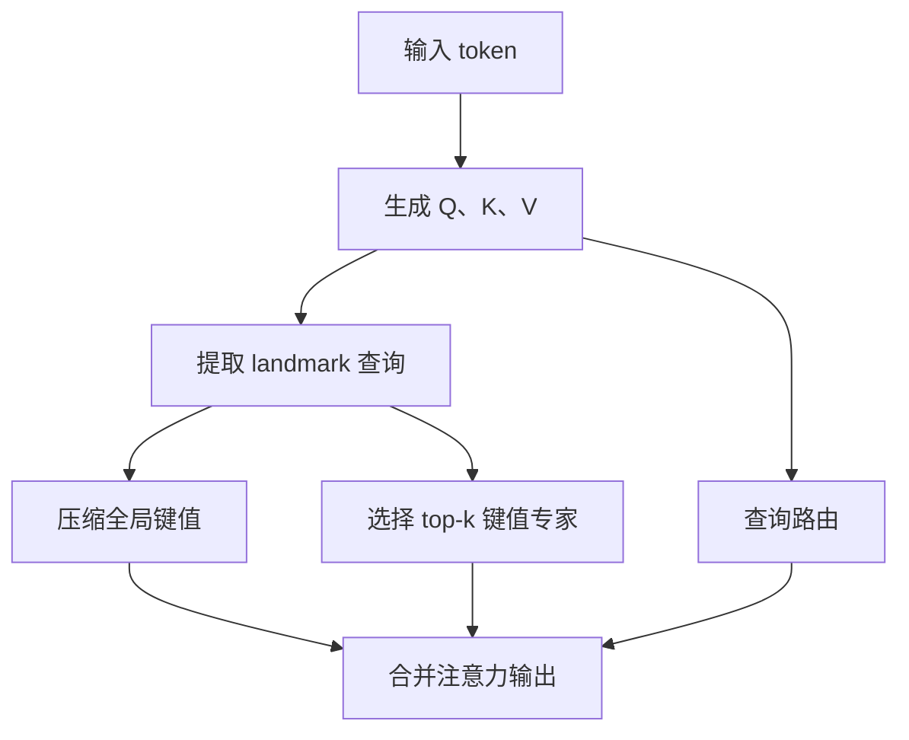
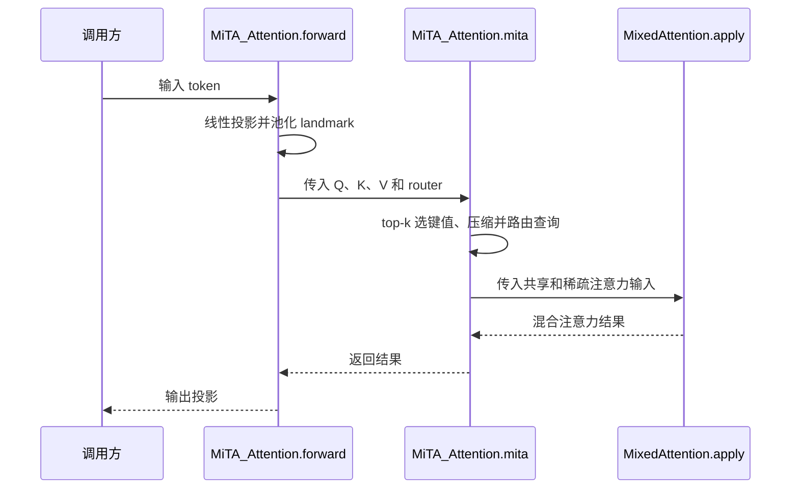

# Mixture-of-Top-k Attention: Efficient Attention via Scalable Fast Weights / MiTA：通过可扩展快权重实现高效注意力

MiTA 将注意力解释为输入依赖的快权重网络，结合共享压缩与稀疏路由；由北京邮电大学提出，论文与官方仓库标注 NeurIPS 2026。

## 一句话定义

MiTA 是一种高效注意力：用少量 landmark 查询把键值压缩成共享专家，再为每个 landmark 收集可复用的 top-k 键值专家，让每个查询只读「共享专家 + 一个被路由到的专家」，在保留全局摘要的同时避免对全部键值做全量查找。

## 英文缩写速查

| 缩写 | 英文全称 | 简要说明 |
|------|----------|----------|
| MiTA | Mixture-of-Top-k Attention | 共享压缩与 top-k 专家路由 |
| FFN | Feed-Forward Network | 前馈网络 |
| MLP | Multi-Layer Perceptron | 多层感知机 |
| LRA | Long Range Arena | 长序列评测基准 |

## 为什么重要

- 论文把线性注意力、Linformer、TTT（压缩）与 MoBA、DSA（路由）统一为「扩展快权重」，给出五维分类，可对照不同高效注意力的取舍。
- 单纯压缩丢失精确访问，单纯路由缺全局视角；MiTA 同时用两者，消融中「仅压缩」70.3、「仅路由」70.8、两者合用 71.1（表 6，ImageNet-1K DeiT-T）。
- 相比为每个查询单独选 top-k 的做法，专家数固定且可复用，更利于硬件实现；LRA 总训练时间减少 77%。

## 核心原理

对单个查询，注意力写作 $V\operatorname{softmax}(K^Tq/\sqrt d)$，可写成以指数为激活函数的两层快权重 MLP；其键值来自输入，归一化还依赖查询。**这是一种等价表述，不意味着注意力运算消失，也不等同于普通固定参数 FFN。**论文引用了更早的快权重研究。

论文按五个维度组织现有方法：扩展策略、专家数量、专家类型、专家构造、路由拓扑。MiTA 通过 landmark 查询压缩全局上下文，同时构造可复用的 top-k 键值专家，查询路由到其中的专家。

## 项目流程图

## 源码运行时序图

根据官方 README 模块入口及 `mita/mita_attention.py`；底层内核与训练入口尚待核查。

## 评测

- ImageNet-1K：MiTA-DeiT-T 为 71.1% / 1.1G FLOPs；加入深度卷积后为 73.4% / 1.1G。DeiT-T 为 72.2% / 1.2G，比较时需区分结构配置。
- ADE20K：直接替换 ViT-T 的注意力，MiTA 为 36.5 mIoU / 7G FLOPs，CBT 基线为 39.1 / 12G。
- LRA：五任务总训练时间 2.4 小时，对比标准注意力 10.6 小时；使用 RTX 4090 测量。结果属于论文指定任务和实现条件。

## 与其他工作对比

以下均为论文同表对照（表 2 / 4 / 5），不是跨论文横比：

| 对照 | 差异 | 论文结果 |
|------|------|----------|
| 标准 softmax 注意力 | 每个查询读取全部键值；MiTA 只读共享压缩专家 + 被路由到的 top-k 键值专家 | LRA 五项合计训练时间 10.6 h → 2.4 h（RTX 4090，标准注意力用融合内核） |
| DeiT-T（ImageNet-1K） | 同量级视觉 Transformer 基线 | DeiT-T 72.2% / 1.2G；MiTA-DeiT-T 71.1% / 1.1G，加深度卷积后 73.4%——精度提升与结构改动混在一起，需分开看 |
| CBT（ADE20K，ViT-T） | 论文的分割基线 | CBT 39.1 mIoU / 12G；MiTA 直接替换注意力为 36.5 / 7G——省算力但精度更低 |

在论文的五维分类（扩展策略、专家数量、专家类型、专家构造、路由拓扑）中，MiTA 的位置是「共享压缩专家 + 稀疏 top-k 专家」的组合：前者保留全局上下文，后者做局部稀疏读取。与 [多头注意力](../concepts/multi-head-attention.md) 的关系是替换其注意力计算方式，而不是改变多头结构。

## 结论

MiTA 展示了结合全局压缩与局部稀疏读取的可行性，精度和速度需结合任务实测。

- 采用共享专家可保留压缩后的全局上下文。
- top-k 专家可供多个查询复用；专家数量和宽度影响精度及开销。
- 视觉结果不能直接推断机器人策略或大语言模型上的收益。

## 工程实践

- 默认配置：landmark 由均匀等分窗口的 2D 平均池化得到；实现中每个查询路由 1 个专家（外加共享专家），按专家分配对查询排序后分组计算，再用在线 softmax 合并（算法 1）。一次路由多个专家需借助 MoBA，速度更低。
- 调参经验：增大专家数 m 比增大每专家宽度 k 更有效；经验做法是先固定 m 与 k 的比例，再微调（附录 A）。训练时用较小的 m、k，推理时调大常可获得增益（附录 C）。
- 迁移成本：直接把已有 ViT 的注意力替换为 MiTA 会掉点（ADE20K 各规模 -1.2 至 -2.8 mIoU，ImageNet-21K 微调 -0.3 至 -1.6），原生训练效果更好；标准注意力训练、MiTA 推理保留 95% 以上性能。
- 瓶颈：gather 的随机访存使流水线偏内存受限，论文引用 DeepSeek Sparse Attention 的优化实现作为缓解思路。
- 官方公开了注意力模块、视觉训练代码及检查点链接；本页未运行仓库代码或 CI，源码调用链见上文时序图及代码归档。

## 局限

- 论文只做视觉任务（ImageNet-1K、ADE20K、LRA），自述未评估 LLM 解码阶段，算力有限；主要贡献是概念框架。
- 论文自述 m 取值为初步研究，未充分发挥 MiTA；ADE20K 与微调实验为直接替换注意力，精度低于基线。
- 与加深度卷积、Gate 等组件混合时，精度提升不能全部归因于注意力本身；ViT-5-S 上 MiTA 仍低于原模型 0.5–0.9 个点。
- 视觉结果不能直接推断机器人策略或大语言模型上的收益；本页未复现实验。

## 关联页面

- [多头注意力](../concepts/multi-head-attention.md)
- [Transformer](../concepts/transformer.md)

## 参考来源

- [论文归档](../../sources/papers/mita.md)
- [官方代码归档](../../sources/repos/mita.md)
- [论文 v6 全文](https://arxiv.org/html/2602.01219v6)

## 继续阅读

- [Vision Transformer](../concepts/vision-transformer.md)
- [MiTA 官方仓库](https://github.com/QishuaiWen/MiTA)
- 论文引用的对照方法：MoBA（arXiv 2502.13189）、Agent Attention（ECCV 2024）、DeepSeek-V3.2 稀疏注意力（arXiv 2512.02556）
