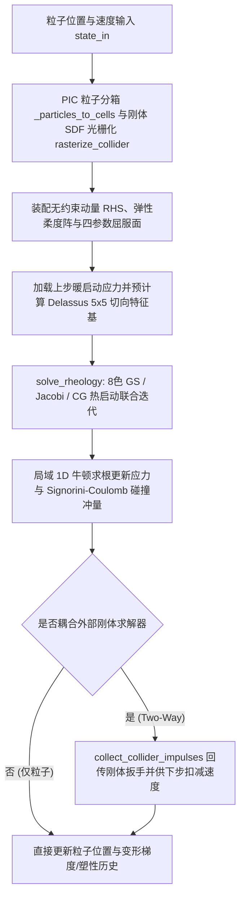
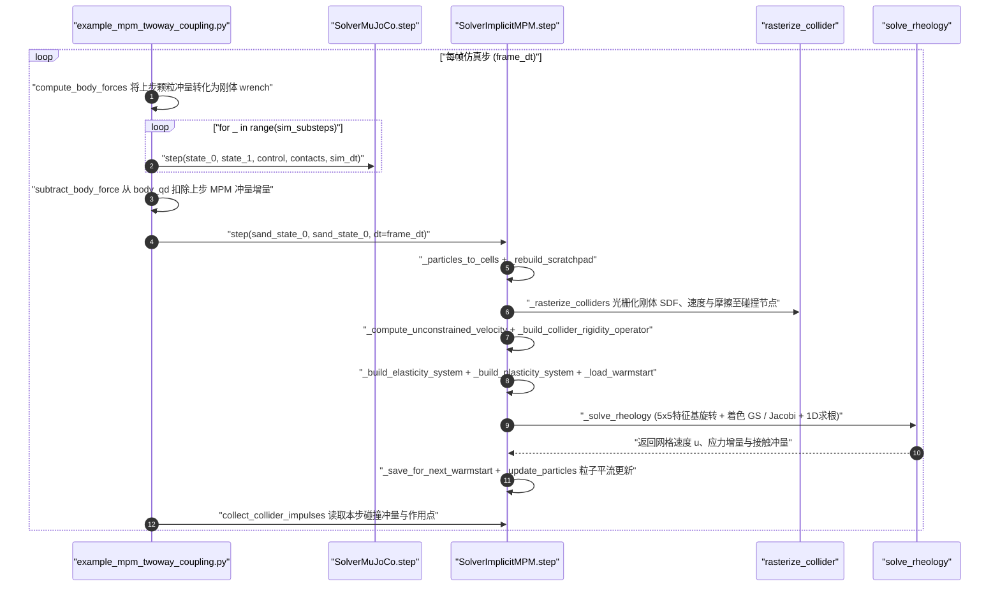

# Mixed MPM：刚性弹粘塑性混合物质点法

**Mixed Material Point Methods for Stiff Elastoplasticity**（Gilles Daviet，[DOI:10.1145/3811345](https://doi.org/10.1145/3811345)，ACM TOG / SIGGRAPH 2026，[项目页](https://research.nvidia.com/labs/prl/mixed_mpm/)）提出一族基于 **混合速度–应力–碰撞冲量变分鞍点** 的 **物质点法（MPM）**，在 **CFL 量级时间步长** 下统一求解从颗粒沙土、黏聚雪/泥、刚性弹粘塑性固体直至近不可压（$\nu \to 0.5$）粘性流体。依托 **三线性速度 `Q1` + 间断应力 `P0`/`dP1` + 二次血清型碰撞 `S2`** 紧凑离散以及 **5×5 切向特征分解 + 1D 牛顿求根**，算法在 GPU 上支持千万级粒子扩展，并已直接落地为 [Newton](./newton-physics.md) 的 `SolverImplicitMPM` 核心求解器。

## 一句话定义

**通过分离速度场、间断应力场与碰撞冲量的混合隐式求解器，在可观大步长下稳定仿真从近不可压流体到硬质弹塑性土体的广泛材料，并与关节刚体系统做双向力矩耦合。**

## 英文缩写速查

| 缩写 | 英文全称 | 简要说明 |
|------|----------|----------|
| MPM | Material Point Method | 物质点法：粒子携带历史量、背景网格求解动量与应力 |
| CFL | Courant–Friedrichs–Lewy | 显式平流步长上界；本文追求大刚度下仍按 CFL 步长隐式推进 |
| `Q1-P0-S2` | Trilinear Velocity / Constant Stress / Quadratic Serendipity Collider | 本文主力紧凑混合离散单元组合 |
| SDF | Signed Distance Field | 有向距离场，用于将外部刚体几何光栅化至碰撞节点 |
| APIC | Affine Particle-In-Cell | 仿射粒子–网格传输格式，保留局部速度梯度减少数值耗散 |

## 为什么重要

在腿式机器人越野行走、挖掘机铲装、柔性抓手捏取颗粒或粉雪等机器人高保真仿真任务中，传统 MPM 面临两重障碍：
- **刚度与不可压缩锁死：** 显式 MPM 在高杨氏模量 $E$ 或泊松比 $\nu \to 0.5$ 时时间步长被声速极度压扁；标准位移基隐式 MPM 则在流–塑大变形与近不可压条件下因 Hessian 病态而难以收敛；
- **地形反作用缺失：** 游戏引擎或轻量化仿真常用高度图或单向耦合近似沙雪，系统性低估地形对足端和关节产生的滑移阻力与下陷反作用力矩，导致策略步态失真。

Mixed MPM 把弹性模量转入柔度共轭形式，让求解器自然跨越「极软粘流体 → 沙雪颗粒 → 接近刚体极限」的光谱，同时在 Newton 中通过共享速度/冲量接口与 MuJoCo Warp、Kamino 等刚体求解器构成完整双向闭环。

## 核心原理

### 核心信息

| 维度 | 内容 |
|------|------|
| **论文** | *Mixed Material Point Methods for Stiff Elastoplasticity*（ACM TOG / SIGGRAPH 2026） |
| **作者 / 机构** | Gilles Daviet（NVIDIA Research，Annecy） |
| **支持本构** | Corotated / Hencky 粘弹性 + Drucker–Prager / Von Mises / 黏聚 Cam Clay 统一四参数屈服面 |
| **实现位置** | 已开源并合入 [Newton](https://github.com/newton-physics/newton)（`SolverImplicitMPM`、`solve_rheology.py` 与 `mpm_*` 示例） |

### 关键数学与离散机制

1. **连续混合变分鞍点公式（Sec. 3）：**
   将总应变率分解为弹性部分与塑性部分 $D(u) = \dot{\varepsilon}^e + \dot{\varepsilon}^p$，把原本对极高刚度 $E$ 病态的原问题改写为速度 $u$ 与应力 $\sigma$、边界接触冲量 $r$ 的凸–凹混合鞍点 $\min_u \max_{\sigma, r}$。借助弹性余能共轭 $E^*(\sigma)$（支持 Corotated 与高体积压缩保真度更优的 Hencky 对数应变 $\log S$），即便当 $E \to \infty$ 或 $\nu \to 0.5$ 时柔度项也只是趋近于零而不会触发数值奇异。

2. **统一四参数多边形屈服面与双势流动（Eq. 7）：**
   在 $(p, \|\mathrm{Dev}\,\sigma\|)$ 应力不变量平面上引入四参数多边形屈服包络 $(p_c, \beta, \mu, \tau_c)$，把 Drucker–Prager 摩擦颗粒、Von Mises 金属弹塑性以及黏聚雪/黏土（可内切或外接 Cam Clay 椭圆）纳入同一表示；再通过双势（bipotential）$B(\sigma, \dot{\varepsilon}^p)$ 与剪胀调节因子 $\theta \in [0, 1]$ 在关联流动（$\theta=1$）与零体积剪胀非关联流动（$\theta=0$）之间连续插值，并辅以弹性/塑性粘性 $(\eta_e, \eta_p)$ 与基于塑性体变 $J_p$ 的显式硬化。

3. **紧凑混合元家族 `Q1-P0-S2` 与 `Q1-dP1-S2`（Sec. 4，Table 2）：**
   - **速度基 `Q1`（三线性元）：** 与 `B2`/`B3` 二次/三次 B 样条相比，虽然应力分布略有网格噪声，但仅涉及最近邻顶点，**8 色着色即可全并行 Gauss–Seidel**（`B2` 需 64 色），速度提升一个量级以上；
   - **间断应力空间 `P0` / `dP1`：** 摒弃会诱发棋盘格寄生振荡的连续 `Q1-Q1` 对，使局部应力块可以逐单元完全解耦求解；
   - **血清型碰撞节点 `S2`：** 布置在单元顶点与棱边中点上的二次插值节点，既获得比 `Q1` 更精确光滑的曲率碰撞法向，又不会把速度 stencil 扩大到 2 格以外。

4. **5×5 切向特征分解 + 1D 标量求根（Alg. 3–5）：**
   在进入主迭代循环前，每个时间步预先计算应力节点对应的局部 Delassus 块并对 5×5 偏应力切向块做正交特征分解（得到特征向量矩阵 $Q_i$ 与对角矩阵 $D_i$）。因此每次 Gauss–Seidel 迭代中的复杂三维非关联弹塑性返回映射被化简为**一维标量乘子 $\alpha$ 的单调牛顿求根**，完全省去了每颗粒子上昂贵的 3×3 SVD 分解；同时通过单向量压缩存储 $B$ 矩阵使每对重叠节点仅存一个 `vec3`。

5. **双向 Signorini–Coulomb 刚体耦合（Alg. 6）：**
   每个外循环中：先将上步颗粒对刚体施加的冲量按步长扣除出纯外力/纯关节预测速度 $\dot{q}_{\mathrm{pred}} = \dot{q}_{\mathrm{new}} - \Delta t\, I_b^{-1} f_b$，把刚体块对角近似 Delassus 算子 $R = J^T I_b^{-1} J$ 接入 MPM 碰撞节点联合求解 Signorini–Coulomb 接触冲量，最后把更新后的颗粒冲量与位置回传给 MuJoCo Warp / XPBD / Kamino 推进刚体。

### 流程总览

## 实验与评测

原文 §6 在工作站（Intel i9-10980XE + **NVIDIA RTX PRO 6000 Blackwell Max-Q**）上从局部精度、求解器消融到 8 个大型场景进行了系统评测（Table 3、Table 4、Fig. 16）：

| 评测项 | 配置与规模 | 实测结果 |
|------|------|------|
| **100 万随机局部返回映射（Table 3）** | 随机材料参数与应力试算 | 平均双势残差仅 **$1.2 \times 10^{-9}$**，最大牛顿求根次数 19 次，**99% 样本在 $\le 6$ 次内收敛** |
| **沙柱坍塌求解器/单元对比（Fig. 16）** | 颗粒沙柱自由坍塌离散与迭代格式消融 | 各向异性特征分解 Gauss–Seidel（`GS, Ours`）收敛速度显著优于 `GS, FBSOC`（Daviet 2016b）、`GS, Isotropic` 与 `Jacobi`；`Q1-P0` 耗时 **106 ms/frame**、`Q1-dP1` **180 ms/frame**，而二次 B 样条 `B2-dP1` 跃升至 **13.3 s/frame**（`B2-Part. Jacobi` 3.1 s） |
| **ANYmal C 双向耦合步态（Table 4）** | 160 万粒子（沙+雪+黏土），MuJoCo Warp，50 FPS×4 子步 | **0.7 s/frame**；对比单向耦合（高估步幅），双向地形反作用使机器人在流沙中**自动缩短步幅并稳定行走** |
| **大规模沙城坍塌（Table 4）** | **4900 万粒子**，$n_u=5.8\text{M}$、$n_\sigma=5.1\text{M}$，60 FPS×2 子步 | 仅需 **4.0 s/frame**（其中 `solve_rheology` 占总时间 79.3%） |
| **硬质碎纸机 / 混凝土压溃 / 雪崩（Table 4）** | 碎纸机 `Q1-dP1-S2`（44.4 万）、混凝土臂（640 万）、雪崩（1400 万） | 分别耗时 **1.4 s/frame**（120 FPS）、**0.8 s/frame**（240 FPS）与 **5.4 s/frame**（30 FPS）；刚体球落入流动粒子与溃坝水体仅 **0.5 s / 0.1 s/frame** |
| **实时交互沙盘（Sec. 6.3）** | 67.3 万粒子 + 6 个 500/1000/2000 kg/m³ XPBD 刚体 | 交互渲染帧率达 **~20 FPS**（关闭粒子渲染时约 **30 FPS**） |

## 结论

**总判：Mixed MPM 通过「速度–应力混合鞍点 + `Q1-P0/dP1-S2` 紧凑单元 + 5×5 切向特征基 1D 求根」，把刚性弹塑性、颗粒流与近不可压流体推进到 CFL 大步长与千万级粒子规模，成为 Newton 原生的多物理可变形地形与耦合模块。**

1. **优先从 `Q1-P0-S2` 起步：** 大规模沙雪/颗粒交互在 8 色 `Q1-P0` 下即可获得约百倍于高阶 B 样条的吞吐；仅在大应变悬臂弯折或硬质撕裂场景切换到 `Q1-dP1-S2`。
2. **步态与抓握受地形反作用支配时必开双向耦合：** 单向耦合系统性低估反作用力矩，会诱导腿足或末端执行器学出在真实颗粒中失稳的虚高动作。
3. **利用链式暖启动组合加速纯固相/强刚度收敛：** Newton `solve_rheology` 支持 `("cr", "gs")` 或 `("cg", "jacobi", "gs-batched")` 等组合在接触求解前先用 Krylov 方法消解弹性压力波。
4. **使用 `fixed` 网格模式配合 CUDA Graph：** 例如 `example_mpm_twoway_coupling.py` 固定网格padding与激活单元上限，才能避免动态内存重分配打断 CUDA Graph 捕获。
5. **需要严防薄壳/细杆穿透时与 DAT 互补部署：** MPM 通过网格速度场天然平滑自接触，而混合刚–软–布料网格界面的严格无穿透交给 [DAT](./paper-dat-divide-and-truncate.md) 负责。

## 与其他工作对比

| 路线 | 擅长材料与刚度范围 | 刚体耦合方式 | 相对 Mixed MPM 的关键差异 |
|------|--------------------|--------------|---------------------------|
| **Mixed MPM（本文）** | 沙/雪/近不可压流体/**硬质弹塑性（含高 $E$ 极限）** | 原生双向 Signorini–Coulomb + Delassus 近似 | `Q1-P0/dP1-S2` + 5×5 切向分解避免步长与 SVD 瓶颈，直接集成进 Newton |
| **传统显式 MPM / MLS-MPM** | 软弹塑性、颗粒、低粘流 | 多为单向 SDF 排斥或弱惩罚 | 高杨氏模量 $E$ 或 $\nu \to 0.5$ 时声速 CFL 迫使极小时间步长 |
| **Daviet et al. 2016b（`Q1-Q1` + FBSOC）** | 颗粒流与干燥雪 | 刚体单/双向摩擦接触 | `Q1-Q1` 连续应力有明显寄生网格振荡（Fig. 2b），且 FBSOC 局部迭代收敛慢于本文特征分解 GS |
| **[Genesis](./genesis-world-10.md) 内部 MPM** | 沙/雪/软体/流体综合可微仿真 | 引擎内建多求解器耦合 | 偏向可微渲染与统一引擎生态；Newton 在与 **MuJoCo Warp / [Kamino](./paper-kamino.md)** 共享物理模型与代理接口双向耦合上更直接 |
| **纯 FEM 软体** | 小–中应变拓扑不变连续弹性体 | 视具体接触约束 | 网格拓扑固定场景 FEM 更省；遇到大流动、泥沙坍塌或颗粒破碎时 MPM 无网格畸变负担 |
| **[DAT](./paper-dat-divide-and-truncate.md)** | 不解本构，专解几何无穿透接触 | 刚–软–壳多后端后处理 | 二者**不是竞争而是互补**：Mixed MPM 负责连续体/颗粒流变，DAT 负责网格与刚体接口的无穿透截断 |

## 源码运行时序图

以下时序图严格对齐 [Newton](https://github.com/newton-physics/newton) 中的 `newton/examples/mpm/example_mpm_twoway_coupling.py` 与 `SolverImplicitMPM`（`newton/_src/solvers/implicit_mpm/solver_implicit_mpm.py`、`solve_rheology.py`、`rasterized_collisions.py`）：

## 工程实践

| 实践要点 | 建议做法 |
|------|----------|
| **可运行示例定位** | 仓库内置 `python -m newton.examples mpm_twoway_coupling`（双向耦合盒）、`mpm_anymal`（ANYmal 行走）及 `mujoco_mpm_coupled_solver`（基于 `SolverCoupledProxy` 的标准化双向耦合） |
| **双向耦合标准接口** | 新代码建议复用 `SolverImplicitMPM` 实现的 `CouplingInterface`（`coupling_rewind_proxy_body` 与 `coupling_harvest_proxy_wrenches`），避免手写 `compute_body_forces` / `subtract_body_force` 出错 |
| **离散与网格配置** | 大场景默认 `mpm_options.strain_basis = "P0"`、`grid_type = "fixed"`（配合合理的 `grid_padding` 与 `max_active_cell_count` 以支持 CUDA Graph）；需精细弯折/剪切带时改为 `"dP1"` |
| **非接触纯固体优化** | 无外部刚体接触的纯弹塑性固体可将 `solver` 设成 `("cr", "gs")` 或 `"cg"`，利用共轭余量/梯度热启动大幅减少主迭代次数 |
| **时间步设置原则** | 虽摆脱刚度声速步长限制，仍需保证单个时间步内粒子位移不超过体素尺寸 `voxel_size` 过多，典型示例运行在 50–120 FPS 配合 1–4 个刚体子步 |

## 常见误区与局限

- **误以为隐式 Mixed MPM 完全无步长上限：** 算法通过混合应力摆脱了高杨氏模量 $E$ 对步长的限制，但粒子平流与塑性硬化 $h(J_p)$ 仍为显式更新（原文 §7.1），因此全局仍须遵循**对流 CFL 条件**（粒子单步不得跨越多格）。
- **低阶 `Q1` 单元的静水压/应力网格噪声（原文 §7.1）：** 工程主力 `Q1-P0` / `Q1-dP1` 在理论上不满足 inf-sup 稳定条件，应力场会出现棋盘格状高频空间抖动，在极限刚性/不可压测试中收敛严格度不如高阶元。
- **多材料交界面参数模糊与收敛拖尾：** 材料属性从粒子向网格插值会在多种物质边界产生混合柔度与屈服过渡；另外 Gauss–Seidel/Jacobi 在极低残差区间的渐近收敛依然偏慢。
- **大规模 RL 实证仍待扩展：** 论文在 ANYmal C 上展示了预训练策略在双向耦合沙雪地形的泛化响应，但高通量向量化 MPM 环境下的端到端强化学习样本效率仍需工程验证。

## 关联页面

- [Newton Physics](./newton-physics.md) — `SolverImplicitMPM` 所在的 GPU 物理引擎
- [DAT（多物理无穿透接触）](./paper-dat-divide-and-truncate.md) — Newton 同栈的刚–软–壳统一几何接触方案
- [Kamino](./paper-kamino.md) — 可与 Mixed MPM 通过代理接口联合仿真的闭链刚体求解器
- [仿真物理保真（Query）](../queries/simulation-physics-fidelity.md) — 可变形地形与接触仿真保真分析
- [Genesis World 1.0](./genesis-world-10.md) — 同类包含 GPU MPM 后端的多物理平台对照
- [强化学习（Reinforcement Learning）](../methods/reinforcement-learning.md) — 面向可变形地形的策略训练与应用背景

## 参考来源

- [Mixed MPM 论文归档](../../sources/papers/mixed_mpm_siggraph_2026.md)
- [NVIDIA Mixed MPM 项目页归档](../../sources/sites/nvidia-mixed-mpm.md)
- [Mixed MPM 原文精读归档（SIGGRAPH 2026 全文）](../../sources/papers/mixed_mpm_siggraph_2026_reading.md)
- [NVIDIA Newton — SolverImplicitMPM 源码归档](../../sources/repos/newton_mixed_mpm.md)

## 推荐继续阅读

- [NVIDIA PRL：Mixed MPM 项目页与演示视频](https://research.nvidia.com/labs/prl/mixed_mpm/)
- [ACM TOG / SIGGRAPH 2026 原文（DOI:10.1145/3811345）](https://doi.org/10.1145/3811345)
- [Newton GitHub（`SolverImplicitMPM` 与 `examples/mpm/`）](https://github.com/newton-physics/newton)
