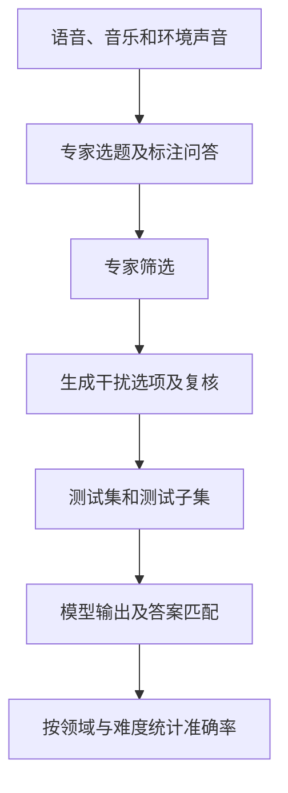
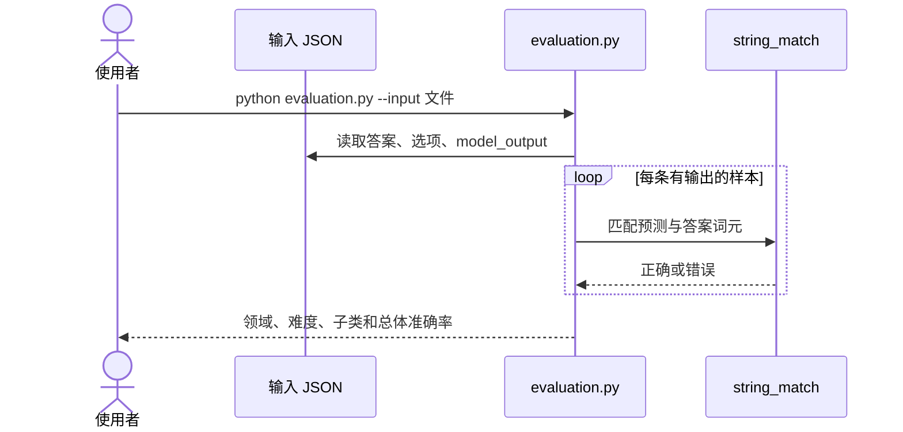

# MMAU：音频理解与推理基准

MMAU 使用音频与选择题评估音频语言模型的感知、知识提取和推理，不直接测试机器人动作。

## 英文缩写速查

| 缩写 | 英文全称 | 简要说明 |
|------|----------|----------|
| MMAU | Massive Multi-Task Audio Understanding and Reasoning Benchmark | 音频理解与推理基准 |
| LALM | Large Audio-Language Model | 大型音频语言模型 |
| MCQ | Multiple Choice Question | 多项选择题 |

## 基准构建与流程

论文 [arXiv:2410.19168v1](https://arxiv.org/html/2410.19168) 描述从 13 个音频语料选择声音、音乐、语音素材，专家选题、编写并筛选问答，GPT-4 辅助生成选项，再由专家复核。原论文统计 10,000 题，test-mini 1,000 题、test 9,000 题，涵盖 27 项任务；使用微平均准确率。论文正文与当前项目 README 对信息提取和推理任务的分类数量存在差异，引用时应注明版本。

## 源码运行时序图

根据[官方 evaluation.py](https://github.com/Sakshi113/MMAU/blob/main/evaluation.py) 与 README，脚本评估已生成的回答，不负责调用模型。

## 评测与局限

- 2025-05-15 版本修订约 25% 的问答和约 5% 音频；[官方榜单](https://sakshi113.github.io/mmau_homepage/)区分新版、旧版和未经团队验证的社区结果。
- README 写 `model_prediction`，当前脚本实际读取 `model_output`；缺少该键的样本被跳过，须核对覆盖数，不能把输出总数当作完整集结果。test 答案不公开，官方提供提交评测入口。
- 图中 WITA-Omni 的 82.6 暂未在可读取的基准官方榜单中核验，不能确认其子集、版本和测评方。

## 与其他工作对比

| 基准 | 输入模态 | 侧重 |
|---|---|---|
| MMAU | 音频 | 语音、音乐、环境声的感知、知识提取与推理选择题 |
| [Daily-Omni](./paper-daily-omni.md) | 音频 + 视频 | 跨模态时序对齐问答 |
| [TimeLens-Bench](./paper-timelens.md) | 视频 + 文本查询 | 事件起止时间定位 |
| [EmbSpatial-Bench](./embspatial.md) | 静态图像 | 第一人称空间关系 |

MMAU 只覆盖音频单模态，与音视频基准互补；四者都不直接评测机器人动作。

## 结论

MMAU 适合诊断音频感知与推理，结果需带版本、数据划分和有效样本数。

1. 分开报告 speech、sound、music 与总体结果。
2. 复核输出字段和缺失样本，避免分母变化造成虚高。
3. 对照音视频基准及真实交互测试，不用单个音频榜替代系统评测。

## 关联页面

- [Daily-Omni](./paper-daily-omni.md)：音视频时序对齐。
- [EmbSpatial-Bench](./embspatial.md)：静态图像空间关系。
- [Query：具身大模型评测基准选型](../queries/embodied-eval-benchmark-selection-loop.md)

## 参考来源

- [官方仓库归档](../../sources/repos/mmau.md)

- [四项基准来源归档](../../sources/sites/multimodal-four-benchmarks-20261030.md)
- [MMAU 原始论文 v1](https://arxiv.org/abs/2410.19168v1)

## 推荐继续阅读

- [官方代码与数据](https://github.com/Sakshi113/MMAU)
