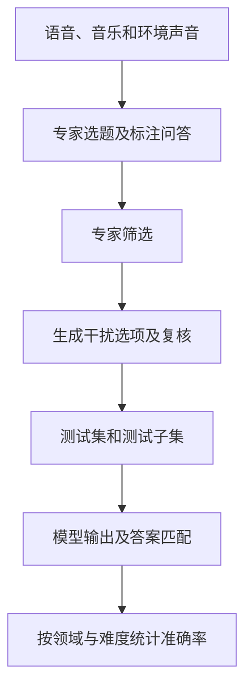
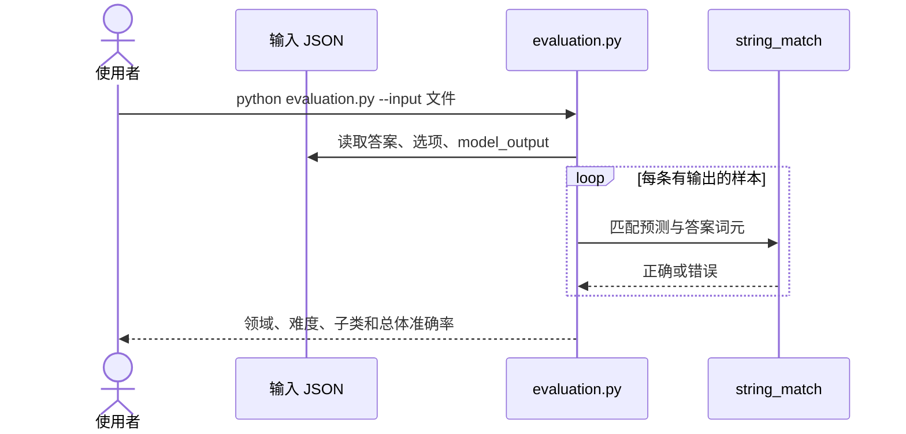

# MMAU：音频理解与推理基准

MMAU 使用音频与选择题评估音频语言模型的感知、知识提取和推理，不直接测试机器人动作。

## 英文缩写速查

| 缩写 | 英文全称 | 简要说明 |
|------|----------|----------|
| MMAU | Massive Multi-Task Audio Understanding and Reasoning Benchmark | 音频理解与推理基准，10k 条音频选择题 |
| LALM | Large Audio-Language Model | 大型音频语言模型，接收音频与文本输入、生成文本回答 |
| MCQ | Multiple Choice Question | 多项选择题，本基准的唯一题型 |
| ALE | Audio-Language Encoder | 音频-语言编码器（如 CLAP 类双塔模型），按余弦相似度选项 |
| CLAP | Contrastive Language-Audio Pretraining | 音频与文本对比学习模型，论文中作为 ALE 基线 |
| LLM | Large Language Model | 大语言模型；论文用 GPT-4o、Llama 3 做纯文本对照 |

## 为什么重要

- 语音、环境声和音乐的理解大多停留在 ASR、声学场景分类等基础任务，缺少需要专家知识和多步推理的评测（论文 §1、§3.3）。
- MMAU 把问题拆成两类：信息提取（需要音频细节与外部知识）和推理（需要超越内容理解的复杂思考），便于定位模型是感知失败还是推理失败。
- 机器人具身系统需要听觉输入（如报警声、对话指令），该基准可作为音频感知能力的一项诊断，但不替代真实交互测试。

## 核心原理

### 流程总览：基准构建

论文 [arXiv:2410.19168v1](https://arxiv.org/abs/2410.19168) 描述从 13 个音频语料选择声音、音乐、语音素材，专家选题、编写并筛选问答，GPT-4 辅助生成选项，再由专家复核。原论文统计 10,000 题，test-mini 1,000 题、test 9,000 题，涵盖 27 项任务；使用微平均准确率。论文正文与当前项目 README 对信息提取和推理任务的分类数量存在差异，引用时应注明版本。

构建细节（论文 §3.2、附录 C）：

- 输入：音频片段 + 英文问题 + 四个选项；标注者需先完整听完音频。
- 输出：单个正确选项；问题按 task、difficulty、dataset 三类标签标注。
- 标注约 11,000 对，过滤丢弃约 800 对；专家复核再丢弃约 200 对。
- 选项增强：用 GPT-4 基于音频上下文生成干扰项（提示见论文图 10）。

### 评测协议

$$\mathrm{Acc}=\frac{1}{N}\sum_{i=1}^{N}\mathbf{1}[\hat{y}_i=y_i]$$

其中 $N$ 为全部样本数（微平均，跨领域合并计数）。对 LALM，论文用正则和字符串匹配把自由文本回答映射到选项，并对选项顺序做 5 次随机打乱取多数票。

对 ALE（如 CLAP 系列），论文先用 GPT-4o 把"问题+选项"改写为假设句，再计算音频嵌入与各假设嵌入的余弦相似度，取最高者为答案（附录 B.1）。

## 源码运行时序图

根据[官方 evaluation.py](https://github.com/Sakshi113/MMAU/blob/main/evaluation.py) 与 README，脚本评估已生成的回答，不负责调用模型。

## 实验结果

| 模型 | 类型 | test 平均准确率（论文 Table 3） |
|---|---|---|
| Random Guess | 基线 | 25.92 |
| Human（test-mini） | 人类 | 82.23 |
| Gemini Pro v1.5 | 闭源 LALM | 52.97 |
| Qwen2-Audio-Instruct | 开放权重 LALM | 52.50 |
| GAMA | 开源 LALM | 31.81 |
| GPT-4o + 强音频描述（文本） | LLM + 字幕 | 58.74 |

- 论文结论：最佳 LALM 约 53%，最佳级联（描述 + LLM）约 59%，人类约 82%。
- 噪声替换实验：MuLLaMa 与 SALMONN 几乎不变，GAMA、Qwen2-Audio-Instruct、Gemini Pro v1.5 明显下降，说明后者更依赖音频输入。
- 错误分析（500 条）：Qwen2-Audio-Instruct 感知错误 55%、推理错误 18%；Gemini Pro v1.5 感知错误 64%、推理错误 11%。
- ALE 对照（附录 B.1）：CLAP 系列平均约 35–40%，低于多数 LALM；论文认为 ALE 在选项为"词袋"式时受益，并非真正组合推理。

## 评测与局限

- 2025-05-15 版本修订约 25% 的问答和约 5% 音频；[官方榜单](https://sakshi113.github.io/mmau_homepage/)区分新版、旧版和未经团队验证的社区结果。（"约 25%/约 5%"的修订比例来自项目页与后续版本说明，本次只读 v1 全文，未核实。）
- README 写 `model_prediction`，当前脚本实际读取 `model_output`；缺少该键的样本被跳过，须核对覆盖数，不能把输出总数当作完整集结果。test 答案不公开，官方提供提交评测入口（项目页 EvalAI 挑战）。
- 图中 WITA-Omni 的 82.6 暂未在可读取的基准官方榜单中核验，不能确认其子集、版本和测评方。

## 与其他工作对比

| 基准 | 输入模态 | 侧重 |
|---|---|---|
| MMAU | 音频 | 语音、音乐、环境声的感知、知识提取与推理选择题 |
| [Daily-Omni](./paper-daily-omni.md) | 音频 + 视频 | 跨模态时序对齐问答 |
| [TimeLens-Bench](./paper-timelens.md) | 视频 + 文本查询 | 事件起止时间定位 |
| [EmbSpatial-Bench](./embspatial.md) | 静态图像 | 第一人称空间关系 |

MMAU 只覆盖音频单模态，与音视频基准互补；四者都不直接评测机器人动作。论文自身对比（Table 2）显示，与 AIR-Bench、AudioBench、MuChoMusic 等相比，MMAU 在三域覆盖和知识型信息提取上最全（论文自述）。

## 工程实践

- **复现评测**：先用自己的推理脚本生成 JSON，字段名对齐 `model_output`，再运行 `python evaluation.py --input <file>`；核对输出总数与有效样本数。
- **提示与选项**：论文对 LALM 尝试多套 prompt 并报告最佳结果；报告时需注明 prompt、选项顺序打乱次数和解析规则。
- **分域报告**：至少分开给出 speech、sound、music 与总体准确率，并注明 test-mini 或 test。
- **开放性检查**：test 真值不公开，正式成绩需经官方提交；自建子集不得与榜单直接比较。
- **源码开放状态**：项目页与仓库均可访问，评测脚本可运行；test 标注不公开（部分开源）。项目页 GitHub 链接为 `Sakshi113/mmau`，与 wiki 元数据 `Sakshi113/MMAU` 为同一仓库（大小写不敏感，未逐一核对）。
- **机器人应用**：本基准不含动作输出，仅可用于选择音频感知模块；上机前仍需真实交互或仿真评测。

## 局限与风险

- **题型单一**：仅多项选择题，论文承认不评测开放生成，无法暴露语言幻觉（论文 §6）。
- **技能划分**：信息提取与推理技能互不重叠，部分真实场景需要两类技能组合，当前版本未覆盖（论文 §6）。
- **标注偏置**：人工标注与 GPT-4 选项增强都可能引入偏置；论文计划继续修正（论文 §6）。
- **选项词袋效应**：ALE 与部分模型能靠词汇重合作答，不一定说明组合推理能力（论文 §B.1、Fig. 8）。
- **版本与分母风险**：数据版本、test-mini/test 划分、缺失输出字段都会改变结果；成绩须带版本号与有效样本数。
- **分域排序**：论文正文关于分域强弱的文字在 PDF 抽取中有错位，本页不引用具体排序（未核实）。
- **社区结果**：榜单中未经团队验证的结果不应与官方结果混用。

## 结论

MMAU 适合诊断音频感知与推理，结果需带版本、数据划分和有效样本数。

1. 分开报告 speech、sound、music 与总体结果。
2. 复核输出字段和缺失样本，避免分母变化造成虚高。
3. 对照音视频基准及真实交互测试，不用单个音频榜替代系统评测。

## 关联页面

- [Daily-Omni](./paper-daily-omni.md)：音视频时序对齐。
- [EmbSpatial-Bench](./embspatial.md)：静态图像空间关系。
- [Query：具身大模型评测基准选型](../queries/embodied-eval-benchmark-selection-loop.md)

## 参考来源

- [MMAU 原始论文归档（sources/papers）](../../sources/papers/mmau_arxiv_2410_19168.md)
- [官方仓库归档](../../sources/repos/mmau.md)
- [四项基准来源归档](../../sources/sites/multimodal-four-benchmarks-20261030.md)
- [MMAU 原始论文 v1](https://arxiv.org/abs/2410.19168v1)

## 推荐继续阅读

- [MMAU 项目页与榜单](https://sakshi113.github.io/mmau_homepage/)
- [官方代码](https://github.com/Sakshi113/MMAU)
- [arXiv 论文 PDF](https://arxiv.org/pdf/2410.19168)
