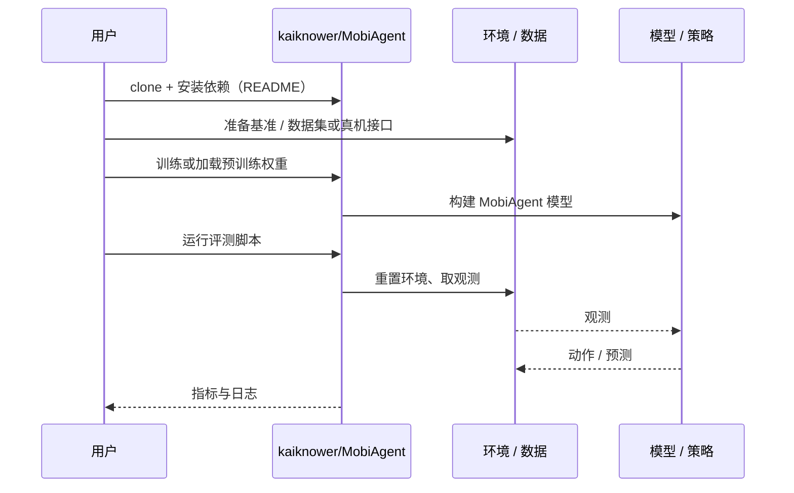

# MobiAgent（arXiv:2610.03476）

**MobiAgent**（*MobiAgent: Dual-Loop Recursive Policy Self-Improvement for Long-Horizon Mobile Manipulation*，[arXiv:2610.03476](https://arxiv.org/abs/2610.03476)，[项目页](https://kaiknower.github.io/mobiagent)，[代码](https://github.com/kaiknower/MobiAgent)）来自 [具身智能小站 2026-10-13 盘点](../../sources/blogs/wechat_embodied_station_34_papers_mulligan_2026-10-13.md)，属「人形与移动操作」组。

## 一句话定义

**内循环动态组合技能并视觉反思，外循环整理部署轨迹与更新技能库。**

## 英文缩写速查

| 缩写 | 英文全称 | 简要说明 |
|------|----------|----------|
| MM | Mobile Manipulation | 移动操作 |
| VLM | Vision-Language Model | 视觉语言模型 |
| Skill lib. | Skill Library | 技能库 |

## 为什么重要

- 长程移动操作需要执行反思与离线学习双循环。
- 开源结论：**部分开源**（步骤 2.5，2026-10-14）。仓库可达；公众号称模型下载有访问条件。
- 同期同组工作见 [失败导向采集与可组合世界动作模型：具身智能小站 10-13 期 34 篇阅读坐标](../overview/embodied-station-2026-10-13-34-papers-technology-map.md)。

## 核心机制

| 项 | 内容 |
|----|------|
| **arXiv** | [2610.03476](https://arxiv.org/abs/2610.03476) |
| **开源** | **部分开源** |
| **要点** | 仿真与实体平台。 |
| **文内指标** | 以原文为准。 |

## 源码运行时序图

以下为按仓库入口（`kaiknower/MobiAgent`）推断的通用运行链路；入库日仅核实仓库可达，未逐文件阅读，具体脚本名以 README 为准。

## 实验与评测

- 以原文为准。
- **读法：** 本页为索引级摘要，依据公众号转述的官方摘要与仓库信息整理；逐项数字与 baseline 以原文 PDF 为准。

## 与其他工作对比

- 横向索引见 [失败导向采集与可组合世界动作模型：具身智能小站 10-13 期 34 篇阅读坐标](../overview/embodied-station-2026-10-13-34-papers-technology-map.md)；同 arXiv 不重复造页。

## 结论

**自改进系统把部署轨迹变成技能库更新，是闭环数据飞轮的具体做法。**

1. 开源边界：**部分开源** — 仓库可达；公众号称模型下载有访问条件。
2. 核心机制：仿真与实体平台。
3. 复现与选型前核对任务协议、硬件与基准口径，勿直接横比公众号摘录数字。

## 关联页面

- [loco-manipulation](../tasks/loco-manipulation.md)
- [data-flywheel](../concepts/data-flywheel.md)
- [embodied-station-2026-10-13-34-papers-technology-map](../overview/embodied-station-2026-10-13-34-papers-technology-map.md)

## 参考来源

- [mobiagent_dual_loop_self_improvement_arxiv_2610_03476.md](../../sources/papers/mobiagent_dual_loop_self_improvement_arxiv_2610_03476.md)
- [wechat_embodied_station_34_papers_mulligan_2026-10-13.md](../../sources/blogs/wechat_embodied_station_34_papers_mulligan_2026-10-13.md)
- [arXiv:2610.03476](https://arxiv.org/abs/2610.03476)

## 推荐继续阅读

- [arXiv PDF](https://arxiv.org/pdf/2610.03476)
- [项目页](https://kaiknower.github.io/mobiagent)
- [Hugging Face 权重](https://huggingface.co/Liukaikai/MobiAgent)（项目页列出；下载访问条件未核实）
- [https://github.com/kaiknower/MobiAgent](https://github.com/kaiknower/MobiAgent)
