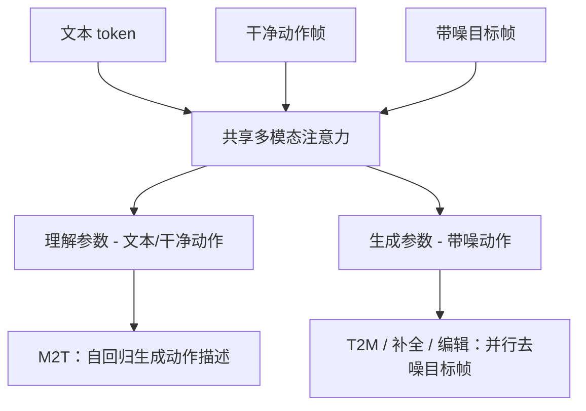

# Möbius｜统一动作语言模型（arXiv:2611.05279）

## 一句话定义

Möbius 将人体动作的去噪生成与动作理解放入同一个多模态骨干，支持文本生成动作、动作描述、时序补全及指令编辑。

## 英文缩写速查

| 缩写 | 英文全称 | 简要说明 |
|---|---|---|
| MoT | Mixture-of-Transformers | 按角色路由参数、共享注意力的架构（Liang et al., 2024） |
| T2M | Text-to-Motion | 文本条件动作生成 |
| M2T | Motion-to-Text | 动作描述（动作理解） |
| CFG | Classifier-Free Guidance | 推理时的无分类器引导，本文设为 3.0 |
| MPJPE | Mean Per Joint Position Error | 关节位置误差，用于时序补全 |

## 为什么重要

传统部分统一模型将语言理解交给语言模型、动作生成交给外部扩散模块；Möbius 让干净动作、带噪动作和文本共同参与共享注意力，去噪过程本身发生在统一骨干中。它直接在逐帧动作特征上建模，不依赖离散动作 token 或预训练动作 VAE。

## 核心信息

| 项 | 内容 |
|---|---|
| 论文 | [arXiv:2611.05279v1](https://arxiv.org/abs/2611.05279v1)（2026-11-03） |
| 机构 | 香港科技大学、腾讯游戏 Motus、麻省理工学院 |
| 任务 | 动作描述（M2T）、文本生成动作（T2M）、时序补全、指令编辑 |
| 规模 | 0.6B 变体（Qwen3-0.6B 骨干，总参数 1.047B，仅 HumanML3D）；1.7B 变体（Qwen3-1.7B 骨干，总参数 3.148B，另加约 1,700 小时内部数据） |
| 代码状态 | 官方仓库公开介绍，README 称实现代码仍在内部审核（以 `sources/repos` 归档为准） |
| 核验边界 | 论文 arXiv HTML（v1）全文与附录已通读；项目页内容未纳入核验 |

## 核心原理与方法流程（依据论文 §3）

要点（论文 §3.1-§3.3、附录 A）：

- **表示：** 201 维 HY-Motion 特征，30 FPS，每帧一个位置；不使用离散 tokenizer 或动作 VAE。
- **路由：** 文本与干净动作走理解参数，带噪动作走生成参数；动作 token 双向注意力，文本保持因果注意力。
- **训练：** Phase I 从 Qwen3 初始化，训练动作描述；Phase II 用理解参数初始化生成参数并冻结理解参数，训练去噪。
- **推理：** Euler 50 步，CFG 3.0，EMA 权重。

## 评测与证据

以下数值均来自论文表格。

| 任务 | 基准 | Möbius 结果 | 对照 |
|---|---|---|---|
| T2M（表 1） | HumanML3D，MS-272 评测器 | 0.6B：R@1 0.8209，FID 6.1291，MMDist 13.9973；1.7B：R@1 0.7968，FID 10.6642 | HY-Motion(1B) R@1 0.7899，FID 13.5194；MotionStreamer R@1 0.6303，FID 12.2110 |
| M2T（表 2） | HumanML3D，TM2T 协议 | 0.6B：BLEU-4 0.2032，CIDEr 0.5754 | MotionGPT3：BLEU-4 0.1605，CIDEr 0.4077 |
| 编辑（表 3） | MotionFix，MotionLab 协议 | 0.6B†（加 MotionFix 数据）：AvgR 2.8026，FID 0.0955 | MotionLab AvgR 3.7500；未编辑源动作 AvgR 3.5100 |
| 时序补全（表 S9） | HumanML3D | 预测 MPJPE：0.6B 7.177；关键帧插值 FID：1.7B 0.286 | 最佳基线 Kimodo：MPJPE 8.781；FID 0.358 |

**注意事项（论文自身或表格可核对）：**

- 1.7B 使用内部 1,700 小时数据，与仅 HumanML3D 训练的方法不可直接比较。
- 正文称 1.7B 在 T2M 的 R-Precision、FID、MMDist 上最优，但表 1 中 0.6B 的 R@1 与 FID 更优，应以表格为准。
- 时序补全中观测帧保持误差（[P]-MPJPE）因任务而异，并非全面领先（表 S9）。
- 消融（表 4）仅用 Qwen3-0.6B 与 T2M+M2T 目标，其 FID（ID 10：4.8772）与主表（6.1291）不一致，论文未解释。
- 消融结论：帧级编码优于 VQ 与 VAE；角色路由优于模态路由（模态路由下理解崩溃）；理解先行后迁移优于仅生成与联合训练。

## 结论

Möbius 的核心贡献是把去噪生成放入与动作理解相同的多模态注意力空间，并用角色路由与两阶段训练避免两种能力相互干扰。在 HumanML3D 的 T2M 与 M2T 上，仅用 HumanML3D 训练的 0.6B 变体表现突出；编辑与补全结果也有竞争力，但多数对比涉及不同训练数据，结论应谨慎引用。

- 「无需独立扩散模块」指去噪在统一骨干内进行，并非「不用扩散」：论文仍使用 flow/Euler 去噪。
- 生成结果是人体动作特征（201 维 HY-Motion 表示），不能直接等同于机器人可执行的控制策略。

## 与其他工作对比

| 项目 | 定位区别 |
|---|---|
| [HY-Motion 1.0](./paper-hy-motion-1-0.md) | 专注文本→动作生成的十亿级 DiT+流匹配模型；Möbius 沿用其 201 维动作特征，但把生成与动作理解放进同一骨干（表 1 中 HY-Motion 为对照基线，训练数据规模不同） |
| [Kimodo](./kimodo.md) | 运动学扩散模型，支持文本与轨迹/关键帧约束；在 Möbius 时序补全（表 S9）中是最佳基线 |
| [HumanML3D](./paper-notebook-humanml3d.md) | 评测数据集而非方法；Möbius 0.6B 仅用其训练，1.7B 另加内部数据，跨变体比较需注意 |

## 局限与工程实践

- 作者自述：实验限于受控单人动作；尚未覆盖多人交互、精细手指动作、异构身体重定向，未在真实机器人上部署。
- 论文未报告真机或仿真控制结果。
- 官方实现未开放（以仓库 README 为准），训练与推理复现性无法独立验证。

## 源码运行时序图

不适用：官方仓库尚未发布可运行实现，无法核实实际入口与模块调用关系。

## 推荐继续阅读

- [arXiv:2611.05279 原文](https://arxiv.org/abs/2611.05279v1)：附录 A 含全部推理与数据细节
- [Möbius 项目页](https://jiazhishu.github.io/mobius/)：官方演示与多轮创作示例
- [官方仓库 mobius-code](https://github.com/JiazhiShu/mobius-code)：当前仅含公开介绍，实现代码未开放

## 参考来源

- [论文归档](../../sources/papers/mobius_arxiv_2611_05279.md)
- [官方项目页归档](../../sources/sites/mobius-motion-language.md)
- [官方仓库归档](../../sources/repos/mobius-code.md)

## 关联页面

- [Awesome Text-to-Motion（Zilize）](./awesome-text-to-motion-zilize.md) — 文本到动作生成论文索引，可对照其他 T2M 方法
- [HumanML3D](./paper-notebook-humanml3d.md) — 论文主要评测数据集
