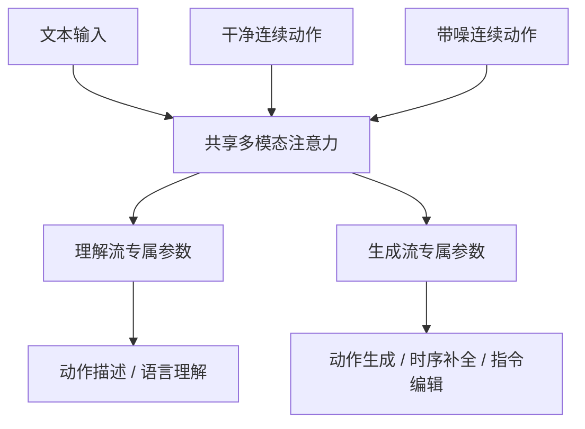

# Möbius｜统一动作语言模型（arXiv:2611.05279）

## 一句话定义

Möbius 将人体动作理解与扩散式生成纳入同一个多模态模型，支持文本生成动作、动作描述、时序补全及指令编辑。

## 英文缩写速查

| 缩写 | 英文全称 | 简要说明 |
|---|---|---|
| UMM | Unified Motion Model | 统一动作模型 |
| VAE | Variational Autoencoder | 本方法不依赖预训练动作 VAE |
| T2M | Text-to-Motion | 文本条件动作生成 |
| MIT | Massachusetts Institute of Technology | 合作研究机构 |

## 为什么重要

传统部分统一模型将语言理解交给语言模型、动作生成交给独立扩散模块；Möbius 让干净动作、带噪动作和文本共同参与共享注意力，并以任务专属参数处理不同流。它直接在连续帧级动作上建模，不依赖离散动作 token 或预训练 motion VAE。

## 核心信息

| 项 | 内容 |
|---|---|
| 论文 | [arXiv:2611.05279v1](https://arxiv.org/abs/2611.05279v1) |
| 机构 | 香港科技大学、腾讯游戏 Motus、麻省理工学院 |
| 任务 | Motion captioning、Text-to-motion、Temporal completion、Instruction-guided editing |
| 规模 | 摘要提及 1.7B 参数和 1700 小时动作数据 |
| 代码状态 | 官方仓库公开介绍，实际实现仍在内部审核中 |
| 核验边界 | 已读摘要与官方 README；全文、附录、实验表格未通读 |

## 方法流程（基于论文摘要及官方 README 的高层结构）

> 此图仅表达摘要与官方 README 明示的高层关系；不代表完整网络拓扑或扩散训练细节。

## 评测与证据

论文摘要称在 HumanML3D 上取得统一动作模型中的领先表现；具体指标、基线及统计条件仍待全文核验，暂不填入未经验证的数值。

## 结论

Möbius 的研究价值在于将动作理解和生成放入共享多模态表示空间，但复现与指标比较仍受公开材料限制。

- 适合关注统一动作建模与人形动作先验的研究者。
- 区分“无需独立扩散模块”和“完全不使用扩散”；后者不成立。
- 不能将人体动作生成结果直接等同于机器人可执行控制策略。
- 需在论文全文核查后补齐实验细节。
- 实现代码未开放，不能宣称可直接部署。

## 局限与工程实践

- 官方实现仍在内部审核，无法验证训练、推理入口或复现性。
- 论文全文与附录尚未通读；本节点保持草稿。
- 当前公开信息不能证明动作输出具备机器人动力学可行性或真实硬件控制能力。

## 源码运行时序图

不适用：官方仓库尚未发布可运行实现，无法核实实际入口与模块调用关系。

## 参考来源

- [论文归档](../../sources/papers/mobius_arxiv_2611_05279.md)
- [官方项目页归档](../../sources/sites/mobius-motion-language.md)
- [官方仓库归档](../../sources/repos/mobius-code.md)

## 关联页面

- [Awesome Text-to-Motion（Zilize）](./awesome-text-to-motion-zilize.md) — 文本到动作生成论文索引，可对照其他 T2M 方法
- [HumanML3D](./paper-notebook-humanml3d.md) — 论文摘要报告的主要评测数据集
