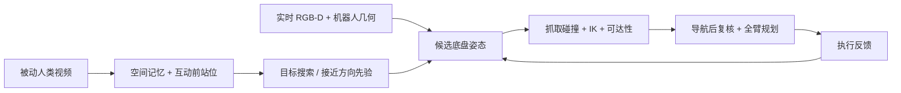
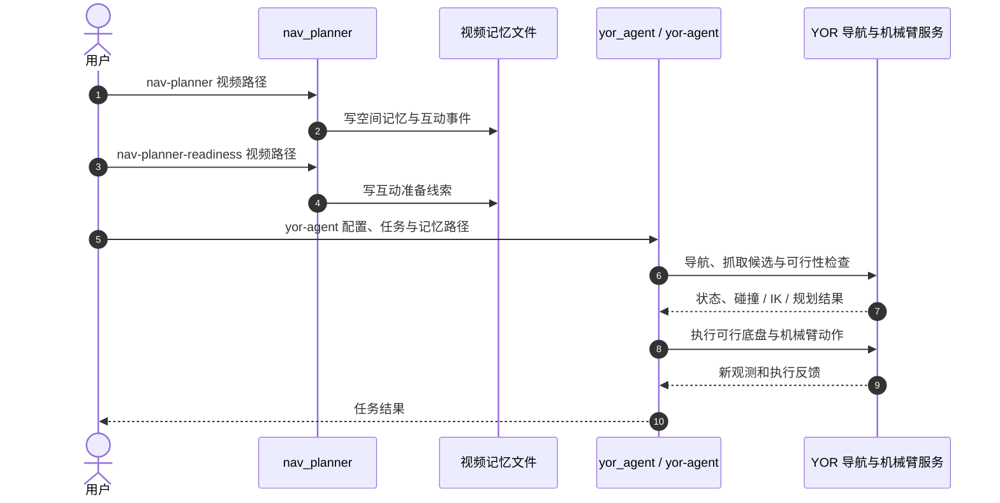

# MoCaP：让机器人找到目标后站到能抓的位置

**MoCaP**（*Mobile Code-as-Policies*）从被动人类视频提取“物体在哪里”和“人从哪个方向准备操作”的线索，让移动操作机器人在找到目标后继续寻找符合自身机械臂可达性与碰撞约束的底盘位置。

## 一句话定义

用人类日常视频提供搜索地点与接近方向先验，再由机器人自己的几何约束决定最终抓取站位。

## 英文缩写速查

| 缩写 | 英文全称 | 简要说明 |
|------|----------|----------|
| MoCaP | Mobile Code-as-Policies | 将视频经验与闭环代码策略用于移动操作的框架 |
| VLM | Vision-Language Model | 用于理解视频、场景与语言任务的视觉语言模型 |
| IK | Inverse Kinematics | 检查候选底盘位姿下机械臂能否到达抓取目标 |
| TCP | Tool Center Point | 机械臂末端工具中心点，抓取目标需转换到该坐标系 |
| RGB-D | Red-Green-Blue + Depth | 机器人当前视觉与深度观测，用于几何对齐和碰撞检查 |

## 为什么重要

物体定位成功只说明机器人看见或找到了目标，不能保证机械臂能从当前底盘位置够到它。桌沿、柜体、目标所在侧、底盘到达方向都会改变可抓取空间。MoCaP 将“找目标”和“准备好抓取”分成有联系但不同的判断：人类视频帮助选择更合适的接近方向，最终可执行性仍由机器人自身的几何、碰撞与 IK 检查验证。

## 核心原理

### 视频经验如何变成机器人先验

1. **离线构建空间记忆：** 从被动 RGB 视频提取物体、地标和地点连通关系，供之后的任务复用；同时记录人物与目标互动的事件帧。
2. **检索人与目标的互动：** 任务开始后按目标描述匹配历史互动，使用伸手前视图和前序视图估计人物相对目标的位置与朝向。
3. **对齐人和机器人视角：** 使用 VGGT 估计相机间相对位姿，并结合当前深度恢复尺度，将人类接近方向投影到机器人坐标系。该方向是排序/初始化线索，不直接作为必达的固定机器人轨迹。
4. **搜索可抓取底盘姿态：** 生成邻近平面位移与转角候选；对每个姿态变换抓取位姿，先用工作空间、夹爪碰撞和名义 IK 过滤，再偏好调整较小且保留多个可行抓取的姿态。
5. **执行并复核：** 移动后重新观测与验证可行性；通过后用 cuRobo 规划全臂预抓取和接近动作。失败信息回到代码代理，供下一轮重新规划。

代码代理不是低层连续控制器；它在闭环中生成 Python 程序并调用有机器人约束的原语。失败调用会停止当前程序，让代理结合新观测和执行反馈调整下一步。

## 源码运行时序图

官方仓库 [MoCAP-7/MoCAP](https://github.com/MoCAP-7/MoCAP) 公开 `nav_planner/` 与 `yor_agent/`。项目页与论文链接到该实现；仓库未注明许可证。

## 工程实践

| 环节 | 实现与使用注意 |
|------|------|
| 视频输入 | 使用日常被动 egocentric RGB；论文实验以 Aria Gen 2 录制，运行还需 API 凭据 |
| 搜索记忆 | 离线空间记忆可在多个任务间复用；固定启动摘要可能遗漏目标或随场景变化而过时 |
| 人类站位迁移 | 迁移的是接近方向先验；底盘停靠距离、可达性和执行轨迹需按机器人平台重新计算 |
| 姿态筛选 | 至少有一个抓取通过夹爪碰撞与 IK 检查后才纳入候选；移动后用新观测重新验证 |
| 代码复现 | 仓库 README 给出 `nav-planner`、`nav-planner-readiness` 与 `yor-agent` 入口；真机任务还需配置 YOR 服务和 API |
| 许可 | 仓库未提供 LICENSE 文件，使用或再分发前需先确认授权 |

## 实验与评测

论文在单一室内环境、YOR 移动操作平台上测试，包含双臂、夹爪、升降柱、全向底盘、ZED2i RGB-D 相机；Jetson Orin NX 运行 agent 与感知/规划服务。每个主要条件的试验数较少，场景来自一段人类视频。

| 评测 | MoCaP | 对照 / 读法 |
|------|------|------|
| 纸箱抓取 | 16/20 成功（80%），19/20 尝试抓取 | CaP-X 与碰撞感知导航变体 CaP-X+ 均为 0/20 成功 |
| 罐子抓取 | 8/10 成功（80%），10/10 尝试抓取 | 两个基线均未定位或成功抓取 |
| 蓝色垃圾桶导航 | 10/10 成功 | 无视频先验版本 7/10；ApexNav 2/10；CoW 0/10 |
| 抓取就绪底盘位姿 | 45 次配对试验中 38 次就绪（84.4%） | 无人类接近先验时 18/45（40.0%）；差异主要出现在与人类站位不一致的起始方向 |

基座站位消融中，先验组与对照组汇总差异在论文当前样本规模下不显著；不能将 84.4% 当作跨场景保证。该实验更直接支持的结论是：一个合适的接近方向线索可能减少“机器人虽已到目标附近、机械臂却够不到”的失败。

## 结论

**MoCaP 的关键价值在于把“看见目标”与“具备抓取条件”分开处理，并用人类接近行为改善底盘姿态搜索的起点。**

1. **定位不是可操作性：** 搜索成功后仍需评估底盘站位、夹爪碰撞与机械臂 IK。
2. **人类先验用于引导搜索：** 它提供接近方向，最终姿态仍由机器人可达性和碰撞约束决定。
3. **视频可跨任务复用：** 空间记忆与互动记录在用户请求到来前构建，不要求每个任务都采一条机器人示范。
4. **移动后必须重新核验：** 预测姿态受导航误差和深度缺失影响，论文在移动后重新观测并检查抓取条件。
5. **结果先视为可行性证据：** 单环境、单段视频和有限试验尚不能说明跨房间、跨对象泛化。
6. **代码可读可运行，但许可未明：** README 给出运行入口，仓库没有 LICENSE，复用范围需另行确认。

## 与其他工作对比

| 工作 | 主要差别 |
|------|----------|
| [CaP-X](https://arxiv.org/abs/2603.22435) | 提供代码代理式操作接口；MoCaP 在移动操作中增加被动视频空间记忆与人类接近方向先验，并显式检查真实机器人的站位可行性 |
| [SimVLA](./paper-simvla-zero-shot-mobile-manipulation.md) | 侧重仿真数据训练 VLA 并零样本迁移；MoCaP 使用冻结组件，将视频记忆接入运行时搜索与规划 |
| [Zero-shot Object Navigation](../tasks/zero-shot-object-navigation.md) | 物体导航关注抵达可识别目标；MoCaP 进一步判断目标周围是否存在可操作的底盘与抓取配置 |

## 局限与风险

- 评测限制于一个环境、一段视频和少数目标物体，当前证据主要证明系统可行，不代表多家庭泛化。
- 单次启动摘要可能遗漏相关物体或因场景变化变陈旧；基座局部搜索依赖可见几何。
- 深度观测不完整、机器人占地模型有误差时，碰撞检查也会受限。
- 论文当前操作范围是抓取与抬起；持续接触、精确放置和双臂协同未覆盖。
- 运行依赖专用机器人标定、RGB-D、Nav2/机器人服务、VLM/代码模型及 API 凭据，不是脱离系统集成即可部署的单一策略。
- 公开仓库缺少 LICENSE 文件；“代码可访问”不等于许可已明确。

## 关联页面

- [Manipulation](../tasks/manipulation.md) — 移动到目标附近之后，还需选择可抓取的底盘姿态。
- [Zero-shot Object Navigation](../tasks/zero-shot-object-navigation.md) — 空间记忆用于物体搜索，MoCaP 再接上操作站位筛选。
- [LLM 与机器人控制接口](../concepts/llm-robotics-control-interfaces.md) — 代码代理如何调用机器人原语。
- [SimVLA](./paper-simvla-zero-shot-mobile-manipulation.md) — 另一条零样本移动操作路线。

## 参考来源

- [MoCaP 论文来源归档](../../sources/papers/mocap_arxiv_2610_20998.md)
- [MoCaP 项目页归档](../../sources/sites/mocap-project.md)
- [MoCaP 代码仓库归档](../../sources/repos/mocap.md)
- [arXiv:2610.20998 HTML](https://arxiv.org/html/2610.20998v1)
- [MoCAP-7/MoCAP](https://github.com/MoCAP-7/MoCAP)

## 推荐继续阅读

- [MoCaP 项目页](https://mocap-7.github.io/MoCAP-page/)（视频与代码入口）
- [MoCaP 论文](https://arxiv.org/abs/2610.20998)
- [MoCaP 官方代码](https://github.com/MoCAP-7/MoCAP)
- [GraspGen-X](https://github.com/NVlabs/GraspGenX)（论文使用的抓取生成器）
