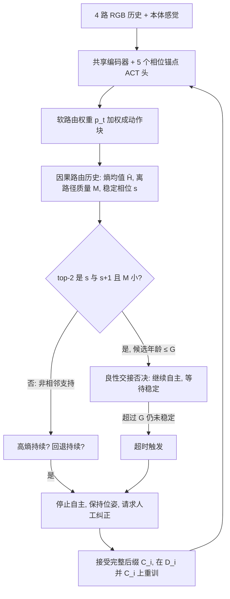

# MoE-DAgger（arXiv:2611.10825）

**MoE-DAgger**（*MoE-DAgger: Transition-Aware Router-Entropy Gating for Selective Human Correction in Phase-Structured Manipulation*，[arXiv:2611.10825](https://arxiv.org/abs/2611.10825)，UNIST，v1 2026-11-07）。项目页 <https://sj824.github.io/MoE-DAgger/>；论文未给仓库，项目页标 "Code (coming soon)"（2026-11-11 核查），故本页不写 `code:`。收录自公众号《机器人动作块太长，什么时候该重新规划？》（2026-11-11 的 53 篇论文速览）第 34 条。

## 一句话定义

**在「相位监督的软混合专家（MoE）」ACT 策略上，用因果路由历史判断一次高路由熵是相邻阶段的正常交接还是非相邻 / 回退的持续歧义，只在后者（或交接超时）时停下自主、请人接管纠正，用于 DAgger 的选择性数据采集。**

## 英文缩写速查

| 缩写 | 英文全称 | 简要说明 |
|------|----------|----------|
| DAgger | Dataset Aggregation | 在学习者自己访问的状态上加专家标注并聚合重训（见 [DAgger](../methods/dagger.md)） |
| MoE | Mixture of Experts | 多个专家头按路由权重加权；本文为软路由，5 个相位锚点动作头（§III-A） |
| ACT | Action Chunking with Transformers | 一次预测一整段动作块；本文每个专家头输出一个完整 ACT 块（块长 30 步，表 I） |
| ACT-TD | ACT-Temporal-Disagreement | 对照：重叠 ACT 块对同一步动作预测的分歧（式 10） |
| H / H̄ | normalized Shannon entropy / causal mean | 路由分布的归一化熵及其 5 步因果均值（式 3） |
| G / R | Green / Red | 两个任务：下层货架 / 上层货架推方块（§IV-A） |
| P0–P4 | Phases 0–4 | approach、entry/alignment、push、withdrawal/clearance、home return |
| CI | Confidence Interval | 表 II 用 Wilson 95% CI，差值用 Newcombe 95% CI（§V-C） |

## 为什么重要

- 作者自述（§I）：固定主动人工控制预算下，既要选「纠正哪条 rollout」，也要选「何时接管」；在碰撞开始之后才提议太晚，在良性交接处就提议又会阻止自主走到后面的交互状态。
- 作者自述（§III-B，命题 1）：软 MoE 的标量熵不能决定转移结构，K=5 时两个路由分布 (.475, .475, 1/60×3) 与 (.475, 1/60×3, .475) 熵同为 0.567 却对应「合法相邻」与「非相邻」支持。这解释了为什么直接用熵阈值会在正常换阶段处误报。
- 我的判断：这是把「已知任务阶段拓扑」当作采集先验的一个具体、可检验的做法，与常见的不确定性门控（集成分歧、扩散不确定度）互补而非替代；论文自己也承认并非全面优于无阶段不确定度（§VII-a）。

## 核心原理与流程总览

**策略（§III-A）：** 每个任务一个独立策略；共享编码器接 4 路 RGB 历史与本体感觉，5 个相位锚点动作头各预测完整 ACT 块，softmax 路由 p_t 加权混合；训练时用人工复核的相位标签对路由做（标签平滑）交叉熵，另有负载均衡与块平滑项（式 2）。运行时**不**给策略相位标签 / 进度变量 / 硬模式命令，路由不投影到相位图，可回退可重入。相位图只在采集规则里使用。

**采集规则（§III-B/C，式 3–9）：** 因果跟踪「稳定相位」s⁻。合法集合 A(s⁻)={s⁻, s⁻+1}，离路径质量 M_t = 1 − Σ_{k∈A} p_k。当 top-2 恰为 {s, s+1} 且 M_t ≤ τ_M 时视为局部兼容，开启交接候选；候选在年龄 ≤ G（30 步）内给出「有界良性交接否决」B_t，期间不因高熵发起查询。触发 Γ_t 为三支之一：持续高熵（H̄ 超阈值连续 5 步且无否决）、交接候选超时、持续回退（argmax 相位早于 s⁻ 连续 3 步）。部署版本关闭了跳变与动作分歧两支（§III-C）。

## 工程实践

- **硬件与任务（§IV-A）：** Franka Research 3，刚性两层货架夹具，推 7 cm 立方体过停止线、退出、回家；初始各 30 条示教（Green 9,956 帧 / Red 9,410 帧，共 968.3 s，20 Hz）。
- **数据与预算（§IV-A/B）：** MoE-DAgger 保留纠正集 2,251 / 2,551 帧 = 112.55 / 127.55 s 主动人工控制，各 15 条后缀；其余交互方法按此时长（±5%）匹配；整段后缀不裁剪；重训用 D_i ⊎ C_i。
- **阈值校准（§IV-B-b）：** 每任务 20 条开发轨迹上把原生分数阈值调到「10/20 条轨迹至少一次提议」，不按成功 / 失败平衡；表 I 的部署阈值 τ_H=0.50（Green）/0.46（Red）。filtered-H 沿用 MoE-DAgger 的熵侧设置且**不**单独重校准。
- **主要结果（表 II，n=50，2 个 checkpoint × 25 rollout）：** 任务成功率 Green / Red：BC-only 52.0/48.0；ExtraDemo-BC 58.0/46.0；Human-trigger DAgger 72.0/68.0；Phase-matched Random 62.0/60.0；filtered-H 62.0/52.0；ACT-TD 82.0/72.0；Ensemble 84.0/68.0；MoE-DAgger 84.0/78.0，碰撞 0.0/0.0。对 filtered-H +22/+26 pp（95% CI [4.6,37.8]/[7.3,42.4]）；对 ACT-TD +2/+6 pp（CI [−13.0,16.9]/[−10.9,22.5]，含零）。
- **共轨迹审计（表 III、图 4）：** 50+50 条无干预轨迹（失败 29/36）；B=15 / 25 时合并「对齐失败 / 提议」MoE-DAgger 83.3% / 80.0%，ACT-TD 70.0/72.0，Ensemble 63.3/60.0，filtered-H 3.3/2.0。这是回溯式的窗口对齐，不衡量干预能否挽救（§IV-C、§V-B）。
- **机制检验（表 IV、V）：** 影子回放中良性交接重叠 Green 66.0% → 0.0%、Red 49.7% → 2.1%；主动无否决消融中任务成功率 68.0/60.0 → 84.0/78.0（差值 CI 含零），序列执行 +10/+14 与碰撞 −10/−16 的 CI 不含零（§VI-C）。
- **复现状态：** 论文未发布代码，项目页 "Code (coming soon)"；所以阈值、重训清单等只能按论文表 I 与 §III-D 描述复核，无法运行验证。

## 与文章说法的核对

对照《机器人动作块太长，什么时候该重新规划？》第 34 条原话（claims 文件）：

| 文章说法 | 核对结果 |
|----------|----------|
| 「结合路由熵和阶段历史」 | 属实（§III）。更准确说是**软 MoE 路由分布的因果历史**加上**已知有序相位图**；运行时策略并不拿阶段标签 |
| 「区分正常阶段切换与危险回退」 | 基本属实，但「回退」只是三支触发之一（持续高熵、交接超时、持续回退，式 9）；论文把「非相邻支持」「超时」同样当作需要纠正的情形，「危险」是文章措辞，论文用 persistent non-benign ambiguity |
| 「选择人工纠正时机」 | 属实（摘要、§III-C/D） |
| 「同等人工控制预算下做真机比较」 | 属实：Franka Research 3 真机，预算按 MoE-DAgger 实际**主动人工控制时间**匹配 ±5%（§IV-B）。限定：不含离线相位标注与旁站时间，因此不等于总操作员工作量（§VII-c）。另有仿真 0 项 |
| 「目前主要验证两种相近货架推送任务」 | 属实：Green 下层货架、Red 上层货架，作者称"同一推送族的两个几何实例"，各自独立策略（§IV-A、§VII-c）。多任务复用、其他机器人未测 |
| （文章未写数字） | 补充：任务成功率 84.0/78.0%，比 filtered-H 高 22/26 pp；但与 ACT-TD（82.0/72.0）差距的 CI 含零，Green 上 Ensemble 与其并列 84.0%（表 II）。读文章时不应理解为"全面优于所有不确定性方法"，作者自己写"拓扑感知的分配而非普遍优势"（§VII-a） |
| 项目页 | 页面数字（84%/78%、+22/+26 pp、0/50 碰撞）与论文一致；代码标 "coming soon"，未核到仓库 |

## 局限

作者自述（§VII-c）：

- 单机器人、单夹具、两个同族几何实例；任务各用独立策略，多任务复用、可学习 / 非线性相位图、无监督技能发现、其他机器人与开放世界均未测。
- 每个方法—任务条件仅一份采集数据集，两个训练种子 + 重复 rollout 不量化采集集变异；只做一轮聚合，无收敛性或最优停止规则。
- 预算只计主动人工控制，不含离线相位标注与旁站时间；回溯关键窗口不等于干预能挽救该 rollout；碰撞失败仅 3 / 4 条，部分推动（partial push）覆盖仍有限（Green 12/15，Red 9/20，§VI-B），Red B=25 部分推动 ACT 7/20 高于其 6/20。
- 路由可能集中于单一专家而熵低、动作预测却分歧大，需与 ACT 时序分歧等信号融合。

我的观察（未被论文验证）：

- 需要相位监督：训练用的是人工复核的逐帧相位标签（§III-A），采集规则依赖已知有序相位图；对没有清晰阶段结构的任务如何迁移，论文未做实验，属推测。
- 主要对照差距的统计力：与 ACT-TD / Ensemble 的任务成功率差距 CI 含零，无否决消融的任务成功率差值 CI 也含零；较强的证据来自对 filtered-H 的差值和序列执行 / 碰撞差值。
- 部署阈值只以「10/20 条出现提议」校准，各方法的原生分数不可比，也没有对阈值敏感性做分析（正文未见）。
- 论文无代码，结果无法独立复现。

## 关联页面

- [DAgger（数据聚合）](../methods/dagger.md)：本文所改进的采集框架。
- [模仿学习](../methods/imitation-learning.md)、[行为克隆](../methods/behavior-cloning.md)：策略的训练基础。
- [动作分块（Action Chunking）](../methods/action-chunking.md)、[ACT](./paper-act.md)：专家头的输出形式与 ACT-TD 对照基础。
- [混合专家（MoE）](../concepts/mixture-of-experts.md)：软路由 MoE 背景。
- [DAgger 原论文 Ross et al.](./paper-ross-dagger.md)
- [主动式人机在环纠正](./paper-proactive-human-in-the-loop-correction.md)、[UniIntervene++ 自适应干预](./paper-uniintervene-plus-plus-adaptive-intervention.md)、[FlowDAgger](./paper-rcl-2607-08877-flowdagger-human-in-the-loop-adaptation-of-gener.md)：同属选择性人工干预方向，细节以各页为准。

## 参考来源

- [sources/papers/moe-dagger_arxiv_2611_10825.md](../../sources/papers/moe-dagger_arxiv_2611_10825.md)：论文通读归档（含项目页核对）
- [arXiv:2611.10825](https://arxiv.org/abs/2611.10825)
- 项目页 <https://sj824.github.io/MoE-DAgger/>

## 继续阅读

- [arXiv PDF v1](https://arxiv.org/pdf/2611.10825v1)
- [DAgger 方法页](../methods/dagger.md)
- [ACT 论文页](./paper-act.md)
