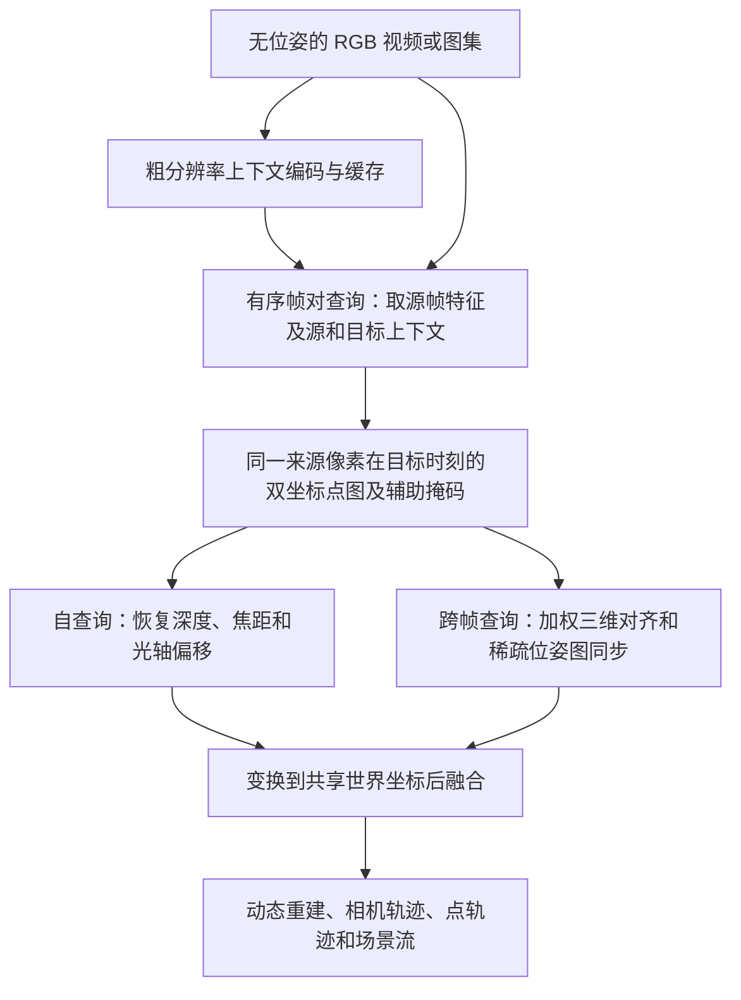

# MoGe-4D：统一稠密四维重建与跟踪 / Efficient, Flexible, and Unified Dense 4D Reconstruction and Tracking

## 一句话定义

**MoGe-4D** 从未提供相机位姿的 RGB 视频或图集出发，通过成对稠密点图联合估计深度、相机参数与三维运动；同一来源像素可在不同目标时刻查询，包括对被遮挡或移出画面的点做位置估计。

## 英文缩写速查

| 缩写 | 英文全称 | 简要说明 |
| --- | --- | --- |
| ViT | Vision Transformer | 全片段上下文编码器与轻量查询编码器采用的骨干类型 |
| RelEPE | Relative End-Point Error | 三维位置误差按真值点到相机距离归一化，不是米制绝对误差 |
| AUC | Area Under the Curve | 误差阈值精度曲线下面积；跟踪表采用 25% 的相对误差上限 |
| ATE | Absolute Trajectory Error | 将轨迹对齐后的相机位置误差，需同时注明对齐条件 |
| RGB-D | Red, Green, Blue and Depth | RigIDTrack 的记录和附录标注流程涉及深度，不是模型 RGB 推理前提 |
| Sim(3) | Three-Dimensional Similarity Transform | 同时允许旋转、平移和统一尺度变化的对齐 |

## 核心信息

| 项 | 内容 |
| --- | --- |
| 机构 | 中国科学技术大学、微软研究院、中国科学院大学、清华大学 |
| 作者 | Ruicheng Wang、Linlin Xin、Sicheng Xu、Jianfeng Xiang、Zelong Lv、Yu Deng、Yue Dong、Guangzhong Sun、Tong Zhang、Jiaolong Yang |
| 论文 | [arXiv:2611.32198v1](https://arxiv.org/abs/2611.32198v1)，2026-11-24；[HTML](https://arxiv.org/html/2611.32198v1) · [PDF](https://arxiv.org/pdf/2611.32198v1) |
| 输入与输出 | RGB 片段或图集；输出米制深度估计、相机内外参、稠密三维点图与运动、可见性和不确定性等。无序图集可做重建；解释运动方向和速度仍需有序时间信息。 |
| 发布状态 | [官方项目页](https://microsoft.github.io/MoGe-4D/)可读；截至 2026-11-28，代码和 RigIDTrack 数据尚在合规审核，未见权重下载。 |

## 为什么重要

移动相机拍到物体移动时，二维像素位移无法直接拆成相机运动和物体运动。把**同一个表面点在同一个目标时刻**同时表达在两台相机的坐标系中，就能从预测的三维对应解相对位姿，再分析物体运动，不必把深度、匹配和稠密点跟踪拆成完全独立的链路。

## 核心机制

1. **有序查询。** 对 `i → j`，两张点图都在来源帧 `i` 的像素网格上，预测这些点在目标时刻 `j` 的三维位置：allocentric 用来源相机坐标，egocentric 用目标相机坐标。自查询 `i → i` 恢复本帧深度；固定 `i` 扫过目标时刻是跟踪；固定 `j` 聚合多个来源是动态重建。
2. **粗上下文、细查询。** DINOv2、V-JEPA 2.1 或 VGGT-Ω 初始化的重型上下文编码器一次读全片段并缓存；轻量 DINOv2 ViT-B 重编码来源图像，经桥接特征取得源、目标上下文，以可调分辨率解码成对点图与辅助掩码。
3. **几何后处理。** 自查询用重投影估计焦距和沿光轴平移，假定主点居中；对有较高共视分数的帧对，用不确定性、动态、可见与天空掩码加权的三维对应估计相对变换，多帧在稀疏位姿图同步。将两张图转到共享世界坐标系后，以动态掩码从稳定背景与移动前景的两路预测中融合。绝对尺度来自学习和几何估计，世界系并非地理坐标系。

### 项目流程图

### RigIDTrack：训练监督，不是推理输入

在 Blender 中拟合运动一致的网格面群，每群共享逐帧仿射变换；保留 RGB-D、相机参数与像素群 ID 后，对一个源像素可逆投影、回到群内标准坐标、应用目标变换，再转入查询相机坐标。这里的「精确」指对**压缩后的仿射表面表示**做解析输运；不同群之间的原始形变可能有拟合误差。

补充材料报告合成训练集约 **18.99K 段、5.07M 帧、46.95 小时**，另有 88 段同一生成设置下的留出测试。表 9 的多物体运动记录平均 120.3 KiB，RGB+深度 776.4 KiB，额外约 **15.5%**；单物体 33.6 / 419.9 约 **8.0%**。不是所有视频固定多 15%，也不是模型运行显存。

## 评测结果与口径

| 维度 | 作者报告 | 如何读 |
| --- | --- | --- |
| 三维跟踪（表 2a） | V-JEPA 2.1 版对 V-DPM：世界系全点 RelEPE **0.138 → 0.077**，AUC **72.65% → 78.89%** | 六个基准均值，32 帧、5 FPS、首帧播种；世界系先 Sim(3) 对齐，不能当绝对尺度精度 |
| 米制深度（表 3） | DINOv2 版原始深度 Rel **0.079**、δ25 **97.00%**，DA3 为 **0.103 / 89.34%**；场景尺度诊断绝对对数误差 **0.060 / 0.072** | 五个真实基准，深度误差不做尺度拟合；尺度因子单列用以诊断偏差，不是没有误差或真机测距标定 |
| 多视角重建（表 2b） | VGGT-Ω 初始化版全局点相对距离 **0.045** 对原 VGGT-Ω **0.048**，但 AUC **84.13%** 对 **85.81%** | 对齐后指标各有所长，不能概括为每项都优于专用三维模型 |
| 效率与长度（图 7、12） | 518×336 的 50 帧全帧对查询约比 4RC 快 **4×**；Oxford-Spires 500 帧的 DINOv2 版无需滑窗也能跑相机轨迹 | 全查询仍随帧数平方增长；500 帧实验是对齐后的相机轨迹外推，不是 500 帧逐像素密集跟踪或在线实时 |

## 与其他工作对比

| 工作 | 分工差异 |
| --- | --- |
| [D4RT](./paper-d4rt.md) | 前者按时空单点发起查询；MoGe-4D 用有序帧对一次输出两张稠密地图。论文速度对照包含非官方 Open-D4RT，未实现原版查询去重，不宜把倍数解读为与官方实现的直接计时。 |
| [Track4World](./paper-track4world.md) | 用三维相关建模稠密场景流；MoGe-4D 以两坐标系的稠密点图约束位姿，再从世界系点的时间差恢复流。 |
| [π⁴](./paper-pi4-4d-scene-geometry-motion.md) | 两者都把未标定 RGB 用于四维感知；π⁴ 组织成共享视觉编码和几何/运动分支，MoGe-4D 的查图接口面向帧对及可调解码分辨率。不同评测不横排名。 |
| [LingBot-Map 2.0](./paper-lingbot-map-v2.md) | 若需要严格因果的流式建图，关注其逐帧更新与缓存；MoGe-4D 的上下文编码对完整输入片段计算，这不是同一运行方式。 |

## 工程实践与局限

- 做 Real2Sim 或动作提取时，用已知长度、标定板或可靠深度独立复核尺度与漂移；把相机轨迹及物体轨迹分开验收，并标出遮挡导致的推断区。点图不能直接提供碰撞网格、质量、摩擦或关节参数。
- 薄边缘易出现飞点，专门的手部/人脸捕获超出论文验证范围；V-JEPA 2.1 版在长度超过 100 帧时明显退化，不能用 DINOv2 的长片结果替代。
- **源码运行时序图：不适用。** 截至核验日，本项目无可运行官方代码；上图依据论文，不是实测运行轨迹，也未运行基准或模型。

## 结论

MoGe-4D 最值得看的是用一套查询把几何和轨迹相互约束。需要米制尺寸看未经尺度拟合的表 3；需要动态跟踪看表 2 的遮挡与对齐口径；需要长录制或真机使用时，仍要另外验证因果性、尺度漂移和下游物理资产。

## 关联页面

- [视觉三维重建流程](../methods/visual-3d-reconstruction.md)：分别验收几何、渲染与物理用途。
- [机器人状态估计流程](../methods/robot-state-estimation-workflow.md)：位姿量测、参考系和误差监测。
- [机器人仿真场景生成](../methods/robot-simulation-scene-generation.md)：点图或轨迹仍需转换为物理资产。
- [Real2Sim 纵深路线](../../roadmap/depth-real2sim.md)：Stage 1 的动态几何感知上游。

## 参考来源

- [MoGe-4D：论文全文核对归档](../../sources/papers/moge_4d_arxiv_2611_32198.md)
- [Microsoft 官方项目页与开放状态归档](../../sources/sites/moge-4d-microsoft.md)

## 推荐继续阅读

- [微软 MoGe-4D 项目页：原始示例与交互评测图表](https://microsoft.github.io/MoGe-4D/)
- [论文 HTML：附录 A.5、B 与 C](https://arxiv.org/html/2611.32198v1)
