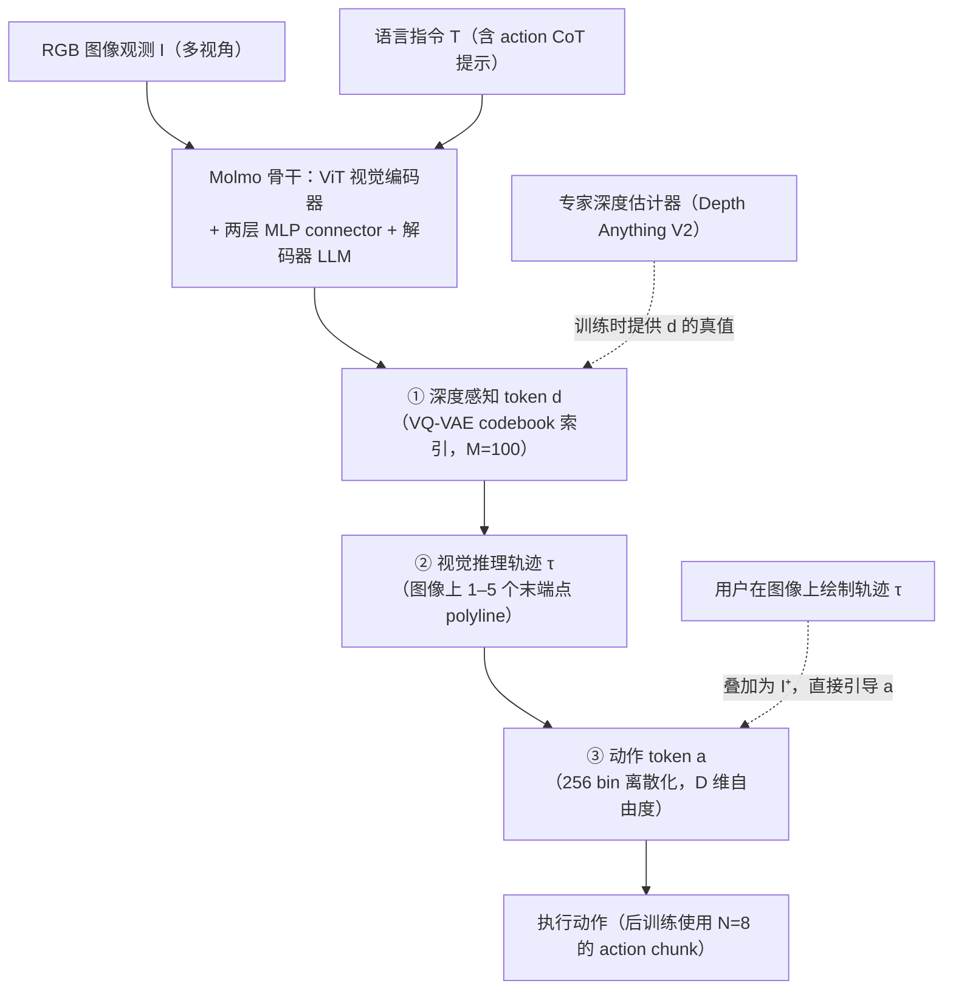

# MolmoAct

**MolmoAct**（[arXiv:2508.07917](https://arxiv.org/abs/2508.07917)，[GitHub](https://github.com/allenai/molmoact)）是 [Khushi 的 VLA 演进长文](https://x.com/starlitmatcha/status/2116918927913804223) 中单独成节介绍的模型之一。本页依据 arXiv 摘要页与该长文；技术细节以论文正文为准。

## 一句话定义

**MolmoAct 提出 Action Reasoning Models（ARM）：把感知、规划与控制放进结构化三阶段——深度感知 token、可编辑的中层空间轨迹、低层动作——使行为可解释、可引导。**

## 英文缩写速查

| 缩写 | 英文全称 | 简要说明 |
|------|----------|----------|
| ARM | Action Reasoning Model | 动作推理模型 |
| VLA | Vision-Language-Action | 视觉–语言–动作模型 |
| VQ-VAE | Vector-Quantized Variational Autoencoder | 离散化潜变量自编码器 |

## 为什么重要

- 在长文的演进线里属于「显式空间推理（深度 → 轨迹 → 动作）路线」。
- 摘要要点：论文摘要称：MolmoAct 将观测与指令编码为深度感知 token，生成作为可编辑的轨迹的中层空间规划，再预测精确低层动作；MolmoAct-7B-D 在 SimplerEnv Visual Matching 零样本 70.5%，超过闭源 Pi-0 与 GR00T N1.5；LIBERO 平均成功率 86.6%，长时程比 ThinkAct 多 6.3%；真实世界微调较 Pi-0-FAST 单臂多 10%、双臂多 22.7% 任务进度；分布外泛化多 23.3%；并首次发布含 1 万+ 高质量轨迹的 MolmoAct Dataset（中期训练，平均带来 5.5% 提升），开源全部权重、训练代码与数据。

## 流程总览

图依据：论文 §2.2–2.4（式 (4)(5)）、§4.3；Fig.2 训练流程。

## 长文的讲法（作者表述）

文章称其三阶段为：用 Depth Anything v2 与 VQ-VAE 把深度图压成 10×10 离散 token（作为训练目标，推理时不需再跑深度估计器）→ 预测至多 5 个图像空间点描述末端轨迹 → 输出 8 个离散化动作的 chunk；优点是能检查预测的深度与意图轨迹而非只看最终动作，缺点是生成中间 token 增加推理延迟，且「轨迹看着合理不等于执行正确」。文章称 MolmoAct 2 在其基础上提升空间推理、自适应深度预测并换成连续 flow-matching 动作专家。

## 核对

- **arXiv：** [2508.07917](https://arxiv.org/abs/2508.07917)（提交 2025-08-11），作者：Lee, Duan, Fang, Deng, Liu, Li 等（arXiv 摘要页前 6 位）
- 摘要与文章一致：深度感知 token → 可编辑轨迹 → 动作的三阶段结构。文章的 10×10 token、5 个点、8 个动作 chunk 等细节来自文章，未在摘要中核对。allenai/molmoact 仓库 README 称模型与数据集已于 2025/08/12 发布，训练 / 微调 / 评估代码已释出，并于 2026/5/5 发布 MolmoAct2（allenai/molmoact2）。

## 评测

以下数字均来自论文 §5（Table 1、Fig.5–9），评测模型为 MolmoAct-7B-D：

| 实验 | MolmoAct 结果 | 主要对照 | 说明 |
|------|---------------|----------|------|
| [SimplerEnv](./paper-simplerenv-real2sim-eval.md) Google Robot Visual Matching（零样本） | 70.5% | 超过 GR00T N1.5、π0、π0-FAST、Magma | 预训练约 26.3M 样本，论文称比 π0 的至少 903M 小一个数量级 |
| 同上，RT-1 子集微调后 | 71.6% | 比 Magma 高 3.2 个百分点 | |
| SimplerEnv Variant Aggregation（微调后） | 72.1% | 比第二名 RT-2-X 高 7.8 个百分点 | 与 Visual Matching 差距 < 1%，用作视觉分布偏移鲁棒性证据 |
| [LIBERO](./libero-benchmark.md) 四套件平均（LoRA 微调） | 86.6% | LIBERO-Long 比第二名 ThinkAct 高 6.3 个百分点 | chunk K=8，整段执行后再重新推理 |
| 真机 Franka 微调（单臂 3 任务 / 双臂 3 任务，每任务 50 条示教、25 次试验） | 任务进度比 π0-FAST 高 10%（单臂）/ 22.7%（双臂） | OpenVLA、π0-FAST | 指标为分段任务进度，非二值成功率 |
| 真机 OOD（语言改写 / 位置变化 / 干扰物 / 新物体） | 任务进度平均比 π0-FAST 高 23.3% | OpenVLA、π0-FAST | |
| MolmoAct Dataset mid-training 消融（3 个真机任务，各 10 次） | 平均提升 5.5% | 无 mid-training 版本仍比 π0-FAST / OpenVLA 高 14.8% / 10.9% | |
| 视觉轨迹引导（pick_up_bowl，15 次） | 成功率 75% | 比开放语言引导高 33%；语言引导下比 π0-FAST 高 29% | 体现「可编辑中层轨迹」的实际收益 |

- **人评：** SimplerEnv 开放指令跟随的 Elo 竞技场中，对 SpatialVLA 胜率 58%、对 OpenVLA 胜率 81%；轨迹生成 Elo 高于 Gemini-2.5-Flash、GPT-4o 与 HAMSTER。
- **口径注意：** 真机结果多为「任务进度」分段计分；SimplerEnv 零样本只评 Google Robot Visual Matching 套件（与其预训练分布最接近），不能直接外推到 WidowX 等套件。

## 与其他工作对比

| 维度 | MolmoAct（本页） | [OpenVLA](./paper-openvla.md) / [π0](./paper-pi0.md) 类端到端 VLA | [ECoT](./paper-ecot.md) 等语言 CoT VLA | [MolmoAct2](./paper-molmoact2.md) |
|------|------------------|------------------------|------------------|-----------|
| 中间表示 | 深度 token + 图像平面轨迹（可视化、可编辑） | 无，特征直出动作 | 文本子目标 / 语言推理 | 强化空间推理 + 自适应深度预测 |
| 动作头 | 离散动作 token（256 bin） | OpenVLA 离散 token；π0 flow matching | 离散 token | 连续 flow-matching 动作专家 |
| 可引导性 | 用户在图像上画轨迹即可改动作 | 只能改语言指令 | 只能改语言指令 | 延续轨迹可视化 |
| 预训练数据量 | 约 26.3M 样本（OXE 子集 + 推理标注 + 网页多模态） | π0 至少 903M 样本 | 视项目而定 | 见其页面 |
| 代价 | 生成中间 token 增加推理延迟 | 延迟较低 | 文本推理同样有延迟 | 见其页面 |

- **与语言 CoT 的区别（论文 §6.3）：** ECoT、CoT-VLA、ThinkAct 的推理落在文本、子目标图像或潜变量上，难以与场景精确对齐；MolmoAct 的每一步推理都能在图像平面与 3D 空间中解码出来。
- **与 RT-Trajectory / HAMSTER 的区别（论文 §6.2）：** 同样支持轨迹引导，但 HAMSTER 只输出 2D 轨迹交给固定任务集的底层策略，MolmoAct 在同一个 VLM 骨干里端到端完成轨迹与动作。
- **在本库演进线中的位置：** 见 [VLA 技术地图](../overview/vla-history-rt1-to-molmoact-technology-map.md)；后续 MolmoAct2 把离散动作换成连续 flow-matching 专家。

## 结论

**MolmoAct 证明「在空间里推理」（深度 → 轨迹 → 动作）能让 VLA 同时更强、更可解释、更可引导，且数据量比 π0 级模型小一个数量级。**

- 三阶段中间表示都可视化，用户画轨迹即可纠正动作（引导成功率 75%）
- SimplerEnv 零样本 70.5%、LIBERO 86.6%，真机微调与 OOD 均超过 π0-FAST
- MolmoAct Dataset mid-training 带来约 5.5% 的稳定增益
- 代价：中间 token 增加推理延迟；「轨迹看着合理」不保证执行正确
- 权重、代码与数据全部开源，后续由 MolmoAct2 接棒

## 关联页面

- [vla](../methods/vla.md)
- [paper-molmoact2](../entities/paper-molmoact2.md)
- [molmo2-vlm](../entities/molmo2-vlm.md)
- [paper-pi0](../entities/paper-pi0.md)
- [paper-openvla](../entities/paper-openvla.md)
- [vla-history-rt1-to-molmoact-technology-map](../overview/vla-history-rt1-to-molmoact-technology-map.md)

## 参考来源

- [molmoact_arxiv_2508_07917.md](../../sources/papers/molmoact_arxiv_2508_07917.md)
- [x_starlitmatcha_vla_history_rt1_to_molmoact2_2026-11-01.md](../../sources/blogs/x_starlitmatcha_vla_history_rt1_to_molmoact2_2026-11-01.md)
- [arXiv:2508.07917](https://arxiv.org/abs/2508.07917)
- [arXiv PDF](https://arxiv.org/pdf/2508.07917)：已通读方法部分与实验：§2 MolmoAct（2.1–2.4）、§4 训练方案（4.1–4.3）、§5 实验评测（5.1–5.6）、§6 相关工作、§7 结论
