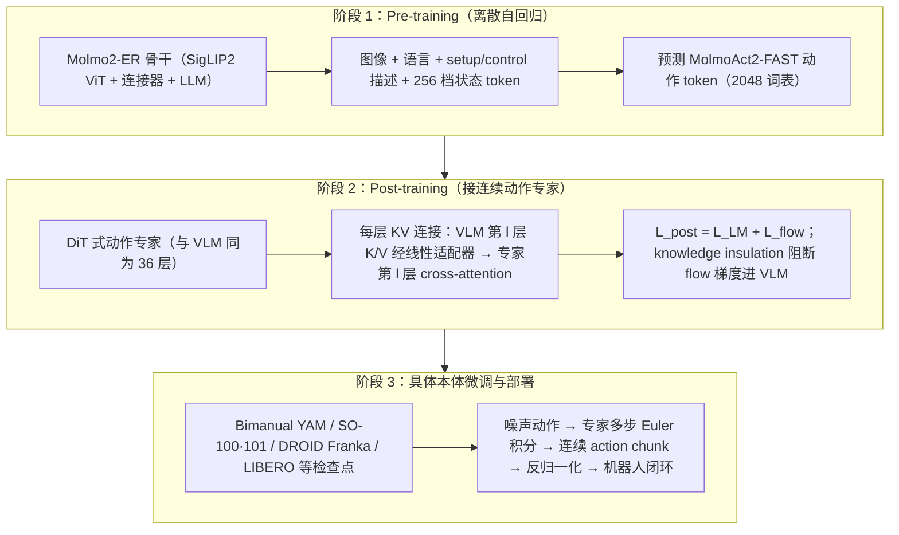
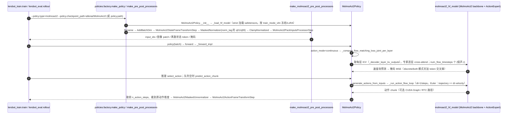

# MolmoAct2：面向真机部署的 Action Reasoning Models

**MolmoAct2**（*Action Reasoning Models for Real-world Deployment*，[arXiv:2605.02881](https://arxiv.org/abs/2605.02881)，[博客](https://allenai.org/blog/molmoact2)，[代码](https://github.com/allenai/molmoact2)）是 **Allen Institute for AI（Ai2）** 开源的 **action reasoning VLA** 家族：在 [Molmo2-ER](./molmo-er.md) 视觉-语言骨干上接入机器人状态与 **flow-matching 连续动作专家**，面向 Franka / SO-100/101 / 双臂 YAM 等真机闭环。

## 一句话定义

**MolmoAct2 = 先 ER（理解空间与任务）再出动作——并把整条栈开源到 LeRobot 可 fine-tune、可评测、可部署。**

## 英文缩写速查

| 缩写 | 英文全称 | 简要说明 |
|------|----------|----------|
| VLA | Vision-Language-Action | 视觉-语言-动作策略 |
| ER | Embodied Reasoning | Molmo2-ER 具身推理 mid-training |
| Ai2 | Allen Institute for AI | 发布机构 |
| HF | Hugging Face | 模型与数据集托管 |
| YAM | Yet Another Manipulator | 论文双臂真机平台 |

## 为什么重要

- **开源可部署 VLA 栈：** 相对闭源 frontier VLA，提供 base checkpoint、fine-tuned policy、BimanualYAM 数据集与 ManiSkill/DROID 零样本评测脚本。
- **ER→Action 两段式：** 与 LightNav「先 ER 再 SFT」、[Gemini Robotics ER](./gemini-robotics.md) 同路线；Molmo2-ER 数据集单独发布供 mid-training 研究。
- **产业评测触点：** [Manda Robotics 开放策略评测](./manda-robotics-open-policy-evaluation.md) 将 MolmoAct 2 列为 DROID 五策略之一；[Embody](./anthropic-embody.md) 用作 LLM 监督的操作基线。

## 核心信息

| 项 | 内容 |
|----|------|
| **机构** | Allen Institute for AI（Ai2） |
| **骨干** | Molmo2-ER VLM（论文 §4.1：SigLIP2 ViT + 连接器 + LLM）+ DiT 式 flow-matching action expert（§4.2：与 VLM 同为 L=36 层，逐层 KV 条件） |
| **开源** | **已开源** [allenai/molmoact2](https://github.com/allenai/molmoact2)；HF base/finetuned + ER datasets |
| **部署** | LeRobot MolmoAct2 policy；FastAPI 推理服务（DROID/YAM） |

## 流程总览

图依据：论文 §4.1–§4.3（Fig.4）。MolmoAct2-Think（自适应深度推理变体）不在 LeRobot 版本内，见下文「LeRobot 实现」。

## 评测

| 设定 | 读法 |
|------|------|
| MolmoSpace leaderboard | 官方称 **第一 VLA**（项目 README 口径） |
| ManiSkill 零样本 | DROID + Bimanual YAM sim eval 脚本已发布 |
| Manda RoboLab-120 | MolmoAct 2 报告 **13.8%** aggregate（DROID 零样本对照） |

## 与其他工作对比

| 维度 | MolmoAct2（本页） | 直出动作的端到端 VLA | 闭源 VLA 产品栈 |
|------|--------------------|----------------------|------------------|
| 推理结构 | **先 ER 后动作**：Molmo2-ER 骨干 + flow-matching 动作专家 | 特征直出动作 | 不可见 |
| 开源边界 | 代码 + base/finetuned 权重 + **ER 数据集** + LeRobot 部署栈 | 视项目而定 | 通常仅 API |
| 部署目标 | Franka / SO-100·101 / 双臂 YAM 真机闭环 | 视项目而定 | 产品本体 |
| 可复核性 | 高：第三方可 fine-tune、可重跑评测 | 中 | 低 |

- **「MolmoSpace 第一」的口径要看清：** 那是 **项目 README 的自报口径**，与 [Manda RoboLab-120](./manda-robotics-open-policy-evaluation.md) 上 **13.8% aggregate（DROID 零样本）** 是两套完全不同的评测面——前者偏空间认知，后者是第三方真机聚合成功率，**不可互相替代，也不可合成一个排名**。
- **开源栈本身是它的主要贡献之一：** 把 ER 数据、权重与 LeRobot 部署路径一起放出，使它成为少数能被外部 **重跑而非转述** 的 VLA；横比时这一点应计入，而不是只比成功率。
- **与骨干页的分工：** 视觉-语言能力归 [Molmo2-ER](./molmo-er.md) / [Molmo2 VLM](./molmo2-vlm.md)，本页只负责 **动作侧** 的结构与部署读法。

## 结论

**MolmoAct2 把「具身推理 + 连续动作 VLA」做成可复现开源产品，而非单次论文 demo。**

- Molmo2-ER 与动作头解耦，ER 数据可独立 mid-training
- flow-matching 连续专家对接真机 chunk 控制
- base + finetuned + 数据集 + LeRobot 集成 **已可跑通**
- Manda 等第三方评测将其列为开放策略对照组
- 相对闭源 Gemini/GR 系，数字需按各自 benchmark 协议读，不可横比 SR

## 核心方法（论文 §4，已通读方法与评测节）

- **Pre-training（§4.1）：** 从 Molmo2-ER 初始化，保持 Molmo2 的 token 接口；机器人样本在序列里加「状态 token」（归一化后每维均匀离散为 256 档）和「动作 token」（未来 1 秒轨迹，经 MolmoAct2-FAST Tokenizer，2048 词表，动作补零到 32 维）。数据 10% 多模态 + 90% 机器人（YAM / SO-100·101 / DROID 各 30% 机器人权重）；训练 200K 步、最大序列 4200 token、64 张 H100。
- **Post-training（§4.2）：** 在预训练 VLM 上加 DiT 式动作专家；专家每个 block 做动作自注意力、对应层 VLM 的 K/V 交叉注意力、MLP（AdaRMS 时间调制）。损失 L_post = L_LM + L_flow，每个 chunk 采样 K=4 个 (噪声, t)；动作最大 30 步×32 维，带补零掩码；VLM 的 K/V 在进入专家前 detach（knowledge insulation），目标离散动作 token 对专家被遮掉。训练 100K 步、专家学习率 5×10⁻⁵。
- **微调（§4.3）：** 流时间采样提到 8 个/chunk，不再使用 knowledge insulation，不含多模态数据。
- **MolmoAct2-Think（§5，LeRobot 未包含）：** 自适应深度推理，只对场景变化区域重预测深度 token。
- **数据与工具（论文自述）：** MolmoAct2-BimanualYAM（720 小时遥操作双臂数据）、MolmoAct2-DROID、MolmoAct2-SO100/101；Molmo2-ER 在 3.3M 样本语料上以「先特化再复习」训练。

## 实验要点（论文 Table 8 / §6.8，作者表述）

| 项 | 数字 | 备注 |
|----|------|------|
| LIBERO 平均 | MolmoAct2 97.2%（Spatial 97.8 / Object 100 / Goal 97.8 / Long 93.2）；Think 98.1% | 同表 π0.5 96.9、GR00T N1.7 97.0、π0 94.2 |
| RoboEval | 44.3% | 论文称高于次优 π0.5 3.8 个百分点 |
| 真机 8 个任务 | 平均 50.1% | 论文称比次优 OpenVLA-OFT 高 15 个百分点 |
| 单张 H100 控制频率（LIBERO，horizon 10） | MolmoAct2 优化后 55.79 Hz；离散动作路径 14.17 Hz | 论文自述；连续路径比离散快约 3.94 倍 |

上面的 Manda 13.8% 与 MolmoSpace 第一，是第三方/项目 README 口径，不在论文 Table 8 中。

## 源码运行时序图

### LeRobot 实现（固定提交 9e5ee98）

入口是通用脚本；MolmoAct2 特有代码在 `src/lerobot/policies/molmoact2/`（`modeling_molmoact2.py` 的 `MolmoAct2Policy`、`processor_molmoact2.py`、`molmoact2_hf_model/` 内移植的 HF 模型）。

### 官方原仓库

官方训练/评测/FastAPI 推理代码在 [allenai/molmoact2](https://github.com/allenai/molmoact2)（`sources/repos/allenai-molmoact2.md` 仅有概述）。本次未逐文件阅读该仓库，因此不在此绘制其时序图，避免以通用模板冒充；原页面此处原有的三节点示意图已被上面的 LeRobot 源码图取代。

## LeRobot 实现

- **范围：** 仅常规 MolmoAct2 的训练与评测；文档明确 MolmoAct2-Think（自适应深度推理）尚未包含在 LeRobot 策略中。原始论文实验的训练代码用 allenai/molmoact2。
- **安装与硬件：** `uv sync --locked --extra molmoact2`，需要 NVIDIA GPU；`policy.dtype=bfloat16` 时 VLM 大矩阵用 bf16、动作专家整体 fp32；`policy.compile_model=true` 只编译动作专家 block。未暴露原版的 `fsdp_devices` 模型并行。
- **权重与归一化：** `policy.checkpoint_path=allenai/MolmoAct2`（或 `allenai/MolmoAct2-LIBERO`）加载原始 HF 权重；`policy.path` 加载 LeRobot 保存的检查点。LIBERO 需使用官方 `norm_stats.json`，不要用 `lerobot/libero` 近似分位数。
- **默认与推荐（文档）：** `action_mode` 可选 continuous / discrete / both，官方机器人微调用 continuous；`train_mode_vlm` 默认 lora（fft / freeze 可选），动作专家始终全量训练；LIBERO 用 `chunk_size=n_action_steps=10`、`num_flow_timesteps=8`；`enable_knowledge_insulation` 默认 false，与论文微调阶段一致。
- **限制：** 图像增强默认关闭，需手动开 `--dataset.image_transforms.enable=true`，并且 LeRobot 通用变换配置无法表达原配方的 20% 高斯模糊。

## 关联页面

- [MolmoER](./molmo-er.md)
- [Molmo2 VLM](./molmo2-vlm.md)
- [VLA](../methods/vla.md)
- [LeRobot](./lerobot.md)
- [空间推理 benchmark 地图](../overview/spatial-reasoning-benchmarks-technology-map.md)

## 参考来源

- [lerobot.md](../../sources/repos/lerobot.md)：LeRobot 固定提交 9e5ee98 的 `docs/source/molmoact2.mdx` 与 `src/lerobot/policies/molmoact2/`
- [molmoact2_arxiv_2605_02881.md](../../sources/papers/molmoact2_arxiv_2605_02881.md)
- [allenai-molmoact2.md](../../sources/sites/allenai-molmoact2.md)
- [allenai-molmoact2.md](../../sources/repos/allenai-molmoact2.md)

## 推荐继续阅读

- [Ai2 MolmoAct2 博客](https://allenai.org/blog/molmoact2)
- [GitHub allenai/molmoact2](https://github.com/allenai/molmoact2)
- [MolmoAct v1 仓库](https://github.com/allenai/MolmoAct)（前代）
