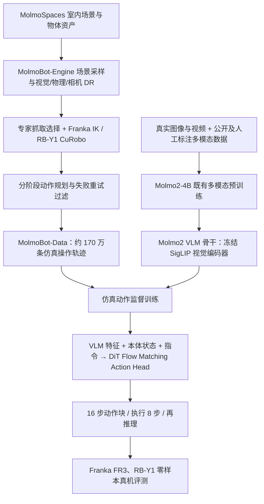
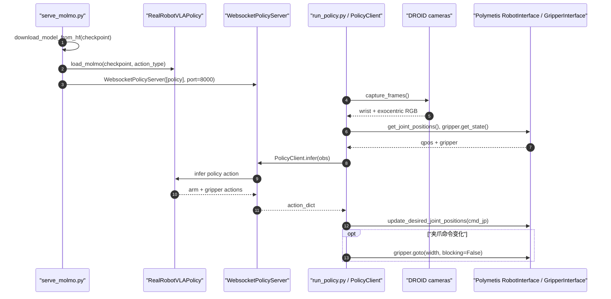

# MolmoB0T：大规模仿真实现零样本操作 / Large-Scale Simulation Enables Zero-Shot Manipulation

## 一句话定义

**MolmoB0T（MolmoBot）** 是 Ai2 提出的开放机器人操作研究：基于 MolmoSpaces 生成约 **170 万条仿真专家轨迹**训练多类操作策略，在 **Franka FR3 与 Rainbow RB-Y1** 上展示无需真实机器人轨迹训练和任务微调的 **Zero-shot Sim2Real**；旗舰策略**继承了经过真实图像/视频预训练的 Molmo2 视觉语言骨干**，所以“纯仿真”不能扩展到全部模型预训练（[论文 v3](https://arxiv.org/html/2603.16861v3)，§4.1）。

## 英文缩写速查

| 缩写 | 英文全称 | 简要说明 |
|------|----------|----------|
| Ai2 | Allen Institute for AI | 论文核心研发机构 |
| VLM | Vision-Language Model | 旗舰策略所用 Molmo2-4B 预训练多模态骨干 |
| VLA | Vision-Language-Action | 结合视觉/指令输入与动作预测的机器人策略 |
| DiT | Diffusion Transformer | 对 VLM 特征逐层交叉注意力的动作预测网络 |
| FM | Flow Matching | 以连续流匹配训练动作块的方案 |
| DR | Domain Randomization | 训练时随机化光照、材质、相机和物理参数 |
| Sim2Real | Simulation-to-Reality Transfer | 仿真数据训练策略直接在真实机器人运行 |
| DROID | Distributed Robot Interaction Dataset | Franka 的机器人/相机评测构型及对比基准 |

## 为什么重要

- **把机器人数据与视觉预训练分开理解：** 无真机动作示教 ≠ 不使用任何真实世界信息。论文明确保留 Molmo2-4B 已学习的图像/视频表征，且冻结 SigLIP 视觉编码器。
- **突破只靠小任务 sim2real 的范围：** 在可移动操作和桌面抓放上使用同一套程序化数据生产基础设施，并给出真实平台零样本验证。
- **提供可追踪的工程入口：** 模型训练、数据生成、checkpoint 和 DROID 真机推理脚本均公开，能检查动作 I/O 和控制环路。

## 核心信息

| 维度 | 论文/官方信息 |
|------|--------------|
| 主论文 | *MolmoB0T: Large-Scale Simulation Enables Zero-Shot Manipulation*，arXiv:2603.16861v3（2026-11-08），官网标注 CoRL 2026 |
| 机构 | 艾伦人工智能研究所（Allen Institute for AI, Ai2）、华盛顿大学、加州大学洛杉矶分校、达姆施塔特工业大学、普林斯顿大学 |
| 仿真专家数据 | MolmoBot-Data 约 1.7M demonstrations / 5,704h / 94.2k environments；论文 Table 3/4 |
| 机器人 | Franka FR3（DROID 构型）与 Rainbow Robotics RB-Y1 移动双臂 |
| 任务 | Pick、PnP Into、PnP Next-To、PnP Color、Open、Open-door（六种语义任务；数据发布列八种平台/场景配置） |
| 模型家族 | MolmoBot（Molmo2-4B + DiT/FM）、MolmoBot-Pi0（PaliGemma + FM）、MolmoBot-SPOC（轻量 Transformer） |
| 开源状态 | [模型/训练/推理代码](https://github.com/allenai/MolmoBot) · [MolmoSpaces 数据生成](https://github.com/allenai/molmospaces) · [模型权重](https://huggingface.co/collections/allenai/molmobot-models) · [数据](https://huggingface.co/datasets/allenai/molmobot-data) |

## 核心原理

### 两段预训练必须区分

| 阶段 | 使用的数据 | 是否涉及真实世界 |
|------|------------|----------------|
| **Molmo2-4B 视觉语言基座预训练** | 大规模图文、多图像、视频及人工标注/合成任务（[Molmo2 原论文](https://arxiv.org/html/2601.10611v4)） | **是**，其中包含真实图像、视频 |
| **MolmoBot 操作策略训练** | MolmoSpaces/MolmoBot-Engine 生成的机器人观测、状态、专家动作轨迹 | **没有使用真实机器人训练轨迹** |
| **零样本真机评测** | 未在目标真实任务上追加示教训练/微调，直接执行策略 | **是**，用于测试，不等于训练数据 |

MolmoBot 论文 §4.1 特别指出，Molmo2 接受过多图和视频预训练；训练 MolmoBot 时**冻结 SigLIP 视觉编码器**以保留视觉特征、避免对仿真伪影过拟合。论文 §5.3 还提出：较强的预训练视觉表征可能削弱继续增加仿真背景数量的边际收益。这一解释属于作者讨论，不是单独受控的“去掉所有真实视觉预训练”消融结果。

### 流程总览

图分别对应 Molmo2 原论文数据/预训练、MolmoBot v3 §§3–5 与图 2/3；**真实视觉基座预训练**和**仿真机器人动作训练**是不同阶段，不把前者错误画成仿真监督。

### 训练与控制接口

- **输入：** 当前 RGB 视角、语言指令、关节状态；旗舰 MolmoBot (H=1/2) 额外使用过去 1/2 帧观测（间隔 8 steps），某些任务可使用 2D 目标点。
- **输出：** 16 步 action chunk，执行 8 步后再推理；Franka 使用**绝对关节位置**，RB-Y1 手臂/躯干使用**相对关节位置**且底盘给平面偏移（论文附录 B.4/B.5）。
- **合成专家：** 从 MolmoSpaces-Grasp 候选抓取筛选、逆运动学/碰撞检查生成动作，分 phase 完成抓放与铰接任务；失败时重试，超过设定次数丢弃该 episode。
- **训练特性：** 图片与提示词增强，采样时提高成功抓取、重试和完成片段权重；用多个 flow matching 时间点监督轻量动作头。

## 实验与评测

| 对比（作者协议） | MolmoBot | 对照 | 适用范围 |
|---|---:|---:|---|
| **DROID / Franka 真机抓放成功率** | **79.2%**（MolmoBot H=1） | π₀.₅-DROID **39.2%** | 四个真实环境 × 10 项任务 × 每项 3 次，共 120 次/策略；不是所有机器人与所有任务 |
| 仿真 Franka 多任务平均 | **64.1%**（H=1） | π₀.₅-DROID **10.0%** | 论文 Table 1 的七个任务/渲染设定平均，不能直接与真实成功率混算 |
| RB-Y1 开门 | 展示零样本真机执行 | 无可比公开通用模型 | 有定性视频与独立仿真结果，**不引用 79.2%** 作为 RB-Y1 的成功率 |

**数据消融：** §5.3 报告抓取性能随合成轨迹数量改善；增加对象类别帮助仿真性能但未在该组真机评测中同样稳定；固定演示总量时只增加场景数量并未表现出单调收益。

## 结论

**MolmoBot 支持“大规模仿真机器人动作数据可用于零样本真机迁移”，但不支持“机器人模型从初始权重开始从未学习真实世界视觉信息”。**

1. **声明训练边界：** 论文证明的是 *simulation-only robot-policy training*，不是 *simulation-only VLM pretraining*。
2. **区分性能口径：** 79.2% vs 39.2% 是 120 次 DROID/Franka 真机抓放对照，不能泛化为任意机器人和接触场景。
3. **复现实验先固定接口：** Franka 的绝对关节指令、手腕加一外部相机、控制频率与动作块长度，不能直接套到 RB-Y1。
4. **理解泛化贡献：** Molmo2 的视觉先验与任务/对象/相机随机化的仿真动作数据共同起作用；仅由目前结果不能独立归因它们的百分比贡献。
5. **先做自有平台验收：** 把 RGB 域差、动力学域差、安全限幅和任务失败恢复分别测试，不把单次零样本演示当成稳定交付。

## 与其他工作对比

| 路线 | 主要数据来源 | 核心差别 |
|------|-------------|----------|
| MolmoBot | 预训练 Molmo2 的图文/视频先验 + **仿真机器人操作轨迹** | 无目标平台真机示教训练与微调的零样本操作 |
| [MolmoMotion](./molmo-motion.md) | 视频 3D 点运动预训练，后用于操纵骨干初始化 | 强调物体级运动先验；下游 DROID 实机数据微调研究**不是** MolmoBot 零样本实验 |
| [MolmoBot-Data](./dataset-molmobot-data.md) | 程序化仿真专家轨迹 | 数据实体，和本页**论文/模型**实体分开维护，不复制论文主体内容 |
| [Sim2Real 方法横向对比](../comparisons/sim2real-approaches.md) | DR、系统辨识、适应 | MolmoBot 主要依靠大规模随机化与视觉先验，不等同证明其他策略在所有域差中失效 |

## 源码运行时序图

官方仓 `MolmoBot/README.md` 和 `robot_eval/scripts/droid/run_policy.py` 给出了 **Franka 真机推理路径**，下图遵循这条可核对的入口（不把模型服务与硬件执行混成单进程）：

服务端 `serve_molmo.py` 的 `main → download_model_from_hf → load_molmo → RealRobotVLAPolicy → WebsocketPolicyServer.serve_forever`；DROID 端 `run_policy.py` 循环执行 `get_obs → policy_client.infer(obs) → update_desired_joint_positions`。图仅展示代码可核实的主干，不声称在本环境运行了真机。

## 工程实践

- **训练/复现：** 官方 `MolmoBot/README.md` 从 Molmo2-4B checkpoint 解包、`convert_to_unsharded.py` 开始，用 `torchrun ... launch_scripts/train_molmobot.py`、`--action_preset franka_joint` 和分布化的数据集路径训练；官方实验使用 8–64 H100，资源需求较高。
- **数据预处理：** 官方建议使用 `bulk_download.py` 下载指定任务配置，先 `validate_trajectories.py` 过滤，再 `calculate_stats.py` 计算 `actions` / `obs/agent/qpos` 统计。
- **真机服务：** `launch_scripts/serve_molmo.py --hf-repo allenai/MolmoBot-DROID --action-type joint_pos`；`robot_eval/scripts/droid/run_policy.py` 作为客户端，从相机与 Polymetis 读状态、通过 PolicyClient 请求预测并写入期望关节位置。
- **安全边界：** 查看配置的 `action_scale`、关节安全限制与丢帧/超时处理；`--no-max-delta` 会关闭服务端相对关节差限幅，不应在未受控真机验证时启用。
- **开放程度：** 训练、推理、数据生成代码及数据、模型权重均有公开入口；本文**未实际跑通训练或真机评测**，需基于固定 commit 与硬件安全程序逐步复现。

## 局限与风险

- **基座非纯仿真：** Molmo2 在真实图像、视频等多模态数据上训练。冻结视觉编码器意味着作者有意保留这些预训练特征；不能宣传为“无任何真实世界数据”。
- **任务域有限：** 以刚体和可动机构为主；论文 §6 明言可变形物与更复杂接触操作仍困难。
- **统计边界：** 真机 DROID 抓放指标以特定场景、对象、相机和平台为分母；RB-Y1 不提供等价通用策略基线。
- **稳定部署未证明：** 论文承认长期可靠部署可能需要真实目标环境数据、on-policy 失败与人工干预记录；成功率不是保证安全。
- **持续迭代代码：** README、模型数据、依赖版本可能变化；检查实际 commit 和许可证，不能由项目“开源”推断所有第三方资产统一许可。

## 关联页面

- [MolmoBot-Data 数据集](./dataset-molmobot-data.md) · [MolmoMotion](./molmo-motion.md)
- [Sim2Real](../concepts/sim2real.md) · [Domain Randomization](../concepts/domain-randomization.md) · [VLA](../methods/vla.md) · [Imitation Learning](../methods/imitation-learning.md)
- [Sim2Real 纵深路线（Stage 3）](../../roadmap/depth-sim2real.md)

## 参考来源

- [MolmoBot 论文 v3 通读记录](../../sources/papers/molmobot_arxiv_2603_16861.md)
- [Ai2 官方项目主页核查](../../sources/sites/molmobot-ai2.md)
- [MolmoBot/MolmoSpaces 官方源码及真实部署入口](../../sources/repos/allenai-molmobot.md)
- [MolmoBot-Data 官方数据集核验](../../sources/datasets/allenai-molmobot-data.md)

## 推荐继续阅读

- [MolmoB0T 原论文 arXiv v3](https://arxiv.org/html/2603.16861v3)
- [Molmo2 原论文 arXiv v4（真实图像与视频预训练来源）](https://arxiv.org/html/2601.10611v4)
- [Ai2 MolmoBot 项目和真机演示](https://allenai.github.io/MolmoBot/)
- [MolmoBot 训练与推理 README](https://github.com/allenai/MolmoBot/blob/main/MolmoBot/README.md)
