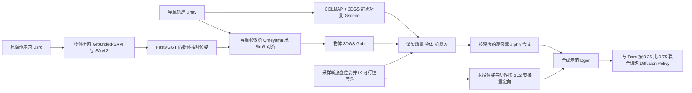

# MOMASPLAT（arXiv:2611.08372）

**MOMASPLAT**（*MOMASPLAT: Dynamic Novel-View Demonstration Augmentation for Mobile Manipulation*，[arXiv:2611.08372](https://arxiv.org/abs/2611.08372)，[项目页](https://robin-lab.cs.utexas.edu/momasplat/)）来自得克萨斯大学奥斯汀分校（UT Austin）RobIn Lab，作者 Sateesh Kumar、Arnav Balaji、Arpit Bahety、Skand Peri、Georgios Pavlakos、Roberto Martín-Martín（首页脚注与致谢）。原文通读记录见 [来源归档](../../sources/papers/momasplat_arxiv_2611_08372.md)。本页出自「具身运控lab」周报条目，周报说法的核对见文末「与周报说法的核对」。

## 一句话定义

**一个移动操作示范增强框架：把静态场景和被操作物体分开做 3D 重建，从采样的新底盘位姿重渲染整条操作轨迹（含接触后物体被移动的阶段），并按运动学变换动作，得到可直接用于模仿学习的合成示范。**

## 英文缩写速查

| 缩写 | 英文全称 | 简要说明 |
|------|----------|----------|
| MoMa | Mobile Manipulation | 移动操作：底盘导航加机械臂操作 |
| NVS | Novel-View Synthesis | 新视角合成 |
| 3DGS | 3D Gaussian Splatting | 三维高斯泼溅，可从任意视角光栅化渲染的场景表示 |
| SfM | Structure-from-Motion | 运动恢复结构，本文用 COLMAP |
| VGGT | Visual Geometry Grounded Transformer | 前馈 3D 基础模型，从无位姿图像序列直接估相机位姿；本文用其加速版 FastVGGT |
| IK | Inverse Kinematics | 逆运动学 |
| SE(2) / SE(3) / Sim(3) | Special Euclidean / Similarity group | 平面刚体变换 / 三维刚体变换 / 含尺度的三维相似变换 |
| PSNR | Peak Signal-to-Noise Ratio | 重建保真度指标 |
| DP | Diffusion Policy | 扩散策略，本文的下游模仿学习策略 |

## 为什么重要

- 论文指出（Sec. I）：移动操作中机器人很少从示范采集时的同一底盘位姿开始操作，而视觉运动策略对相机位姿变化敏感；靠多位置真机遥操作采集数据成本高。
- 已有 NVS 增强（如 One-Thousand Trajectories、VISTA）假设静态场景，只能增强接触前的自由空间动作（Sec. I、II）；本文补上接触后物体运动这一段。
- 论文自述的关键洞察（Sec. I）：常规移动操作数据采集已自带多视角，导航阶段（物体静止）覆盖场景，操作阶段提供物体中心观测，无需额外扫描或外置相机。

## 核心机制

### 流程总览

### 3D 重建（Sec. III-A、附录 B）

- **静态场景：** 用导航数据 Dnav 做 COLMAP SfM，稀疏点云初始化 3DGS，用 WildGaussians 的不确定性加权降低瞬态内容影响；重建时遮掉物体和机器人（机器人掩码由仿真器按记录的构型渲染得到），避免物体被「烤」进场景形成静态鬼影。SfM 只有未知尺度，用机载深度与渲染深度的逐像素比值中位数恢复米制尺度。
- **被操作物体：** 对象无已知 3D 模型，且小而弱纹理，不适合特征匹配；作者改用前馈 3D 基础模型 FastVGGT，对仅保留物体的帧估计「物体相对」相机位姿。由于物体在导航中静止，同一批相机分别被 VGGT（坐标系 v）和 SfM（世界系 w）定位，用 Umeyama（外加 RANSAC 与 Huber 精修，附录 B-2）求闭式 Sim(3) 对齐；再联合优化位姿与物体 3DGS（60,000 步）。关键帧之间用 SLERP 与线性插值补全逐时刻位姿。
- **铰接物体：** 只把运动的刚性部件（笔记本盖、炸锅篮）作为物体高斯，其余留在静态场景；不估计铰接参数，也不外推到示范之外的运动。

### 新底盘位姿合成（Sec. III-B、附录 C）

- **采样：** 在每个原底盘位姿周围 1.2 m × 1.2 m 内均匀采样平面位置，朝向使物体在相机视野中心，再加 ±20 度均匀噪声；要求源手臂轨迹（末端相对物体位姿不变）在若干探测时刻有 IK 解（cuRobo，TIAGo，OmniGibson），否则拒绝重采样。
- **渲染与合成：** 场景、物体、机器人三路分别渲染，机器人由 IK 得到的关节配置在 OmniGibson 中渲染，按逐像素深度排序和不透明度做前向 alpha 合成。
- **动作与本体感觉重定向：** 末端位姿用 ΔT = T̃⁻¹·T 变换；平移增量旋转到新底盘系，旋转增量的轴同样旋转、角度不变，夹爪指令不变。

### 策略训练（Sec. III-C、附录 D）

Diffusion Policy（ResNet-18 + 空间 softmax，输入 224×224 头部 RGB 与末端本体感觉，观测 2 步、预测 8 步动作块，AdamW 学习率 3e-4、batch 32、100,000 步）。源示范与合成示范采样比 0.25 : 0.75。

## 实验与结果

以下均为论文数据，设置见 Sec. IV-A：TIAGo，5 个真机任务、3 个场景，每任务 12 个未见底盘位姿各 3 次试验。

| 项 | 数值 | 出处 |
|----|------|------|
| 未见位姿平均成功率 | MoMaSplat 37%；One-Thousand Trajectories 17%；VISTA 8%；Source Only 6%；Action Augmentation 6% | Sec. IV-B |
| 原底盘位姿 | 各方法相当（3 个原位姿，各 15 次试验） | Sec. IV-B |
| 大位移 | PickPlaceBottle 30 cm 处 33%、CloseLaptop 40 cm 处 50%，此时各基线为 0 | Sec. IV-B |
| 源示范数量（PickPlaceBottle，10 至 20 cm 4 个点） | 10 / 50 / 90 条：33% / 42% / 50%；90 条不增强 8% | Sec. IV-B |
| 仿真生成质量（75 条，2,486 帧） | PSNR 全图 21.27 / 场景 26.40 / 物体 18.18 / 机器人 17.43 dB | Table I |
| 物体位姿误差（30 条） | 平移 1.46 ± 0.71 cm，旋转 4.01° ± 4.66° | Sec. IV-B |
| 真机重建 | 场景 24.00 dB（110 留出帧）；物体 23.63 dB（直接注册）/ 22.59 dB（插值） | Sec. IV-B |

作者解释：Source Only 与 Action Augmentation 在多数任务超过 10 cm 后接近 0；VISTA 不变换动作且逐帧生成缺乏时间一致性；One-Thousand Trajectories 只增强自由空间接近动作（Sec. IV-B）。这是作者自述的归因，论文未做更细的单项消融。

## 与其他工作对比

| 对照 | 论文口径的差异 |
|------|----------------|
| One-Thousand Trajectories（基线） | 静态场景 3DGS；本文复现时补上同样的动作重定向，并在 PickPlaceBottle 上只用 40 条初始物体位姿匹配的示范生成（400 条，附录 A） |
| VISTA | 用 ZeroNVS 单图扩散逐帧合成，不变换动作 |
| MimicGen 系 / MoMaGen | 在仿真中变换并拼接轨迹，常需真机开环 rollout 验证（Sec. II）；见 [MimicGen](./mimicgen.md) |
| Mobi-π（论文引用 [3]）类选位姿方法 | 论文称其选与训练分布匹配的底盘位姿但需预扫描和测试时优化（Sec. II）；本文改为训练对多位姿鲁棒的策略 |

## 工程实践

- **数据需求：** 每个任务 75 至 90 条真机遥操作示范加 9 条导航轨迹；除 RGB 外需机载深度（恢复尺度）与机器人构型（渲染机器人、遮挡机器人像素）。
- **流水线较重（编者读后判断）：** 需要 COLMAP、WildGaussians、Grounded-SAM 2、FastVGGT、gsplat 和 OmniGibson + cuRobo 多个组件，论文未报告端到端生成耗时。
- **关键超参（Table II）：** 场景 3DGS 30,000 步；物体 3DGS 60,000 步；Sim(3) RANSAC 子集 5 个相机、8000 次、内点阈 0.2 m；每条源示范 10 条合成示范。
- **代码：** 论文称将公开发布（Sec. V），入库时未核查是否已上线。

## 局限

论文自述（Sec. V）：假设场景大体静止、物体刚性可见，可变形物体、严重遮挡、弱纹理表面困难；场景模型来自物体被遮掉的导航视角，物体初始状态下遮住的区域（抬起瓶子下方、抽屉与炸锅内部）从未被观测、揭开后仍缺失；依赖稳定的开放世界分割；直接重放源物体轨迹，不建模接触力与动力学，因此示范非物理；视角质量取决于导航数据覆盖。

编者看到的未验证之处：

- 真机结果为每任务 12 位姿 × 3 次试验，样本量小，正文只给出平均值与个别点，未见置信区间（推测：单点差异需谨慎解读）。
- 合成示范只改视角，动作是源动作的刚体变换；论文未验证大位移时手臂可达性之外的闭环可行性（如底盘位姿大幅变化时的碰撞），只有 IK 筛选。
- 生成质量的定量对照仅在仿真一个任务上有真值；真机只评场景与物体，没有全图指标，原因是仿真机器人外观与真机不同（Sec. IV-B）。
- 物体 PSNR（18.18 dB）和机器人 PSNR（17.43 dB）较低，论文将机器人误差归因于合成时的光照与阴影差异；该归因是作者说法。
- 基线中 VISTA 和 One-Thousand Trajectories 为作者自行复现（含对后者追加动作重定向），其结果受复现细节影响。

## 与周报说法的核对

- 机构：周报写「待核实」，论文首页为 The University of Texas at Austin（RobIn Lab）。
- 「底盘位姿与示范采集位置存在偏差」「普通新视角增强难以重建接触后物体运动」：与论文 Abstract 和 Sec. I 一致。
- 「三维基础模型」：论文中前馈 3D 基础模型（FastVGGT）只用于估被操作物体的位姿；静态场景用 COLMAP + 3DGS，不是基础模型。
- 「生成具有动态物体交互的新视角示范」：物体运动是重放源示范中估计的物体轨迹，不是模拟动力学（Sec. V 自承非物理）。
- 「五项真实移动操作任务，鲁棒性明显提高」：属实，平均 37% 对最强基线 17%（Sec. IV-B）；但周报未给数字，且原位姿下各方法相当。

## 关联页面

- [模仿学习](../methods/imitation-learning.md)
- [Diffusion Policy（方法）](../methods/diffusion-policy.md)
- [Diffusion Policy（论文）](./paper-diffusion-policy.md)
- [生成式数据增强](../methods/generative-data-augmentation.md)
- [操作任务总览](../tasks/manipulation.md)
- [VGGT](./paper-vggt-visual-geometry-grounded-transformer.md)
- [SplatSim：高斯泼溅 sim2real](./paper-splatsim-gaussian-splatting-sim2real.md)
- [BEHAVIOR-1K](./behavior-1k.md)
- [MimicGen](./mimicgen.md)

## 参考来源

- [momasplat_arxiv_2611_08372.md](../../sources/papers/momasplat_arxiv_2611_08372.md)
- [arXiv:2611.08372](https://arxiv.org/abs/2611.08372)
- 具身运控lab 周报（Manipulation 条目，转述）

## 继续阅读

- [项目页](https://robin-lab.cs.utexas.edu/momasplat/)
- [arXiv PDF v1](https://arxiv.org/pdf/2611.08372v1)
- [VGGT](./paper-vggt-visual-geometry-grounded-transformer.md)
