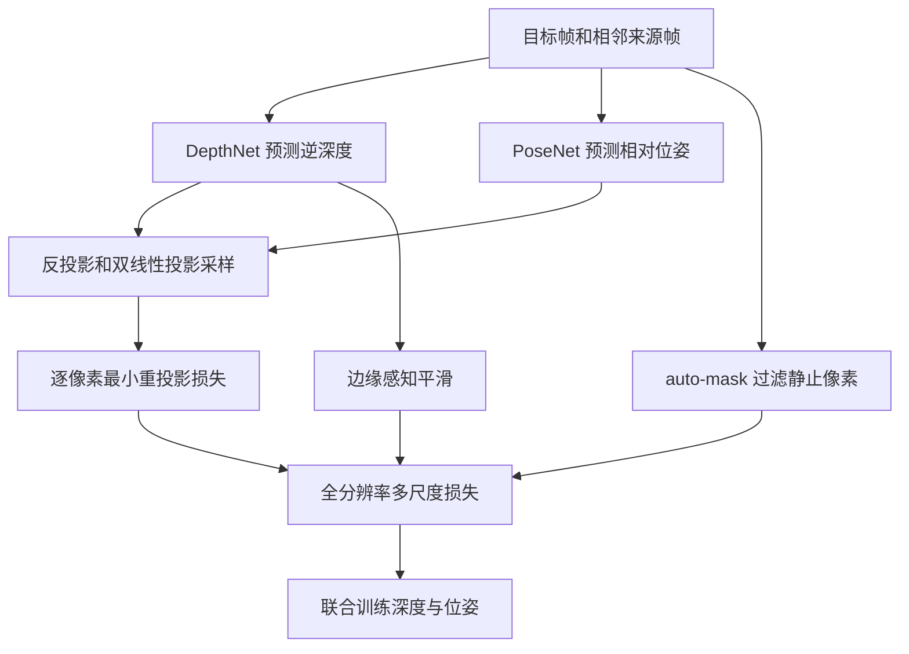
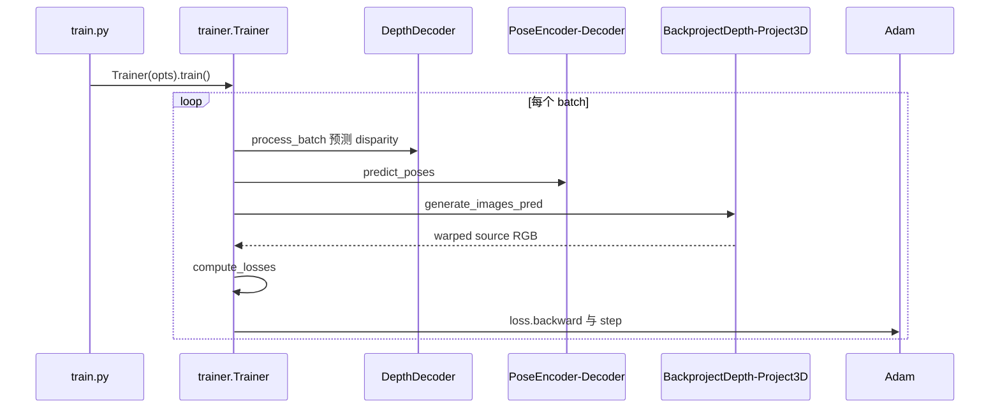

# Monodepth2 / Digging Into Self-Supervised Monocular Depth Estimation

## 一句话定义

Monodepth2 以逐像素最小重投影、自动静止像素掩码和多尺度全分辨率损失改进单目视频自监督深度估计。

## 英文缩写速查

| 缩写 | 英文全称 | 简要说明 |
|---|---|---|
| CNN | Convolutional Neural Network | 卷积特征学习网络 |
| 3D | Three Dimensional | 三维空间中的数据表示 |
| IoU | Intersection over Union | 空间候选/标注框重叠程度 |
| SSIM | Structural Similarity Index Measure | 光度损失中的结构相似性 |

## 为什么重要

Monodepth2 以逐像素最小重投影、自动静止像素掩码和多尺度全分辨率损失改进单目视频自监督深度估计。 对机器人视觉、点云感知和三维重建的意义在于清楚分离**测量数据、几何特征、网络预测与评价协议**；跨方法比较必须使用同类实验输入和指标。

## 核心原理与方法

DepthNet 用 ResNet18 encoder-decoder 预测目标帧逆深度；PoseNet 由两帧 RGB 预测 SE(3) 相对位姿。相机 K 与预测深度构建目标到来源帧的 warp，使用 L1+SSIM 光度误差。min reprojection 对每像素选最适合的来源帧，缓解遮挡；auto-masking 拒绝相机不运动或违反运动假设的像素；full-res multi-scale 让不同尺度视差在原图分辨率比较重投影误差。边缘平滑避免无纹理区域无约束发散。

## 流程总览（原论文方法）

## 源码运行时序图

**实际检查的入口：** train.py → Trainer(opts).train() → trainer.Trainer.run_epoch/process_batch → networks.DepthDecoder/pose → generate_images_pred → compute_losses → Adam step；evaluate_depth.py 和 test_simple.py 是评估、推理单独入口。。以下 Mermaid 对照作者仓库与运行模块，未宣称 GPU 运行成功。

## 实验与评测

arXiv v4 Table2 KITTI Eigen，640×192、仅单目视频 M：AbsRel 0.115、δ1 0.877；baseline（无三项改进）AbsRel 0.140、δ1 0.852。训练 20 epochs / ResNet18。单目评测按图 median scaling，非直接公制深度。反射、颜色饱和和边界模糊有论文 Fig8 明确失败示例。

## 结论

**Monodepth2 的价值在于明确的数据流与约束设计，而不是无条件提高所有场景的性能。**

1. 首先理解核心模块与原论文优化目标；
2. 比较结果时保留数据集、val/test、分辨率、是否带额外监督等条件；
3. 迁移到机器人平台应重新测量延迟、显存与传感器标定；
4. 原论文报告的结果不等于这里已独立复现。

## 工程实践

- 官方实现：[Monodepth2](https://github.com/nianticlabs/monodepth2)。
- 训练/评测时遵循作者 README，核对依赖版本、数据路径、模型配置和 checkpoint。
- 生产/机器人部署前需要验证误差/延时/坐标系，而不是直接套用论文训练超参数。

## 局限与风险

方法依赖图像亮度一致性和近似刚体场景假设；动态/反射或无纹理区域可能失效。单目视频训练的尺度无法凭网络自行获得米制真值。作者仓库训练环境为旧版 PyTorch，未在本次复现。

## 关联页面

- [SfMLearner（自监督单目深度与位姿的早期工作）](./paper-sfmlearner-zhou.md)

- [OpenPCDet](./openpcdet.md)
- [FeatDepth](./paper-featdepth.md)
- [COLMAP](./colmap.md)

## 参考来源

- [作者原论文全文归档](../../sources/papers/vision3d_monodepth2_primary_paper_20261108.md)
- [作者官方源码归档](../../sources/repos/vision3d_monodepth2_20261108.md)
- [arXiv 原始全文](https://arxiv.org/html/1806.01260)
- [作者代码](https://github.com/nianticlabs/monodepth2)

## 推荐继续阅读

- [完整原论文及引用](https://arxiv.org/html/1806.01260)
