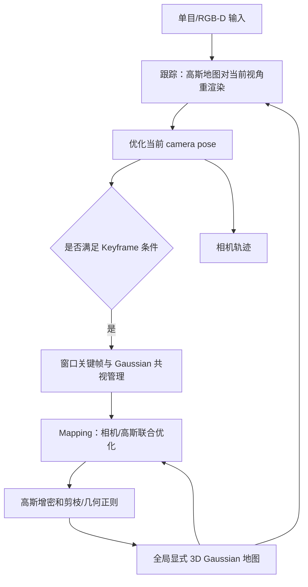
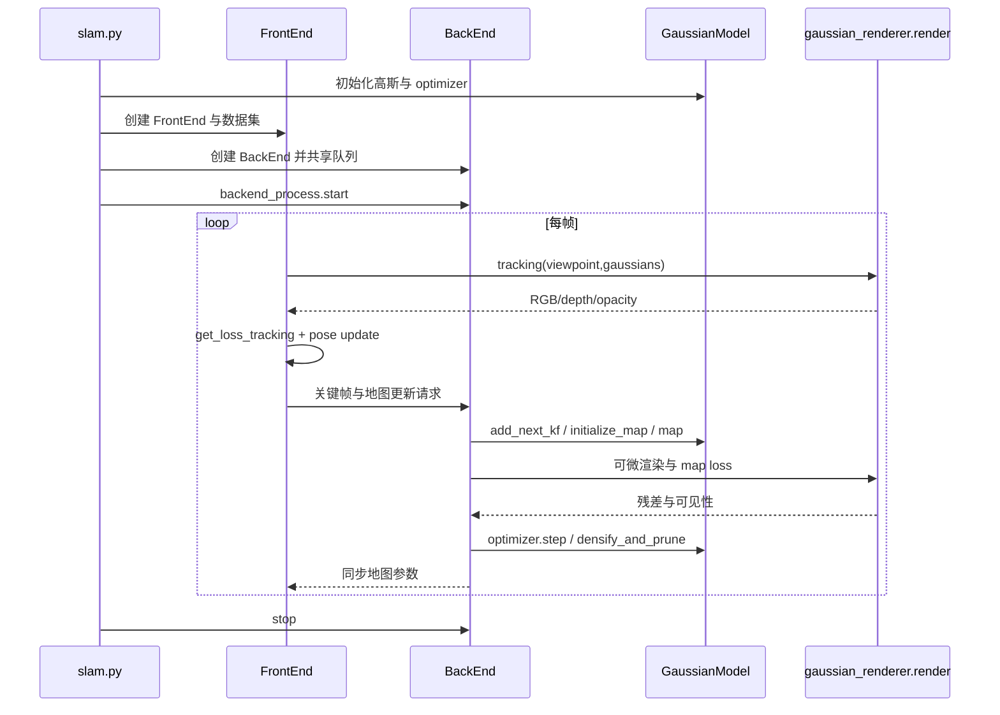

# MonoGS / Gaussian Splatting SLAM：单目高斯跟踪与稠密建图

## 一句话定义

CVPR 2024 MonoGS 在不依赖离线 COLMAP 位姿的条件下直接优化单目 SE(3) 相机姿态和全局 3D Gaussian 地图，也支持 RGB-D 与实验性双目模式；不是 Vladimir Yugay 的 Gaussian-SLAM。

## 英文缩写速查

| 缩写 | 英文全称 | 简要说明 |
|---|---|---|
| GS | Gaussian Splatting | 基于高斯核的可微渲染 |
| SE(3) | Special Euclidean Group | 三维刚体姿态流形 |
| BA | Bundle Adjustment | 相机位姿和场景结构联合优化 |
| RGB-D | RGB and Depth | 彩色与深度输入 |
| ATE | Absolute Trajectory Error | 轨迹误差 |
| FPS | Frames Per Second | 必须区分渲染与完整 SLAM 帧率 |

## 为什么重要

原始 3D Gaussian Splatting 假设输入图像的位姿精确且已知。MonoGS 把 camera tracking 和 map refinement 同时置于显式高斯表示内，研究单目尺度、共视窗口和 incremental 3D reconstruction 的困难；它是**单目 SLAM 系统**，不是 4DGS 动态物体建模方法。

## 核心原理与方法

1. **直接 pose 优化**：追踪时固定地图高斯位置，优化当前 SE(3) 相机位姿，单目图像使用光度残差；RGB-D 模式额外使用 depth residual；相机雅可比基于 Lie algebra 与 3DGS 投影推导。
2. **Keyframes**：通过 Gaussian covisibility（考虑遮挡）及中位深度归一化位移决定何时注册关键帧，并维护有限共视窗口。
3. **几何约束**：在增量地图下通过 isotropic shape regularization 和几何一致性缓解错误协方差/形状的高斯；通过 densify/prune 控制地图可观性。
4. **异步实现**：Python `slam.py` 创建 FrontEnd/BackEnd 以及 GUI 的进程队列；前端跟踪并请求关键帧，后端初始化、增量优化地图，前端与后端之间同步高斯参数。
5. **不等价于闭环系统**：作者 §5 提到未来要增加全局 loop closure。不能把增量局部窗口 BA 当成全局回环校正。

## 流程总览（论文 §3 / Fig2）

## 源码运行时序图

依据官方 `VSLAM-LAB/MonoGS` 的 `slam.py`、`utils/slam_frontend.py`、`utils/slam_backend.py`、`gaussian_splatting.gaussian_renderer.render` 的前后端真实入口，未经实机运行。

## 实验与评测

论文 Table1 TUM RGB-D ATE RMSE（单位 cm，三组序列）：

| 实验设置 | fr1/desk | fr2/xyz | fr3/office | 平均 |
|---|---:|---:|---:|---:|
| 单目，无闭环 | 3.78 | 4.60 | 3.50 | **3.96** |
| RGB-D，无闭环 | 1.50 | 1.44 | 1.49 | **1.47** |

Replica RGB-D：作者 Table2 多进程配置 ATE 平均约 0.58cm，单进程平均 0.32cm（不同 mapping iteration 数），不属于相同效率条件。论文报告总 SLAM 平均约 3 FPS，附录对渲染 FPS 和进程计时分别统计，不能把约 769 FPS 的渲染速度当整套 SLAM 速度。

## 与其他工作对比

MonoGS 与同期高斯 SLAM 的最大区别是**支持单目输入**并采用异步前后端；下表数值均出自各自论文自己的表格。

| 对照 | 差异 | 论文结果/说明 |
|---|---|---|
| [SplaTAM](./paper-splatam.md) | SplaTAM 只做 RGB-D，用 silhouette 掩码限定追踪像素，每帧顺序执行 Tracking→Densification→Map Update；MonoGS 单目/RGB-D 皆可，靠高斯共视窗口选关键帧，前后端异步 | SplaTAM 页面报告 ScanNet++ PSNR；本页报告 TUM/Replica ATE，指标不同 |
| [Gaussian-SLAM](./paper-gaussian-slam.md) | Gaussian-SLAM 用多个独立子地图控制规模；MonoGS 后端持有一个全局高斯集合 | 两者均无全局回环 |
| [GS-SLAM（Yan）](./paper-gs-slam-yan.md) | GS-SLAM 仅 RGB-D，位姿追踪只用 RGB 光度项、完整系统未开源；MonoGS 在 RGB-D 模式下额外加深度残差，并给出位姿解析雅可比，完整代码开源 | 三者作者与源码不同，避免混名 |
| [NICE-SLAM](./paper-nice-slam.md) | NICE-SLAM 是 RGB-D 隐式 feature grid；MonoGS 是显式高斯，单目也可运行 | 同为 TUM fr1/desk、fr2/xyz、fr3/office：NICE-SLAM Table2 报 2.7/1.8/3.0 cm（5 次取最佳），MonoGS RGB-D Table1 报 1.50/1.44/1.49 cm；两篇论文运行协议不同，仅作参考 |

## 结论

**显式高斯兼顾渲染与位姿优化，但实时跟踪依赖稳定共视窗口、几何正则和位姿初值。**

- 两个前后端独立，不能把代码调用画成严格同步顺序循环。
- 单目版的特定 TUM 结果不等于任何场景均有公制尺度或有可靠闭环校正。
- 实机部署需要谨慎处理相机初始化、剧烈运动、GPU 资源及光度曝光变化。

## 工程实践

- 官方示例 `python slam.py --config configs/mono/tum/fr3_office.yaml --eval` 使用 headless 评估；RGB-D 需使用对应 `configs/rgbd/` 配置。
- Realsense D455 现场演示需要相应 PyRealSense 与传感器数据，作者建议避免初始化前快速运动。
- `dev.speedup` 分支与主线版本独立，不可将其 10 FPS 声明套用到 main。

## 局限与风险

原论文 §5 未覆盖全局 loop closure；显式 Gaussians 本身不直接编码表面法线，后续网格提取需额外几何。强反光、曝光波动和低纹理区域可能让光度跟踪不稳定；GPU 自定义 rasterizer 的版本与显存适配是额外成本。

## 关联页面

- [NICE-SLAM](./paper-nice-slam.md)
- [SplaTAM](./paper-splatam.md)
- [Gaussian-SLAM（Yugay）](./paper-gaussian-slam.md)

## 参考来源

- [MonoGS 原始论文通读档案](../../sources/papers/vision3d_monogs_primary_paper_20261108.md)
- [MonoGS 源码通读档案](../../sources/repos/vision3d_monogs_20261108.md)
- [原文与附录](https://arxiv.org/html/2312.06741)
- [作者源码](https://github.com/VSLAM-LAB/MonoGS)

## 推荐继续阅读

- [CVPR 2024 作者原文](https://arxiv.org/html/2312.06741)
