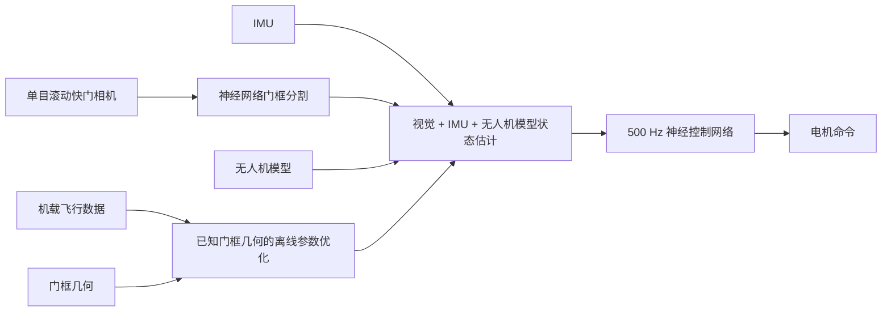

# MonoRace（Winning Champion-Level Drone Racing with Robust Monocular AI）

**MonoRace** 是代尔夫特理工大学提出的自主竞速无人机系统：它将单目视觉与 IMU 状态估计、赛道几何离线校准和 500 Hz 直接电机控制组合起来，在不使用 GPS 或外部运动捕捉的条件下完成高速竞速。

## 一句话定义

用前视单目相机和 IMU 感知赛道与自身运动，再由轻量神经网络直接控制电机，实现机载、低延迟的自主竞速飞行。

## 英文缩写速查

| 缩写 | 英文全称 | 简要说明 |
|------|----------|----------|
| IMU | Inertial Measurement Unit | 提供角速度与加速度观测，和视觉及无人机模型共同支持状态估计 |
| A2RL | Abu Dhabi Autonomous Racing League | MonoRace 论文报告的 2025 年自主无人机竞速赛事 |
| RL | Reinforcement Learning | 用于训练直接生成电机命令的神经控制网络 |
| GPS | Global Positioning System | MonoRace 无需依赖的全球卫星定位系统 |
| AI | Artificial Intelligence | 论文所比较的自主竞速系统类别 |

## 为什么重要

- **在有限传感器下做高动态飞行：** 单目滚动快门相机与 IMU 的组合，降低了对双目深度、GPS 和外部定位设施的依赖。
- **控制链路短：** 网络直接生成电机命令，减少传统多层控制器在感知与动作之间引入的延迟。
- **实机竞赛检验：** 工作在公开竞赛赛道中报告最高约 100 km/h 的速度，并处理相机干扰和 IMU 饱和，展示了资源受限机载 AI 的高动态应用。

## 方法栈

MonoRace 的机载闭环由视觉门框感知、状态估计与直接电机控制组成；另有离线流程用赛道几何和飞行数据优化估计参数。

| 阶段 | 输入 | 方法 | 输出 |
|------|------|------|------|
| 门框感知 | 前视单目滚动快门图像 | 神经网络分割赛道门框 | 门框图像区域 |
| 状态估计 | 门框分割、IMU、无人机模型 | 融合视觉与机体运动信息 | 位置与运动状态 |
| 参数细化 | 机载飞行数据、已知门框几何 | 离线优化状态估计参数和相机外参 | 经过校准的估计器参数 |
| 控制 | 估计状态 | 强化学习训练的小型神经网络，直接输出电机命令 | 机载执行器输入 |

### 流程总览

离线优化使用已知赛道几何对机载数据进行校准，尤其细化相机外参；在线飞行时，估计状态进入直接生成电机命令的控制网络。

## 实验与评测

TU Delft 报道与论文摘要给出的主要实机结果如下：

- 系统赢得 2025 年 Abu Dhabi Autonomous Drone Racing Competition（A2RL）。
- 在直接淘汰赛中超过其他自主竞速队伍和三位人类世界冠军飞手。
- 论文报告赛道最高速度约 100 km/h，并展示对相机干扰与 IMU 饱和的鲁棒性。
- 机载神经网络以 500 Hz 生成电机命令；系统不使用 GPS 或外部运动捕捉。

具体指标与实验条件应以论文全文为准；报道中的“世界最快”属于新闻标题表述，阅读时应以竞赛设置和论文评测口径判断。

## 结论

**MonoRace 的关键在于把可靠的单目状态估计和高速控制压进小型机载闭环，并以竞赛实飞验证其性能。**

1. **相机不是独立定位器** — 门框图像、IMU 和无人机模型共同参与状态估计，不能把系统简化成单目视觉直接回归全局位姿。
2. **离线赛道几何用于估计器校准** — 已知门框几何与飞行数据帮助细化参数，特别是相机外参；这属于校准流程，不是实时外部定位。
3. **500 Hz 是控制网络的命令频率** — 它描述网络生成电机命令的频率，不代表视觉感知、训练或所有传感器都以同一频率运行。
4. **竞赛成绩有明确边界** — 论文报告在 A2RL 赛道和直接淘汰赛中获胜；不能据此推断所有环境下都优于人类飞手。
5. **代码复现入口尚未确认** — 论文与校方报道未列出公开仓库，因此目前只能依据论文和报道理解方法，不能按源码复现部署。

## 源码运行时序图

**不适用：** 本次核查的论文与 TU Delft 官方报道未提供公开代码仓库或运行入口，因此没有可对齐的源码训练、推理或部署时序。

## 局限与风险

- **感知与外参误差：** 高速下图像模糊和滚动快门畸变会影响门框分割；离线外参优化依赖赛道几何及飞行数据质量。
- **竞赛泛化范围：** 报告结果针对特定竞速赛道和比赛条件；跨赛道、光照、机体与执行器的泛化仍需单独评估。
- **复现资料边界：** 当前给定来源未提供代码、权重或数据下载入口；不能仅凭论文结果推断系统可直接复现。
- **控制安全性：** 直接输出电机命令缩短了链路，但同时要求严格验证状态估计、网络输出限幅、失效检测和安全接管。

## 与其他工作对比

论文将 MonoRace 放在此前使用双目相机和 IMU、并在受控室内击败人类竞速冠军的自主竞速路线之后。MonoRace 的变化是用单目滚动快门相机面对竞赛环境，以已知赛道几何辅助离线状态估计校准，并将控制压缩为 500 Hz 直接电机命令。比较时应同时看传感器配置、定位设施、控制频率和赛道条件，不能只比较最高速度。

## 关联页面

- [State Estimation（状态估计）](../concepts/state-estimation.md) — MonoRace 的单目视觉、IMU 与无人机模型估计链路
- [Reinforcement Learning](../methods/reinforcement-learning.md) — 直接控制网络的训练范式
- [Gym-PyBullet-Drones](./gym-pybullet-drones.md) — 无人机仿真与控制研究环境

## 参考来源

- [MonoRace 论文摘录（arXiv:2601.15222）](../../sources/papers/monorace_arxiv_2601_15222.md)
- [TU Delft 官方报道归档](../../sources/sites/tudelft-monorace.md)
- [Science Robotics DOI](https://doi.org/10.1126/scirobotics.aee9250)

## 推荐继续阅读

- [MonoRace 论文（arXiv）](https://arxiv.org/abs/2601.15222)
- [TU Delft 官方报道](https://www.tudelft.nl/2026/tu-delft/de-wetenschap-achter-s-werelds-snelste-autonome-racedrone)
- [Gym-PyBullet-Drones 项目](https://github.com/utiasDSL/gym-pybullet-drones)
