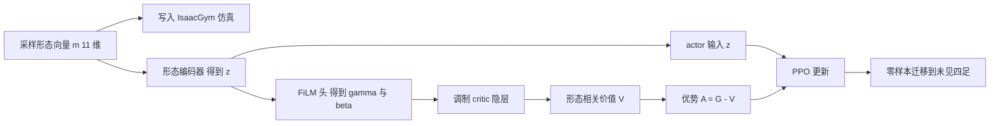

# MorFiC：用 FiLM 调制 critic 修正跨形态价值偏差（arXiv:2603.14554）

**MorFiC**（*MorFiC: Fixing Value Miscalibration for Zero-Shot Quadruped Transfer*，[arXiv:2603.14554](https://arxiv.org/abs/2603.14554)，Mishra、Raj、Xiao、Manocha；马里兰大学与乔治梅森大学）是一篇四足 RL 运动策略跨形态零样本迁移的论文。结论依据 [来源归档](../../sources/papers/morfic_arxiv_2603_14554.md)（v1 全文通读）。

## 一句话定义

**在标准 PPO 上只改 critic 的参数化：把机器人物理与控制参数（11 维形态向量）编码成潜变量 z，用 FiLM（逐特征仿射调制）作用于 critic 隐层，让单一共享 critic 为不同形态给出不同价值估计；仅在 Go2 一个源机器人（带形态随机化）上训练，零样本迁移到其他四足（§IV，作者自述）。**

## 英文缩写速查

| 缩写 | 英文全称 | 简要说明 |
|------|----------|----------|
| MorFiC | Morphology-Aware FiLM Critic | 本文方法名（§I） |
| FiLM | Feature-wise Linear Modulation | 用条件向量生成逐特征缩放 γ 与偏移 β 调制网络中间特征（§IV-D，引 Perez 等） |
| PPO | Proximal Policy Optimization | 本文唯一的优化算法，MorFiC 不改目标函数（§IV-E） |
| GAE | Generalized Advantage Estimation | 优势估计，λ=0.95（Table VI） |
| OOD | Out-of-Distribution | 形态落在训练分布之外 |
| EV | Explained Variance | 自举回报与 critic 预测的解释方差，文中衡量价值校准（图 3a） |
| DR | Domain Randomization | 域随机化（附录 C） |
| MDP | Markov Decision Process | 文中把多形态运动写成以 m 为参数的 MDP（§III-B） |

## 为什么重要

- **提出的视角：** 跨形态迁移不只是让策略更强（更大网络、更多机器人），critic 在形态间的干扰也是失败来源；这是作者的主张，靠对照实验间接支持，不是因果证明（§I、§VI-B）。
- **成本侧：** 只用 1 个源机器人加形态随机化、4 亿步、一块 RTX 4090 笔记本 GPU 训练（§V-E），对照 Table III 中动辄 16 到数百个训练形态的路线。
- **改动小：** 相对 PPO 只换 critic 的条件注入方式（拼接改 FiLM），容易移植到其他 actor-critic 运动训练（推测，未在文中验证其他算法）。

## 核心原理与流程总览

**问题陈述（§III、§IV-A）：** 训练时 m 从分布 p_train 采样且整条回合固定。同一状态在轻与重机器人上未来结果可能不同，共享 critic 被迫对不兼容的价值目标取平均，偏差经 Â = Ĝ − V 传到策略梯度（式 3、5）。

**方法栈（§IV-B 至 IV-F，附录 B）：**

1. 采样 11 维形态向量 m（Table I：5 个连杆质量加 3 个关节的上下限共 11 维），归一化到 [-1, 1]，写入仿真（质量、惯量、关节限位、力矩限位、PD 与动作缩放，图 2 图注）。
2. 形态编码器 z = f(m)，2 层 MLP（11→128→64，ELU）。actor 与 critic 共用同一个 z。
3. actor：π(a | o, z)。critic：主干输入 x = (o, 历史 h, 特权量 p)，每个隐层按 `h ← h(1+γ(z)) + β(z)` 调制（附录 B Table VII，末层零初始化、输出缩放 0.1，使起步近似无条件 critic）。
4. 训练：标准 PPO，奖励由速度跟踪、惩罚与三项稳定性塑形（直立、压力中心、足宽）组成（式 6 至 12，附录 A）。
5. 部署：编码器与策略导出为 JIT 模块，机载 LCM 状态估计与遥控指令（图 2）。

**评测（§V-D，Table IV）：** 指标为最大稳定前向速度 v̄、稳定速度窗口 Twin、最长不摔时长 Tmax；速度指令 1、2、2.5 m/s（Table IV 具体用哪一档文中未标）。

## 工程实践

- **环境与规模（§V-E）：** IsaacGym，4000 并行环境，dt=0.005，回合约 20 s，4 亿步；代码主要改自 Walk These Ways 与 legged_gym 系仓库（引 [30, 3]），见 [Walk These Ways](./paper-walk-these-ways-quadruped-mob.md)、[legged_gym](./legged-gym.md)。
- **形态随机化范围（Table I）：** 基座质量 3.30 至 6.92 kg，大腿质量 0.63 至 1.15 kg，小腿质量 0.06 至 0.17 kg 等，各维独立均匀采样；关节限位同样随机。
- **域随机化（附录 C）：** 摩擦 [0.5, 1.25]，每 15 s 推力最大 1.0 m/s，动作延迟历史最多 6 步；§V-E 另列关节摩擦、电机延迟、传感器噪声。
- **课程（§V-E）：** 指令速度课程，对所有基线一致。
- **PPO 超参（Table VI）：** γ=0.99，λ=0.95，ε=0.2，熵系数 0.01，5 epoch，4 minibatch，梯度裁剪 1.0。
- **测试时需要什么（Table III）：** 需要目标机器人的形态参数（Morph@test 为 ✓）并使用历史观测（Hist@test 为 ✓，ht 为 15 帧 × 48 维，Table II）。所谓零样本指不再训练或微调，不是不需要目标机器人信息（§III-A）。
- **真机（§VII）：** 机载 LCM 状态估计，Go1 与 Go2 均未微调；作者列出的失败来源为延迟与状态估计漂移、接触不匹配、Go2 的观测或动作缩放不一致以及保守的安全层（§VII-B）。
- **代码：** 论文未给出仓库链接，故 frontmatter 不写 `code:`。

## 评测证据与清单说法的对比核对

清单（Glen Berseth 的 CoRL 2026 阅读清单，条目由 LLM 据摘要起草）对本文的一句话：*A shared critic averages incompatible value targets across quadruped morphologies; fixing this miscalibration enables zero-shot transfer.* 逐项核对如下。

| 清单说法 | 论文实际 | 判断 |
|----------|----------|------|
| 共享 critic 对四足形态间不兼容的价值目标取平均 | §I、§IV-A 明确作此表述，但属作者主张与动机论证，文中无理论推导；实证只有图 3 的 EV 与优势噪声代理（定性读图）及图 4 的价值轨迹 | 与论文一致，但「平均不兼容目标」是假设而非被直接测得的机制 |
| 修正这种误校准「使得」零样本迁移成为可能 | 对照是 4 个 PPO 变体（Table IV），差别仅是形态信息如何注入 critic；未单独操控 critic 价值误差，也没有 FiLM 之外的其他 critic 解耦方案（如分形态 critic）作对照 | 因果表述偏强：论文证明的是「FiLM critic 优于拼接」，不是「校准本身带来迁移」 |
| 零样本迁移 | 仿真：Go2 训练，Go1、A1、AlienGo、B1、Cheetah、ANYmal 零样本（Table IV）。真机：Go1，以及 Go2（§VII-A） | 限定词缺失：见下 |

补充核对（清单摘要未覆盖的细节）：

- **Go2 真机不是跨形态迁移。** Go2 就是源训练机器人（Table IV 脚注「Training morphology」，§VII-A 说用的是 sim-transfer 同一份 Go2 权重）。真正的跨机器人真机迁移只有 Go1（Go2 训练）以及 A1 训练后到 Go1 与 Go2（70%，试验数未给）。摘要所说「两台真机零样本」按「无需微调」读成立，按「未见形态」读只对 Go1 成立。
- **并非全面占优。** Table IV：训练机 Go2 上 MorFiC v̄=1.911，低于 PPO 变体 1（1.942）与变体 3（2.174）。Go1 上 2.171 对 2.103，差距很小。Tmax：AlienGo 为 9.08，低于 PPO 变体 1（18.92）与变体 3（20.028）；B1 为 4.72，低于变体 3 的 5.028。B1 的 v̄ 虽从 0.049 升到 0.245（约 5 倍），绝对速度仍仅 0.245 m/s，Twin=0.72 s。引言称「所有平台上最高前向速度、更高成功率」，成功率表在文中并不存在，速度也不含 Go2。
- **「表中最优速度、6 台机器人」成立：** Table IV 图注称在 6 台上最优；按我的计算，对每台目标机取最强基线后平均提升约 0.26 m/s，与图注一致。
- **摘要的倍数是对不同基线算的：** A1 的 +16.1% 对 PPO 变体 1（2.286 对 1.969），Cheetah 约 2 倍对变体 3（1.193 对 0.595，对变体 1 为约 3.7 倍），B1 约 5 倍对变体 3（0.245 对 0.049）。
- **Table III 的「零样本 7 台」与 Table IV 的 6 台非训练机器人对不上：** 文中说 7 个目标含 2 台真机（§VI-C），口径不清。
- **数据以单次评测报告：** 文中未见种子数、置信区间或显著性检验。

## 结论

MorFiC 说明形态条件 critic 可能改善部分跨四足迁移，但速度、稳定性与源机器人表现并非同步提升。

- 按目标形态分别报告速度、摔倒与稳定时长，不只汇总速度优势。
- 复现前核对 FiLM 的正文和附录公式差异，并分离价值偏差与策略改进的证据。
- 真机部署需重新验证延迟、状态估计和缩放约定，不能从单源平地结果外推人形或极端形态。

## 局限

**论文自己承认（§VIII-B）：**

- 极端分布外形态（ANYmal，尤其 B1）迁移显著变差，倾倒与摔倒增多、速度下降。
- 只研究四足与速度跟踪运动，未评估双足与人形。
- 真机失败来自延迟、状态估计漂移、接触不匹配，Go2 上速度较低、失败率较高（§VII-B）。

**我看到的未验证之处（我的判断）：**

- **机制只靠相关证据：** 图 3 的 EV 在各目标机上并非 MorFiC 处处最高（如 Go2 与 Cheetah 上读图可见基线与之接近，仅为定性判读）；没有测「价值偏差」本身（如分形态回报的真值对比），也没有 FiLM 层数、位置、是否 actor 也用 FiLM 的消融。
- **基线只有 4 个 PPO 变体：** 与 URMA、GenLoco 等的对比只有 Table III 的特性对照，没有同条件数值对比。
- **Twin 列信息量低：** 多数项封顶 3.00 s，且若干行 Twin 与 Tmax 数值相同（如 A1 的 PPO 变体 2），指标定义不够清楚。
- **只有一个源机器人与一个模拟器（IsaacGym）：** A1 作源机器人只有真机的粗略结果（成功率 70%，次数未给），没有仿真表。
- **方法描述有细微不一致：** 正文式为 h̃ = γ⊙h + β，附录为残差形式 h(1+γ)+β；图 2 提到「可选自适应」但正文未说明是否启用。
- **真机试验次数偏少：** Go1 为 10 次，Go2 与 A1 训练的试验数未给；真机无与基线策略的对比。

## 关联页面

- [PPO](../methods/ppo.md)：MorFiC 的底座，只改 critic。
- [GAE](../methods/gae.md)：优势估计，决定 critic 偏差如何进入策略梯度。
- [域随机化](../concepts/domain-randomization.md) 与 [Sim2Real](../concepts/sim2real.md)：本文的形态随机化与真机部署背景。
- [分布外泛化](../concepts/out-of-distribution-generalization.md)：B1、ANYmal 等极端形态的表现。
- [跨本体迁移策略](../queries/cross-embodiment-transfer-strategy.md) 与 [跨本体枢纽](../overview/hub-cross-embodiment.md)：同主题的相邻路线。
- [运动控制任务](../tasks/locomotion.md)、[四足机器人](./quadruped-robot.md)、[legged_gym](./legged-gym.md)、[Isaac Gym](./isaac-gym.md)。
- [Walk These Ways](./paper-walk-these-ways-quadruped-mob.md)、[Rapid Locomotion RL](./paper-rapid-locomotion-rl.md)：本文引用并借用其训练代码与课程设计（§V-E）。
- [具身感知通才专家蒸馏](./paper-notebook-embodiment-aware-generalist-specialist-distillat.md)：另一条跨形态路线。

## 参考来源

- [morfic_arxiv_2603_14554.md](../../sources/papers/morfic_arxiv_2603_14554.md)
- [arXiv:2603.14554](https://arxiv.org/abs/2603.14554)

## 推荐继续阅读

- [arXiv PDF](https://arxiv.org/pdf/2603.14554v1)
- [PPO 方法页](../methods/ppo.md)
- [跨本体迁移策略](../queries/cross-embodiment-transfer-strategy.md)
