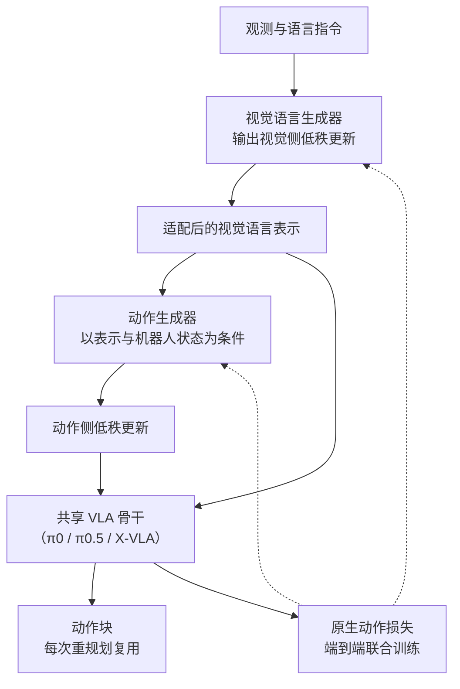
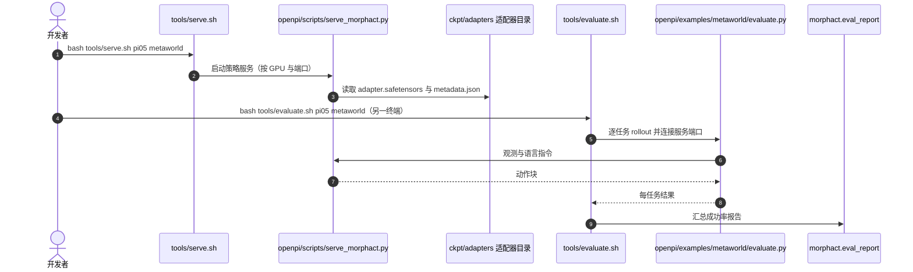

# MorphAct：机器人策略随操作情境改变参数

**MorphAct 让 VLA 的低秩参数更新随当前情境生成，并让视觉语言侧与动作侧生成器耦合训练，以缓解共享参数在不同操作之间的梯度冲突。**

论文 *MorphAct: Robot Policies Morphing with the Worlds They Act In*（[arXiv:2610.20019](https://arxiv.org/abs/2610.20019)，[代码](https://github.com/MINT-SJTU/MorphAct)，[项目页](https://mint-sjtu.github.io/MorphAct.io/)）。

## 英文缩写速查

| 缩写 | 英文全称 | 简要说明 |
|------|----------|----------|
| VLA | Vision-Language-Action | 视觉语言动作策略；本文骨干（π0、π0.5、X-VLA）均属此类 |
| VLM | Vision-Language Model | 策略中的视觉语言模块；MorphAct 先在此侧生成适配 |
| LoRA | Low-Rank Adaptation | 低秩适配；MorphAct 的更新同为低秩形式，但由生成器按情境输出，而非固定学习 |
| LIBERO | Lifelong Robot Learning Benchmark | 本文使用的操作仿真基准之一 |
| π0 / π0.5 | Physical Intelligence π0 / π0.5 policy | 本文骨干与真机对照基线 |

## 为什么重要

- 通用策略要同时承担接近、抓取、放置等不同操作，固定参数上的训练信号可能相互牵制；论文用原子任务诊断说明视觉语言与动作两侧都有此类冲突。
- 相比为每个任务单独训练适配器，MorphAct 不需要操作标签或专家适配器目标，适配规则在共享参数中学习。
- 选型读法：收益与推理延迟同时存在，真机绝对成功率仍低，需要带着数字看（见下文结论）。

## 核心信息

| 项 | 内容 |
|----|------|
| **机构** | 项目页列出：中国科学技术大学（USTC）、上海交通大学（SJTU）、新加坡国立大学（NUS）、南洋理工大学（NTU）、同济大学、深圳技术大学（转述，未核 PDF 作者单位） |
| **平台** | 骨干：π0、π0.5（OpenPI）、X-VLA；仿真：LIBERO、Meta-World；真机：论文报告，具体机器人未核实 |
| **数据** | LIBERO、Meta-World 标准评测；真机每任务 50 次 |
| **开源** | **部分开源**（2026-10-15 核查）：代码 [MINT-SJTU/MorphAct](https://github.com/MINT-SJTU/MorphAct)（MIT）公开；Meta-World 三个骨干适配器已发布于 Hugging Face；LIBERO 适配器标注 "coming soon" |

## 核心原理

### 流程总览

固定的共享 VLA 骨干之上，两个生成器按情境输出低秩更新：视觉语言生成器以观测与指令为条件，动作生成器以适配后的表示与机器人状态为条件。两者用原生动作损失联合训练，更新在每次重规划时生成一次，并在动作块内复用。

- 实现层面（推测，依据仓库 `morphact/tokenizer.py` 的 LoRA A/B 因子计数与 `morphact/_core.py` 的生成器结构）：生成器输出的是 LoRA 式因子，而非直接输出完整权重。

## 源码运行时序图

官方仓库以 `tools/serve.sh` 启动策略服务、`tools/evaluate.sh` 启动仿真客户端，二者通过端口连接（Meta-World 路径；LIBERO 路径为 `openpi/examples/libero/main.py`）。

- **最短复现路径（README）：** `bash tools/install_openpi.sh` → `bash tools/serve.sh pi05 metaworld` → 另一环境 `bash tools/evaluate.sh pi05 metaworld`。
- **训练入口：** `openpi/scripts/train_morphact.py`；X-VLA 侧见 `xvla/src/morphact_xvla/train_metaworld.py`。

## 工程实践

| 项 | 建议 |
|----|------|
| 复现入口 | 按上面的 serve / evaluate 两终端流程；需 Linux + NVIDIA GPU 与 `uv` |
| 适配器 | Meta-World：Hugging Face `MINT-SJTU/MorphAct-Metaworld`，放入 `ckpt/adapters/`；LIBERO 适配器待发布，需自行训练 |
| 消融优先 | 对照「固定条件化」「仅 VLM 更新」「仅动作侧更新」，确认收益来自两侧耦合 |
| 推理延迟 | 文章转述：相对共享 LoRA，π0 / π0.5 动作块延迟约 +18–21%（未核 PDF）；部署前实测 |
| 真机评测 | 论文每任务 50 次；五金分类绝对成功率仅 22%，小样本结论需谨慎 |

## 实验与评测

- **仿真：** LIBERO 与 Meta-World 上三个骨干均提升。Meta-World 均值：X-VLA 55.54 → 63.11，π0 50.75 → 67.05（最大 +16.30），π0.5 48.70 → 64.42。LIBERO 均值：X-VLA 93.05 → 97.20，π0 94.15 → 96.65，π0.5 96.85 → 98.60。
- **消融（X-VLA，LIBERO）：** 完整 97.20；固定条件化 87.50；任务 ID 条件化 88.25；仅 VLM 更新 43.50；仅动作侧更新 81.00；不适配特征 86.00。
- **真机（π0.5 → MorphAct，每任务 50 次）：** 分拣字母 82 → 92；五金分类 8 → 22；送水 78 → 86；柜子收纳 84 → 96。

## 结论

**MorphAct 的价值在于把情境相关的参数调整放进共享策略；收益与推理代价需要一起读，且仿真增益大于真机绝对提升。**

1. **条件化要同时作用在两侧** — 只更新 VLM 侧（43.50）或只更新动作侧（81.00）都明显低于完整版（97.20）。
2. **观测驱动的逐步生成优于固定条件** — 固定条件化 87.50、任务 ID 条件化 88.25，均低于完整方法。
3. **真机绝对成功率仍低** — 五金分类仅从 8% 升到 22%，结论只能说明方向有效。
4. **推理延迟要计入选型** — 文章转述相对共享 LoRA 延迟增加约 18–21%，需实测。
5. **复现程度分层** — Meta-World 适配器与推理入口公开，LIBERO 适配器未发布，复现 LIBERO 结论需自行训练。

## 与其他工作对比

| 对照 | 差异读法 |
|------|----------|
| [VLA](../methods/vla.md) 骨干（π0、π0.5、X-VLA） | MorphAct 是叠加在骨干之上的参数适配，不替换骨干 |
| [LoRA](../concepts/lora.md) | 共享静态 LoRA 对所有情境使用同一更新；MorphAct 的更新由观测和状态按情境生成 |
| [基础策略](../concepts/foundation-policy.md) | 通用策略通常靠数据规模与预训练；MorphAct 关注共享参数内部的任务竞争 |

## 局限与风险

- **评测范围：** 仿真集中于 LIBERO 与 Meta-World，真机仅少量任务、每任务 50 次，跨机器人外推未验证。
- **资源缺口：** LIBERO 适配器未发布；训练与复现需要 OpenPI / X-VLA 环境与算力。
- **推理开销：** 生成器增加延迟，实时控制需单独评估。
- **未核实项：** 作者单位以项目页转述为准，真机平台细节未核 PDF。

## 关联页面

- [VLA](../methods/vla.md) — 本文的策略骨干族
- [LoRA](../concepts/lora.md) — 最接近的参数适配对照
- [基础策略](../concepts/foundation-policy.md) — 共享策略的背景
- [分布外泛化](../concepts/out-of-distribution-generalization.md) — 多任务与情境变化的评测语境

## 参考来源

- [morphact_arxiv_2610_20019.md](../../sources/papers/morphact_arxiv_2610_20019.md) — 论文摘录与开源核查
- [arXiv:2610.20019](https://arxiv.org/abs/2610.20019) — 原文（cs.RO，2026-10-14 提交）
- [MINT-SJTU/MorphAct](https://github.com/MINT-SJTU/MorphAct) — 官方代码仓库

## 推荐继续阅读

- [MorphAct 项目页](https://mint-sjtu.github.io/MorphAct.io/)
- [MorphAct 论文 HTML 版](https://arxiv.org/html/2610.20019v1)
- [MorphAct-Metaworld 适配器（Hugging Face）](https://huggingface.co/MINT-SJTU/MorphAct-Metaworld)
