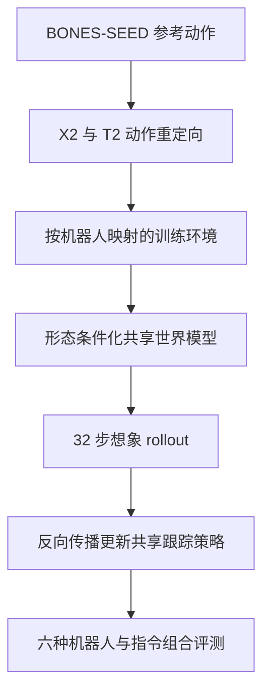
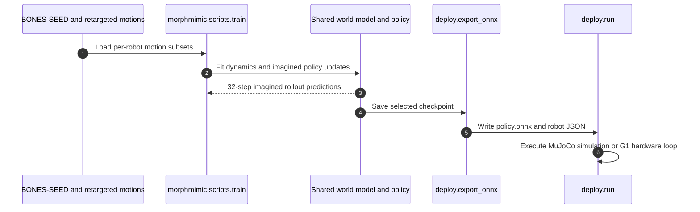

# MorphMimic：跨人形机器人共享可微世界模型与跟踪策略

**MorphMimic**（*Morphology-Conditioned World Model and Policy Sharing Across Humanoids*，2026 技术报告）由加州理工学院与佐治亚理工学院研究者提出，目标是在不同人形机器人上共同训练一个可微世界模型和一套全身动作跟踪策略。它沿用 SuperMimic 的“学习动力学模型，再通过短时想象 rollout 反向传播策略梯度”路线，并扩展到跨本体共享；官方仓库注明其 SuperMimic 基础算法是作者根据论文独立实现，并非 SuperMimic 作者的代码或经其认可的扩展。

## 英文缩写速查

| 缩写 | 英文全称 | 简要说明 |
|---|---|---|
| WM | World Model | 预测机器人状态随动作变化的动力学模型 |
| WBC | Whole-Body Control | 多关节协调的人形全身控制 |
| FiLM | Feature-wise Linear Modulation | 以形态描述符调制策略解码器隐藏特征 |
| IMU | Inertial Measurement Unit | 提供机身姿态和角速度反馈的惯性测量单元 |
| ONNX | Open Neural Network Exchange | 仓库用于导出共享策略的部署模型格式 |

## 为什么重要

常见动作跟踪栈会针对每种人形的关节命名、默认姿态、增益和力矩限制分别训练或适配。MorphMimic 把机器人本体显式作为模型输入，让多个相似人形复用同一套策略与可微动力学模型，并用一致的动作 latent 表示协调同一段人体参考动作在不同本体上的执行。除了完整全身参考，它还把稀疏的 VR 跟踪点接入同一个策略解码器。

## 核心原理

### 规范化接口

作者按运动学功能把关节映射到共同顺序，使用符号与角度偏移校准各机器人关节的方向和零位；动作再映射回各自的原生关节。机器人状态按 14 个跟踪刚体槽位对齐：骨盆等效体、每条腿三个刚体、躯干等效体、每条手臂三个刚体。统一接口对应 G1 的 29 关节布局，避免网络直接依赖各机器人不同的命名与排列。

### 形态条件化和共享潜空间

125 维形态描述符编码执行器和动作增益、力矩限制、肢段长度、躯干尺寸及质量。它被输入共享世界模型，并通过 FiLM 调制共享策略解码器。不同机器人之间的网络权重共享，而运动归一化统计、参考动作、回放数据及机器人常量各自保存。对应帧的全身参考经共享运动编码器得到 latent，训练时用对齐损失将各机器人 latent 拉近到跨机器人均值；五点编码器则学习生成可由同一解码器执行的指令 latent。

### 双接口训练流程

控制频率为 50 Hz。完整动作接口使用多帧关节与躯干目标；五点接口输入骨盆、左右手腕、左右脚踝的稀疏目标与可见性掩码，再由专用编码器映射到相同的策略 latent。源码提供动作转换、训练入口、checkpoint 到 ONNX 的导出、CPU MuJoCo 仿真，以及 G1 真机和 PICO VR 遥操作流程。

## 评测结果

| 设置 | 技术报告结果 | 解读 |
|---|---|---|
| 公共动作集合 | 128,786 段三个机器人动作库共有的片段 | 使用相同源动作并分别重定向到三台机器人 |
| 统一策略仿真生存率 | G1：全身 99.747%、五点 99.729%；X2 Ultra：99.891%、99.880%；T2：99.886%、99.852% | 生存率是从片段首帧确定性运行至末帧的比例；评测用标称仿真参数与干净观测和目标 |
| 与单机专家比较 | 所有共享配置在六种机器人/指令组合上的平均回报差距不超过 0.02 | 统一策略不是每个指标都优于各自专家；G1 五点接口的平均回报差距最大，为 0.018 |
| 联合训练成本 | 三张 H100 NVL 共 16.3 GPU-hours；三个单机器人专家合计 13.9 GPU-hours | 跨本体共享不是总 GPU-hours 更低的证据 |
| 真机演示 | Unitree G1 完成舞蹈、行走和实时 VR 遥操作 | 报告未展示 X2 Ultra、T2 真机部署；作者将其列作未来工作 |

## 源码运行时序图

仓库 README 将训练、ONNX 导出、Sim2Sim 与 G1 硬件入口分别列出。多机器人联合训练默认每台机器人占一个 GPU rank，实际运行需三张 GPU；仿真/硬件流程共享导出的策略，但机器人配置文件各自保存。

## 与其他工作对比

| 工作 | 路线 | 与 MorphMimic 的区别 |
|---|---|---|
| [SuperMimic](./paper-supermimic.md) | 单一人形上联合训练跟踪策略与可微世界模型，用想象 rollout 的解析梯度降低训练计算 | MorphMimic 沿用该路线，加入规范化接口、形态描述符和共享动作 latent，扩展到 G1、X2 Ultra、T2 三种本体共训 |
| [SONIC](./nvidia-sonic.md) | 扩大网络、动作数据与仿真训练计算的模型无关人形动作跟踪 | SONIC 靠规模化无模型训练；MorphMimic 靠可微世界模型与跨本体共享，报告重点是统一策略与单机专家的回报差距 |
| 单机器人专家（报告内基线） | 每台机器人各自训练世界模型与策略 | 统一策略六种组合平均回报差距不超过 0.02，但联合训练 GPU-hours 略高（16.3 vs 13.9） |

## 局限与风险

- **仿真到真机覆盖有限：** 只有 G1 有报告中的真机演示，X2 Ultra 和 T2 的近 99.9% 生存率是仿真评测。
- **指标边界：** 仿真测试使用确定性策略、标称物理参数、干净观测与目标；高生存率不等于抗传感器噪声、未见动作泛化或长时真机可靠性。
- **动作语料：** 三个训练库共享 128,786 段由共同人体动作来源重定向的片段；结果不能单独证明对不同来源或分布外动作的泛化。
- **算力对比：** 统一训练消耗 16.3 GPU-hours，略高于三个专家合计的 13.9 GPU-hours；统一方案强调共享部署与跨机器人复用。
- **新增本体成本：** README 与报告要求新机器人提供规范关节映射、形态描述符与重定向动作；并非无需适配的零样本通用控制器。
- **与 SuperMimic 的关系：** 共享的是研究路线和可微世界模型训练范式。官方 README 说明 MorphMimic 作者独立复现了 SuperMimic 基础方法，不能将其描述为 SuperMimic 作者实现或正式授权版本。

## 结论

**一句话总判：** MorphMimic 的关键进展是将可微模型动作跟踪扩展到跨人形本体共享，并用形态条件、规范化关节/刚体表示和共享指令 latent 支持同一策略控制 G1、X2 Ultra 与 T2。

1. **复用时要区分训练与部署：** 报告展示三种仿真人形共训和单一共享策略，但新本体仍需映射、描述符和动作重定向。
2. **把 99.7% 解读为仿真生存率：** 这是公共测试动作片段到达末帧的比例，不是泛化率或真机成功率。
3. **五点接口复用策略解码器：** 它把骨盆、手腕和脚踝目标编码成全身动作 latent，适合低维遥操作输入。
4. **真机结论限定在 G1：** 论文实机演示舞蹈、行走和 VR 遥操作，X2 Ultra/T2 实机是未来工作。
5. **先检查算力和数据成本：** 三模型共训使用 16.3 GPU-hours，略多于三个单机专家合计；联合模型的优势是策略复用，不是这组实验中的最低训练算力。

## 关联页面

- [SuperMimic：用一个可微世界模型扩展人形全身控制](./paper-supermimic.md) — MorphMimic 沿用其世界模型想象 rollout 训练路线，并扩展到多种人形本体。
- [SONIC：大规模自然人形全身控制](./nvidia-sonic.md) — 另一种人形动作跟踪扩展路线，可对照模型无关大规模仿真。
- [全身控制（WBC）](../concepts/whole-body-control.md) — 人形全身运动协调问题背景。
- [模仿学习](../methods/imitation-learning.md) — 参考人体动作驱动策略的训练范式。

## 参考来源

- [MorphMimic 技术报告](../../sources/papers/morphmimic_technical_report_2026.md)
- [MorphMimic 官方项目页](../../sources/sites/morphmimic-project.md)
- [MorphMimic 官方代码仓库](../../sources/repos/morphmimic.md)
- [SuperMimic 论文来源](../../sources/papers/supermimic_arxiv_2610_28480.md)

## 推荐继续阅读

- [MorphMimic 技术报告 PDF](https://lzyang2000.github.io/morphmimic/static/morphmimic.pdf)
- [MorphMimic 官方 README](https://github.com/lzyang2000/morphmimic#readme)
