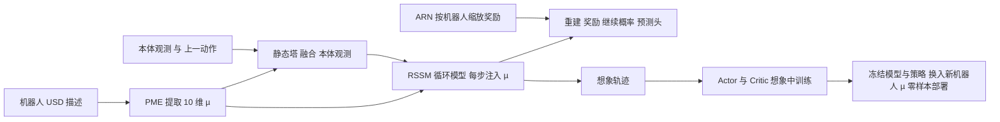

# QWM：形态条件世界模型的跨构型四足运动（arXiv:2604.08780）

**论文：** *Morphology-Conditioned World Model for Cross-Embodiment Quadrupedal Locomotion*（[arXiv:2604.08780](https://arxiv.org/abs/2604.08780)，cs.RO，v1 2026-04-09，v2 2026-08-17）。作者来自 McGill / Mila / 蒙特利尔大学 / ETH Zurich，含 Glen Berseth 与 Marco Hutter。本页以 v2 为准，v1（标题为 *Toward Hardware-Agnostic Quadrupedal World Models via Morphology Conditioning*）的差异单列在"与清单说法的核对"一节。

## 一句话定义

**QWM（Quadrupedal World Model）是在 DreamerV3 的 RSSM 上，把从机器人描述文件（USD）提取并归一化的形态向量 µ 同时注入编码器和循环动力学，再用按机器人类型的分位数奖励归一化稳定多机器人训练，使一个世界模型加一个在想象中训练的策略能零样本控制留出的四足机器人。**

## 英文缩写速查

| 缩写 | 英文全称 | 简要说明 |
|------|----------|----------|
| QWM | Quadrupedal World Model | 本文方法 |
| WM | World Model | 世界模型，学习环境动力学的预测模型 |
| MBRL | Model-Based Reinforcement Learning | 基于模型的强化学习 |
| RSSM | Recurrent State-Space Model | Dreamer 系的循环状态空间模型，含确定性状态 h 与离散随机状态 z |
| PME | Physical Morphology Encoder | 从机器人描述提取形态向量 µ 的模块 |
| ARN | Adaptive Reward Normalizer | 按机器人类型的 5%–95% 分位差 EMA 奖励缩放 |
| USD | Universal Scene Description | 机器人资产描述格式，PME 的输入 |
| µ | morphology vector | 形态向量，归一化到 [-1,1]，10 维（附录 C） |
| PME-PPO | PME conditioned PPO | 论文自建的无模型对照，把同一个 µ 拼接进 PPO 输入 |
| NMSE | Normalized Mean Squared Error | 按各机器人运动方差归一化的预测误差 |
| LOO | leave-one-out | 留一：逐特征比较目标机器人与其余 7 台的偏差 |

## 为什么重要

- 回答了一个具体设计问题：当机器人说明（µ）已知时，是把 µ 喂给无模型策略，还是喂给学习到的动力学模型再在想象中提取策略（v2 摘要与第 1 节）。论文的实验结论是前者在训练集上与 QWM 持平，但在留出机器人上明显更差（第 5.3 节，表 1）。
- 作者自述它是"四足家族内首个"展示零样本跨构型迁移的世界模型（v2 摘要，"据我们所知"）。这是作者的优先权声明，本页未做文献检索验证。
- 与 RMA 一类隐式系统辨识相对：隐式方法要靠运动历史推断形态，QWM 直接用工程说明，省去适应滞后（第 1 节作者论点）。

## 核心原理与流程总览

QWM 的三个组件（第 4 节）：

1. **形态条件世界模型（第 4.1 节）：** 编码器分两塔，动态塔处理本体观测 o_t，静态塔处理 µ，拼接后线性融合；同时 µ 每个时间步都输入循环模型，h_t = f(h_{t-1}, z_{t-1}, a_{t-1}, µ)。附录 C 给出的网络规模：本体塔 5 层 1024 单元，形态塔 2 层 512 单元，h 为 512 维 GRU，z 为 32×32 离散类别。
2. **PME（第 4.2 节、附录 D）：** 从前左腿链取髋偏置、大腿、小腿长度和膝关节构型（X 型或狗型），从四个髋位置取足端支撑多边形长宽与长宽比，取 log(1+总质量) 与躯干质量占比，取扭矩密度（平均最大关节力矩除以重量）。min-max 按训练集统计归一化。
3. **ARN（第 4.3 节，式 7）：** 对每种机器人维护回报 P95 与 P05 之差的 EMA 作为尺度 σ_R，奖励除以 max(1, σ_R)。

策略只读世界模型的潜状态 (h, z)，不直接读原始观测（第 1 节）。部署新机器人时只替换 µ。

## 工程实践

- **仿真平台：** Isaac Lab 上自建异构批环境 Hetero-Isaac，按环境编号索引机器人类型，每台机器人保持各自的碰撞体、运动学树和执行器增益，奖励也保持各自的默认形式（附录 A）。8 台机器人：ANYmal B/C/D、Unitree A1/Go1/Go2/B2、Spot。
- **奖励与随机化：** 沿用 Isaac Lab 官方各机器人默认奖励项、权重和随机化范围，未做专门调参（附录 A）。训练期的随机化包括摩擦、质量、质心、外推力、20 ms 控制延迟和观测噪声，论文称这是潜状态能吸收 µ 之外残差、从而无需微调上真机的关键原因（附录 A）。
- **训练规模：** 4096 并行环境，36M 环境步，5 个种子（第 5.1 节、附录 E）。
- **零样本协议：** 评测某台机器人时，在其余 7 台上从头训练，冻结后只换入目标 µ，每个种子 128 个环境（第 5.3 节）。
- **真机：** 留出的 ANYmal-D 与 Go1，使用与仿真完全相同的权重，50 Hz 板载推理；10 次×60 秒，平坦室内地面，随机速度指令（第 5.4 节、附录 F）。
- **复现状态：** 论文未给出 QWM 代码链接；只有 Hetero-Isaac 仿真环境的仓库被引用。

### 论文报告的关键结果

| 项 | 数值与出处 |
|----|-----------|
| 零样本 Go1（QWM / PME-PPO / 专家 PPO） | 奖励 35.5 / 23.1 / 39.7，回合长 974.4 / 602 / 996.1（表 1） |
| 零样本 ANYmal-D | 奖励 18.2 / 10.1 / 21.8，回合长 948.6 / 530 / 981.3（表 1） |
| 零样本 B2 | 奖励 12.1 / -0.2 / 13.6，回合长 925.4 / 337 / 961.1（表 1） |
| 真机线速度误差 m/s（QWM / 专家 PPO） | ANYmal-D 0.30 / 0.28，Go1 0.34 / 0.31，均 0/10 跌倒（表 2） |
| µ 扰动 20% 的回合长保留 | QWM 约 80%，PME-PPO 约三分之一（第 5.3 节，附录 H 表 13） |
| 消融 | 去掉 ARN 的变体全部几乎不学（流平在零奖励附近），去掉编码器条件后期崩溃，去掉 RSSM 条件样本效率下降且渐近奖励偏低（第 5.1 节、附录 E） |

## 与清单说法的核对

清单（Glen Berseth 的 CoRL 2026 阅读清单第 024 条，作者说明摘要为 LLM 据论文摘要起草）的原句：*Conditions one world model on scale-invariant morphology features and trains policies inside it, transferring zero-shot to unseen quadrupeds.*

| 清单说法 | 论文核对 |
|----------|---------|
| 清单标题 Morphology-Conditioned World Model for Cross-Embodiment Quadrupedal Locomotion | 与 arXiv v2（2026-08-17）标题一致；v1 标题不同，本次的核对以 v2 为准 |
| 单个世界模型以尺度不变的形态特征为条件 | 基本属实：v2 摘要写"scale-invariant physical features"。但 µ 里并非全部特征都尺度不变：长度以米为单位，质量取对数，只有足端长宽比和质量占比等属比值（第 4.2 节、附录 C）。"尺度不变"是作者措辞，本页判断为部分特征如此 |
| 在其中训练策略 | 属实：策略与评论家完全在想象轨迹上训练（第 3.2 节） |
| 零样本迁移到未见过的四足机器人 | 有限定地成立。留出的是 3 台（ANYmal-D、Go1、B2），不是任意四足；它们与训练集同属 Isaac Lab 里已有资产的商用四足，且 µ 假设固定的三段腿 12 自由度模板（第 6 节）。仿真三台均有结果，真机只做了 ANYmal-D 与 Go1（第 5.4 节） |
| （清单未提及）真机 | 论文有真机，但限于平坦室内地面，10 次×60 秒（附录 F） |
| （清单未提及）版本差异 | v1 的 B2 留出结果失败（奖励 2.2，回合长 405.2），作者当时写成"外推边界"；v2 的 B2 变为 12.1 与 925.4。清单若据 v1 摘要起草则与 v2 不一致，若据 v2 则无冲突。两版差别的原因论文未逐项解释 |

其他需要读者注意的限定：每个留出机器人对应一个单独从头训练的模型，表 1 的 5 个种子是在这些模型上评测；对比的无模型基线是作者自建的 PME-PPO，其配置细节（超参数等）见附录，但"PME-PPO 的零样本差"是否对更强的无模型方案（如更大网络、专门的域随机化）也成立，论文未测。

## 局限

**论文自己承认的（第 6 节）：**

- µ 假设固定的四足三段腿模板、12 自由度、站姿以髋关节为根，泛化是该模板内的参数化泛化，不覆盖腿数或关节数不同的构型和非四足身体。
- 评测限于盲走平地速度跟踪，没有外感知和接触丰富的地形。

**本页补充的观察（我的判断，非作者自述）：**

- 世界模型基线（DreamerV3、PWM、TWISTER）在训练集上没有收敛，因此零样本比较中只剩 PME-PPO 作为对照；说明 QWM 优于这些基线的证据主要来自"它们在不给 µ 时训练就失败"（第 5.1 节），这混合了"是否给 µ"和"是否世界模型"两个因素，作者用附录消融（去掉 PME）部分分离了前者。
- 零样本评测点只有 3 台机器人，每台只测 5 个种子；B2 的 v1/v2 结论反转，说明该结论对评测协议或训练细节较敏感，后续独立复现尚未见到。
- 真机每台只有 10 次×60 秒的平地试验，没有户外、斜坡或扰动测试，所以"真机零样本"的覆盖面很窄。
- 无公开代码，难以核对训练细节。
- 相关工作的优先权和效率声明（"首个"、"无需 GNN 的开销"）为作者自述，本页未验证。

## 关联页面

- [基于模型的强化学习](../methods/model-based-rl.md)：QWM 所属的 MBRL 框架
- [PPO](../methods/ppo.md)：专家与 PME-PPO 基线所用的算法
- [生成式世界模型](../methods/generative-world-models.md)
- [Sim2Real](../concepts/sim2real.md) 与 [域随机化](../concepts/domain-randomization.md)：论文把无微调上真机归因于训练期随机化
- [系统辨识](../concepts/system-identification.md)：QWM 要替代的隐式辨识思路
- [奖励设计](../concepts/reward-design.md)：异构奖励尺度是 ARN 要解决的问题
- [运动控制任务](../tasks/locomotion.md)
- [Isaac Lab](./isaac-lab.md)、[ANYmal](./anymal.md)
- [RMA](./paper-rma-rapid-motor-adaptation.md)：隐式形态推断的代表
- [Dreamer](./paper-dreamer-latent-imagination.md)、[DreamerV3 笔记](./paper-shenlan-wm-13-dreamerv3.md)、[DayDreamer](./paper-daydreamer-world-models-real-robots.md)
- [Hodge 形态先验四足退化](./paper-hodge-morphology-priors-quadruped-degradation.md)：同为把形态结构当先验的四足工作

## 参考来源

- [sources/papers/morphology-conditioned-world-model-quadruped_arxiv_2604_08780.md](../../sources/papers/morphology-conditioned-world-model-quadruped_arxiv_2604_08780.md)
- [arXiv:2604.08780](https://arxiv.org/abs/2604.08780)
- 清单：Glen Berseth, *My CoRL 2026 Reading List*（<https://www.fracturedplane.com/blog/2026/11/10/CoRL2026-Reading-List.html>）。清单排序是作者按自己的研究兴趣模型打分，不是论文质量评价。

## 推荐继续阅读

- [arXiv PDF（v2）](https://arxiv.org/pdf/2604.08780v2)
- [RMA](./paper-rma-rapid-motor-adaptation.md)，对比隐式形态辨识
- [Dreamer](./paper-dreamer-latent-imagination.md)，了解 QWM 的骨干
