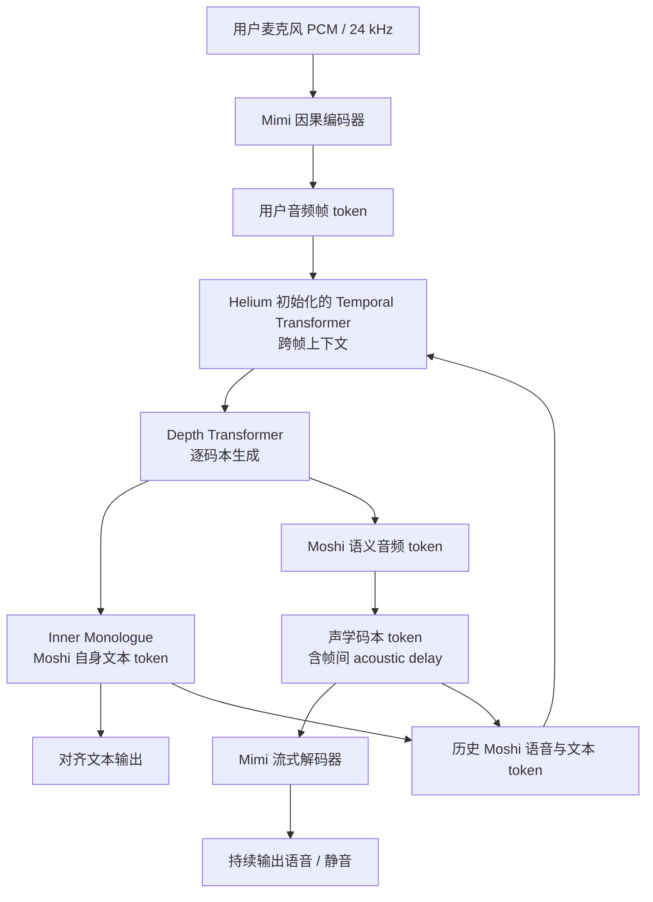
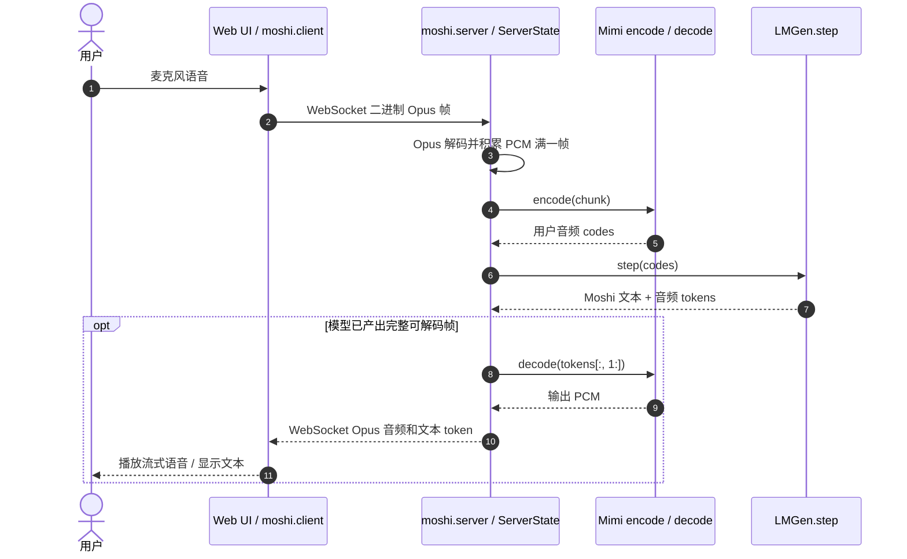

# Moshi：面向实时对话的语音—文本基础模型 / Moshi: a speech-text foundation model for real-time dialogue

> Kyutai · arXiv:2410.00037v2（2024-10-02）· [论文 PDF](https://arxiv.org/pdf/2410.00037v2) · [官方源码](https://github.com/kyutai-labs/moshi)

## 一句话定义

**Moshi** 是将用户语音与系统输出语音联合建模的 **全双工流式 speech-to-speech 基础模型**：它不必等用户结束一轮说话，便能持续监听、插话、回应并生成带语调的音频。

## 英文缩写速查

| 缩写 | 英文全称 | 简要说明 |
|------|----------|----------|
| LLM | Large Language Model | Moshi 从预训练 Helium 文本语言模型扩展而来 |
| RVQ | Residual Vector Quantization | Mimi 的多码本音频量化方式 |
| ASR | Automatic Speech Recognition | 以音频领先文本的时序构建流式转写模型 |
| TTS | Text-to-Speech | 以文本领先音频的时序构建流式语音合成 |
| WER | Word Error Rate | 论文 §5.7 的语音识别及合成可懂度指标 |
| HRI | Human–Robot Interaction | 在机器人交互中应用流式语音对话的场景 |

## 为什么重要

- 传统 VAD → ASR → 文本 LLM → TTS **分段级联**，容易积累秒级时延并丢掉语气、非语言声音及重叠说话信息；Moshi 直接以音频为主信号，文字是自身输出语音的辅助序列。
- 全双工的核心不是仅仅能快速回复，而是**用户流与机器人说话流可以时间重叠**；对讲解型人形机器人、具身助手和陪伴交互，能够处理插话与短反馈。
- 该工作解决的是语音会话建模，**不直接输出机器人关节动作**；要落地运动任务，仍须经过意图解析、技能白名单、导航/运控与安全过滤。见 [人形语音交互](../methods/humanoid-voice-interaction.md)。

## 核心信息

| 项目 | 论文与官方材料核对 |
|------|------------------|
| 机构 | Kyutai |
| 论文版本 | arXiv:2410.00037v2，2024-10-02 |
| 输入 | 用户持续麦克风音频，经 Mimi 编为离散音频帧 |
| 输出 | Moshi 语音音频 token + 与其自身语音对齐的文本 token |
| 核心组件 | Helium 文本 LLM（7B）、Mimi 神经音频 codec、Temporal Transformer 与 Depth Transformer |
| 音频 token | Mimi 24 kHz → 12.5 Hz（80 ms / 帧）、8 codebooks，约 1.1 kbps |
| 延迟 | 论文理论 160 ms；官方 README 报 L4 GPU 约 200 ms；非机器人端到端响应时间 |
| 开放状态 | [Python/MLX/Rust 推理源码](../../sources/repos/kyutai-labs-moshi.md)及模型权重已发布；原始完整训练语料不能据此视为开源 |

## 核心原理

### 1. Mimi：一套音频 token 同时容纳语义与声学

Mimi 以因果编码器/解码器对 24 kHz 音频作 12.5 Hz 帧化；通过 WavLM 表征蒸馏提高首量化层的语言判别能力，使用 split RVQ 让语义与音质不必互相严重牺牲。注意：**12.5 Hz 是音频 token 帧率，不是机器人电机控制频率**。

### 2. Helium + RQ-Transformer：按帧、按码本两级推理

论文中 Helium 7B 文本骨干延伸为 Temporal Transformer，负责长时间上下文；小型 Depth Transformer 在每个时间步生成语义/声学等码本 token。声学码本可采用滞后一帧的预测排列以使流式生成更高效（论文 §3.4，图 3–4）。

### 3. Inner Monologue 与双流生成

Moshi 持续接收**用户音频流**，同时自回归产生**系统音频流**，并在系统端先预测与发声时间对齐的**文本 token**；并非先生成整篇文字、再调用外部 TTS。文本 token 不要求对用户音频先运行完整外部 ASR。音频与文本延迟顺序改变还可以训练专用的流式 ASR/TTS 形态（论文 §3.4.4、§5.7），不应与对话 checkpoint 混为一谈。

### 流程总览（论文图 1–4）

此图抽象论文的流式数据/生成顺序：在线推理的用户分支由真实音频强制输入，输出侧采样 Moshi 的文本与语音；两侧均可同时活动。

## 源码运行时序图

静态核对 Kyutai 官方仓库的 [`moshi/moshi/server.py`](https://github.com/kyutai-labs/moshi/blob/main/moshi/moshi/server.py)、[`models/lm.py`](https://github.com/kyutai-labs/moshi/blob/main/moshi/moshi/models/lm.py) 和 [PyTorch README](https://github.com/kyutai-labs/moshi/blob/main/moshi/README.md) 的真实入口 `python -m moshi.server`：

服务端为每次连接重置 Mimi 与 LMGen streaming state；`ServerState.recv_loop` 调用 `mimi.encode` 与 `lm_gen.step`，`decode_and_send` 调用 `mimi.decode` 并发回音频、文本。这是**官方源码路径的静态核对**，不是本次 GPU 运行实测。

## 实验与评测

| 指标（论文 v2） | Moshi | 读法 |
|----------------|-------|------|
| 0-shot Spoken Web Questions，Table 8 | 26.6% | 无 Inner Monologue 为 9.2% |
| 0-shot LlaMA-Questions，Table 8 | 62.3% | 无 Inner Monologue 为 21.0% |
| 0-shot Audio TriviaQA，Table 8 | 22.8% | 无 Inner Monologue 为 7.3% |
| 流式 TTS，LibriSpeech test-clean，§5.7 | WER 4.7% | 额外 TTS 专项训练，音频相对文本延迟 2 秒 |
| 流式 ASR，LibriSpeech test-clean，§5.7 | WER 5.7% | 额外 ASR 专项训练，文本相对音频延迟 2 秒 |
| 语音交互延迟，摘要/README | 理论 160 ms；实测约 200 ms | 指论文/官方运行环境，不含机器人任务规划、网络、控制 |

Inner Monologue 对语言内容质量影响明显，但在音频编解码、质量、实时性、安全方面仍存在取舍；不能仅凭问答准确率代替真实环境下打断、回声和语音自然度评估。

## 与其他工作对比

| 路线 | 主要交互单位 | 边界 |
|------|--------------|------|
| 传统级联 ASR → LLM → TTS | 先转写/分轮再合成 | 模块灵活，但累积延迟、非语言信息易丢失 |
| **Moshi** | 双流音频 token + 同步的系统文本 token | 擅长流式全双工对话；本身不是机器人动作策略 |
| [Qwen-Audio-Agent](./paper-qwen-audio-agent.md) | Realtime 前台 + 后台 Agent 任务编排 | 重在工具委派、异步任务生命周期；与 Moshi 的音频模型层次不同 |
| [VibeVoice-ASR](./microsoft-vibevoice.md) | 长音频 → 转写/时间戳/说话人 | 侧重转写、说话人；不是双向实时对话模型 |

## 结论

**Moshi 的关键贡献是将自然对话的“边听边说”建模为同步双流音频生成，而非为级联语音管线加速一个部件。**

1. 做实时语音前台时，要测试**重叠说话、打断与回声处理**，而不只比较 ASR WER。
2. 不要把 Mimi 的 **80 ms 帧**误解为整个机器人感知→规划→执行的响应时延。
3. 要保持语言正确性，应关注 Inner Monologue 的文本条件和是否能被下游记录/审计。
4. 需要离线会议转写可优先比较专用 ASR；需要长耗时工具任务则需额外 Agent 编排。
5. 落地机器人时把语言解释映射成**白名单技能**，运控仍由独立低层控制器闭环。

## 工程实践

- **最短本地验证：** 按官方 README 安装 `moshi`，运行 `python -m moshi.server` 后用本地 8998 端口页面或 `python -m moshi.client` 验证；需事先准备匹配的模型权重、音频设备和 GPU。
- **硬件与部署：** 官方 Python README 记载 PyTorch 未提供通用量化路径且需要约 24 GB 显存；MLX 有 4/8 bit 版本，Rust/Candle 有生产推理服务。版本与权重格式要匹配。
- **与机器人衔接：** 建议将 Moshi 输出的文本/语音事件送入 [HRI 技能层](../methods/humanoid-voice-interaction.md)，而非直接作为关节期望值；继续加入任务语义校验、时序容错、抢话恢复与急停。
- **开源核查：** 推理源码与权重可获取；Python 代码 MIT、Rust Apache-2.0、模型权重 CC-BY 4.0（参见 [官方源码归档](../../sources/repos/kyutai-labs-moshi.md)）。本次未运行训练或推理 benchmark。

## 局限与风险

- **安全：** 论文 §6 的毒性、训练音频复述、音色控制与水印研究是风险评估，不是提供完善内容审查或身份防伪保证。
- **知识与语种边界：** Helium 以公开英文文本预训练；本文不能据此断言所有多语言场景都具备同等表现，尤其不能直接推断中文机器人指令可靠性。
- **量化：** 论文 §5.8 在 4 bit 下音频听感仍可接近原模型，但 MMLU 会明显下降；量化后的音质“好听”不等于指令理解“正确”。
- **链路与资源：** 实时推理还依赖网络、回声消除与硬件；公开演示地址本次读取超时，不等于服务已经下线。
- **应用边界：** 文中没有机器人真机动作控制/具身任务成功率实验；人形应用属于独立工程集成建议，不是论文已有结论。

## 关联页面

- [人形机器人智能语音交互](../methods/humanoid-voice-interaction.md) — 从 speech-to-speech 对话接到技能和安全约束
- [Qwen-Audio-Agent](./paper-qwen-audio-agent.md) — 全双工前台与后台任务编排的区别
- [Microsoft VibeVoice](./microsoft-vibevoice.md) — 长音频 ASR 路线的比较
- [LLM 机器人控制接口](../concepts/llm-robotics-control-interfaces.md) — 为什么不能把语音模型等同于低层控制器

## 参考来源

- [论文 v2 原文归档](../../sources/papers/moshi-arxiv-2410-00037.md)
- [Kyutai 官方推理仓库与源码路径归档](../../sources/repos/kyutai-labs-moshi.md)
- [官方演示入口核查](../../sources/sites/kyutai-moshi-chat.md)
- [论文 PDF v2](https://arxiv.org/pdf/2410.00037v2)

## 推荐继续阅读

- [Kyutai Moshi 官方实现与启动指南](https://github.com/kyutai-labs/moshi)
- [Kyutai Moshi 模型权重集合](https://huggingface.co/collections/kyutai/moshi-v01-release-66eaeaf3302bef6bd9ad7acd)
