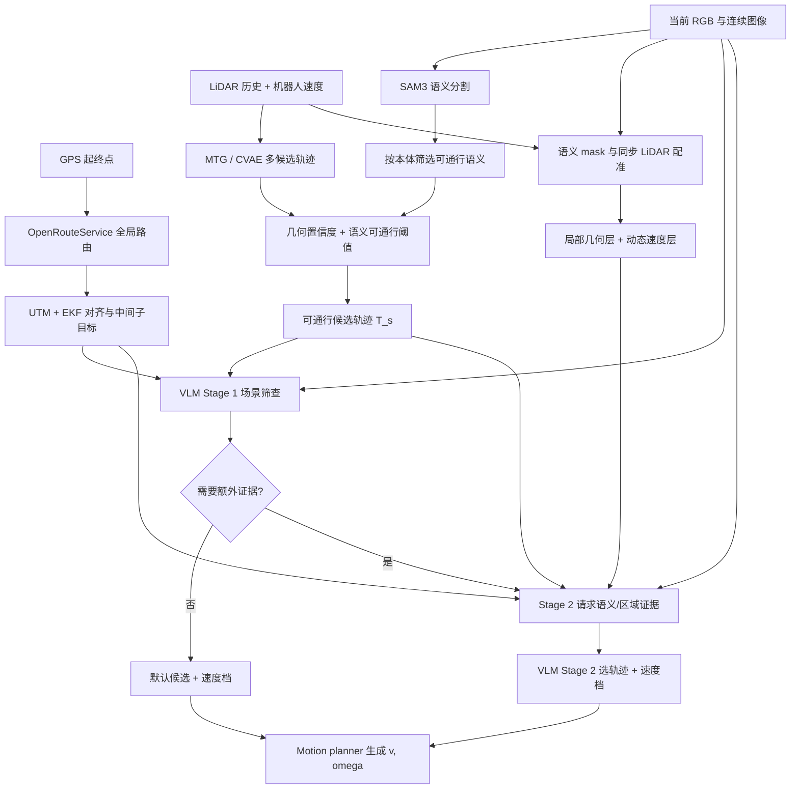

# MOSU2：基于多模态场景理解的长距离导航系统（Long-range Navigation System with Multi-modal Scene Understanding）

**MOSU2**（Jing Liang、Zhenyu Hou 等，2026，arXiv:2611.11148v1）将**公共道路 GPS 路由、几何/语义可通行筛选**和**按需索取道路参与者位置/速度的视觉语言推理**连接成户外长距离导航系统。实验覆盖轮式 Husky、四足 Unitree Go2 与轮腿 Diablo；不是无需感知约束的端到端 VLA，也不是按自然语言指令找目标的经典 VLN。

## 一句话定义

**先排除不可通行轨迹，再决定是否需查询局部地图中的几何与速度证据**；对普通场景快速选择，对复杂人车交互用 VLM 二阶段裁决可执行的轨迹和速度档位。

## 英文缩写速查

| 缩写 | 英文全称 | 简要说明 |
|---|---|---|
| MOSU2 | Multi-modal Scene Understanding (second-generation system) | MOSU 的后续系统，新增局部地图工具检索与两阶段推理 |
| VLM | Vision-Language Model | 理解 RGB 中手势、交通规则与不规则条件 |
| GPS | Global Positioning System | 公共路网路径与粗粒度中间目标来源 |
| LiDAR | Light Detection and Ranging | 提供三维几何与测距 |
| CVAE | Conditional Variational Autoencoder | 从点云与速度历史产生多候选轨迹的 MTG 主体 |
| MTG | Multiple Trajectory Generation | 继承自 MOSU 的多轨迹生成模块 |
| SAM3 | Segment Anything Model 3 | 开放词汇图像分割，支持可通行区域与语义地图 |
| EKF | Extended Kalman Filter | 对齐 GPS 子目标与里程计坐标的状态估计 |

## 为什么重要

- **能走，不代表应该走：** 把结构化地形可通行性与人行横道、行人手势、施工指示、车辆是否礼让等动态条件分开处理。
- **从图像语义到可量测事实：** 仅用单帧 RGB，容易把正在靠近的车与停住的车混为一谈；本文为 VLM 暴露物体位置、速度等按需查询接口。
- **工程上有代价账：** 二阶段能降低部分误停和误入风险，但云端决策时延变长，不能误解为实时闭环安全保证。
- **与[导航纵深路线](../../roadmap/depth-navigation.md)结合：** 展示 GPS 全局目标、可通行局部运动与高层情境理解的分层协作。

## 核心信息

| 字段 | 原文核验值 |
|---|---|
| 论文 | [arXiv:2611.11148v1](https://arxiv.org/abs/2611.11148)（2026-11-08） |
| 作者 | Jing Liang、Zhenyu Hou、Senthurbavan Kirubaharan、Md Safwan Mondal、Ashok Gudivada、Xuesu Xiao、Dinesh Manocha（以 v1 为准） |
| 机构 | 斯坦福大学（Stanford University）、乔治梅森大学（George Mason University）、马里兰大学学院公园分校（University of Maryland, College Park） |
| 项目 | [官方项目主页](https://jinggm.github.io/mosu2/) |
| 代码 | [jingGM/mosu2](https://github.com/jingGM/mosu2) **仅展示站点**；截至 2026-11-17 未找到可运行导航实现 |
| 机器人 | Husky（轮式）、Unitree Go2（腿式）、Diablo（轮腿） |
| 输入 | GPS 目标/当前位姿、历史 LiDAR 与速度、连续 RGB、语义分割与局部地图 |
| 输出 | 选中的可通行轨迹 + stop / slow / normal 速度档 → 运动规划器的线速度和角速度 |

## 核心原理

### 1. 全局子目标与局部可通行筛选（论文 §3.1–3.2）

1. OpenRouteService 或公共路由服务从 GPS 起终点规划全局路线，约每 **35 m** 拿一个中间 GPS 子目标，用 UTM 转换与 EKF 对齐到 odometry frame；距离子目标小于约 **15 m** 切换下一个。GPS 是方向指导，不用于精确踩点。
2. MTG 的 **CVAE** 输入 LiDAR 时序和历史机体速度生成多条局部轨迹，每条具有几何置信度。
3. **SAM3** 按 robot-specific traversability 对 road / sidewalk / vegetation / building / stairs 进行分割（例如轮式不按足式能力走楼梯）。用 Bresenham 把轨迹投影到图像像素，计算轨迹途经可行类别比例。
4. 几何置信度和语义可通行分数加权后，以阈值筛成候选集 T_s；先过滤物理可行性，随后才考虑社会交通合理性。

### 2. 可检索地图与两阶段决策（论文 §3.3–3.4）

- **语义几何地图：** 连续 RGB mask 与经标定的 LiDAR 点关联，点云转到机器人里程计坐标，构建 **20 m 半径 / 0.2 m 栅格**地图；保留类别、区域、中心位置。
- **动态层：** 同类别最近邻跨帧关联，利用里程计坐标中的质心位移估速度；目标缺少有效深度或关联时标记未知，**不能把估计速度当成意图真值**。
- **第一阶段（context screening）：** 当前 RGB、子目标和 T_s 输入 VLM，判断是否需要额外证据；不需要时选端点最接近子目标的候选轨迹，给出速度模式。
- **第二阶段（decision）：** 触发时基于问题选择语义词和地图区域，查询位置/速度，结合最新 RGB 序列处理礼让、信号和工地禁行提示，输出轨迹编号及速度档位。
- **控制接口：** 选中轨迹和速度档由低层 motion planner 转为线/角速度，并随新观测重复决策。

### 流程总览（基于原文 Fig. 2、§3.1–3.4）

## 实验与评测（arXiv v1 §4）

平台为 Husky、Go2、Diablo，机载 RGB、3D LiDAR、GPS；本地 i9 / RTX 3060，云端 VLM API。多轨迹生成 **20 Hz**、运动规划 **50 Hz**、局部地图 **2 Hz**；第二阶段在论文实验设置中使用连续 **5 帧**，间隔 **0.2 s**，覆盖约 **1.0 s**。

| 测试场景 | MOSU 成功率 | MOSU2 成功率 | MOSU2 检测准确率 | MOSU2 决策延迟 |
|---|---:|---:|---:|---:|
| 停止手势 | 61% | 71% | 89% | 2.52 s |
| 施工区 | 50% | 100% | 100% | 5.16 s |
| 信号灯路口 | 42% | 100% | 93% | 4.72 s |
| 人车共享道路 | 56% | 100% | 89% | 4.95 s |
| 普通人行道基线 | 100% | 100% | 86% | 1.80 s |
| **五组不加权均值** | **61.8%** | **94.2%** | **91.4%** | **3.83 s** |

- MOSU2 条件检测准确率由 **72.2% → 91.4%**；平均决策延迟由 **1.72 s → 3.83 s**（约 **2.2 倍**）。
- 平均输入/输出 token 由约 **820/60** → **3560/310**；这些均为作者报告数据，未由本次复测。
- 真机试验数量有限，论文明确提醒 **不能据此声称统计显著性**；导航成功率定义还包含遵守场景规则，允许通行时一直停住算失败。

## 与其他工作对比

| 路线 | 侧重 | 与 MOSU2 的区别 |
|---|---|---|
| MOSU（前作） | GPS + LiDAR 候选 + 单帧 VLM 排序 | 没有按需索取地图位置/速度的第二阶段 |
| [Off-Road Global Nav](./paper-offroad-global-nav.md) | 离线地理先验与越野全局可通行图 | 主轴是公里级地形 costmap，而非人与车辆的交通交互 |
| [视觉–语言导航任务](../tasks/vision-language-navigation.md) | 用自然语言指令导航 | MOSU2 接收 GPS 目标，VLM 负责社会交通情境理解；不能直接等同 VLN benchmark |

## 结论

**MOSU2 的核心增益来自将 VLM 的交通/社会理解接到可查询的真实几何与运动证据，而非单纯增加推理层数。**

1. **先过滤可行性：** 几何 + 语义约束不应让高层语言推理绕开。
2. **按需查速度：** 对是否礼让、车辆会否横穿等问题，单帧画面不足。
3. **阅读对照数字：** 信号路口成功率 42%→100%，但常触发 Stage 2 的决策延迟 4.7–5.2 s。
4. **判断安全边界：** 依赖云 API，场景可能在推理后已变化；应有独立低时延安全监测与动作复核。
5. **复现要看代码：** 当前只有展示仓，不应把展示视频当作可运行 ROS/导航栈。

## 源码运行时序图

**不适用（截至 2026-11-17）。** 项目主页所链 [GitHub 仓](https://github.com/jingGM/mosu2) 只有 HTML、图片、视频、论文等展示资产和极简 README，未包含可辨认的算法训练、推理、ROS 启动或真机运行入口；以上为**论文系统数据流**，不是经源码验证的运行时序。未来公开导航实现后再补可核对的 sequenceDiagram。

## 工程实践

| 核对项 | 工程读法 |
|---|---|
| 跨平台 | 可通行区域按机器人本体定义，轮式/腿式的地形语义约束不同 |
| 传感器同步 | 保证 RGB/LiDAR 标定、里程计时间戳和跨帧匹配，防止错把位置变化当物体速度 |
| 提示词 / 调用 | Stage 1 的升级触发、Stage 2 的语义和区域请求是关键质量点 |
| 延迟预算 | 20/50 Hz 是局部生成/规划频率，**不是** 云端 VLM 每步决策频率 |
| 实测指标 | 导航成功率、条件检测准确率、决策时延、tokens、误停/误过路口及干预次数 |
| 可运行实现 | 暂无官方导航源码；若自行集成，需另选本地规划器、感知运行链与安全策略，不能称复现 MOSU2 |

## 局限与风险

- 最近邻同类语义目标关联可能错配，遮挡、稀疏 LiDAR、SAM3 分割和标定误差会传递到速度判断；地图并非精确目标跟踪器。
- Stage 1 漏检会错过进一步检索；冗余升级则损耗网络与 token，条件触发并**不**保证比 MOSU 更快。
- 4.72–5.16 s 的复杂情形推理延迟，使动态车流中的信息时效性和独立安全措施尤其重要。
- **版本差异必须标注：** [项目页](../../sources/sites/mosu2-project.md)展示 **9 位作者**、不同实验表（如 stop 0%→67%）与 5 帧/2.5 s 表述；本页所有定量值统一采用 **arXiv v1（7 位作者）**。两者不能拼成同一实验。
- 作者报告覆盖若干真实场景，不代表公共道路普适安全或经认证的商用部署。

## 关联页面

- [视觉–语言导航（VLN）任务](../tasks/vision-language-navigation.md) — 区分语言导航与交通情境理解
- [FCN 语义分割](../methods/fcn-semantic-segmentation.md) — 与 SAM3 分割范式对照，并非 MOSU2 使用 FCN
- [轨迹优化](../methods/trajectory-optimization.md) — 理解候选评估与可执行运动的不同层次
- [动态障碍滤波](../concepts/dynamic-obstacle-filtering.md) — 几何/动态估计的失效风险
- [Off-Road Global Nav](./paper-offroad-global-nav.md) — 长程场景中的另一类全局路径先验
- [导航（Navigation）纵深路线](../../roadmap/depth-navigation.md)

## 参考来源

- [MOSU2 arXiv v1 全文核对归档](../../sources/papers/mosu2_arxiv_2611_11148.md)
- [MOSU2 官方项目页与 GitHub 开放状态归档](../../sources/sites/mosu2-project.md)
- [arXiv 论文 HTML 全文](https://arxiv.org/html/2611.11148v1)

## 推荐继续阅读

- [MOSU2 原文 PDF](https://arxiv.org/pdf/2611.11148v1)
- [MOSU 前作](https://arxiv.org/abs/2507.04686) — 对照哪些导航组件是 MOSU2 的真正新增项
