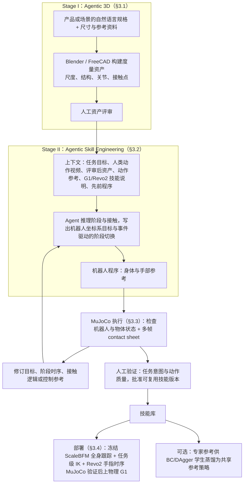

# MOTIO: Agentic Skill Engineering for Reality-Grounded Humanoid Loco-Manipulation

**一句话定义：** 智能体将人类动作视频、度量三维资产、运动参考及可复用技能组合成分阶段机器人程序，利用物理执行反馈与人类验证迭代，无需任务专用遥操作示范。

## 英文缩写速查

| 缩写 | 英文全称 | 简要说明 |
|------|----------|----------|
| VLA | Vision-Language-Action | 以视觉和语言条件生成动作的模型 |
| G1 | Unitree G1 | 人形机器人平台 |
| Sim2Real | Simulation to Real | 从仿真迁移到真实机器人 |

## 为什么重要

智能体将人类动作视频、度量三维资产、运动参考及可复用技能组合成分阶段机器人程序，利用物理执行反馈与人类验证迭代，无需任务专用遥操作示范。

## 流程总览

图依据：论文 §3.1 / §3.2 / §3.3 / §3.4 / Fig.2

## 方法与核心原理

智能体将人类动作视频、度量三维资产、运动参考及可复用技能组合成分阶段机器人程序，利用物理执行反馈与人类验证迭代，无需任务专用遥操作示范。

## 源码运行时序图

不适用：截至入库日未核实到可运行的官方实现。

## 工程实践

复现时先对齐训练数据、具身接口和评测设置；记录数据来源及运行环境。

## 评测与结果

33 次记录的首次批准中，智能体工作时间中位数为 97.0 分钟；请求至批准的中位数为 2.80 小时。G1 在扫描办公室连续执行 101.75 秒瓶子丢弃任务；蒸馏后的单策略在仿真完成 18 个任务。

## 结论

**工程判断应结合论文的训练和评测条件。**

- 97 分钟统计智能体工作时间，不等于完整请求到批准时间。
- 三维资产、已有技能接口与人工验证均是系统依赖。
- 真机长程演示与 18 项仿真蒸馏结果应分别解读。

## 局限与风险

结果依赖已有机器人技能、场景资产及人工验证；单次长程演示不足以说明普遍成功率。截至 2026-10-28，项目页未列出代码或数据下载链接。

## 与其他工作对比

与 [MimicAll](./paper-mimicall.md) 的跨机体运动跟踪相比，本工作关注不同层面的数据、动作表示或任务生成。

## 关联页面

- [MimicAll](./paper-mimicall.md)
- [操作任务](../tasks/manipulation.md)

## 参考来源

- [来源归档](../../sources/papers/motio.md)
- [来源归档](../../sources/sites/motio.md)
- [arXiv PDF](https://arxiv.org/pdf/2610.33446)：已通读方法部分（实验与附录以略读为准）：§1 引言、§3 Agentic Skill Engineering（3.1–3.4）、Fig.2

## 推荐继续阅读

- [论文原文](https://arxiv.org/abs/2610.33446)
