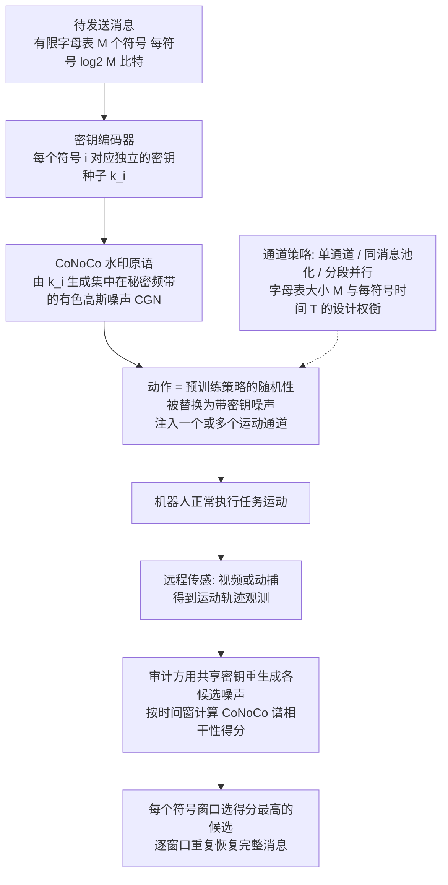

# Motion-based messaging

**Motion-based messaging**（*Remotely Detectable Keyed Communication through Motion*（v1 标题；v2 改名 *Robot Motion as a Keyed Communication Channel*），[arXiv:2609.08920](https://arxiv.org/abs/2609.08920)，[项目/代码](https://sites.google.com/view/motionbasedmessaging/home)）— 详见 [具身智能小站 10 篇盘点（2026-09-09）](../../sources/blogs/wechat_embodied_station_visual_focus_10_papers_2026-09-09.md)。

## 一句话定义

无线不可用时，机器人运动本身能否成为可远程观测的通信信道——本文把任意短消息写进策略动作噪声而不显著伤害任务表现。

## 英文缩写速查

| 缩写 | 英文全称 | 简要说明 |
|------|----------|----------|
| HRI | Human-Robot Interaction | 多机/人机交互场景 |
| VMAS | Vectorized Multi-Agent Simulator | 仿真基准之一 |
| MuJoCo | Multi-Joint dynamics with Contact | 物理仿真后端 |
| bps | bits per second | 通信速率 |

## 为什么重要

- Discovery / Reacher / Lunar Lander / Football 四环境验证
- 真机 RoboMaster 四机：轨迹约 26%（v2）/ 35%（v1）处即可解码目标意图

## 流程总览

图依据：论文 §V Method（§V-A 通道、§V-B 编码与解码、§V-C 设计空间）/ Fig. 1（Messaging through motion）。

## 核心信息

| 项 | 内容 |
|----|------|
| **arXiv** | [2609.08920](https://arxiv.org/abs/2609.08920) |
| **开源** | **部分开源** |
| **项目/代码** | [https://sites.google.com/view/motionbasedmessaging/home](https://sites.google.com/view/motionbasedmessaging/home) |

## 核心原理

- Discovery / Reacher / Lunar Lander / Football 四环境验证
- 真机 RoboMaster 四机：在轨迹约 26%（v2）/ 35%（v1）处即可解码各机目标意图（页面此前写「路径 10%」，论文无此数字）
- 50 Hz 控制下四机联合恢复 8-bit 消息（聚合速率，非单机）：v1 摘要/§VI：split-message，T=600 次策略调用（轨迹长度 35%）时四机均解码正确（n=20），8 bit/12 s，聚合 0.67 bits/s；v2（现行，标题改为 Robot Motion as a Keyed Communication Channel）摘要/§VI：8 bit/10 s，聚合 0.8 bits/s，T=6 s 时联合恢复 95%（轨迹长度 26% 处 T=10 s 全部解出）（依据 arXiv:2609.08920v1/v2）

## 源码运行时序图

**不适用（官方可运行代码尚未发布或待核实）。** 截至 2026-09-09 以项目页/公众号链为准。

## 实验与评测

- 指标与设置以原文 PDF / 项目页为准；上文 Highlights 来自公众号归纳 + 项目页摘要。
- 横向对照见 [视觉聚焦与数据效率 10 篇技术地图](../overview/visual-focus-data-efficiency-10-papers-technology-map.md)。

## 与其他工作对比

> 下表只做**定位对照**，不做跨设定横比：本页 Highlights 来自公众号归纳 + 项目页摘要（见参考来源），未逐条核对原文实验表，与下列各页不共享同一评测协议。

| 对照 | 差异读法 |
|------|----------|
| **无线信道**（DDS / Wi-Fi / 专网，本文的替代对象） | 差别在**物理层**：常规链路用电磁波，本文用**机器人自身运动**当载波，接收端是远处的相机或动捕。代价直接写在数字里——真机 50 Hz 控制下报四机联合恢复 8-bit 消息，但聚合仅 **0.67（v1）/ 0.8（v2）bits/s**（每机 0.167 / 0.2），比任何无线链路低数个量级。这是「无线不可用时的兜底」，不是带宽竞争者 |
| [DDS 通信](../concepts/dds-communication.md) | 机器人栈默认的中间件对照：DDS 讨论 QoS、发现、可靠性；本文的信道没有重传、没有握手，可靠性靠冗余编码与观测时长换 |
| [多智能体强化学习](../methods/marl.md) | MARL 里的「涌现通信」常是**智能体之间**的隐式信道，且与策略一起训；本文相反——策略**预训练好不动**，消息写进动作噪声里，因此可加在既有策略上 |
| [人形多机协同](../concepts/humanoid-multi-robot-coordination.md) | 应用侧对照：该页讲多机任务分配与协同；本文提供的是这类协同在通信降级时可用的一条低速旁路（真机 RoboMaster 实验里，轨迹约 26%–35% 处即可解出目标意图） |
| [机器人安全状态机](../concepts/robot-safety-state-machine.md) | 提醒读法：往动作里注噪声意味着**任务性能与安全裕度都要重新核**——本文称不显著伤害任务表现，但这是在其四个仿真环境与 RoboMaster 上的结论，换本体要重测 |

## 结论

**Motion-based messaging 的可迁移主张已写入 Highlights；部署前以原文实验设定与开源边界为准。**

1. **真影响：** 见核心原理 bullets。
2. **次要代价：** 预印本/待开源项需独立复现验证。
3. **部署读法：** 部分开源 — 先读 README 或项目页再接真机/智能体栈。

## 关联页面

- [视觉聚焦与数据效率 10 篇技术地图](../overview/visual-focus-data-efficiency-10-papers-technology-map.md)
- [模仿学习](../methods/imitation-learning.md)
- [DDS 通信](../concepts/dds-communication.md) — 被替代的常规链路
- [多智能体强化学习](../methods/marl.md) — 涌现通信的对照读法
- [人形多机协同](../concepts/humanoid-multi-robot-coordination.md) — 应用侧场景
- [机器人安全状态机](../concepts/robot-safety-state-machine.md) — 动作注噪的安全核查入口

## 参考来源

- [motion_based_messaging_arxiv_2609_08920.md](../../sources/papers/motion_based_messaging_arxiv_2609_08920.md)
- [具身智能小站 10 篇盘点（2026-09-09）](../../sources/blogs/wechat_embodied_station_visual_focus_10_papers_2026-09-09.md)
- [arXiv:2609.08920](https://arxiv.org/abs/2609.08920)
- [arXiv PDF](https://arxiv.org/pdf/2609.08920)：已通读方法部分（实验与附录以略读为准）：§IV 预备（CoNoCo 水印原语）、§V 方法（通道、编码与解码、设计空间）
- 核对（2026-11-02）：对照 arXiv:2609.08920 v1 与 v2 摘要及 §VI RoboMaster 段；原「0.67 bit/s、100% 恢复」是 v1 口径，v2 为 8-bit、0.8 bits/s、T=6 s 联合恢复 95%；「路径 10% 处解码」两版均无，改为 35%（v1）/ 26%（v2）。

## 推荐继续阅读

- [原文 PDF](https://arxiv.org/pdf/2609.08920)
- [项目/代码](https://sites.google.com/view/motionbasedmessaging/home)
