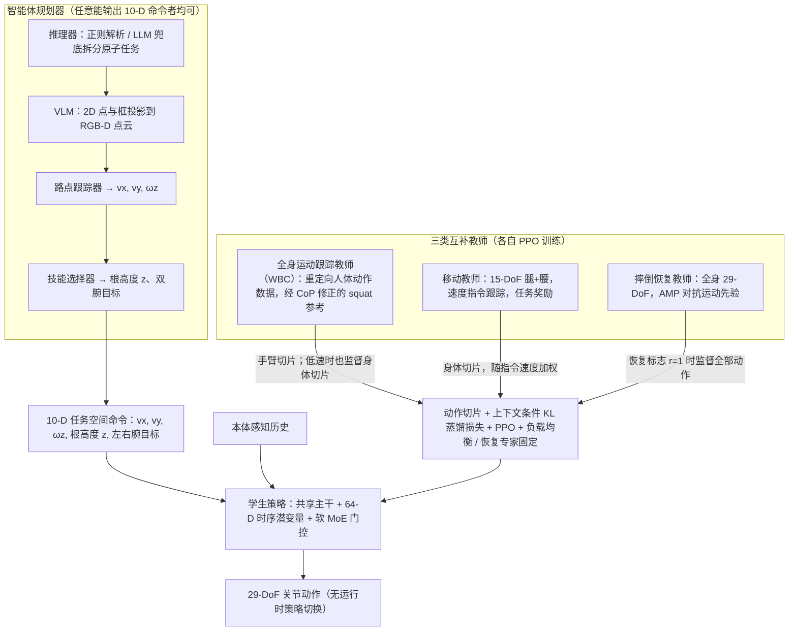

---

type: entity
tags: [paper, motion-cerebellum-survey, humanoid, motion-control, caltech]
status: complete
updated: 2026-10-06
arxiv: "2606.06493"
summary: "接口：任务空间命令 + 多教师蒸馏。输入是任务空间命令、本体状态和不同教师策略输出；实现上把移动、恢复、全身跟踪等互补教师蒸馏到一个学生控制器，并用门控/条件机制融合专家能力；上层只需给速度、手部目标、身体高度等紧凑命令。"
related:
  - ../overview/humanoid-motion-cerebellum-technology-map.md
  - ../overview/motion-cerebellum-category-07-loco-manip-interface.md
sources:
  - ../../sources/papers/motion_cerebellum_survey_48_handoff.md
  - ../../sources/blogs/wechat_embodied_ai_lab_humanoid_motion_cerebellum_survey.md
  - ../../sources/papers/motion_cerebellum_64_catalog.md
---

# HANDOFF

**HANDOFF** 收录于 [具身智能研究室 · 运动小脑 64 篇长文](https://mp.weixin.qq.com/s/Kx9myecE1Z0eGqOapoqQnA) **第 48/64** 篇，归类为 **G Loco-Manip 接口**。

## 一句话定义

接口：任务空间命令 + 多教师蒸馏。输入是任务空间命令、本体状态和不同教师策略输出；实现上把移动、恢复、全身跟踪等互补教师蒸馏到一个学生控制器，并用门控/条件机制融合专家能力；上层只需给速度、手部目标、身体高度等紧凑命令。

## 英文缩写速查

| 缩写 | 英文全称 | 简要说明 |
|------|----------|----------|
| WBC | Whole-Body Control | 协调全身关节满足多任务/约束的控制层 |
| RL | Reinforcement Learning | 通过与环境交互学习策略的范式 |
| Loco-Manip | Loco-Manipulation | 行走与操作动力学耦合的全身任务 |

## 为什么重要

- 接口：任务空间命令 + 多教师蒸馏。输入是任务空间命令、本体状态和不同教师策略输出；实现上把移动、恢复、全身跟踪等互补教师蒸馏到一个学生控制器，并用门控/条件机制融合专家能力；上层只需给速度、手部目标、身体高度等紧凑命令。
- 运动小脑 64 篇 **#48/64** · 接口：任务空间命令 + 多教师蒸馏。

## 流程总览

图依据：论文 §III-A~G（教师、上下文条件蒸馏式 2–3、智能体规划器）/ Fig.1、Fig.2、Fig.5。

## 核心信息

| 字段 | 内容 |
|------|------|
| 编号 | 48/64 |
| 分组 | G Loco-Manip 接口 |
| 机构 | 加州理工学院、人类与机器认知研究所 |
| 论文/项目 | https://arxiv.org/abs/2606.06493v1 |

## 核心机制（归纳）

### 1）策展导读要点

接口：任务空间命令 + 多教师蒸馏。输入是任务空间命令、本体状态和不同教师策略输出；实现上把移动、恢复、全身跟踪等互补教师蒸馏到一个学生控制器，并用门控/条件机制融合专家能力；上层只需给速度、手部目标、身体高度等紧凑命令。

### 2）策展导读要点

机构：加州理工学院、人类与机器认知研究所

## 结论

**HANDOFF 的取舍是「多教师蒸馏成一个学生」：用门控/条件机制把移动、恢复、全身跟踪等互补专家融进单一控制器，代价换来的是上层只需给紧凑命令。**

- 真正起作用的是门控/条件融合，而不是把教师数据混在一起硬训一个更大的策略。
- 接口被压到速度、手部目标、身体高度这类任务空间命令，规划侧的负担因此显著下降。
- 能力上限由教师集合决定：教师没覆盖的行为（例如未训练过的恢复模式）不会在学生身上凭空出现。
- 与同为 G 组接口类工作的差别请回 [分类 hub](../overview/motion-cerebellum-category-07-loco-manip-interface.md) 横向对照；本页无量化指标，论文入口为 arXiv 预印本。

## 常见误区

1. 运动小脑条目解决 **身体层** 问题，不替代 VLA/世界模型的任务规划。

## 实验与评测

- 本页在公众号/survey **策展编译**基础上补充机制归纳；**量化 benchmark、消融与实机指标以原文 PDF / 项目页为准**（链接见 [参考来源](#参考来源)）。
- 与同栈姊妹篇对照时，请回到对应 **技术地图 / 42 篇栈 / BFM 地图 / VLN 地图** 总览中的实验段落。

## 与其他页面的关系

- 技术地图：[humanoid-motion-cerebellum-technology-map.md](../overview/humanoid-motion-cerebellum-technology-map.md)
- 分类 hub：[motion-cerebellum-category-07-loco-manip-interface.md](../overview/motion-cerebellum-category-07-loco-manip-interface.md)

## 参考来源

- [motion_cerebellum_survey_48_handoff.md](../../sources/papers/motion_cerebellum_survey_48_handoff.md)
- [motion_cerebellum_64_catalog.md](../../sources/papers/motion_cerebellum_64_catalog.md)
- [wechat_embodied_ai_lab_humanoid_motion_cerebellum_survey.md](../../sources/blogs/wechat_embodied_ai_lab_humanoid_motion_cerebellum_survey.md)
- [arXiv PDF](https://arxiv.org/pdf/2606.06493)：已通读方法部分（实验与附录以略读为准）：§I 引言、§III（A 至 G）全部方法；§IV 实验仅略读

## 推荐继续阅读

- [运动小脑技术地图](../overview/humanoid-motion-cerebellum-technology-map.md)
- [人形 RL 身体系统栈](../overview/humanoid-rl-motion-control-body-system-stack.md)
